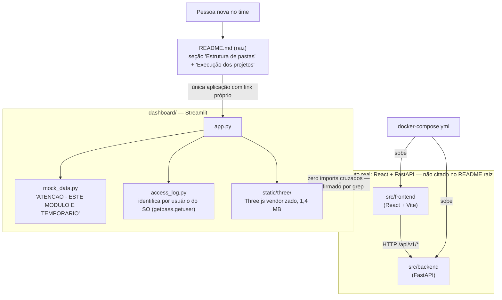
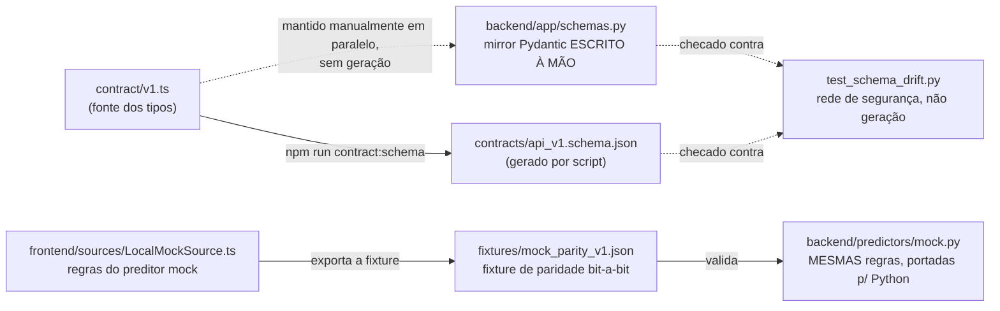
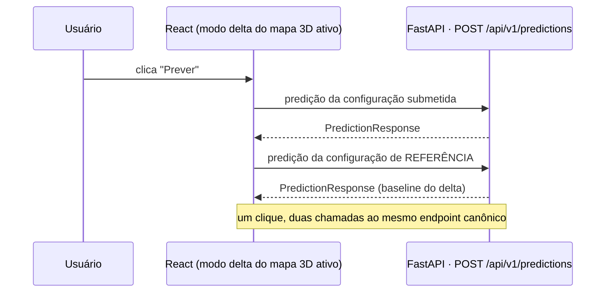
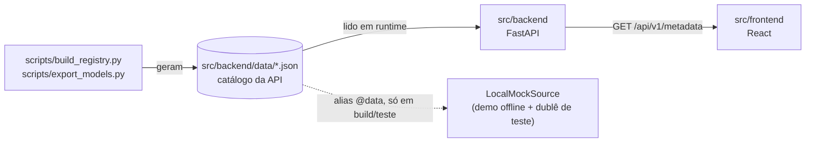

# Diagnóstico da arquitetura atual

> ⚠️ **Parcialmente executado em 27/09/2026.** O diagnóstico abaixo descreve o
> repositório como ele estava em 26/09/2026. Várias das seções já foram
> resolvidas — elas ficam aqui porque explicam *por que* as mudanças foram
> feitas, e estão marcadas com ✅ RESOLVIDO. O que foi executado está na
> [seção 7](#7-o-que-foi-executado-em-27092026).
>
> Este documento descreve o que existia no repositório e por que essa
> organização confunde quem chega agora. Ele não propõe a arquitetura alvo —
> isso já está em [`extras/REFACTORING_AGENT_GUIDE.md`](extras/REFACTORING_AGENT_GUIDE.md).
> Também não substitui o grafo completo gerado em
> [`../graphify-out/GRAPH_REPORT.md`](../graphify-out/GRAPH_REPORT.md); este
> documento é o recorte legível desse grafo, com cada afirmação verificada
> diretamente no código-fonte (comandos e arquivos citados abaixo, não apenas
> o relatório gerado).

## 1. O problema em uma imagem

Existem **dois produtos completos** neste repositório, mas só um deles está
vivo. O ponto de entrada documentado — o README da raiz — aponta para o
produto errado.



`dashboard/` nunca importa nada de `src/backend` ou `src/frontend`, e
`src/backend` nunca importa nada de `dashboard`. São dois códigos-fonte
paralelos que não se falam. Comando usado para confirmar:

```bash
grep -rn "src\.backend\|src/backend\|src/frontend\|from app\." dashboard/*.py   # vazio
grep -rn "dashboard" src/backend/app/config.py src/backend/app/data.py src/backend/app/main.py   # vazio
```

## 2. Por que está confuso

### 2.1 O README da raiz não descreve o produto que existe

[`README.md`](../README.md) tem 98 linhas. Nenhuma delas menciona
`src/frontend`, `src/backend`, React, FastAPI ou `docker-compose.yml` — dá
para conferir com `grep -n "src/frontend\|src/backend\|FastAPI\|React\|docker-compose" README.md`,
que não retorna nada. A seção "Estrutura de pastas" lista `assets`,
`documents`, `notebooks` e `dashboard`; a seção "Execução dos projetos" só
ensina a rodar notebooks. A seção "Descrição" ainda tem o texto de template
do curso, nunca preenchido:

```
Escreva uma curta descrição sobre o seu projeto (...)
Coloque seu link aqui
```

Uma pessoa que entra pelo caminho documentado é levada para
`dashboard/README.md` — um app que o próprio código descreve como fase mock,
temporária, sem autenticação real — e nunca descobre que existe um produto
em React + FastAPI com modelos treinados de verdade.

### 2.2 Um segundo produto completo, morto, mas não removido ✅ RESOLVIDO

`dashboard/` não é um protótipo de duas telas: é uma aplicação Streamlit
inteira, com sua própria camada de dados (`mock_data.py`), suas próprias
regras de negócio (`business_rules.py`), seu próprio log de acesso sem
autenticação (`access_log.py`, que identifica o usuário pelo sistema
operacional — `getpass.getuser()` — não por login), sua própria visualização
3D (`stove_3d.py`) e uma **segunda cópia vendorizada do Three.js**
(`dashboard/static/three/`, 1,4 MB, independente da que `src/frontend`
instala via npm). O próprio `dashboard/README.md` já avisa: "Fase mock. O
modelo de Machine Learning ainda não está pronto." — isto foi escrito antes
dos modelos reais existirem, e ficou obsoleto quando `models/` e
`src/backend/app/predictors/real.py` passaram a existir. Nada na base de
código reflete essa obsolescência: o dashboard continua no `pip install -r
dashboard/requirements.txt` funcionando, respondendo com números
placeholder, sem nenhum aviso visível de que já existe um sucessor.

### 2.3 Um contrato de API, cinco lugares para mantê-lo igual



`contract/v1.ts` → `api_v1.schema.json` é geração automática, o que é
correto. O problema são os outros dois braços: `schemas.py` é um espelho
Pydantic escrito à mão que só um teste (`test_schema_drift.py`) impede de
divergir — ele avisa depois do fato, não impede a edição manual de acontecer.
E o preditor mock existe **duas vezes**, em duas linguagens
(`LocalMockSource.ts` e `predictors/mock.py`), mantidas idênticas por uma
fixture de paridade que precisa ser regerada manualmente
(`EXPORT_PARITY=1`, ver cabeçalho de `test_parity.py`). Qualquer mudança de
regra de negócio no mock tem que ser feita duas vezes, em duas sintaxes, e só
um teste dedicado percebe se alguém esquecer uma das duas.

### 2.4 O cliente de produção pode responder com dado sintético

`src/frontend/src/sources/index.ts` escolhe em runtime, por variável de
ambiente (`VITE_DATA_SOURCE`), entre `ApiSource` (fala com o FastAPI) e
`LocalMockSource` (roda inteiramente no navegador, nunca chama a rede). O
mesmo bundle de produção carrega os dois caminhos e decide qual usar. Isso
significa que o artefato publicado é capaz de simular uma predição de modelo
real sem nenhum modelo ter rodado — o que é apropriado para uma demo offline,
mas é uma bifurcação de comportamento que não deveria existir dentro do
cliente que também serve produção.

### 2.5 Uma ação do usuário, duas requisições HTTP



`src/frontend/src/hooks/useThermalQueries.ts` define `usePredictionQuery`
(a consulta submetida) e `useReferencePredictionQuery` (a mesma arquitetura e
recorte, trocando a config pela `reference_config` do metadata). As duas
chamam `getPredictionSource().predict(...)` de forma independente. Sempre que
o mapa de delta está ativo, uma única submissão do formulário dispara duas
requisições de predição para o mesmo endpoint, em vez de uma chamada que peça
os dois resultados de uma vez.

### 2.6 Dependência invertida: o back-end lê dados de dentro do front-end ✅ RESOLVIDO

`src/backend/app/config.py` define:

```python
DEFAULT_DATA_DIR = REPO_ROOT / "src" / "frontend" / "src" / "data"
```

O serviço de API — que deveria ser a fonte de verdade dos dados — lê seus
registros de sensores, estatísticas e opções de variável de **dentro da
árvore de código-fonte do cliente React**. A intenção original (documentada
em `app/data.py`) era boa — "para que mock do front e mock do back nunca
divirjam" — mas o efeito colateral é uma dependência de runtime na direção
errada: o backend depende de onde o frontend guarda seus arquivos-fonte, em
vez de o frontend consumir dados que o backend possui e serve.

### 2.7 Sem integração contínua

Não existe `.gitlab-ci.yml` nem workflow do GitHub Actions no repositório.
Toda a rede de segurança que já existe — `pytest` no backend, `vitest` e
`oxlint` no frontend, o teste de drift de contrato, a fixture de paridade do
mock — só roda quando alguém lembra de rodar localmente antes de abrir o
merge request. Nada bloqueia um merge que quebre qualquer uma dessas
garantias.

## 3. Código morto identificado ✅ RESOLVIDO

Arquivos e diretórios sem nenhuma referência ativa, confirmados por busca no
código-fonte (não apenas inferidos pelo grafo):

| Item | Evidência |
| --- | --- |
| `dashboard/` inteiro | Ver seção 2.2 — zero imports cruzados, ausente do `docker-compose.yml`, o próprio README do diretório se descreve como fase temporária já superada. |
| `src/frontend/src/assets/react.svg`, `vite.svg`, `hero.png` | Sobras do template inicial do Vite; `grep -rn "react.svg\|vite.svg\|hero.png" src/frontend/src --include=*.tsx --include=*.ts` não encontra nenhuma referência. |
| `data/margens_por_sensor.json`, `data/margens_por_sensor_varC.json` | Não aparecem em nenhum `.py`, `.ts`, `.tsx` ou `.md` do repositório. |

Um caso que **parece** morto mas não é, para não repetir o erro de tratar
aresta inferida como prova: `src/frontend/src/pages/ThermalMapDev.tsx` está
de fato roteado em `App.tsx` (`/dev/thermal-map`) — é uma página de
desenvolvimento intencional, não código órfão.

## 4. Três ambientes Python sem indicação de qual é qual

A raiz tem três `requirements.txt` distintos e nada no README explica a
relação entre eles:

- `requirements.txt` (raiz) — bibliotecas de notebook/pesquisa (`pandas`,
  `scikit-learn`, `shap`, `jupyter`...).
- `src/backend/requirements.txt` — o serviço FastAPI (`fastapi`, `pydantic`,
  `sqlmodel`, mais o `scikit-learn` **pinado** para casar com os artefatos
  `.joblib`).
- `dashboard/requirements.txt` — só o Streamlit legado.

Isoladamente cada um faz sentido; juntos, sem um mapa, forçam quem chega a
adivinhar qual `pip install` corresponde a qual parte do projeto.

## 5. Leitura recomendada, em ordem

1. Este documento — o que existe e por que confunde.
2. [`../graphify-out/GRAPH_REPORT.md`](../graphify-out/GRAPH_REPORT.md) — o
   grafo completo (4.970 nós, 10.776 arestas) de onde vieram vários dos
   achados acima, incluindo comunidades e conexões que este documento não
   detalha.
3. [`extras/REFACTORING_AGENT_GUIDE.md`](extras/REFACTORING_AGENT_GUIDE.md) — a
   arquitetura alvo e o plano de 7 fases para sair daqui para lá.

## 6. Decisão avaliada: manter só `src/frontend` + `src/backend`

> Leitura que fiz do pedido: "deixar apenas a arquitetura de
> `src/frontend`/`src/backend` com FastAPI, retirando todos os códigos que
> [não] existem no docker" — ou seja, usar o `docker-compose.yml` como a
> fronteira que define o que fica. Ela já sobe exatamente `api`
> (`src/backend`) e `web` (`src/frontend`, servido por nginx); não referencia
> `dashboard/`. Então, na prática, esta decisão é **remover `dashboard/`** —
> o único código do repositório que é uma aplicação completa e paralela e que
> o Docker nunca construiu. Não interpretei o pedido como incluir
> `notebooks/`, `scripts/`, `models/` ou `documents/`: nenhum desses também
> está no `docker-compose.yml`, mas nenhum deles é uma segunda aplicação —
> são o pipeline de treino e a documentação que produzem os artefatos que
> `src/backend` carrega em runtime (`models/manifest.json` e os `.joblib`).
> Removê-los junto quebraria a Fase 4 do
> [`REFACTORING_AGENT_GUIDE.md`](extras/REFACTORING_AGENT_GUIDE.md) antes mesmo
> de ela começar. Se a leitura pretendida for outra, este é o ponto para
> corrigir.

### 6.1 O que continua visível — toda a superfície de UI do React hoje

Confirmado lendo `App.tsx`, cada página/painel, e navegando a aplicação
rodando (login real, `MODEL_MODE=real`, sem erros no console):

- **`/login`** — formulário usuário/senha (modo `api`; o modo `local` pula
  esta tela).
- **`/` (Home, autenticada)** — a tela do produto, montada em `AppShell`:
  - **Cabeçalho fixo**: título "Thermal Predictor", nome do usuário logado,
    botão "Sair".
  - **Painel lateral esquerdo (`ConfigPanel`)**, recolhível: seção "Áreas"
    (checkbox por `key_area` + "Selecionar todas"), seção "Sensores das áreas
    selecionadas" (busca por nome), seção "Configurações do fogão" (7
    variáveis do `StoveConfig` em selects), botão "Prever".
  - **Painel lateral direito (`HistoryPanel`)**, recolhível: lista de
    consultas salvas nesta sessão, cada uma reabrível com o recorte
    original.
  - **Área central, em 3 abas (`ResultsPanel`)**:
    - **Resultados** — tira de resumo da configuração consultada; 4 KPIs
      (sensores previstos, excedem o limite, em atenção ≥ 90 %, pior razão
      temp/limite); nota de confiabilidade (interpolação / extrapolação
      moderada / fora de domínio); rodapé com versão do conjunto de modelos,
      id da consulta e timestamp; um cartão por área com algoritmo
      (Random Forest/Gradient Boosting), medidor de temperatura máxima e
      tabela por sensor (temperatura, margem de erro, limite, razão, status,
      confiabilidade).
    - **Mapa térmico** — fogão 3D (`ThermalMap3D`, R3F/Three.js), pinos por
      sensor clicáveis, modos de cor (status/calor/delta), vista explodida.
    - **Métricas Estatísticas** — seletor de área, dispersão previsto×real,
      importância das variáveis, mapa de calor do erro por área, tabela de
      erro por área — tudo lido de `GET /api/v1/metrics`, dados reais de
      validação (ver conversa anterior sobre a remoção do mock dessa aba).
- **`/styleguide`** e **`/dev/thermal-map`** — não são telas do produto: a
  primeira é a referência de tokens de cor/tipografia/componentes, a segunda
  é uma bancada de ajuste do 3D com medidor de FPS. Ficam em `src/frontend`,
  então sobrevivem à decisão, mas nunca aparecem na navegação normal.

Nada disso depende de `dashboard/` — já é servido inteiramente por
`src/backend`. Retirar `dashboard/` **não remove nenhum elemento da UI que o
usuário final usa hoje**.

### 6.2 O que se perde — capacidades do Streamlit sem equivalente no React

Lendo `dashboard/app.py` até o fim (não só a UI, as funções que ela chama),
existem 3 capacidades que o React **não tem hoje** e que desapareceriam de
verdade, não só de aparência:

| Capacidade do dashboard | Onde está | Equivalente em `src/frontend` |
| --- | --- | --- |
| Comparar até 4 configurações lado a lado na mesma consulta (RF09) | `render_new_query_page()`, `MAX_CONFIGS = 4` | Nenhum — o React consulta uma config por vez (mais a config de referência fixa do delta, que não é escolhida pelo usuário). |
| Exportar os resultados em CSV e em Excel (RF11) | `render_export_buttons()` | Nenhum — `grep` por "csv\|Excel\|download" em `src/frontend/src` não encontra nada. |
| Tela de histórico de acessos, filtrável por usuário (RF10) | `render_access_history_page()` | Nenhuma tela — mas o **dado já existe**: `src/backend/app/db.py` define `AccessLog` e grava uma linha por chamada (`record_access()`); só falta um endpoint `GET` e uma tela para lê-lo. É trabalho de expor o que já é persistido, não de recriar a coleta. |

Duas coisas que **parecem** perda mas não são, para não superestimar o
impacto:

- **A visualização 3D do dashboard** (`stove_3d.py`, coloração por pior
  severidade da área, com seletor quando há mais de uma configuração) é sua
  própria implementação, mais simples que o `ThermalMap3D` do React (sem
  pinos por sensor, sem modos de cor, sem vista explodida). Removê-la não
  tira capacidade do usuário — o mapa do React já cobre o mesmo papel e vai
  além dele.
- **`dashboard/model_evaluation.py`** não é código morto só relativo ao
  React: é código morto dentro do próprio `dashboard/` —
  `grep -n "model_evaluation" dashboard/app.py` não retorna nada, ou seja,
  `app.py` nunca importa esse módulo. Removê-lo junto com o resto do
  diretório não tira nenhuma tela que alguém usa hoje.

### 6.3 Resumo da decisão

Do ponto de vista do Docker, esta decisão não muda nada — `docker-compose.yml`
já nunca construiu `dashboard/`. Do ponto de vista do repositório, ela
remove 2.805 linhas de Python (`wc -l dashboard/*.py`) de uma segunda
aplicação comprovadamente desconectada (seção 2.2), mais 1,4 MB de Three.js
vendorizado, sem tirar nenhum elemento da tela que o produto React expõe
hoje.
O custo real é apenas a lista da tabela acima: comparação multi-configuração,
exportação CSV/Excel e uma tela de histórico de acessos (cujo dado de
back-end já existe, só falta expor). Isso é exatamente o que a Fase 1 do
[`REFACTORING_AGENT_GUIDE.md`](extras/REFACTORING_AGENT_GUIDE.md) pede — mover
`dashboard/` para arquivo/remoção — com o detalhe, que o guia não
quantifica, de quais três capacidades ficam pendentes para alguém decidir se
valem a pena reconstruir no React.

## 7. O que foi executado em 27/09/2026

A decisão da seção 6 foi aprovada e executada, com duas extensões dadas na
mesma instrução: **remover também todo o Docker** (não haverá deploy; o
produto roda apenas local) e **aceitar a perda das funcionalidades do
Streamlit mesmo sem equivalente no React**.

### 7.1 Código morto removido

| Removido | Tamanho | Verificação prévia |
| --- | --- | --- |
| `dashboard/` (aplicação Streamlit inteira) | 2.805 linhas Python + 1,4 MB de Three.js vendorizado | Zero imports cruzados com `src/`; ausente do `docker-compose.yml` |
| `data/margens_por_sensor.json`, `data/margens_por_sensor_varC.json` | 2 arquivos | Nenhuma referência em `.py`, `.ts`, `.tsx` ou `.md` |
| `src/frontend/src/assets/{react.svg,vite.svg,hero.png}` | 3 arquivos | Sobras do template Vite, sem referência no código |

A dispensa para `dashboard/stove_3d.py` — que a revisão anterior do
`REFACTORING_AGENT_GUIDE.md` exigia explicitamente antes de apagar — foi dada
nestes termos: *"concordo em perder as funcionalidades do streamlit, mesmo sem
correlação no React"*. As três capacidades perdidas estão na tabela da
seção 6.2. O fogão 3D **não** é uma quarta perda: severidade por região já
existe no mapa React (`components/thermal-map/zoneStatus.ts`), que ainda
oferece pinos por sensor, modos de cor e vista explodida.

### 7.2 Docker removido por completo

`docker-compose.yml`, `.dockerignore`, `src/backend/Dockerfile`,
`src/frontend/Dockerfile`, `src/frontend/.dockerignore` e
`src/frontend/nginx.conf`. Nenhum script npm ou de Python dependia deles — a
verificação foi feita antes da remoção. O produto passa a ter exatamente um
modo de execução, documentado no README da raiz: dois processos locais,
`uvicorn` e `vite`.

### 7.3 Dependência invertida corrigida

O catálogo que a API serve saiu de dentro da árvore de código do React e
passou a pertencer ao back-end:

```text
antes:  src/backend/app/config.py  ->  src/frontend/src/data/*.json
depois: src/backend/app/config.py  ->  src/backend/data/*.json
```

- `DEFAULT_DATA_DIR` agora é `BACKEND_DIR / "data"`. O back-end não sabe mais
  que `src/frontend` existe.
- `scripts/build_registry.py` e `scripts/export_models.py` escrevem no
  diretório do back-end.
- O `LocalMockSource` — que é a demo offline e o dublê dos testes do
  front-end — importa esses mesmos arquivos por um alias `@data/*`, apontando
  para `src/backend/data/`. É a **única** dependência do front sobre esse
  diretório, ela acontece em build/teste (nunca em runtime), e existe
  justamente para não criar uma segunda cópia do catálogo.



### 7.4 Documentação alinhada

- `README.md` da raiz: a entrada `dashboard` (link quebrado após a remoção)
  foi substituída por `src`, `models` e `scripts`, e a seção "Execução dos
  projetos" agora ensina a subir a API e a interface localmente, separando
  isso do fluxo de notebooks. Isso fecha o achado da seção 2.1.
- `REFACTORING_AGENT_GUIDE.md`: reescrito para refletir local-only sem
  Docker, registrar as decisões já aplicadas e a dispensa do Streamlit, e
  ajustar a Fase 6 (SQLite permanece; PostgreSQL e pipeline de deploy saíram
  de escopo).
- `documents/extras/plano_frontend.md`: marcado como histórico nas partes que
  ainda descrevem `docker compose`.
- `documents/documentacao.md`: **não alterado**. Suas 37 menções a "dashboard"
  são a palavra no sentido de interface, não caminhos para `dashboard/`.

### 7.5 Verificação

| Verificação | Resultado |
| --- | --- |
| `pytest src/backend/tests` | 87 passed |
| `npm run test` (3 execuções) | 200 passed, 1 skipped |
| `npx tsc --noEmit` | limpo |
| `npm run lint` | 0 errors |
| `npm run build` | sucesso |
| `GET /api/v1/metadata` com `MODEL_MODE=real` | contrato 1.2.0, 7 variáveis, 77 sensores, 7 áreas |

### 7.6 O que continua em aberto

Nada nas seções 2.3, 2.4, 2.5 e 2.7 foi resolvido — a duplicação do contrato,
a bifurcação mock/API no cliente, as duas requisições por clique e a ausência
de CI seguem como estavam. São as Fases 2 a 6 do
[`REFACTORING_AGENT_GUIDE.md`](extras/REFACTORING_AGENT_GUIDE.md).
