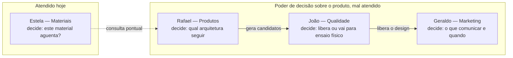

# Plano: abas de decisão para usuários não técnicos

> **Status: proposta para revisão da equipe.** Nada aqui foi implementado.
> As recomendações estão marcadas como tal e as perguntas em aberto estão na
> [seção 8](#8-o-que-precisa-de-decisão-da-equipe).
>
> Base: [`documentacao.md` §4.1.6 (Personas)](documentacao.md), os requisitos
> funcionais de §6.1.1 e as regras de negócio de §6.2.1. Os números de
> viabilidade foram medidos no repositório, não estimados — ver
> [seção 7](#7-viabilidade-técnica-medida).
>
> **Duas partes.** As seções 1 a 9 propõem abas dentro dos requisitos já
> especificados. A [Parte II](#parte-ii--ideias-fora-dos-requisitos)
> (seções 10 a 12) reúne ideias de features e de visualização **sem requisito
> associado**, incluindo um achado sobre o teto de acurácia dos dados que
> apareceu durante esta análise.

## 1. O problema que este plano resolve

A dashboard hoje tem três abas — **Resultados**, **Mapa térmico** e
**Métricas Estatísticas** — e todas as três falam a língua de quem já sabe
ler um ensaio térmico:

| O que a tela mostra hoje | Quem consegue agir com isso |
| --- | --- |
| Tabela de 74 sensores com temperatura, margem, limite e razão | Estela (Materiais), Rafael (Produtos) |
| Fogão 3D com pinos por sensor e modos de cor | Estela, Rafael |
| MAE, RMSE, R², dispersão previsto × real, importância das variáveis | Quem valida o modelo, não quem usa a previsão |

Isso atende bem a **Estela (Engenheira de Materiais)**, que §4.1.6 descreve
como quem "toma decisões técnicas diretamente a partir do resultado da
previsão". O problema é que ela não é quem decide **qual combinação de peças
vira um fogão**. Essa decisão é de outras três personas, e para elas a tela
atual entrega dado bruto onde deveria entregar um veredito.

O sintoma mais direto: a pergunta "**qual destes designs eu escolho?**" não
tem resposta na dashboard atual. Ela responde "quanto esquenta o sensor 42
nesta configuração" — uma pergunta que só faz sentido para quem já escolheu
o design.

## 2. Quem decide o quê



Lendo §4.1.6 pela **autoridade de decisão**, e não pelo cargo:

| Persona | A decisão que ela toma | O que §4.1.6 diz que ela precisa |
| --- | --- | --- |
| **Rafael** — Eng. de Produtos | Qual arquitetura/arranjo de componentes seguir | "comparando múltiplas arquiteturas em paralelo e sabendo em quais Key Areas o risco se concentra"; usa a previsão "para gerar e descartar alternativas de projeto, no momento em que mudar o produto ainda é barato" |
| **João** — Eng. de Qualidade | Liberar o design ou exigir ensaio físico | "verificar rapidamente, para múltiplas configurações, se um componente ultrapassa seu limite térmico, com uma margem de erro clara (≤ 10%) que permita auditar a previsão"; "triar quais configurações apresentam maior risco térmico" |
| **Geraldo** — Marketing | Posicionamento, argumentos e calendário | "acesso antecipado a características térmicas e de desempenho do produto, ainda na fase de desenvolvimento"; "argumentos de diferenciação frente à concorrência" |

**Observação para a revisão:** o pedido que originou este plano citou
Marketing e Qualidade. Incluí **Rafael** porque ele é, literalmente, a persona
que decide "quais designs de combinação de peças são efetivos" — §4.1.6 diz
que ele "atua um passo antes" de Estela e João. Se a equipe preferir manter o
escopo em duas personas, a Aba 2 (Explorador) é a que sai.

## 3. O que já está especificado e não existe

Dois requisitos de §6.1.1 endereçam exatamente esta lacuna e **não estão
implementados** no React. Ambos existiam no dashboard Streamlit e foram
perdidos quando ele foi removido em 27/09/2026 (ver
[`arquitetura_atual_diagnostico.md` §6.2](arquitetura_atual_diagnostico.md)):

| Requisito | Texto | Estado |
| --- | --- | --- |
| **RF08** (Média) | "Permitir a consulta simultânea de duas ou mais configurações, exibindo os resultados lado a lado" | Não implementado |
| **RF10** (Baixa) | "Permitir a exportação dos resultados da consulta em formato tabular" | Não implementado |
| **RF17** (Média) | "Permitir a predição em lote, a partir de um conjunto de configurações fornecido pelo usuário" | Não implementado |

Este plano não inventa requisitos novos: ele propõe **implementar RF08, RF10 e
RF17 em forma de decisão**, não de tabela.

## 4. Princípios que as novas abas não podem violar

Simplificar a leitura não pode virar esconder incerteza. Estas regras já
existem e continuam valendo em toda aba nova:

- **RN05 / RN06** — toda temperatura exibida vem com margem de erro, em
  formato comparável ao critério de 10%. Um veredito "aprovado" sem a folga
  térmica ao lado é proibido.
- **RN08** — em `fora de domínio` o número é suprimido e a recomendação é
  simulação CFD. Um semáforo verde nunca pode nascer de uma extrapolação.
- **RF11** — a previsão estima a saída do CFD, não uma medição física. O aviso
  precisa sobreviver à simplificação.
- **RN14** — a exportação inclui configuração, margem e confiabilidade; nunca
  o valor bruto sozinho.
- Regra 9 do `REFACTORING_AGENT_GUIDE.md`: "não transformar um apoio à decisão
  de engenharia em um mostrador de temperatura".

Tradução prática: as abas novas **traduzem**, não **removem**. "MAE 5,78 °C"
vira "erro típico de ±6 °C"; não vira silêncio.

## 5. As abas propostas

### Aba 1 — "Comparar designs" (Rafael, João)

**A decisão:** entre 2 e 4 candidatos, qual avança?

Implementa RF08. Cada coluna é uma configuração; cada linha é uma pergunta de
decisão, não um sensor:

| | Design A | Design B | Design C |
| --- | --- | --- | --- |
| Veredito | ✅ Aprovado | ⚠️ Atenção | ❌ Reprovado |
| Componentes acima do limite | 0 de 74 | 0 de 74 | 2 de 74 |
| Folga térmica mínima | 7,3 °C | 1,8 °C | −4,1 °C |
| Onde está o aperto | Compartimento da eletrônica | Painel traseiro | Resistências |
| Confiança da previsão | Interpolação | Interpolação | Extrapolação moderada |
| Precisa de ensaio físico? | Não | Sim, no painel traseiro | Sim |

- **Folga térmica** (limite − temperatura prevista) é a métrica central desta
  aba. É o que João precisa para auditar: uma folga de 1,8 °C com erro típico
  de ±6 °C **não é aprovação**, e a tela precisa dizer isso.
- A linha "Precisa de ensaio físico?" é derivada, não inventada: sai da
  comparação entre folga e margem de erro da área.
- **Dados:** disponíveis hoje. Precisa de N chamadas a `POST /api/v1/predictions`
  ou, preferencialmente, do endpoint de lote (RF17).

### Aba 2 — "Explorador de designs" (Rafael)

**A decisão:** dentre todas as combinações possíveis, quais valem a pena?

Esta é a aba que muda a natureza da ferramenta. Hoje o usuário chega com um
design e pergunta "este passa?". Aqui ele pergunta "**quais passam?**".

- O espaço de configuração tem **3.744 combinações**. O laboratório ensaiou
  **56**. O modelo consegue varrer as 3.744 em ~2 s (ver seção 7).
- A tela mostra: quantas combinações passam, quais são as 10 de maior folga
  térmica, e filtros do tipo "só as que não excedem nenhum limite" ou "só as
  que o modelo classifica como interpolação".
- Cruzamento essencial: **ordenar por folga, mas colorir por confiabilidade**.
  A melhor configuração do ranking costuma ser a mais distante do que foi
  ensaiado — exatamente a que merece mais desconfiança. A tela precisa tornar
  esse conflito visível, não escondê-lo atrás de um ranking.
- **Dados:** precisa de RF17 (predição em lote). Sem isso a aba é inviável —
  ver seção 7.

### Aba 3 — "Ficha do design" (Geraldo, João)

**A decisão:** o que eu comunico sobre este produto, e com que segurança?

Uma página por configuração, em português corrente, imprimível e exportável
(RF10 + RN14):

> **Design BR-04** — Blower para frente · Carcaça fechada · Pyro · Alumínio
>
> Todos os 74 componentes avaliados ficaram dentro do limite de engenharia.
> O ponto mais quente é a gaveta de armazenamento, a 142,7 °C, com 7,3 °C de
> folga para o limite de 150 °C.
>
> **Confiança:** esta combinação já foi ensaiada em laboratório, o que é o
> cenário mais confiável do modelo.
>
> **Ressalva:** os valores estimam o resultado da simulação numérica (CFD),
> não uma medição física. Erro típico nesta área: ±6 °C.

- Para Geraldo, isso é o insumo de campanha: um enunciado defensável sobre o
  produto, com a ressalva junto, que ele pode levar para uma reunião sem
  precisar de um engenheiro ao lado para traduzir.
- Para João, é o registro auditável da liberação.
- **Dados:** disponíveis hoje. A exportação é RF10.

### Confiança por área, em linguagem de decisão

As três abas precisam de uma tradução comum. Os números reais do conjunto de
modelos hoje:

| Área | Previsões dentro de ±10% | Tradução proposta |
| --- | --- | --- |
| Interface do forno | 100,0% | Confiança alta |
| Ventilação principal | 89,1% | Confiança alta |
| Resfriamento da eletrônica | 87,5% | Confiança alta |
| Botões do cooktop | 80,3% | Confiança média |
| Resistências | 76,4% | Confiança média |
| Painel traseiro | 70,9% | Confiança média |
| Compartimento da eletrônica de potência | 61,8% | **Confiança baixa** |

O caso do Compartimento da eletrônica é o que justifica esta tradução: seu
R² é **−1,38**, um número que, exibido cru para um não técnico, ou não
significa nada ou assusta sem orientar. "Confiança baixa — confirme esta área
por ensaio antes de decidir" é a mesma informação, acionável.

**Recomendação:** a faixa de corte (alta / média / baixa) é uma decisão de
produto, não estatística. Proposta inicial: ≥ 85% alta, 70–85% média,
< 70% baixa. Precisa do aval da equipe.

## 6. O que este plano não resolve

Uma necessidade de §4.1.6 **não tem dado no sistema** e seria desonesto
prometer: Geraldo "acompanha os indicadores de prazo e de progresso da
validação térmica do produto para ajustar o calendário de lançamento".

O Thermal Predictor não conhece cronograma. Não há data de ensaio, fila de
CFD, nem status de validação em lugar nenhum do repositório — o banco guarda
apenas o log de acesso à API. Uma aba que mostrasse "lançamento previsto para
março" estaria inventando.

O que dá para entregar honestamente a Geraldo é o **antecedente** do prazo,
não o prazo: quantos designs já passam na triagem térmica, quantos ainda
dependem de ensaio físico e onde o risco se concentra. Isso encurta a
conversa dele com a engenharia, mas não substitui um cronograma.

**Se a equipe quiser o indicador de prazo de fato**, é preciso decidir de
onde viria essa informação — provavelmente um sistema externo — e isso é um
projeto separado, não uma aba.

## 7. Viabilidade técnica (medida)

Medições feitas neste repositório, com os modelos reais em `src/backend/models/`:

| Operação | Tempo medido |
| --- | --- |
| 1 predição (7 áreas, 74 sensores) pela rota atual | **479 ms** |
| Varrer as 3.744 combinações uma a uma | **~30 min** |
| Varrer ~1.800 combinações de uma área **em lote** | **267 ms** |
| Varrer o espaço inteiro nas 7 áreas **em lote** | **~2 s** |

A conclusão determina o desenho: a Aba 2 é **inviável** se construída como um
laço sobre o endpoint atual, e **trivial** se apoiada num endpoint de lote.
A diferença não é de otimização, é de ordem de grandeza — o `predict` do
scikit-learn custa quase o mesmo para 1 linha e para 1.800.

Ou seja: **RF17 não é um requisito acessório deste plano, é a fundação da
Aba 2.**

## 8. O que precisa de decisão da equipe

1. **Escopo de personas.** Rafael entra? Ele é quem literalmente decide
   combinações de peças, mas o pedido original citou Marketing e Qualidade.
2. **Faixas de confiança.** ≥ 85% / 70–85% / < 70% é um chute informado.
   Quem define o corte defensável?
3. **Veredito automático.** A Aba 1 propõe rotular um design como
   "Aprovado / Atenção / Reprovado". Isso é apoio à decisão ou assumir uma
   responsabilidade que é do Engenheiro de Qualidade? A alternativa é mostrar
   folga e margem sem rótulo e deixar o julgamento com João.
4. **Ordem de entrega.** Sugestão: Aba 1 (RF08, destrava comparação e recupera
   o que se perdeu com o Streamlit) → Aba 3 (RF10, baixo custo, alto valor
   para Marketing) → Aba 2 (depende de RF17).
5. **BR e MX.** §6.2.1 RN03 diz que o país só troca a tabela de limites, com o
   mesmo modelo. A implementação atual marca MX como indisponível. Para
   Marketing, comparar o mesmo design nos dois mercados é uma pergunta de
   negócio óbvia — vale resolver essa divergência antes da Aba 3?
6. **Onde essas abas vivem.** Três abas novas somadas às três atuais dá seis.
   Faz sentido separar em dois modos ("Engenharia" e "Decisão") em vez de
   uma fileira de seis abas?

## 9. Sequência sugerida

| Etapa | Entrega | Depende de |
| --- | --- | --- |
| 1 | Endpoint de lote (RF17) + Aba 1 "Comparar designs" (RF08) | — |
| 2 | Aba 3 "Ficha do design" + exportação (RF10, RN14) | Etapa 1 para a folga térmica |
| 3 | Aba 2 "Explorador de designs" | Etapa 1 (lote) |
| 4 | Tradução de confiança por área aplicada às três abas | Decisão nº 2 |

As etapas 1 e 2 usam dados que a API já entrega. Só a etapa 3 exige capacidade
nova de back-end, e ela já está especificada como RF17.

---

# Parte II — Ideias fora dos requisitos

> As seções 1 a 9 se limitam ao que já está especificado (RF08, RF10, RF17).
> Daqui em diante são **ideias sem requisito associado**, levantadas durante a
> análise dos dados do projeto. Nada aqui está aprovado nem estimado; entram
> na revisão como matéria-prima de discussão.

## 10. O que os dados revelaram, e que ninguém pediu para olhar

### 10.1 Existe uma coluna com a intenção de cada ensaio, e ela está fora do modelo

`data/dataset_pre_processado.csv` tem uma coluna **`reason`** que não é usada
nem como variável de entrada nem como alvo. Ela guarda, em texto livre, *por
que* cada ensaio foi feito — 35 descrições distintas entre os 56 ensaios:

```
Baseline new Duct                    (6 ensaios)
Added a cover above Heatsink         (5)
Part of study of position            (5)
New Baseline - Hole Tray             (3)
Fan velocity 1500 RPM                (1)
Run 32 - Clip Housing Solution       (1)
Bigger Opening in the single plate   (1)
Double Flow on Blower                (1)
...
```

Repare no vocabulário: **duto**, **tampa sobre o dissipador**, **bandeja**,
**velocidade do ventilador**, **abertura da placa**, **espaçador**. Nenhuma
dessas peças existe como variável do modelo. As 7 variáveis atuais descrevem
um recorte do design; o `reason` descreve o resto.

### 10.2 Quanto isso custa: o teto de acurácia do modelo

Se duas linhas do dataset têm as mesmas 7 variáveis, o modelo **é obrigado a
prever o mesmo número para as duas** — não existe informação que as separe.
Mas, na realidade medida, elas não são iguais.

**35 dos 56 ensaios (62,5%)** compartilham configuração idêntica com pelo
menos um outro, em 11 grupos. Dentro desses grupos, a temperatura real do
Compartimento da eletrônica chega a diferir em **33,1 °C**:

| Ensaio | IPC Comp (média) | `reason` |
| --- | --- | --- |
| Run 1 | 101,7 °C | Não informado |
| Run 3 | 68,7 °C | **Fan velocity 1500 RPM** |

Para o modelo, essas duas linhas são a mesma configuração. Na bancada, são
33 °C de diferença — causados por uma variável que ele não enxerga.

Comparando o erro do modelo com essa dispersão irredutível:

| Área | MAE do modelo | Dispersão entre ensaios idênticos | Quanto do erro é irredutível |
| --- | --- | --- | --- |
| Mainback | 4,85 °C | 4,78 °C | ~98% |
| Botões do cooktop | 2,47 °C | 2,37 °C | ~96% |
| Ventilação principal | 3,33 °C | 3,11 °C | ~93% |
| Compartimento da eletrônica | 5,78 °C | 4,69 °C | ~81% |
| Resfriamento da eletrônica | 4,41 °C | 3,51 °C | ~80% |
| Interface do forno | 2,06 °C | 1,42 °C | ~69% |
| Resistências | 7,97 °C | 4,34 °C | ~54% |

**A leitura:** em 5 das 7 áreas o modelo já está praticamente no teto do que
estes dados permitem. Trocar de algoritmo ou refinar hiperparâmetros não vai
melhorar — o erro restante não está no modelo, está na ausência de variáveis.
Isto confirma, com número, a conclusão que a própria equipe já registrou no
README: *"o gargalo do dataset é variável não medida, não número de runs"*.

E explica o R² de **−1,38** do Compartimento da eletrônica sem recorrer a
"o modelo é ruim": pedir a um modelo que preveja uma faixa de 33 °C com um
único valor produz exatamente isso.

> **Ressalva metodológica.** A coluna "dispersão" é a média, por sensor, do
> desvio-padrão entre ensaios de configuração idêntica. Ela mistura três
> coisas: variável de design não medida, variação legítima entre repetições e
> ruído de medição. Serve para indicar ordem de grandeza e priorizar, **não**
> como piso de erro formal. Alguns grupos têm só 2 ensaios.

### 10.3 Features candidatas, ranqueadas pelo que explicariam

Extraídas do próprio `reason`, ou seja: são coisas que o laboratório **já
variou deliberadamente** e já anotou, só não estruturou como coluna.

| Feature candidata | Evidência nos ensaios | Ganho potencial |
| --- | --- | --- |
| **Velocidade do ventilador** (`fan_level`) | "Fan velocity 1500 RPM", "Fans in Low", "Blower On Medium/High", "Double Flow on Blower" | Alto — associada à maior diferença observada (33 °C) |
| **Tampa sobre o dissipador** | 8 ensaios: "Added a cover above Heatsink", "No cover on HS", "Run with cover" | Médio — ~7 °C no IPC Comp |
| **Tipo de bandeja** | "Hole Tray", "Simplified Tray", "Real Tray" | Médio — ~8 °C |
| **Geometria do duto** | "Baseline new Duct", "Changed the mainback duct", "Top Duct" | Médio — 7 ensaios envolvidos |
| **Presença do cooktop** | "Broil wo Cookitop" | A investigar |
| **Espaçador / abertura da placa** | "Plastic Plate with spacer", "Bigger Opening in the single plate" | Baixo — 1 ensaio cada |
| **Ordem de montagem dos IGBTs** | "Diff Order IGBTs" | Baixo — 1 ensaio |

O `fan_level` **já está documentado** como pendência: a seção 4.4 da
documentação registra que ele ficou fora da versão atual "com ganho
estatístico validado em teste controlado", travado numa reclassificação de
material que o glossário do parceiro ainda não confirmou. Os números acima
sugerem que destravar isso vale mais do que qualquer ajuste de modelagem.

**Recomendação para a revisão:** o pedido mais barato e de maior retorno ao
parceiro não é mais ensaios — é **anotar estas variáveis nos ensaios que já
existem**. Metade delas está descrita em texto livre no `reason`; parte pode
ser recuperada retroativamente sem bancada nenhuma.

### 10.4 Ideias de modelagem que não dependem de dado novo

| Ideia | O que muda para quem decide |
| --- | --- |
| **Prever a folga térmica** (limite − temperatura) em vez da temperatura | O alvo passa a ser a grandeza da decisão. Um erro de 5 °C num sensor com 80 °C de folga é irrelevante; no com 2 °C, é tudo. |
| **Regressão quantílica** (o Gradient Boosting já suporta `loss="quantile"`) | Substitui a margem simétrica de ±MAE por um intervalo real e assimétrico. Atende RN05/RN06 melhor do que hoje. |
| **Um classificador de "excede o limite"** ao lado do regressor | Entrega probabilidade calibrada de estouro — que é literalmente a pergunta do João — em vez de obrigá-lo a comparar temperatura com limite mentalmente. |
| **Expor a dispersão irredutível por área** na resposta da API | Permite à interface dizer "ensaios idênticos variaram 7 °C entre si", que é honestidade sobre o teto dos dados, não sobre o modelo. |

## 11. Ideias de visualização

Todas assumem as regras da seção 4 (margem sempre visível, `fora de domínio`
suprime o número, ressalva de CFD preservada).

### 11.1 Colorir o fogão 3D por folga, não por temperatura

O mapa hoje colore por temperatura e status. Para decidir, o que importa é a
**folga até o limite**: um sensor a 142 °C com limite de 150 °C é urgente; um
a 200 °C com limite de 300 °C não é. São leituras opostas que a escala de
temperatura funde. Um modo "folga" reordena visualmente o fogão pela urgência
real, reusando a infraestrutura de cores que já existe.

### 11.2 Gráfico tornado: o que mudar primeiro

Para um design, mostrar o efeito de alterar **uma** variável por vez sobre o
pior sensor:

```
Trocar blower para To Front    ############  -12,4 C
Abrir o furo do defletor       ######         -6,1 C
Material para Aluminio         ###            -2,8 C
Placa para Right               #              -0,4 C
Mudar run_case para Bake       ........       +8,2 C (piora)
```

É a resposta direta à pergunta do Rafael — "o que eu mexo para resolver?" — e
sai de 7 predições em lote, sem dado novo. Mais útil que a importância de
variáveis da aba de métricas, que diz o que o *modelo* usa, não o que o
*engenheiro* deve mexer.

### 11.3 Fronteira de Pareto: folga × confiabilidade

O melhor design do ranking costuma ser o mais distante do que foi ensaiado.
Plotar folga térmica num eixo e distância ao conjunto de treino no outro torna
esse conflito visível e mostra a fronteira: os designs que não são superados
em nenhuma das duas dimensões. Evita o erro clássico de escolher o topo do
ranking sem ver que ele é o menos confiável.

### 11.4 Matriz design × área

Linhas = configurações candidatas, colunas = as 7 áreas, célula = aprovado /
atenção / reprovado. Permite varrer dezenas de designs de uma vez e enxergar
padrões de coluna ("toda configuração com carcaça aberta reprova no
Compartimento da eletrônica") que nenhuma consulta individual revela.

### 11.5 Grade de duas variáveis

Fixar 5 variáveis e varrer as outras 2 numa grade colorida pela folga.
Não-técnicos leem grade melhor que gráfico de dispersão, e o formato responde
"em que região de projeto eu estou seguro?" em vez de "quanto dá este ponto?".

### 11.6 Falar a língua do ensaio, não a do modelo

Usar o vocabulário do `reason` na interface. "Com tampa sobre o dissipador" é
compreensível para Geraldo; `housing = Closed` não é. O dataset já contém esse
vocabulário — é questão de mapeá-lo, não de escrevê-lo do zero.

### 11.7 Mostrar a dispersão real, e não só a margem do modelo

Quando a configuração consultada coincide com ensaios de laboratório, exibir
**quanto os ensaios reais variaram entre si**, ao lado da previsão. É a
informação mais honesta que a tela pode dar sobre incerteza — e hoje ela
existe no dataset sem chegar a lugar nenhum da interface.

## 12. Se a equipe quiser priorizar

Ordenado por (valor de decisão) ÷ (esforço), na minha leitura — todos
discutíveis:

| # | Ideia | Esforço | Por quê |
| --- | --- | --- | --- |
| 1 | Modo "folga" no mapa 3D (11.1) | Baixo | Reusa o mapa e a escala de cor existentes |
| 2 | Gráfico tornado (11.2) | Baixo | 7 predições; nenhum dado novo |
| 3 | Estruturar `fan_level` a partir do `reason` (10.3) | Médio | Maior ganho de acurácia identificado |
| 4 | Prever folga / classificador de estouro (10.4) | Médio | Alinha o alvo do modelo à decisão |
| 5 | Matriz design × área (11.4) | Médio | Depende do lote (RF17) |
| 6 | Regressão quantílica (10.4) | Alto | Muda o contrato da margem de erro |
