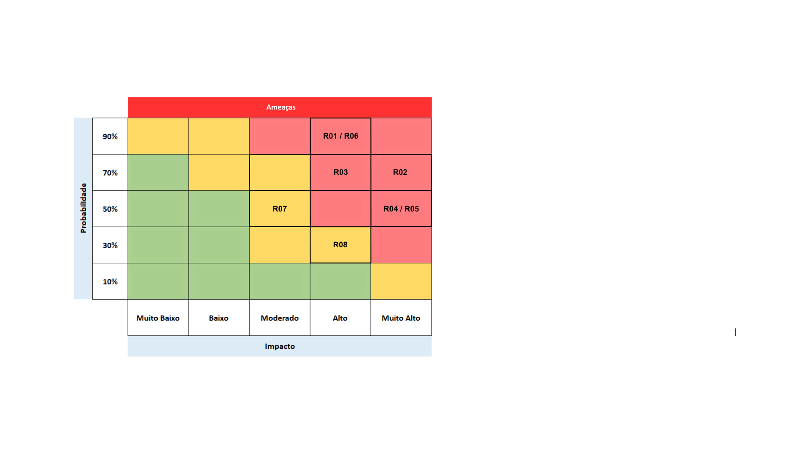
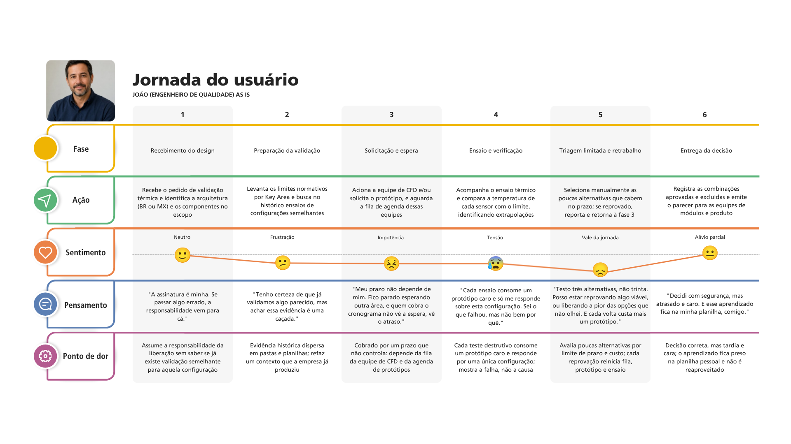
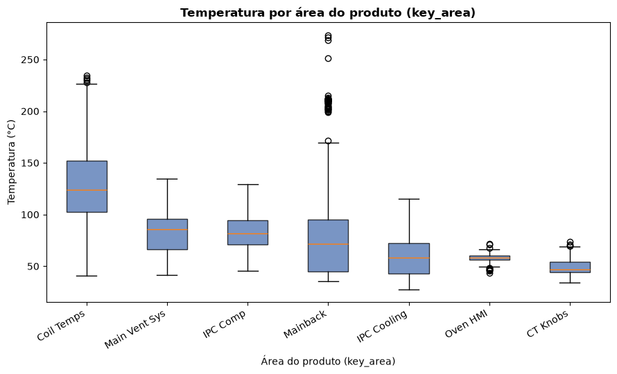
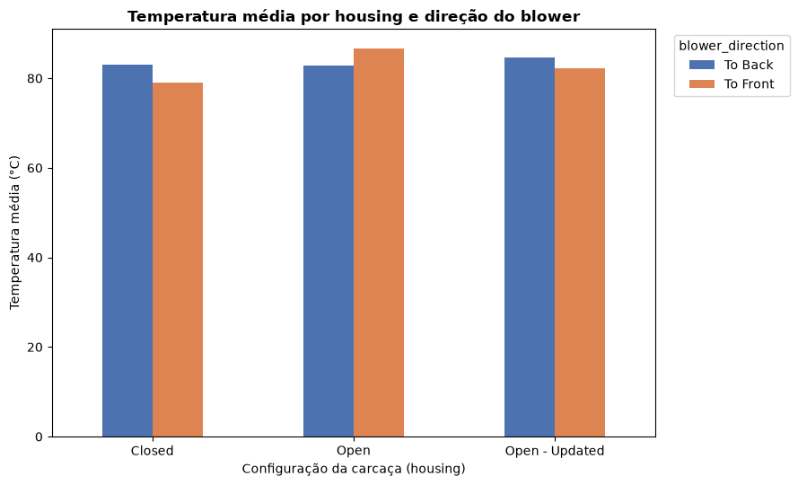
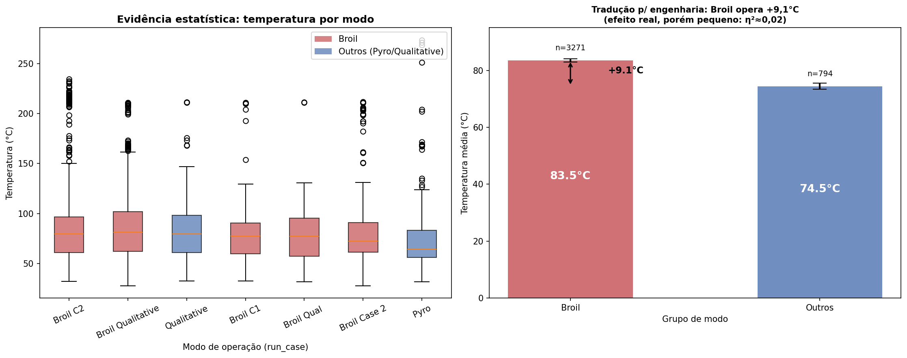
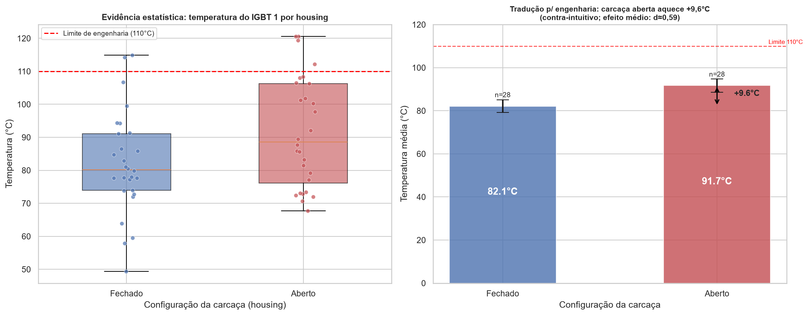
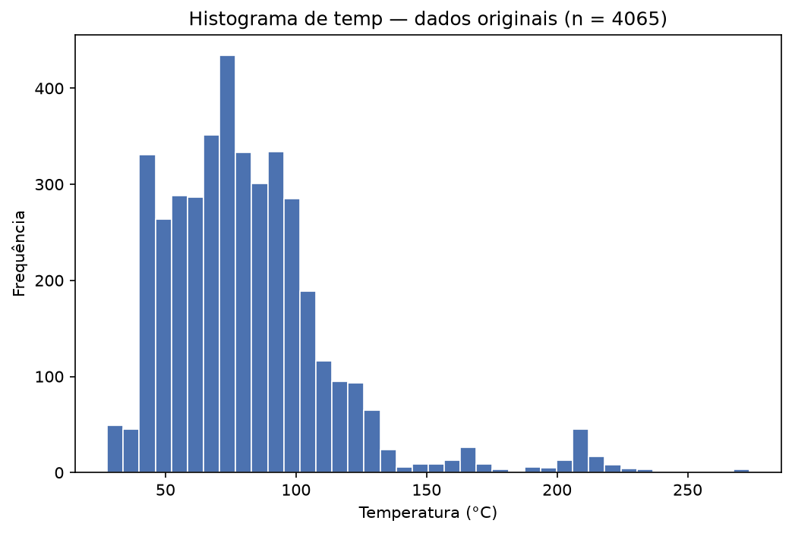

# Documentação Modelo Preditivo - Inteli

```
INSTRUÇÕES GERAIS (remova este trecho ao final)

Você deve editar este documento utilizando notação markdown - siga as convenções neste link 
https://docs.github.com/en/get-started/writing-on-github/getting-started-with-writing-and-formatting-on-github/basic-writing-and-formatting-syntax
```

## Whirlpool Thermal Predictor

### FOG - A predição que nasce da névoa dos dados do Dataset

#### Felipe Sodré Pessôa, Gabriel Lorenzo Baglioli de Loyola, Lucas Andrade Silva, Nícolas Rigolin Carrascossa, Samuel Yenyu Chen, Vitor Medrado Lisbôa, William Martins Moraes


## Sumário
[1. Introdução](#c1)

[2. Objetivos e Justificativa](#c2)

[3. Metodologia](#c3)

[4. Desenvolvimento e Resultados](#c4)

[5. Conclusões e Recomendações](#c5)

[6. Estrutura da Solução Visual e Acesso ao Modelo Preditivo](#c6)

[7. Referências](#c7)

[Anexos](#attachments)


## <a name="c1"></a>1. Introdução

A Whirlpool Corporation é uma multinacional fundada nos EUA em 1911, inicialmente com o propósito de fabricar máquinas de lavar roupa manuais. Atualmente, ela é conhecida como empresa líder global na fabricação de eletrodomésticos para cozinha e lavanderia, com operações em cerca de 170 países e faturamento de R$12,9 bilhões no Brasil em 2024 (Brazil Economy). Ela já está presente no Brasil há mais de 70 anos por meio de marcas amplamente reconhecidas no mercado brasileiro, como Brastemp, Consul, KitchenAid, B.blend etc, detendo cerca de 38% de participação no mercado de linha branca. A parceira direta no caso deste trabalho é a Divisão de Fogões da companhia, responsável pelo desenvolvimento de produtos para os mercados do Brasil e do México, com atuação voltada à engenharia e à pesquisa e desenvolvimento (P&D) de eletrodomésticos.

Nesse setor, o desenvolvimento de novos modelos de fogões de piso depende diretamente da construção de protótipos físicos e da realização de testes destrutivos para validar o comportamento térmico dos equipamentos. Esse processo é indispensável para validar se o fogão desenvolvido realmente se enquadra nos padrões de qualidade, segurança e desempenho exigidos. Porém, o desenvolvimento desses protótipos demanda grandes investimentos e é bem demorado, já que cada teste exige novos protótipos e ciclos completos de testes físicos. Portanto, o processo de um novo lançamento de um fogão é caro e lento, o que pode ser considerado uma fraqueza para esse setor do mercado, levantando um obstáculo que necessita de uma solução.


## <a name="c2"></a>2. Objetivos e Justificativa
### 2.1 Objetivos
```
Descreva resumidamente os objetivos gerais e específicos do seu parceiro de negócios.

Remova este bloco ao final
```

### 2.2 Proposta de solução
```
Descreva resumidamente sua proposta de modelo preditivo e como esse modelo pretende resolver o problema, atendendo os objetivos.

Remova este bloco ao final
```

### 2.3 Justificativa
```
Faça uma breve defesa de sua proposta de solução, escreva sobre seus potenciais, seus benefícios e como ela se diferencia.

Remova este bloco ao final
```

## <a name="c3"></a>3. Metodologia
```
Descreva a metodologia CRISP-DM e suas etapas de desenvolvimento, citando o referencial teórico. Você deve apenas enunciar os métodos, sem dizer ainda como eles foram aplicados, nem quais resultados foram obtidos.

Remova este bloco ao final
```

## <a name="c4"></a>4. Desenvolvimento e Resultados
### 4.1. Compreensão do Problema
#### 4.1.1. Contexto da indústria

O setor de linha branca (eletrodomésticos de grande porte) no Brasil e no México é dominado por um pequeno grupo de fabricantes multinacionais que competem simultaneamente em escala industrial, penetração de marca e velocidade de lançamento de produto. Nesse cenário, a Divisão de Fogões da Whirlpool — parceira direta deste projeto — atua como unidade de engenharia e P&D responsável pelo desenvolvimento de fogões de piso (Freestanding) para as arquiteturas de produto do Brasil e do México, operando sob o guarda-chuva comercial da Whirlpool Latin America e das marcas Brastemp, Consul e KitchenAid. 


##### 4.1.1.1 Análise do contexto da Whirlpool segundo as cinco forças de Porter
###### 1. Rivalidade entre concorrentes existentes — Alta
 
A Whirlpool Latin America lidera a região com Brastemp, Consul e KitchenAid, mas opera em um oligopólio fragmentado e ativamente disputado por preço:
 
- **Multinacionais âncora:** Electrolux (europeia, com aposta estratégica declarada no Brasil apesar de tarifas), Mabe (mexicana, com investimento de US$ 668 milhões anunciado para 2025–2027 e liderança em fogões a gás via planta em Durango), BSH/Bosch e Midea (joint-venture sino-americana que se consolidou como terceira força relevante em linha branca).
- **Fabricantes nacionais robustos:** Esmaltec (líder em fogões no Nordeste), Mueller, Britânia, Philco, Atlas e Continental (marca do grupo Mabe).
- **Entrantes chinesas em expansão acelerada:** Hisense, TCL e Gree, competindo agressivamente por preço.
A evidência mais forte de rivalidade intensa é financeira, não anedótica: a compressão de margem EBIT de 6,0% para 3,0% em um ano, atribuída pela própria Whirlpool a "intensidade promocional" no Brasil, mostra uma guerra de preços ativa entre os players estabelecidos — não apenas concorrência latente¹. Em 2023, a Whirlpool reportava recuperação de quase 4 pontos de *market share* em refrigeradores, lavadoras e fogões em um único trimestre — o que só é possível em um mercado onde a disputa por participação é constante e o custo de reconquista de posição é alto².
 
O setor de linha branca no Brasil (fogões, lavadoras e geladeiras) recuou 1% em vendas em 2025, segundo a Eletros³ — um mercado maduro e de crescimento raso intensifica estruturalmente a rivalidade, pois o crescimento de um player passa a depender quase inteiramente da erosão de participação dos concorrentes, não da expansão da demanda agregada.
 
###### 2. Poder de negociação dos fornecedores — Moderado, com concentração pontual em componentes eletrônicos
 
A Whirlpool Latin America mantém uma base ampla de 3.730 fornecedores (750 de materiais diretos, 2.980 de indiretos), concentrados nos estados onde possui plantas — Amazonas, Santa Catarina e São Paulo⁴. Essa diversificação dilui o poder da maioria dos fornecedores, mas não de forma homogênea entre categorias de insumo:
 
- **Componentes eletrônicos (placas, sensores, semicondutores):** segmento historicamente sujeito a choques globais de oferta, elevando o poder de barganha de fornecedores especializados durante ciclos de escassez — relevante porque a própria estratégia de portfólio da Whirlpool vem incorporando cada vez mais sensores e eletrônica embarcada (ajuste automático de temperatura, detecção de carga em lavadoras), aumentando a dependência da companhia desses insumos⁵.
- **Aço e insumos de commodity:** menor poder de barganha, dado o caráter padronizado e substituível do material.
- O volume de compra da própria Whirlpool, como maior fabricante de eletrodomésticos da América Latina, gera poder de barganha reverso relevante sobre fornecedores de médio e pequeno porte.
###### 3. Poder de negociação dos compradores — Alto
 
Como o modelo é B2C indireto, o comprador relevante para fins de precificação e condição comercial é o canal varejista, não o consumidor final isolado:
 
- No Brasil, Magazine Luiza e Grupo Casas Bahia (via Via Varejo, ~1.073 lojas) concentram parcela relevante do volume de eletrodomésticos, com lojas físicas ainda decisivas em 87% da jornada de compra.
- É particularmente relevante notar que, entre os grandes varejistas, houve fragilidade financeira recente — Americanas em recuperação judicial e desvalorizações acionárias expressivas de Casas Bahia e Magazine Luiza — o que paradoxalmente pode elevar (não reduzir) o poder de barganha de curto prazo desses varejistas sobre fabricantes, que precisam sustentar volume de giro em parceiros financeiramente fragilizados via condições comerciais mais favoráveis, prazos e ações promocionais conjuntas².
- No México, cadeias como Liverpool e Elektra cumprem função equivalente.
- O consumidor final tem baixo custo de troca entre marcas no segmento econômico, o que reforça o papel do varejo como intermediário capaz de colocar fabricantes concorrentes em disputa direta — bem exemplificado pela própria Whirlpool ao reconhecer que "as negociações de preços nunca são fáceis" com os grandes revendedores.
###### 4. Ameaça de novos entrantes — Moderada, em elevação estrutural
 
As barreiras tradicionais de entrada permanecem relevantes — intensidade de capital, certificação regulatória (INMETRO), rede de distribuição consolidada e fidelidade de marca (Brastemp e Consul têm mais de 70 anos de presença regional). Contudo, dois movimentos recentes reduzem a efetividade dessas barreiras:
 
- **Marcas chinesas** (Hisense, TCL, Midea, Gree) expandem agressivamente no varejo brasileiro, em parte redirecionando capacidade excedente originalmente destinada aos EUA em razão de tarifas americanas. Essas marcas entram via importação e parceria de varejo, contornando a barreira histórica de manufatura local — a própria Whirlpool reconhece que a presença chinesa "contribui para aumentar o mercado e expor os diferenciais das marcas", uma leitura que minimiza publicamente uma ameaça que é, estruturalmente, real.
- No México, o boom de *nearshoring* — puxado pelo USMCA e por investimentos como o programa de US$ 668 milhões da Mabe para 2025–2027 — eleva a barreira de entrada para quem não possui planta local, favorecendo incumbentes com operação física estabelecida (caso da própria Whirlpool), mas também sinaliza que o custo de entrada via manufatura doméstica está subindo, o que direciona novos entrantes para a rota de importação — o mesmo caminho já adotado pelas chinesas no Brasil.
###### 5. Ameaça de produtos e comportamentos substitutos — Alta e estruturalmente crescente
 
Esta é a força mais dinâmica e menos óbvia da análise, e onde a leitura simplista ("indução substitui gás") deixa de capturar a real amplitude do fenômeno. Há pelo menos quatro camadas distintas de substituição atuando simultaneamente sobre o portfólio de cocção e refrigeração da Whirlpool na América Latina, com evidência direta de que a própria companhia já reconhece e reage a três delas.
 
**a) Substituição tecnológica intra-categoria — fogão a gás por indução.** A indução deixou de ser artigo de nicho premium e ganha tração em 2026 por eficiência energética, segurança (sem risco de explosão por vazamento) e queda de preço de entrada, com modelos compactos a partir de R$ 180–350. A resposta da própria Whirlpool confirma a materialidade da ameaça: início de produção nacional de fogões por indução em Manaus a partir do segundo semestre de 2026 — uma migração de capacidade fabril, não apenas de portfólio de importação⁶.
 
**b) *Unbundling* funcional do fogão por eletroportáteis — a air fryer.** Este é o vetor de substituição com a evidência quantitativa mais robusta e o mais subestimado em análises convencionais do setor. A penetração de air fryers nos domicílios brasileiros saltou de 36,2% para 64% entre 2022 e 2025 — o maior avanço percentual entre todas as categorias de eletrodomésticos monitoradas —, com o mercado da categoria crescendo 340% no período⁷. As ocasiões de preparo rápido de refeições já respondem por mais de 30% do total de preparos domésticos, enquanto a fritura tradicional (a função historicamente mais associada ao fogão e ao forno) caiu para 17% das ocasiões, recuo de três pontos percentuais apenas entre 2024 e 2025. Isso não é substituição de compra (o consumidor não deixa de ter fogão), mas substituição de **uso e intensidade de uso**: funções antes concentradas no fogão/forno migram para um eletroportátil dedicado, de ticket médio muito inferior, o que tende a alongar o ciclo de reposição do fogão principal e a pressionar para baixo a demanda por capacidade e robustez térmica do produto principal.
 
**c) Substituição do próprio ato de cozinhar — aplicativos de delivery.** A penetração de pedidos por aplicativo entre consumidores brasileiros passou de 80% em 2020 para 89% em 2022, e "não querer cozinhar" é a motivação declarada por 24% dos usuários — a razão mais citada⁸. O efeito líquido sobre a demanda por eletrodomésticos é ambíguo e deve ser tratado com o devido rigor analítico: o consumo doméstico agregado de alimentos ainda cresceu 3,09% entre 2022 e 2023, sugerindo complementaridade mais do que substituição direta na média da população. Ainda assim, a motivação qualitativa é evidência de uma redução na *frequência* de uso do fogão em parcelas específicas do mercado — sobretudo domicílios urbanos menores e unipessoais —, o que modera, sem eliminar, a demanda por produtos de maior capacidade.
 
**d) Substituição por mudança de hábito alimentar e de moradia — o efeito GLP-1 e a compactação urbana.** Este é o sinal mais recente e mais diretamente confirmado pela própria liderança da Whirlpool no Brasil. Segundo executivos da companhia entrevistados em janeiro de 2026, a disseminação de medicamentos GLP-1 (Ozempic, Mounjaro, Wegovy — cuja importação cresceu 88% em 2025) já altera o padrão de compra de eletrodomésticos: consumidores priorizam freezers maiores para armazenar refeições congeladas em porções menores (*meal prep*) e **migram para fogões menores, com menos bocas** — nas palavras do diretor de marketing de categoria da companhia, "as pessoas não querem mais aqueles fogões enormes". Em resposta direta a esse insight, a Whirlpool renovou por completo as linhas de cooktop de Consul e Brastemp, e reposicionou o frigobar Brastemp Retrô (líder com mais de 50% de participação no segmento de compactos premium) como solução de armazenamento de medicamentos e produtos de skincare fora da cozinha. O relatório *Home Appliances Outlook 2026*, da NielsenIQ, corrobora a tendência em nível setorial: o consumidor latino-americano já prioriza "conveniência, multifuncionalidade e benefícios de saúde e bem-estar" acima de preço puro, com o valor das vendas globais de eletrodomésticos crescendo 5% no primeiro semestre de 2025 mesmo com volume estável (+1%) — evidência de premiumização funcional, não apenas de crescimento de mercado⁵. Esse mesmo movimento já havia sido antecipado em 2023, quando a Whirlpool declarou apostar em soluções de lavanderia e cocção voltadas a apartamentos de 30–40 m², um "mercado crescente" segundo a própria liderança regional².

###### Síntese e implicações estratégicas

O setor de linha branca na América Latina apresenta atratividade estrutural moderada a baixa sob a ótica de Porter: rivalidade alta, sustentada por evidência financeira concreta — compressão da margem EBIT da própria Whirlpool de 6,0% para 3,0% em um único ano —, poder de barganha elevado do canal varejista, poder de fornecedores concentrado em componentes eletrônicos críticos, barreiras de entrada em erosão frente a competidores asiáticos via importação, e uma ameaça de substituição multifacetada e ativa, que combina fatores tecnológicos (indução), comportamentais (air fryer, aplicativos de delivery) e sociodemográficos (efeito GLP-1, compactação urbana).

Duas dessas forças têm implicação mais diretas e específicas sobre o projeto Thermal Predictor.

Da segunda força (fornecedores) decorre uma dependência estrutural e crescente de componentes eletrônicos e sensores embarcados — insumos sujeitos a ciclos de escassez global e a concentração de fornecimento —, à medida que a Whirlpool amplia a eletrônica de seus produtos (ajuste automático de temperatura, sensoriamento de carga). Essa dependência eleva o custo e o risco de qualquer processo de desenvolvimento que dependa de iteração física repetida de protótipos, reforçando o valor estratégico de um modelo preditivo capaz de antecipar o comportamento térmico do produto sem depender de múltiplos ciclos de teste físico e digital twin.

Da quinta força (substitutos) decorre uma transição de portfólio já em curso e reconhecida publicamente pela própria liderança da Whirlpool no Brasil: migração para fogões mais compactos, com menor número de bocas, e para tecnologia de indução, motivada por pressão competitiva e por mudança de comportamento do consumidor. Essa transição amplia — e não reduz — a necessidade de um modelo preditivo robusto: sob o modelo tradicional de validação térmica, cada nova arquitetura de produto exigiria um novo ciclo completo de simulação e teste físico, incompatível com a velocidade de renovação de portfólio já imposta pelo mercado.

Em conjunto, essas duas forças convertem a leitura setorial em justificativa direta de negócio para o projeto: o Thermal Predictor não responde apenas a uma dor operacional interna de lead time e custo de prototipagem, mas a uma pressão estrutural de mercado que torna a velocidade de validação térmica um fator de competitividade. Reduzir a dependência de ciclos físicos de teste é, neste contexto, condição para que a Whirlpool consiga acompanhar o ritmo de transição de portfólio já imposto pela concorrência e pelo comportamento do consumidor.

##### 4.1.1.2. Concorrentes identificados

Para efeito de seleção, foram escolhidas três empresas do setor que atuam como concorrentes diretos da Whirlpool. Destaca-se, em primeiro lugar, a Electrolux: incumbente europeu com presença quase centenária no Brasil — 100 anos completados em 2026 — e a marca com maior penetração domiciliar do país, presente em 67% dos lares brasileiros somando o portfólio da marca Continental. O Brasil é, para o grupo global, o segundo mercado mais rentável, atrás apenas da Europa, o que indica que a operação regional não é periférica, e sim um dos pilares de rentabilidade da companhia mundialmente⁹. Em agosto de 2025, a Electrolux inaugurou sua quinta planta no país, em São José dos Pinhais (PR), com investimento de R$ 700 milhões, explicitamente para reduzir dependência de importação asiática e nacionalizar categorias hoje importadas (liquidificadores, ventiladores), com plano declarado de transformar a unidade em plataforma de exportação para o restante da América Latina¹⁰. Outra empresa concorrente que se destaca é a Midea, multinacional chinesa que já não deve ser tratada apenas como ameaça potencial de entrada (Força 4), mas como concorrente estabelecido: ocupa hoje a terceira posição no mercado brasileiro de eletrodomésticos, com cerca de 8% de participação em refrigeradores e 6%–7% em lavadoras¹¹. A companhia converteu deliberadamente sua estratégia de importação para manufatura local, inaugurando em Pouso Alegre (MG) sua primeira planta 100% própria no país — investimento de R$ 630 milhões, capacidade para 1,3 milhão de unidades por ano (700 mil refrigeradores, 600 mil lavadoras) —, movimento motivado explicitamente por contornar o custo do sistema tributário de importação e cumprir exigências de conteúdo local¹². A marca também amplia agressivamente sua linha de eletroportáteis — expansão de portfólio que a equipe recomenda revalidar diretamente com o parceiro, por não ter sido localizada uma fonte primária confiável até o fechamento desta versão. Por fim, identifica-se a Mabe, grupo mexicano fundado em 1946, historicamente o concorrente mais diretamente sobreposto ao escopo do Thermal Predictor por sua forte especialização em fogões e produtos de cocção a gás, com planta dedicada a essa categoria em Durango. Consolidou domínio de mercado na América Latina — chegou a deter cerca de 70% de participação em eletrodomésticos na região, excluindo Estados Unidos e México — por meio de uma joint venture histórica com a General Electric, firmada em 1986, que lhe deu acesso à rede de distribuição americana; em meados dos anos 1990, dois terços de todos os fogões a gás e refrigeradores importados pelos EUA eram projetados e fabricados pela Mabe¹³.

#### 4.1.1.3. Análise do modelo de negócio do parceiro

A Whirlpool Latin America opera um modelo de negócio ancorado em três pilares que se reforçam mutuamente: segmentação de marca multiportfólio, manufatura local verticalizada, e diversificação incipiente para serviços e economia circular como camada adicional de captura de valor. Arquitetura de marcas segmentada: a companhia opera com Brastemp, Consul e KitchenAid ocupando territórios de posicionamento distintos e deliberadamente não concorrentes entre si: Brastemp é posicionada em torno de design, tecnologia e aspiração, capturando o consumidor disposto a pagar prêmio por inovação; Consul compete em durabilidade, eficiência e acesso, com penetração de distribuição mais ampla voltada à base da pirâmide de consumo; KitchenAid atua no extremo superior, como marca premium a super-premium em eletroportáteis. Essa arquitetura permite à companhia competir simultaneamente em múltiplas faixas de preço sem canibalizar a marca âncora — uma resposta estrutural direta à pressão de rivalidade (Força 1) e ao poder de barganha do canal varejista (Força 3), que tende a empurrar negociação de preço para baixo justamente nas faixas mais disputadas. Manufatura local verticalizada como vantagem — e como rigidez-: mais de 95% dos produtos vendidos pela Whirlpool no Brasil são fabricados localmente, com aproximadamente 80% dos insumos adquiridos de fornecedores nacionais. Essa é historicamente a principal barreira de proteção contra concorrência via importação (Força 4) e uma resposta direta à exposição cambial. Diversificação para serviços e economia circular: a companhia opera um canal de venda direta ao consumidor via plataforma própria (Compra Certa) e um programa de logística reversa que já coletou mais de 1 milhão de produtos usados — inclusive de marcas concorrentes — sem custo ao consumidor, integrando esse fluxo a modelos de troca em que o cliente devolve o produto antigo na compra do novo via canal digital. Esse movimento sinaliza uma tentativa de capturar valor além da venda única de hardware, criando relacionamento recorrente com o consumidor e coletando dados de ciclo de vida do produto — mas ainda representa fração marginal da receita total frente ao modelo tradicional de venda via grande varejo. Investimento em inovação como resposta à pressão de margem: a companhia investe cerca de 4% da receita em pesquisa e inovação, mantém hub de inovação em Rio Claro (SP) e parcerias com universidades, sustentando um ritmo de lançamento de dezenas de novos produtos por ciclo.

#### 4.1.1.4. Análise das tendências do setor do parceiro

O setor de linha branca na América Latina converge, para 2026, em torno de quatro tendências estruturais bem documentadas por pesquisas de mercado estabelecidas: premiumização funcional, em que o consumidor prioriza conveniência, multifuncionalidade e benefícios de saúde e bem-estar acima do preço puro — segundo o relatório Home Appliances Outlook 2026 da NielsenIQ, o valor das vendas globais de eletrodomésticos cresceu 5% no primeiro semestre de 2025 mesmo com volume estável (+1%); conectividade e inteligência artificial embarcada (cozinha conectada, sensores de ajuste automático, monitoramento remoto via aplicativo), destacada na Eletrolar Show All Connected 2026 como o principal eixo de diferenciação do setor; eficiência energética e sustentabilidade, que deixaram de ser diferencial competitivo e se consolidaram como requisito básico de mercado; e miniaturização/reconfiguração de portfólio, com migração observável para produtos mais compactos e tecnologias alternativas de cocção como a indução, motivada tanto por mudança comportamental do consumidor quanto por pressão competitiva de custo. Em conjunto, essas tendências reforçam a tese central desta análise: a competitividade no setor deixou de depender apenas de escala e preço, e passou a exigir capacidade de iteração rápida de produto sobre novas arquiteturas térmicas e eletrônicas — exatamente a capacidade que o Thermal Predictor busca viabilizar.

#### 4.1.2. Análise SWOT

A análise delimita-se à Divisão de Fogões da Whirlpool — engenharia e P&D de fogões de piso (Freestanding) para Brasil e México, subordinada à Whirlpool Latin America —, no recorte do desenvolvimento de produtos de cocção e da avaliação térmica por CFD, ponto do negócio em que a solução se insere.

<div align="center">
  <sub>Figura 1 — Matriz SWOT da Solução para Whirlpool Brasil/México</sub><br>
  <br>
  <sup>Fonte: Elaborado pelos autores (2026).</sup>
</div>

---

##### S: Forças (internas)

- **S1. Parque industrial integrado nas Américas** — Joinville (SC), Rio Claro (SP), Manaus (AM); cinco unidades no México (três em Apodaca/Nuevo León, uma em Celaya/Guanajuato, uma em Ramos Arizpe/Coahuila), 3º país mais relevante em manufatura do grupo: escala que dilui o custo fixo de investimento em ferramentas de engenharia por um volume grande de unidades.
- **S2. Investimento contínuo em P&D e manufatura avançada** — cerca de R$500 milhões/ano em pesquisa, desenvolvimento e automação; centro de capacitação em manufatura avançada em Rio Claro¹⁴: reduz o risco de rejeição cultural à tecnologia digital.
- **S3. Acervo proprietário de simulações CFD e ensaios térmicos** — matéria-prima que viabiliza o aprendizado de máquina e barreira de entrada de difícil replicação por concorrentes sem a mesma longevidade na categoria.
- **S4. Cultura de melhoria contínua consolidada (WCM)** — planta de Ramos Arizpe é referência na América do Norte¹⁵: favorece disciplina de dados e versionamento.
- **S5. Engenharia térmica e laboratórios de validação próprios** — permitem confrontar internamente a saída do modelo com dados reais e encurtar o ciclo de verificação.
- **S6. Portfólio multimarca reaproveitável em BR/MX** — Brastemp, Consul, KitchenAid e Whirlpool desenvolvem simultaneamente famílias com requisitos térmicos distintos, multiplicando o retorno de uma mesma ferramenta.

##### W: Fraquezas (internas)

- **W1. Ciclo de simulação térmica longo e caro** — malha, HPC e especialista dedicado por rodada; limita o número de alternativas testáveis no cronograma — gargalo central que o projeto endereça.
- **W2. Dados de engenharia sem estrutura analítica** — base transposta (variáveis em linhas), tipos mistos, referências quebradas, sem dicionário de dados nem pipeline de ingestão orientado a ML.
- **W3. Baixo volume amostral por família de produto** — cada registro é uma simulação custosa; eleva o risco de sobreajuste e limita a generalização para geometrias não observadas no treino.
- **W4. Conhecimento térmico concentrado em poucos especialistas** — risco de descontinuidade e gargalo de agenda, pois a validação do modelo compete com as demais demandas dessas pessoas.
- **W5. Confidencialidade restringe a colaboração externa** — geometrias, materiais e desempenho são informação sensível, tensionando entregas em repositório público com a proteção dos dados do parceiro.
- **W6. Reestruturação da rede fabril em curso** — encerramento de planta em Apodaca até o 2T2027, custo estimado de US$165 milhões¹⁶: desloca linhas, exige revalidação e disputa capex e atenção gerencial com projetos de inovação.

##### O: Oportunidades (externas)

- **O1. Regulação de eficiência energética em endurecimento** — Etiquetagem INMETRO¹⁷ e Selo PROCEL como critério de compra e de acesso a programas habitacionais: favorece quem itera mais alternativas por unidade de tempo.
- **O2. Nacionalização de linhas e crescimento das exportações** — amplia a variedade de produtos desenvolvidos no Brasil; cada nova configuração é um caso de uso adicional para a ferramenta.
- **O3. Padronização de engenharia entre Brasil e México** — modelo validado no Brasil, transferível ao portfólio mexicano a custo marginal baixo, convertendo entrega local em ativo regional.
- **O4. Ecossistema acadêmico e incentivos fiscais à P&D** — testam hipóteses tecnológicas a custo e risco baixos e dão acesso a métodos e literatura recentes sobre modelos substitutos aplicados à engenharia.

##### T: Ameaças (externas)

- **T1. Escassez e disputa por talentos de dados e ML** — perfil necessário para monitorar, retreinar e evoluir o modelo, remunerado acima da média da indústria.
- **T2. Elevação contínua dos patamares normativos** — resoluções do CGIEE e revisões das portarias do INMETRO¹⁷: erro de previsão térmica em fase de projeto pode gerar reprovação em certificação, retrabalho ou risco de campo.
- **T3. Avanço de importados e de fabricantes asiáticos** — Samsung, LG e Midea operam com estruturas de P&D de escala global, encurtando janelas de lançamento e reduzindo a tolerância a ciclos longos.
- **T4. Exposição da produção mexicana à política tarifária dos EUA** — Ramos Arizpe destina quase toda a produção aos mercados norte-americanos¹⁵; alterações tarifárias redirecionam prioridades de investimento.
- **T5. Elasticidade preço-demanda comprime o orçamento de P&D** — cada 1% de aumento de custo reduz a demanda em 0,7% a 1%; juros elevados deixam pouco espaço para repassar custos.

---

##### Matriz TOWS

| | **Forças (S)** | **Fraquezas (W)** |
|:---|:---|:---|
| **Oportunidades (O)** | **SO —** Usar o acervo de CFD (S3) e a validação própria (S5) para maximizar a classe de eficiência energética (O1) antes de comprometer horas de CFD, estendendo o ganho às linhas nacionalizadas (O2) e ao portfólio mexicano (O3). | **WO —** Estruturar o dicionário de dados, padronizar a saída das simulações e planejar novas rodadas por DOE nas regiões de maior incerteza (W2, W3), apoiando-se na parceria acadêmica e nos incentivos à P&D (O4). |
| **Ameaças (T)** | **ST —** Encurtar o ciclo de concepção e validação com escala industrial (S1), cultura de melhoria contínua (S4) e engenharia própria (S5), respondendo à concorrência asiática (T3), preservando margem (T5) e mitigando exposição de propriedade intelectual. | **🛡 WT —** Posicionar o modelo como ferramenta de triagem e priorização — não substituto do CFD na homologação —, reportando faixa de erro explícita e critério objetivo de escalonamento para simulação completa, para conter o risco normativo (T2); documentar o pipeline e automatizar o retreino reduz a dependência de especialistas (W4) e a exposição à rotatividade de talentos (T1). |

##### Implicação para o projeto

O gargalo de custo e lentidão do ciclo de simulação térmica (W1) coincide com as pressões externas que mais crescem: exigência regulatória de eficiência (O1, T2), concorrência acelerada (T3) e necessidade de mais variantes de produto por período (O2, O3). A empresa detém os ativos para atacá-lo — acervo histórico de simulações (S3), engenharia térmica própria (S5) e orçamento de P&D consolidado (S2). O modelo preditivo converte essa fraqueza operacional em capacidade de resposta ao mercado; a principal condicionante de sucesso, evidenciada pela própria análise, não é algorítmica, mas de qualidade e volume de dados (W2, W3) — o que justifica a prioridade das etapas de estruturação do dataset no cronograma do projeto.

##### Limitações da análise

Os fatores internos relativos a dados e à concentração de conhecimento foram inferidos a partir do material disponibilizado e da interação com o parceiro, não de auditoria formal, e carecem de validação com o time de engenharia. A seleção de fatores reflete o recorte declarado: elementos de alto impacto corporativo sem conexão com a etapa de simulação térmica foram deliberadamente excluídos. Os dados externos referem-se ao período até meados de 2026, e o setor é sensível a juros, câmbio e política comercial, de modo que a análise deve ser revisitada ao longo do projeto.


#### 4.1.3. Planejamento Geral da Solução
 
A base de dados disponibilizada pela Whirlpool reúne o histórico de simulações numéricas (CFD) e de testes físicos internos referentes aos fogões de piso (Freestanding) das arquiteturas do Brasil e do México. Ao todo, são 39 rodadas de teste (Runs), cada uma definida por sete variáveis de configuração, como direção do fluxo de ar do blower, estado do housing, posição da placa e formato do duct de ventilação, e acompanhada da leitura de temperatura de 78 sensores/termopares, distribuídos entre as áreas-chave do equipamento (Mainback, bobinas, sistemas de ventilação, componentes do IPC e região de HMI) — lista que a equipe recomenda confirmar com o parceiro caso alguma área-chave adicional exista além das cinco aqui identificadas. Trata-se de um conjunto de dados confidencial, de uso interno da Whirlpool, que deverá ser complementado e corrigido ao longo do projeto conforme alinhado com o parceiro.
 
A solução proposta é um modelo de machine learning supervisionado, treinado a partir desses dados históricos, capaz de aprender a relação entre a configuração de montagem do fogão e a temperatura resultante em cada sensor. Com isso, torna-se possível estimar a temperatura de uma nova configuração sem a necessidade de executar uma simulação CFD completa ou construir um protótipo físico para testá-la.
 
Do ponto de vista operacional, o dashboard funciona da seguinte forma: como input, o usuário seleciona os parâmetros de configuração do fogão que deseja avaliar, direção do fluxo de ar do blower, estado do housing, posição da placa, tipo de mesh duct, presença do furo do defletor e o caso/modo de operação (Run Case) simulado. Como output, o modelo retorna a temperatura estimada para os sensores/termopares das áreas-chave selecionadas, acompanhada de sua margem de erro esperada e de uma indicação de confiabilidade, sinalizando se a configuração consultada está dentro da faixa de combinações já testadas pela Whirlpool ou se representa uma extrapolação do modelo, caso em que a estimativa deve ser tratada com mais cautela.

O uso está previsto para múltiplas áreas da Whirlpool identificadas junto ao parceiro no kickoff do projeto, cada uma impactada de forma distinta pela solução. Para o time de Engenharia (CFD), hoje responsável por rodar as simulações numéricas completas, o impacto é a liberação de capacidade: em vez de simular todas as configurações candidatas, a equipe pode usar o dashboard para triar rapidamente quais delas realmente justificam o tempo de uma simulação CFD completa ou de um teste físico, concentrando seu esforço especializado nos casos mais críticos — o que é especialmente relevante diante da disponibilidade limitada já identificada para essa equipe no primeiro semestre de 2026. Para os times de Produtos e Design, o impacto é a redução do tempo de iteração: decisões de posicionamento de componentes que hoje dependem do ciclo completo de simulação ou protótipo passam a poder ser exploradas em minutos ainda na fase conceitual, permitindo avaliar mais alternativas de design dentro do mesmo prazo de projeto. Para o time de Qualidade, o impacto é a priorização mais informada de quais configurações merecem avançar para testes físicos e destrutivos, reduzindo o número de protótipos construídos apenas para serem descartados. Já para o time de Marketing, o impacto é o acesso antecipado a características térmicas do produto, antes da validação final, para embasar posicionamento e comunicação sem depender do cronograma de testes físicos.

Os principais benefícios esperados são a redução do tempo de desenvolvimento em até 30% e a diminuição dos gastos operacionais com protótipos em até 25%, conforme estimado pelo parceiro no Project Charter. Espera-se, ainda, uma contribuição indireta para a redução do desperdício de materiais associado à fabricação de protótipos físicos e à realização de testes destrutivos.
 
Como critério de sucesso, o modelo deverá prever a temperatura com margem de erro máxima de 10% e apresentar uma eficiência de tempo pelo menos 90% maior do que a simulação numérica tradicional. Por se tratar de uma prova de conceito (PoC), o sucesso desta primeira etapa também será avaliado pela validação consistente do modelo nos sensores e áreas priorizadas em conjunto com o parceiro, e não necessariamente pela cobertura de todos os 78 sensores monitorados.

#### 4.1.4. Value Proposition Canvas

<div align="center">
  <sub>Figura 2 — Canvas de Proposta de Valor da Whirlpool</sub><br>
  <br>
  <sup>Fonte: Elaborado pelos autores (2026).</sup>
</div>

**Produtos e Serviços** 

O bloco reúne os três entregáveis definidos: o modelo preditivo de Machine Learning, o software distribuído em formato open source e o dashboard interativo. Esse último é o ponto de contato direto com a persona Beatriz (Designer UX/UI), responsável por manter e atualizar a interface que traduz as previsões do modelo para os demais usuários. 

**Criadores de Ganho**

Os indicadores de 90% de eficiência frente à simulação tradicional e de 30% de redução no tempo de desenvolvimento sustentam diretamente as necessidades da persona Geraldo (Especialista de Marketing), cuja dor central é depender do cronograma de testes físicos para saber quando o produto estará pronto para divulgação. A pesquisa de gestão de produto melhora a competitividade de várias formas, reduz diretamente os custos de desenvolvimento, permite acesso antecipado ao potencial de mercado e garante vantagens de pioneirismo¹⁸. Os dois criadores adicionais (eliminação de retrabalho entre arquiteturas BR/MX e democratização de decisões técnicas) sustentam a necessidade de Estela (Engenheira de Materiais) de comparar diferentes materiais e espessuras sem depender de um novo protótipo para cada opção.

**Aliviadores de Dor**

Este bloco tem aderência direta às dores das personas técnicas do projeto. A eliminação da dependência de protótipos físicos e testes destrutivos responde precisamente à dor relatada por João (Engenheiro de Qualidade), que depende de testes físicos destrutivos, lentos e caros, para validar a segurança térmica, e por Estela, que enfrenta o mesmo gargalo ao validar resistência de materiais. Estudos sobre simulação digital no desenvolvimento de produto sustentam esse ganho: uma pesquisa da McKinsey, em conversas com líderes de P&D, mostra que gêmeos digitais já reduziram os prazos de desenvolvimento em até 50% para alguns usuários, com redução de custo associada, validando a lógica de que substituir ciclos físicos por simulação preditiva é uma estratégia de negócio consolidada, não apenas uma escolha técnica pontual do projeto¹⁹.

**Ganhos do Cliente**

O ganho de lançar produtos mais rapidamente sem perder qualidade térmica conecta-se novamente à persona Geraldo, cuja necessidade central é alinhar o cronograma de campanha à data real de validação do produto. Pesquisa publicada no IEEE Transactions on Engineering Management reforça essa relação: em estudo com 692 projetos de desenvolvimento de novos produtos, a velocidade de lançamento mostrou-se geralmente associada de forma positiva ao sucesso do novo produto, sustentando por que a previsibilidade de cronograma é um ganho estratégico, e não apenas operacional²⁰. O ganho de custo zero de licenciamento, por sua vez, sustenta a viabilidade orçamentária da solução como um todo.

**Dores do Cliente**

O bloco distingue-se dos aliviadores por descrever a dor sob a perspectiva do cliente, e não da solução proposta. Duas dores refletem diretamente o problema central do projeto (lead time elevado e custo de prototipagem física); as demais decorrem de riscos operacionais específicos identificados na fase de planejamento. A opção por ancorar essas dores em riscos reais do projeto, em vez de dores genéricas de mercado, confere maior credibilidade e rastreabilidade ao canvas.

**Tarefas do Cliente**

A tarefa relacionada à precisão térmica dentro da margem de 10% é o item de maior relevância em todo o canvas, pois corresponde ao critério que determinará, de forma mensurável, o sucesso ou insucesso da solução desenvolvida. Da mesma forma, é imprescindível olhar que diversas simulações são feitas em aplicativos licenciados e fisicamente, mas que ainda não são reaproveitadas para previsões de futuras combinações.


#### 4.1.5. Matriz de Riscos

A Matriz de Riscos é uma ferramenta que auxilia na identificação, análise e priorização dos principais riscos de um projeto, permitindo uma gestão mais estratégica e preventiva. Ela organiza os riscos com base em critérios como probabilidade de ocorrência e impacto, possibilitando classificá-los e definir planos de resposta adequados. No contexto deste projeto, a matriz de riscos foi utilizada para mapear ameaças e oportunidades relacionadas ao desenvolvimento do Thermal Predictor, modelo de Machine Learning para previsão da temperatura de fogões de piso (Freestanding) da Whirlpool nas arquiteturas do Brasil e do México. Entre os riscos mapeados, destacam-se a possível desorganização dos dados históricos de simulações numéricas (CFD) e testes físicos, que pode atrasar a construção da Prova de Conceito, e a disponibilidade limitada da equipe interna de CFD da Whirlpool no primeiro semestre de 2026, o que pode gerar gargalos na fase de validação dos modelos. O mapeamento desses riscos permite à equipe antecipar problemas críticos e tomar decisões mais seguras ao longo do desenvolvimento do projeto, contribuindo para o cumprimento das metas de acurácia (margem de erro ≤ 10%) e eficiência de tempo definidas com o parceiro.

<p align="center">
  <sub>Figura 3 — Matriz de Risco: Ameaças</sub><br>
  
  <br>
  <em>Fonte: Elaborado pelos autores (2026).</em>
</p>

**1. Inconsistência estrutural e perda de rastreabilidade da base histórica (R01):**

Trata-se de um risco de natureza tecnológica. Sua probabilidade de ocorrência foi estimada em 90%, uma vez que a inspeção da base fornecida já evidenciou o problema: cabeçalhos de coluna duplicados (Run 22, 43, 44 e 45 aparecem repetidos), erros #REF! na coluna identificadora dos termopares, aproximadamente 12% de células vazias e uma coluna de limite que mistura valores numéricos com texto. O impacto foi classificado como alto porque nenhum modelo pode ser treinado sobre uma base em formato wide, na qual cada simulação é uma coluna e não uma observação, e porque o descarte de execuções irrecuperáveis agrava diretamente a escassez amostral tratada em R02. A combinação desses fatores resulta em uma classificação geral alta. O impacto não foi classificado como muito alto porque o problema é integralmente detectável antes do treinamento, não podendo propagar-se silenciosamente até a decisão de engenharia. Como plano de ação, a equipe desenvolverá um pipeline de ETL versionado em Python que realizará o unpivot da planilha para o formato long, resolverá as duplicidades por sufixo de repetição, substituirá os identificadores corrompidos por chave estável documentada em dicionário de dados e aplicará validação automática com Pandera por regras nomeadas. Caso mais de 5% dos registros sejam reprovados na validação, o treinamento será interrompido até revisão manual da base junto à equipe de CFD da Whirlpool.

**2. Volume amostral insuficiente de simulações (R02):**

Trata-se de um risco de natureza de dados e Machine Learning. Sua probabilidade de ocorrência foi estimada em 70%, pois a obtenção de execuções históricas adicionais depende de extração nos servidores internos da Whirlpool e da priorização do parceiro, condição favorável à ocorrência mas ainda não confirmada, uma vez que o mapeamento do acervo disponível não foi concluído. O impacto foi classificado como muito alto porque a escassez de amostras impede estimar o erro de generalização com significância estatística e inviabiliza sustentar contratualmente a margem de 10% exigida no Project Charter. A combinação desses fatores resulta em uma classificação geral alta. A base disponibilizada contém trinta e nove execuções independentes, e não aproximadamente três mil e quinhentas observações, pois os termopares de uma mesma simulação compartilham geometria, malha e solver. Como plano de ação, a equipe solicitará formalmente ao Sponsor a extração de execuções adicionais, priorizará algoritmos de baixa variância — Ridge, Random Forest raso e Gradient Boosting regularizado — em vez de redes neurais, adotará validação cruzada Leave-One-Group-Out aninhada com agrupamento por configuração física e reportará toda métrica acompanhada de intervalo de confiança de 95%. Caso o número de execuções utilizáveis permaneça abaixo de sessenta, o escopo será renegociado com o Sponsor para um modelo restrito às condições de operação com maior densidade de dados.

**3. Superajuste do modelo com estimativa de erro otimista (R03):**

Trata-se de um risco de natureza de dados e Machine Learning. Sua probabilidade de ocorrência foi estimada em 70%, devido à alta razão entre o número de variáveis — parâmetros geométricos, direção do soprador, tipo de placa e modo de operação — e o número de execuções independentes disponíveis, condição estrutural presente desde o início do projeto. O impacto foi classificado como alto porque um modelo superajustado apresentaria métricas excelentes em laboratório e desempenho degradado em uso, comprometendo o critério de aceite e exigindo retrabalho de modelagem. A combinação desses fatores resulta em uma classificação geral alta. O risco é agravado pela existência de execuções muito semelhantes entre si na base, que vazam informação entre treino e validação quando o particionamento é feito por linha. Cabe registrar que o impacto não foi classificado como muito alto porque o superajuste, isoladamente, é detectável pelo protocolo de validação antes de qualquer entrega, sendo suas consequências de segurança tratadas em R04. Como plano de ação, a equipe aplicará regularização L1 e L2, separará o conjunto de teste por execução completa e nunca por linha, manterá um conjunto de teste congelado até a validação técnica e exigirá que o modelo supere dois baselines obrigatórios. Caso a diferença entre o erro de treino e o erro de validação ultrapasse cinco pontos percentuais, os hiperparâmetros serão reajustados e a complexidade do modelo reduzida antes de qualquer apresentação de resultados ao parceiro.

**4. Baixa generalização para novos modelos de fogão (R04):**

Trata-se de um risco de natureza de dados e Machine Learning. Sua probabilidade de ocorrência foi estimada em 50%, pois depende do comportamento de uso da ferramenta pelos engenheiros: consultas dentro do envelope de arquiteturas conhecidas não configuram extrapolação, e a proporção entre usos interpolados e extrapolados só será conhecida após a entrega. O impacto foi classificado como muito alto, uma vez que previsões extrapoladas e silenciosamente erradas poderiam levar à aprovação de um projeto termicamente inseguro sem emitir qualquer sinal de alerta ao engenheiro. A combinação desses fatores resulta em uma classificação geral alta. As arquiteturas do Brasil e do México possuem diferenças construtivas relevantes entre si, e o valor de negócio do projeto reside justamente na previsão de produtos ainda não prototipados. Como plano de ação, a equipe implementará um detector de extrapolação em duas camadas, combinando verificação de envelope marginal com detecção de novidade multivariada, e o dashboard exibirá três estados — interpolação, extrapolação moderada e fora de domínio —, suprimindo o valor numérico neste último e recomendando a simulação CFD tradicional, pois exibir um número acompanhado de ressalva textual não impede seu uso. Caso mais de 20% das consultas de teste caiam fora do envelope de treinamento, o domínio de validade será formalmente documentado e comunicado aos engenheiros usuários.

**5. Herança do erro sistemático do solver CFD (R05):**

Trata-se de um risco de natureza de dados e Machine Learning, e constitui a principal ameaça à validade física dos resultados do projeto. Sua probabilidade de ocorrência foi estimada em 50%, pois, embora o aprendizado supervisionado reproduza o alvo por construção, o solver empregado pela Whirlpool é calibrado internamente contra testes físicos, de modo que a magnitude do desvio residual é desconhecida e pode situar-se dentro da tolerância aceitável. O impacto foi classificado como muito alto porque, caso o desvio seja relevante, a previsão pode situar-se simultaneamente dentro da tolerância de 10% em relação ao CFD e fora da realidade física, conduzindo à aprovação de um projeto inseguro sem que nenhuma métrica interna acuse o problema. A combinação desses fatores resulta em uma classificação geral alta. O erro do próprio solver, decorrente da discretização de malha, do modelo de turbulência e das condições de contorno, estabelece o teto real de acurácia alcançável pela solução. Como plano de ação, a equipe reservará um subconjunto de testes físicos como conjunto de calibração independente, quantificará e reportará o desvio entre simulação e teste físico como erro irredutível de referência e declarará explicitamente no dashboard que a previsão estima a saída do CFD, e não a medição. Caso o desvio ultrapasse 5% em qualquer termopar com limite normativo definido, será aplicada camada de correção de viés calibrada sobre os testes físicos disponíveis.

**6. Critério de aceite de 10% não operacionalizável (R06):**

Trata-se de um risco de natureza estratégica. Sua probabilidade de ocorrência foi estimada em 90%, pois a ambiguidade não é uma possibilidade futura, mas uma condição já presente no documento vigente: o Project Charter estabelece erro máximo de 10% sem definir métrica, unidade ou nível de agregação. O impacto foi classificado como alto porque a acurácia é o principal indicador de sucesso do projeto e um critério não verificável impossibilita declarar objetivamente seu atingimento. A combinação desses fatores resulta em uma classificação geral alta. O erro percentual pressupõe escala de razão com zero absoluto, condição que a escala Celsius não satisfaz por ser intervalar: 10% de 150 °C correspondem a 15 °C, mas os mesmos 150 °C equivalem a 423,15 K, cujos 10% correspondem a 42,3 °C, de modo que a métrica se altera conforme a unidade adotada. O impacto não foi classificado como muito alto porque o risco é integralmente resolúvel por acordo documental, sem depender do desempenho técnico da solução. Como plano de ação, a equipe formalizará um aditivo ao Project Charter, antes do início da modelagem, definindo uma métrica tríplice: erro médio absoluto em graus Celsius por termopar, erro normalizado pela folga térmica e taxa de falsos-negativos de segurança. Caso o Sponsor mantenha contratualmente o critério percentual, as três métricas serão reportadas em paralelo e a limitação metodológica será formalmente registrada no relatório final.

**7. Falha de integração e ausência de sustentação do software (R07):**

Trata-se de um risco de natureza de engenharia de software. Sua probabilidade de ocorrência foi estimada em 50%, pois depende de decisão organizacional da Whirlpool quanto à designação de um mantenedor interno, além da formalização do contrato de interface entre o modelo preditivo e o dashboard, ainda pendente. O impacto foi classificado como moderado porque falhas de integração são detectáveis por testes automatizados e corrigíveis dentro do próprio ciclo de desenvolvimento, gerando retrabalho localizado sem comprometer o critério de aceite, enquanto a ausência de sustentação produz seus efeitos apenas após o encerramento do projeto. A combinação desses fatores resulta em uma classificação geral média. Ainda assim, em um ciclo de projeto de um único semestre, não há tempo hábil para tratar integração e sustentação como atividades de encerramento. Como plano de ação, a equipe definirá o contrato de interface com esquema de entrada e saída versionado, implementará testes de integração automatizados em pipeline de integração contínua, elaborará inventário de dependências e respectivas licenças submetido a validação jurídica e entregará plano formal de sustentação com mantenedor designado na Whirlpool. Caso seja identificada licença incompatível com o uso industrial interno ou falha de contrato nos testes automatizados, o componente será substituído antes da Prova de Conceito.

**8. Não adoção da ferramenta pela equipe de engenharia (R08):**

Trata-se de um risco de natureza estratégica e de experiência do usuário. Sua probabilidade de ocorrência foi estimada em 30%, pois a demanda partiu da própria liderança de engenharia e o patrocínio interno reduz substancialmente a resistência organizacional, ainda que a substituição de um processo consolidado exija confiança em previsões que o engenheiro precisa poder auditar. O impacto foi classificado como alto, uma vez que a não adoção anularia integralmente os benefícios previstos de redução de 30% no tempo de desenvolvimento e de 25% nos gastos com protótipos. A combinação desses fatores resulta em uma classificação geral média. Engenheiros tendem a rejeitar previsões que não conseguem auditar, sobretudo quando apresentadas como valor pontual, sem faixa de incerteza associada. Como plano de ação, os usuários finais serão envolvidos como co-criadores desde a Prova de Conceito, será implementada camada de explicabilidade com valores SHAP e exibição de casos análogos do conjunto de treino, os intervalos de predição serão exibidos obrigatoriamente junto a cada previsão, a hierarquia de informação seguirá o agrupamento por Key Area já utilizado pelo time e o dashboard contará com telemetria de uso instrumentada. Caso menos de 50% dos engenheiros treinados utilizem a ferramenta no primeiro mês após a entrega, será realizada nova rodada de treinamento com casos reais escolhidos pela própria equipe.

<p align="center">
  <sub>Figura 4 — Matriz de Risco: Oportunidades</sub><br>
  
  <br>
  <em>Fonte: Elaborado pelos autores (2026).</em>
</p>

**1. Avaliação em larga escala de configurações de projeto (R01)**

Trata-se de uma oportunidade de natureza de negócio e engenharia. Sua probabilidade de ocorrência foi estimada em 70%, pois decorre de uma característica intrínseca da solução e depende apenas de execução pela equipe: uma simulação CFD leva horas para ser concluída, enquanto uma previsão do modelo treinado é obtida em frações de segundo. O impacto foi classificado como muito alto porque permite avaliar centenas de configurações em uma única sessão de trabalho, volume inviável no processo atual, alterando a própria natureza do trabalho de engenharia. A combinação desses fatores resulta em uma classificação geral alta. Hoje o engenheiro seleciona previamente poucas alternativas e simula apenas essas, enquanto a ferramenta permite varrer sistematicamente o conjunto de possibilidades e identificar combinações que dificilmente seriam escolhidas para simulação individual. Como plano de ação, a equipe implementará no dashboard uma funcionalidade de avaliação em lote, capaz de processar simultaneamente múltiplas combinações de direção do soprador, tipo de placa e modo de operação, com resultados ordenados pela proximidade ao limite normativo. Caso a funcionalidade registre uso por mais de 50% dos engenheiros treinados no primeiro mês, será desenvolvido módulo complementar capaz de sugerir configurações que atendam a um alvo térmico especificado.

**2. Consolidação da base histórica como acervo permanente (R02)**

Trata-se de uma oportunidade de natureza de dados. Sua probabilidade de ocorrência foi estimada em 70%, uma vez que o pipeline de tratamento previsto como resposta ao risco R01 produzirá, como resultado necessário, uma base padronizada, documentada e versionada, dependendo apenas de sua formalização como entregável. O impacto foi classificado como alto porque a Whirlpool passará a dispor de um histórico de simulações organizado e consultável, condição hoje inexistente, cujo valor persiste independentemente do desempenho do modelo preditivo. A combinação desses fatores resulta em uma classificação geral alta. Trata-se da única entrega do projeto que gera valor mesmo na hipótese de a meta de 10% de erro não ser plenamente atingida, o que a torna especialmente relevante diante da concentração de riscos descrita na matriz de ameaças. Como plano de ação, a equipe tratará a base tratada e seu dicionário de dados como entregáveis formais do projeto, e não como artefatos internos de desenvolvimento, documentando-os para transferência à Whirlpool e estruturando o formato de modo a acomodar execuções futuras sem retrabalho. Caso a base tratada ultrapasse 95% de conformidade nas regras de validação e seja aprovada pela equipe de CFD na Prova de Conceito, será elaborado procedimento padronizado de ingestão para que novas simulações alimentem o acervo sem intervenção da equipe de dados.

**3. Priorização dos ensaios físicos a partir do modelo (R03)**

Trata-se de uma oportunidade de natureza de negócio. Sua probabilidade de ocorrência foi estimada em 50%, pois depende de resultado técnico ainda não verificado: o modelo precisa ordenar corretamente as configurações por criticidade térmica, ainda que não necessariamente acerte a temperatura absoluta de cada uma. O impacto foi classificado como muito alto porque permitiria concentrar os protótipos físicos remanescentes nas configurações de maior risco, superando a meta de redução de 25% prevista no Project Charter. A combinação desses fatores resulta em uma classificação geral alta. Cabe destacar que ordenar configurações por criticidade é tarefa substancialmente mais simples do que prever sua temperatura exata, de modo que esta oportunidade pode concretizar-se mesmo em cenário de atingimento apenas parcial do critério de aceite. Como plano de ação, a equipe avaliará não apenas o erro absoluto do modelo, mas também sua capacidade de ordenar corretamente as configurações por risco térmico, e desenvolverá no dashboard uma visão de priorização que classifique os casos candidatos por temperatura estimada e por grau de confiança associado. Caso a ordenação produzida pelo modelo coincida com a ordenação real em pelo menos 80% dos pares de configurações avaliados na validação técnica, a funcionalidade será proposta à Whirlpool como apoio formal ao planejamento dos ensaios.

**4. Replicação da solução para outras linhas de produto (R04)**

Trata-se de uma oportunidade de natureza estratégica. Sua probabilidade de ocorrência foi estimada em 30%, pois a decisão excede a alçada da equipe de projeto e depende de deliberação da liderança da Whirlpool, além de exigir a disponibilização de bases históricas de outras linhas, hoje não mapeadas. O impacto foi classificado como muito alto porque a maior parte do que está sendo construído — o processo de tratamento de dados, a arquitetura de modelagem, os alertas de uso fora do domínio válido e o dashboard — independe do produto ser um fogão de piso, podendo ser replicada a fornos, cooktops e demais linhas com esforço significativamente inferior ao do projeto inicial. A combinação desses fatores resulta em uma classificação geral alta, uma vez que a matriz mantém na faixa superior as oportunidades de ganho muito expressivo ainda que de ocorrência incerta. O valor desta oportunidade reside menos no modelo treinado e mais no método replicável que o projeto estabelece. Como plano de ação, a equipe documentará no relatório final quais componentes da solução são independentes do produto e quais foram desenvolvidos especificamente para fogões de piso. Caso o mapa de replicabilidade indique que mais de 70% dos componentes são reutilizáveis sem alteração, o esforço estimado para replicação será formalmente apresentado ao Sponsor na reunião de encerramento.

**5. Identificação de relações entre geometria e temperatura (R05)**

Trata-se de uma oportunidade de natureza de engenharia. Sua probabilidade de ocorrência foi estimada em 50%, pois o modelo analisa as trinta e nove execuções em conjunto, perspectiva indisponível na leitura individual de cada simulação, embora a relevância dos achados dependa de validação pelos especialistas e nem toda relação identificada seja necessariamente desconhecida deles. O impacto foi classificado como alto, uma vez que compreender como determinadas características construtivas influenciam a temperatura gera conhecimento aplicável a projetos futuros, independentemente da adoção da ferramenta preditiva. A combinação desses fatores resulta em uma classificação geral alta. Efeitos combinados entre parâmetros geométricos e modo de operação são particularmente difíceis de perceber na análise caso a caso, e tendem a emergir apenas quando os dados são examinados de forma agregada. Como plano de ação, a equipe aplicará técnicas de interpretabilidade para identificar quais características mais influenciam a temperatura prevista, registrará sistematicamente os padrões encontrados e os submeterá à equipe de CFD no marco de validação técnica, com a ressalva de que correlação estatística não estabelece, por si só, causalidade física. Caso alguma característica figure entre as cinco de maior influência e não seja reconhecida como esperada pela equipe de CFD, o achado será formalizado como entrega complementar no relatório final.

**6. Revisão das margens de segurança com base quantitativa (R06)**

Trata-se de uma oportunidade de natureza de engenharia e custo. Sua probabilidade de ocorrência foi estimada em 30%, pois não basta que o modelo informe sua margem de erro: é necessário que a engenharia esteja disposta a revisar folgas de segurança historicamente consolidadas, decisão que envolve critérios normativos e cultura técnica interna, e não apenas evidência numérica. O impacto foi classificado como alto porque margens excessivamente conservadoras implicam superdimensionamento de isolamento e de materiais, com custo unitário recorrente em toda a produção. A combinação desses fatores resulta em uma classificação geral média, uma vez que o ganho, embora relevante, depende de decisão organizacional pouco provável no horizonte do projeto. Projetos de engenharia térmica frequentemente adotam folgas generosas justamente por não disporem de estimativa formal da incerteza envolvida, de modo que quantificá-la é condição prévia para discutir sua redução. Como plano de ação, a equipe apresentará, junto a cada previsão, a faixa de variação esperada e a distribuição das folgas observadas no histórico, oferecendo à engenharia base quantitativa para avaliar seus critérios. Caso sejam identificados termopares cuja folga média em relação ao limite normativo seja superior ao dobro da incerteza estimada pelo modelo, a relação desses pontos será encaminhada como subsídio à revisão dos critérios de projeto, cabendo à Whirlpool a decisão final.

**7. Identificação de simulações históricas inconsistentes (R07)**

Trata-se de uma oportunidade de natureza de qualidade de dados. Sua probabilidade de ocorrência foi estimada em 50%, pois a comparação entre os valores previstos pelo modelo e os registrados na base evidencia naturalmente as execuções cujo comportamento diverge do padrão das demais, restando incerta a confirmação da inconsistência pela equipe de CFD. O impacto foi classificado como moderado porque não altera diretamente os objetivos definidos no Project Charter, mas contribui para a confiabilidade do próprio acervo de simulações da Whirlpool. A combinação desses fatores resulta em uma classificação geral média. Uma execução que diverge sistematicamente das demais admite duas explicações igualmente informativas: a ausência de alguma variável relevante na base ou uma inconsistência na configuração daquela simulação específica, hipótese de interesse direto para a equipe de CFD. Como plano de ação, a equipe listará as execuções com maior divergência entre valor previsto e valor registrado e as submeterá à equipe de CFD acompanhadas de sua configuração completa, sem presumir qual das duas explicações se aplica. Caso alguma execução apresente divergência superior a três desvios-padrão e a inconsistência seja confirmada pelo parceiro, esta será excluída do conjunto de treino e o achado registrado como contribuição do projeto à qualidade da base.

**8. Padronização de nomenclatura e indicadores entre Brasil e México (R08)**

Trata-se de uma oportunidade de natureza organizacional. Sua probabilidade de ocorrência foi estimada em 50%, pois o tratamento conjunto das bases das duas regiões exigirá, de qualquer forma, conciliar nomenclaturas de termopares, definições de Key Area e critérios de limite, restando incerta apenas a validação do resultado pelas duas unidades. O impacto foi classificado como alto porque uma nomenclatura comum permite comparar diretamente o desempenho térmico das arquiteturas das duas regiões, comparação atualmente dificultada por divergências terminológicas, e não apenas por diferenças construtivas reais. A combinação desses fatores resulta em uma classificação geral alta. Como essa conciliação é condição técnica prévia à modelagem conjunta, o trabalho será realizado de todo modo, restando incerta apenas sua adoção formal pela organização. Como plano de ação, a equipe consolidará em documento único a correspondência entre as nomenclaturas das duas unidades, distinguindo o que é divergência meramente terminológica do que reflete diferença construtiva efetiva, e o submeterá às equipes de engenharia de ambas as regiões. Caso o mapeamento seja validado sem divergências pendentes pelas duas equipes, será proposto à Whirlpool como padrão de referência para o registro de simulações futuras.

#### 4.1.6. Personas

As personas são representações fictícias dos diferentes perfis de usuários e pessoas
impactadas por uma solução. Elas funcionam como um guia para lembrar para quem o
produto está sendo desenvolvido e quem pode ser afetado por ele, orientando as
decisões de projeto a partir das necessidades, dores e objetivos reais desses perfis.

Para o Thermal Predictor, estamos usando proto-personas (suposições embasadas),
definidas com base no entendimento atual do problema e nos diferentes papéis que se
relacionam com a solução: a Engenheira de Materiais, o Especialista de Marketing, a Designer UX/UI, o Engenheiro de Qualidade e o Engenheiro de Produtos.

##### Engenheira de Materiais

<div align="center">
  <sub>Figura 5 — Persona: Engenheira de Materiais</sub><br>
  <br>
  <sup>Fonte: Elaborado pelos autores (2026).</sup>
</div>

A persona de Estela foi escolhida por representar um dos cargos diretamente responsáveis pelas decisões que o Thermal Predictor visa otimizar, já que a escolha do material de cada componente do fogão depende diretamente da temperatura que ele vai atingir em uso.
Hoje, para aprovar ou descartar um material, Estela depende de um protótipo físico e, muitas vezes, de um teste destrutivo — um processo lento e caro que atrasa a decisão de engenharia. Sua necessidade é validar rapidamente se um material resiste termicamente ao ponto de ser aprovado, comparando diferentes materiais e espessuras sem precisar de um novo protótipo para cada opção. No dia a dia, ela consulta o dashboard antes de solicitar um teste físico, usando a previsão do modelo e sua margem de erro para priorizar quais combinações realmente justificam avançar para validação física completa.
Diferente de outras personas que se relacionam com a solução de forma mais indireta, Estela toma decisões técnicas diretamente a partir do resultado da previsão, sendo diretamente impactada pela margem de erro do modelo. Trata-se, portanto, da persona que representa o ganho central do projeto: substituir a dependência de testes físicos demorados e caros por uma validação rápida e confiável.

##### Especialista de Marketing

<div align="center">
  <sub>Figura 6 — Persona: Especialista de Marketing</sub><br>
  <br>
  <sup>Fonte: Elaborado pelos autores (2026).</sup>
</div>

Esta persona foi escolhida porque toda solução técnica só gera valor real para a empresa se esse ganho puder ser traduzido e comunicado ao mercado, e é justamente essa ponte entre resultado técnico e resultado de negócio que a persona de Marketing representa no projeto.
Geraldo depende do cronograma de testes físicos e de validação térmica para saber quando um produto está de fato pronto para divulgação, o que dificulta planejar campanhas e datas de lançamento com antecedência. Sua necessidade é ter acesso antecipado a características térmicas e de desempenho do produto, ainda na fase de desenvolvimento, para embasar o posicionamento e a comunicação da campanha sem depender da validação final. Por isso, acompanha os indicadores de prazo e de progresso da validação térmica do produto para ajustar o calendário de lançamento e os argumentos de diferenciação frente à concorrência.
Diferente das personas técnicas, que se relacionam diretamente com a previsão e a acurácia do modelo, Geraldo importa porque garante que a redução de lead time e de custo conquistada pelo Thermal Predictor não fique restrita à engenharia, mas se converta em velocidade de lançamento e em argumentos concretos de diferenciação frente à concorrência. Sua inclusão evita que o projeto seja avaliado apenas por métricas internas e assegura que ele também seja medido pelo impacto que gera na capacidade da empresa de chegar ao mercado mais rápido e de forma mais competitiva.

##### Designer UX/UI

<div align="center">
  <sub>Figura 7 — Persona: Designer UX/UI</sub><br>
  <br>
  <sup>Fonte: Elaborado pelos autores (2026).</sup>
</div>

Esta persona foi escolhida porque o dashboard é um dos principais entregáveis do
Thermal Predictor, e a designer de interface é a responsável por mantê-lo e
atualizá-lo, garantindo que as previsões do modelo sejam apresentadas em telas
claras e confiáveis para os usuários.
A dor de Beatriz é o risco de os engenheiros pararem de usar o dashboard caso a informação seja apresentada de forma confusa, especialmente quando a previsão vem acompanhada de faixa de erro e de estados como interpolação, extrapolação moderada ou fora de domínio (Seção 4.1.5, R04), que precisam ser compreendidos sem ambiguidade. Ela precisa de uma hierarquia de informação clara — agrupada por Key Area, como já é utilizado pelo time de engenharia — que comunique previsão, margem de erro e nível de confiabilidade de forma imediata, sem exigir interpretação técnica adicional do usuário. No dia a dia, atualiza a interface a partir do retorno dos usuários e da telemetria de uso do dashboard, priorizando ajustes nas telas e nos fluxos mais utilizados pelas equipes de Engenharia, Qualidade e Marketing.
Embora a construção inicial do dashboard seja
feita pela equipe de desenvolvimento e Beatriz não utilize as previsões para tomar
decisões, é uma persona importante porque assegura que os resultados do modelo
continuem sendo apresentados de forma compreensível e que gerem confiança em quem
consome a informação. É, portanto, a persona que garante a usabilidade e a adoção
contínua da solução.

##### Engenheiro de Qualidade

<div align="center">
  <sub>Figura 8 — Persona: Engenheiro de Qualidade</sub><br>
  <br>
  <sup>Fonte: Elaborado pelos autores (2026).</sup>
</div>

Esta persona foi escolhida por representar um dos usuários diretos e mais críticos do
projeto: o Engenheiro de Qualidade é responsável por validar a segurança
térmica dos produtos e decidir se um design pode ou não ser liberado.
João depende de testes físicos destrutivos — lentos e caros — para confirmar que cada componente se mantém dentro do limite térmico normativo antes de liberar um design. Sua necessidade é verificar rapidamente, para múltiplas configurações, se um componente ultrapassa seu limite térmico, com uma margem de erro clara (≤ 10%) que permita auditar a previsão antes de confiar nela. Por isso, usa o dashboard para triar quais configurações apresentam maior risco térmico e, a partir daí, decide quais ainda precisam de teste físico completo antes da liberação do produto.
É uma persona importante porque tanto usa a solução no dia a dia quanto é
diretamente impactada por ela: a confiabilidade da previsão (margem de erro ≤ 10%)
afeta diretamente sua decisão de aprovar ou reprovar um produto. Por atuar em um
ponto crítico do processo — a liberação do produto —, João garante que a solução contribua
para decisões mais rápidas e seguras.

##### Engenheiro de Produtos

<div align="center">
  <sub>Figura 9 — Persona: Engenheiro de Produtos</sub><br>
  <br>
  <sup>Fonte: Elaborado pelos autores (2026).</sup>
</div>

Esta persona foi escolhida por representar o profissional que define a arquitetura do produto e, portanto, toma as decisões que originam o comportamento térmico que todas as demais personas depois avaliam: a geometria, o arranjo dos componentes e a configuração construtiva do fogão.
Hoje, cada alteração de arquitetura proposta por Rafael exige uma nova rodada de simulação de CFD, processo que leva dias e restringe o número de alternativas que ele consegue explorar antes de congelar o design. Sua necessidade é estimar o efeito térmico de uma mudança de geometria ou de arranjo ainda na concepção, comparando múltiplas arquiteturas em paralelo e sabendo em quais Key Areas o risco se concentra. No dia a dia, ele usa o dashboard para varrer configurações candidatas logo no início do projeto, observando a margem de erro e o indicador de confiabilidade (Seção 4.1.5, R04) para distinguir os casos em que a previsão é interpolação daqueles em que o design é inédito e ainda exige validação por simulação completa.
Diferente de Estela e João, que consultam a previsão para aprovar ou reprovar uma escolha já feita, Rafael atua um passo antes: ele usa a previsão para gerar e descartar alternativas de projeto, no momento em que mudar o produto ainda é barato. É a persona que desloca o ganho do Thermal Predictor da etapa de validação para a etapa de concepção, evitando que decisões de arquitetura tomadas no início se revelem termicamente inviáveis apenas ao final do ciclo de desenvolvimento.

#### 4.1.7. Jornadas do Usuário

Um mapa de jornada do usuário representa, em uma linha do tempo, as ações, pensamentos e emoções de uma persona ao buscar um objetivo, evidenciando onde surgem dúvida, confiança e decisão ao longo da experiência, e não apenas o funcionamento técnico do sistema. Essa ferramenta é especialmente relevante para o Thermal Predictor porque a solução não devolve uma resposta definitiva, e sim uma previsão de aprendizado de máquina com margem de erro e indicador de confiabilidade (Seção 4.1.5, R04). O valor do produto depende de como cada persona interpreta essa previsão e a converte em uma decisão real de engenharia, e o mapa torna esse processo de interpretação e decisão explícito, permitindo identificar onde a solução pode reduzir incerteza e apoiar decisões mais rápidas e seguras, sem tratar a previsão do modelo como verdade absoluta.

##### Jornada do Usuário — Engenheiro de Qualidade (João) — Cenário Atual (As Is)

**Cenário:** João recebe da equipe de Design um pedido de validação térmica para uma nova configuração de fogão. Sem uma previsão inicial disponível, ele precisa levantar manualmente o histórico de validações semelhantes, acionar a equipe de CFD para simulação e prototipagem física, aguardar a fila de agenda dessas equipes e, dentro do prazo e do orçamento de protótipos disponíveis, testar apenas algumas das alternativas possíveis antes de emitir seu parecer para as equipes de módulos e produto.

<div align="center">
  <sub>Figura 10 — Mapa de Jornada do Usuário (As Is): Engenheiro de Qualidade (João)</sub><br>
  <br>
  <sup>Fonte: Elaborado pelos autores (2026).</sup>
</div>

**Fase 1 — Recebimento do Design**

- *Ações:* Recebe o pedido de validação térmica, identifica a arquitetura (BR ou MX) e os componentes no escopo.
- *Pensamento:* "A assinatura é minha. Se passar algo errado, a responsabilidade vem para cá."
- *Emoção:* Neutra.
- *Ponto de dor:* Assume a responsabilidade da liberação sem saber se já existe validação semelhante para aquela configuração.

**Fase 2 — Preparação da Validação**

- *Ações:* Levanta os limites normativos por Key Area e busca no histórico ensaios de configurações semelhantes.
- *Pensamento:* "Tenho certeza de que já validamos algo parecido, mas achar essa evidência é uma caçada."
- *Emoção:* Frustração.
- *Ponto de dor:* Evidência histórica dispersa em pastas e planilhas; refaz um contexto que a empresa já produziu.

**Fase 3 — Solicitação e Espera**

- *Ações:* Aciona a equipe de CFD e/ou solicita o protótipo, e aguarda a fila de agenda dessas equipes.
- *Pensamento:* "Meu prazo não depende de mim. Fico parado esperando outra área, e quem cobra o cronograma não vê a espera, vê o atraso."
- *Emoção:* Impotência.
- *Ponto de dor:* Cobrado por um prazo que não controla: depende da fila da equipe de CFD e da agenda de protótipos.

**Fase 4 — Ensaio e Verificação**

- *Ações:* Acompanha o ensaio térmico e compara a temperatura de cada sensor com o limite, identificando extrapolações.
- *Pensamento:* "Cada ensaio consome um protótipo caro e só me responde sobre esta configuração. Sei o que falhou, mas não bem por quê."
- *Emoção:* Tensão.
- *Ponto de dor:* Cada teste destrutivo consome um protótipo caro e responde por uma única configuração; mostra a falha, não a causa.

**Fase 5 — Triagem Limitada e Retrabalho**

- *Ações:* Seleciona manualmente as poucas alternativas que cabem no prazo; se reprovado, reporta o resultado e retorna à fase 3.
- *Pensamento:* "Testo três alternativas, não trinta. Posso estar reprovando algo viável, ou liberando a pior das opções que não olhei. E cada volta custa mais um protótipo."
- *Emoção:* Vale da jornada — o ponto mais baixo do processo.
- *Ponto de dor:* Avalia poucas alternativas por limite de prazo e custo; cada reprovação reinicia fila, protótipo e ensaio.

**Fase 6 — Entrega da Decisão**

- *Ações:* Registra as combinações aprovadas e excluídas e emite o parecer para as equipes de módulos e produto.
- *Pensamento:* "Decidi com segurança, mas atrasado e caro. E esse aprendizado fica na minha planilha, comigo."
- *Emoção:* Alívio parcial.
- *Ponto de dor:* Decisão correta, mas tardia e cara; o aprendizado fica preso na planilha pessoal e não é reaproveitado.

Essa jornada atual evidencia os gargalos que o Thermal Predictor busca endereçar: dependência de filas de outras equipes, custo e escassez de protótipos físicos, evidência histórica dispersa e aprendizado que não é reaproveitado entre configurações. A jornada a seguir (To Be) mostra como esses pontos de dor são reduzidos com o uso da solução.

##### Jornada do Usuário — Engenheiro de Qualidade (João) — Cenário com o Thermal Predictor (To Be)

**Cenário:** João recebe da equipe de Design uma nova configuração de fogão para avaliar antes da liberação do produto. Em vez de aguardar uma bateria completa de testes físicos destrutivos, ele usa o Thermal Predictor para gerar uma previsão térmica por sensor, com margem de erro e indicador de confiabilidade, e a partir dela decide quais componentes podem ser aprovados diretamente e quais ainda exigem confirmação por teste físico antes do encerramento do parecer.

<div align="center">
  <sub>Figura 11 — Mapa de Jornada do Usuário (To Be): Engenheiro de Qualidade (João)</sub><br>
  <br>
  <sup>Fonte: Elaborado pelos autores (2026).</sup>
</div>

**Fase 1 — Acessar e Triar**

- *Ações:* Acessa a plataforma e faz login com suas credenciais, abre a configuração recebida da equipe da Beatriz do Design no dashboard, confere o identificador e a revisão da configuração recebida, e verifica na tela de "casos similares" se já existe parecer emitido para configurações parecidas.
- *Pensamento:* "Já vi algo parecido com isso antes? Existe parecer anterior que eu deva consultar antes de começar do zero?"
- *Emoção:* Neutra, modo organização.
- *Ponto de dor:* Sem esse filtro, revisaria pareceres antigos manualmente e correria o risco de duplicar uma análise já feita.

**Fase 2 — Configurar Parâmetros**

- *Ações:* Seleciona as áreas-chave a avaliar (Mainback, bobinas, ventilação, área do cooktop, painel de comandos), preenche os parâmetros da configuração (direção do fluxo de ar, estado do housing, posição da placa, tipo de duto, Run Case), confere no resumo da tela se todos os campos obrigatórios foram preenchidos e clica em "Gerar previsão".
- *Pensamento:* "Um campo errado invalida a previsão inteira — preciso conferir antes de enviar."
- *Emoção:* Atenção concentrada.
- *Ponto de dor:* Sem validação prévia, o erro só apareceria depois de gerada a previsão, obrigando a repetir o ciclo.

**Fase 3 — Explorar Resultados**

- *Ações:* Na tela de resultados, visualiza a lista de sensores com temperatura estimada e selo de confiabilidade, ordena por proximidade do limite normativo e identifica o da área do cooktop (IPC) destacado em "extrapolação moderada".
- *Pensamento:* "A maioria está tranquila, mas esse ponto está no limite — preciso olhar com mais cuidado."
- *Emoção:* Alívio parcial; atenção no ponto crítico.
- *Ponto de dor:* Sem ordenação por criticidade, o sensor de risco passaria despercebido em meio aos demais.

**Fase 4 — Conferir o Ponto Crítico**

- *Ações:* Abre o detalhe do sensor da área do cooktop (IPC), confere o valor previsto e sua margem de erro (10%) contra o limite térmico normativo cadastrado para aquele componente, e registra no campo de anotações o motivo da dúvida.
- *Pensamento:* "Com essa margem de erro, esse valor ainda está dentro do que a norma permite?"
- *Emoção:* Atenção redobrada antes de decidir.
- *Ponto de dor:* Sem o limite normativo exibido junto ao valor previsto, teria que consultar a norma em outro documento para confirmar a folga real.

**Fase 5 — Decidir (decisão crítica)**

- *Ações:* Marca o sensor da área do cooktop (IPC) como "pendente de teste físico", os demais como "aprovado por previsão", preenche o campo obrigatório de justificativa da pendência e clica em "Salvar decisão parcial".
- *Pensamento:* "Só esse ponto precisa de confirmação física — o resto já pode seguir."
- *Emoção:* Segurança na decisão, com peso do ponto em aberto.
- *Ponto de dor:* Sem status por componente, seria forçado a aprovar ou reprovar tudo de uma vez.

**Fase 6 — Encaminhar e Encerrar**

- *Ações:* Clica em "Gerar parecer", confere o documento consolidado, envia à equipe de engenharia da produção pelo próprio dashboard e acompanha o status "pendente" na tela de acompanhamento até a equipe registrar o resultado do teste físico; então atualiza o status do componente pendente e clica em "Encerrar parecer".
- *Pensamento:* "Reduzi de uma bateria completa de testes para um único ponto crítico — agora só falta confirmar."
- *Emoção:* Dever cumprido e fechamento do ciclo.
- *Ponto de dor:* Sem notificação de retorno e trava de encerramento, o parecer ficaria "aberto" indefinidamente, sem sinalizar quando a decisão final está de fato concluída.

**Oportunidades identificadas**

- Tela de "casos similares" com busca por parecer anterior, evitando retrabalho de análise (Fase 1).
- Validação de campos obrigatórios antes da geração da previsão, evitando ciclos de repetição (Fase 2).
- Ordenação da lista de sensores por proximidade do limite normativo, destacando o ponto mais crítico (Fase 3).
- Exibição do limite térmico normativo junto ao valor previsto e sua margem de erro, dispensando consulta a documento externo (Fase 4).
- Status de decisão por componente (aprovado por previsão / pendente de teste físico), permitindo decisões parciais em vez de tudo-ou-nada (Fase 5).
- Notificação de retorno do teste físico e trava de encerramento do parecer, garantindo rastreabilidade até a decisão final (Fase 6).

##### Comparação entre as Jornadas As Is e To Be

As duas jornadas foram construídas pela própria equipe do projeto, como exercício analítico de UX, e não a partir de entrevista ou observação direta de um engenheiro de qualidade real; a leitura a seguir deve ser tratada como uma síntese comparativa das fases descritas acima, não como medição validada de ganho. A tabela abaixo organiza lado a lado o que já está descrito em cada fase, para facilitar a leitura cruzada.

| Dimensão | Cenário Atual (As Is) | Cenário com o Thermal Predictor (To Be) |
|---|---|---|
| Ponto de partida | Nenhuma estimativa disponível antes de acionar CFD e/ou teste físico (Fase 1) | Previsão térmica disponível assim que a configuração é preenchida (Fase 2) |
| Dependência de outras equipes | Aguarda fila da equipe de CFD e agenda de protótipos para avançar (Fase 3) | Gera e interpreta a previsão sem depender de outra equipe; teste físico é acionado só para o(s) ponto(s) marcado(s) como pendente (Fase 5) |
| Uso de evidência histórica | Busca manual em pastas e planilhas, sem garantia de encontrar o caso equivalente (Fase 2) | Consulta a uma tela de "casos similares" antes de iniciar a análise (Fase 1) |
| Abrangência avaliada | Poucas alternativas testadas fisicamente, limitadas por prazo e custo de protótipo (Fase 5) | Todos os sensores da configuração informada recebem previsão simultânea (Fase 3) |
| Granularidade da decisão | Tudo-ou-nada por rodada de teste: uma reprovação reinicia fila, protótipo e ensaio (Fase 5) | Por componente: aprova por previsão o que está dentro do limite e marca como pendente só o que exige confirmação física (Fase 5) |
| Fase de maior tensão | Fase 5 — Triagem Limitada e Retrabalho | Fase 2 — Configurar Parâmetros e Fase 4 — Conferir o Ponto Crítico |
| Registro e encerramento | Combinações aprovadas/excluídas registradas pelo próprio João; conhecimento fica com ele (Fase 6) | Parecer, decisões parciais e retorno do teste físico registrados no dashboard até o encerramento (Fase 6) |

A leitura cruzada aponta três diferenças descritas nas próprias jornadas: menor dependência de fila de terceiros para obter uma primeira estimativa, decisão por componente em vez de tudo-ou-nada, e um registro centralizado no lugar do conhecimento disperso em planilhas pessoais. Essas diferenças coincidem com as oportunidades já listadas para as Fases 1 e 5 da jornada To Be, o que é esperado, já que ambas as jornadas partem da mesma análise.

<h5 align="center">Demais Jornadas de Usuário</h5>

O mapa de jornada completo, com todas as fases, ações, pensamentos, emoções e oportunidades detalhadas, foi construído para João (Engenheiro de Qualidade) por ele representar o usuário mais crítico da solução: é quem interage diretamente com a previsão do modelo para tomar a decisão de liberação do produto, o cenário em que a margem de erro e o indicador de confiabilidade (R04) têm maior peso. O mínimo exigido pelo WAD — uma jornada detalhada — está atendido por essa jornada. Para as demais personas (Geraldo, Estela e Beatriz), que também interagem com a solução mas em pontos de decisão menos críticos ou mais indiretos, optou-se por um resumo objetivo de suas jornadas, preservando o cenário, o principal ponto de decisão e a oportunidade central identificada em cada uma.

**Geraldo (Especialista de Marketing):** Ao planejar o lançamento de um novo fogão, Geraldo depende de dados técnicos de desempenho térmico e de uma data confiável de validação para montar o cronograma de campanha; com o Thermal Predictor, passa a acessar essas previsões ainda na fase de modelagem, antes da conclusão dos testes físicos. Seu momento crítico é decidir o que pode ser afirmado publicamente com base numa previsão e não numa validação física, por isso opta por ancorar a comunicação em atributos (ex.: "segurança ao toque") em vez de números absolutos, mantendo margem para ajuste. A oportunidade central é exibir o intervalo de confiança da previsão no dashboard, hoje ausente, que é justamente o dado que separaria uma decisão de campanha segura de uma aposta reputacional.

**Estela (Engenheira de Materiais):** Estela usa o dashboard para comparar combinações candidatas de material e espessura antes de enviá-las a teste físico, e seu momento de maior tensão ocorre quando um resultado contraintuitivo diverge da sua experiência prévia, gerando desconfiança momentânea no modelo até que ela consiga confrontar a previsão com casos históricos semelhantes. A oportunidade central é oferecer explicabilidade da previsão (quais variáveis mais influenciaram o resultado) e comparação com casos históricos do dataset, ancorando previsões contraintuitivas em precedentes reais e acelerando a recuperação de confiança na ferramenta.

**Beatriz (Designer UX/UI):** Beatriz não usa o dashboard para gerar previsões, mas para evoluí-lo: cruza feedback qualitativo das demais equipes com telemetria de uso para diagnosticar problemas de hierarquia de informação e ambiguidade nos estados do modelo (interpolação, extrapolação, fora de domínio; R04), redesenha as telas priorizadas e valida com testes de usabilidade se engenheiros e profissionais de marketing conseguem interpretar previsão, margem de erro e confiabilidade sem explicação adicional. A oportunidade central é um painel de métricas de adoção pós-lançamento (acesso por Key Area, tempo de permanência, dúvidas recorrentes), que fecha o ciclo de melhoria contínua da interface de volta ao diagnóstico.

#### 4.1.8 Política de Privacidade

A Política de Privacidade é o documento responsável por garantir a transparência
e a segurança no tratamento de dados. Por meio dela, informamos como os dados são
coletados, utilizados, armazenados e protegidos durante o uso da solução, assegurando
que sejam tratados de forma responsável e em conformidade com a Lei nº 13.709/2018 (LGPD).

**Projeto:** Thermal Predictor

**Informações Gerais**

Esta política de privacidade informa como o projeto Thermal Predictor, desenvolvido pelo grupo FOG, trata os dados pessoais coletados durante o uso da solução. Está em conformidade com a Lei nº 13.709/2018 – Lei Geral de Proteção de Dados (LGPD).

**Dados Coletados**

- Dados fornecidos diretamente: dados dos componentes e temperaturas do dataset inserido pelo usuário.
- Dados coletados automaticamente: nome e e-mail do usuário, e dados de acesso (data e hora de uso).

**Finalidade do Tratamento**

Autenticar usuários e controlar o acesso à solução (dashboard preditivo).

**Armazenamento e Retenção**

- Local: ambiente local onde o sistema é executado. 
- Prazo: durante a vigência do projeto acadêmico.

**Compartilhamento de Dados**

Os dados são compartilhados apenas com a equipe do projeto, supervisores acadêmicos e a Whirlpool. Não há venda a terceiros.

**Segurança dos Dados**

Controle de acesso por autenticação individual e senha criptografada.

**Direitos dos Titulares**

Os titulares dos dados têm direito a acesso, correção, exclusão e revogação do consentimento. Solicitações podem ser feitas pelo e-mail: felipe.pessoa@sou.inteli.edu.br.

**Encarregado de Dados (DPO)**

- Nome: Felipe Sodré Pessôa
- E-mail: felipe.pessoa@sou.inteli.edu.br

### 4.2. Compreensão dos Dados

#### 4.2.1. Exploração de dados

##### Classificação das colunas

A classificação abaixo foi obtida com `df.dtypes` como ponto de partida, seguida de revisão manual para corrigir casos ambíguos (ex.: identificadores numéricos que não são quantidades, colunas com sujeira de formatação). Fonte: `data/dataset_pre_processado.csv` (formato tidy, uma linha por combinação Run x TC), gerado na Seção 0 e classificado na Seção 1.1 de [`notebooks/expl_preprocessamenro_hipote.ipynb`](../notebooks/expl_preprocessamenro_hipote.ipynb).

| Coluna | Tipo |
|---|---|
| run_id | Categórica |
| tc_number | Categórica |
| tc_name | Categórica |
| key_area | Categórica |
| active_limit | Numérica |
| temp | Numérica |
| reason | Categórica |
| blower_direction | Categórica |
| housing | Categórica |
| board_position | Categórica |
| run_case | Categórica |
| losses | Categórica |
| deflector_hole | Categórica |
| material_coil_support | Categórica |

**Observações da revisão manual:**

- `tc_number` parece numérico mas é um **identificador** do sensor (rótulo), não uma quantidade — não faz sentido calcular média/desvio dele, por isso ficou como Categórica apesar de o `dtype` bruto ser inteiro.
- `active_limit` é majoritariamente numérica (limite de temperatura em °C), mas ainda tem 1 valor residual de texto (`"Monitor (150 C)"`) — sensor sem limite de segurança definido. Precisa virar `NaN` (ou um flag `is_monitor` à parte) no pré-processamento da Seção 4.2.2 antes de qualquer cálculo estatístico.
- `reason` (138→134 ausentes conforme a limpeza mais recente) e `losses` (418 ausentes) têm muitos valores faltantes — considerar no tratamento de missing values da Seção 4.2.2.
- `material_coil_support` (material do suporte da bobina: alumínio vs. plástico) **está presente e preenchida** no dataset — é a variável central de uma das hipóteses de negócio do projeto de referência, e pode ser testada com estes dados (relevante para a Seção 4.2.3).


##### Estatística descritiva das colunas

Para cada coluna já classificada, foram calculadas as métricas descritivas correspondentes: média, desvio-padrão e quartis para as numéricas; moda, valores únicos e frequência para as categóricas. Cálculo na Seção 1.2 de [`notebooks/expl_preprocessamenro_hipote.ipynb`](../notebooks/expl_preprocessamenro_hipote.ipynb), a partir de `data/dataset_pre_processado.csv`.

###### Colunas numéricas

| Estatística | temp | active_limit |
|---|---|---|
| Contagem | 4065 | 4009 |
| Média | 81,77 | 184,43 |
| Desvio-padrão | 33,28 | 235,17 |
| Mínimo | 27,69 | 60,00 |
| Q1 (25%) | 59,11 | 100,00 |
| Mediana (50%) | 76,50 | 110,00 |
| Q3 (75%) | 96,02 | 150,00 |
| Máximo | 273,60 | 1000,00 |

###### Colunas categóricas — resumo

| Coluna | Moda | Nulos | Valores únicos |
|---|---|---|---|
| `run_id` | Run 20 | 0 | 56 |
| `tc_number` | 1 | 0 | 77 |
| `tc_name` | AC Blower HES Connector | 0 | 77 |
| `key_area` | IPC Comp | 0 | 7 |
| `reason` | Baseline new Duct | 134 | 34 |
| `blower_direction` | To Front | 0 | 4 |
| `housing` | Closed | 0 | 3 |
| `board_position` | Center | 0 | 3 |
| `run_case` | Broil Qualitative | 0 | 7 |
| `losses` | Simone Losses | 418 | 14 |
| `deflector_hole` | Closed | 0 | 2 |
| `material_coil_support` | Aluminium | 0 | 3 |

###### Distribuição das principais categóricas

**`key_area`** (região do fogão onde o sensor está):

| Valor | Frequência |
|---|---|
| IPC Comp | 1979 |
| Mainback | 610 |
| Coil Temps | 420 |
| CT Knobs | 330 |
| Main Vent Sys | 288 |
| Oven HMI | 220 |
| IPC Cooling | 218 |

**`housing`** (configuração da carcaça):

| Valor | Frequência |
|---|---|
| Closed | 2063 |
| Open | 1328 |
| Open - Updated | 674 |

**`run_case`** (tipo de caso de teste):

| Valor | Frequência |
|---|---|
| Broil Qualitative | 1444 |
| Broil C2 | 1176 |
| Pyro | 569 |
| Broil Case 2 | 355 |
| Qualitative | 225 |
| Broil C1 | 148 |
| Broil Qual | 148 |

###### Gráficos exploratórios — relação entre variáveis

Além das tabelas de estatística descritiva, foram produzidos gráficos para investigar como a temperatura (`temp`) se relaciona com variáveis de configuração e localização do ensaio. Código completo na Seção 1.3 de [`notebooks/expl_preprocessamenro_hipote.ipynb`](../notebooks/expl_preprocessamenro_hipote.ipynb).

<div align="center">
  <sub>Figura 12 — Temperatura por área do produto (key_area)</sub><br>
  <br>
  <sup>Fonte: Elaborado pelos autores (2026), a partir de data/dataset_pre_processado.csv.</sup>
</div>

`key_area` é a variável que mais separa os patamares de temperatura: a mediana varia de 47,1 °C em `CT Knobs` a 123,8 °C em `Coil Temps`, e `Mainback` concentra a maior parte dos valores extremos acima de 200 °C — coerente com o papel dessa região como destino do calor redistribuído, discutido na H1 (Seção 4.2.3).

<div align="center">
  <sub>Figura 13 — Temperatura média por housing e direção do blower</sub><br>
  <br>
  <sup>Fonte: Elaborado pelos autores (2026), a partir de data/dataset_pre_processado.csv.</sup>
</div>

As duas configurações interagem: com o housing `Closed`, o blower para trás (`To back`, 81,5 °C) aquece um pouco mais que para frente (`To front`, 79,8 °C); com o housing `Open`, essa ordem se inverte (86,2 °C para frente contra 83,4 °C para trás). Nenhuma combinação isolada é a mais fria em todas as áreas, o que antecipa o resultado da H2 (Seção 4.2.3): as configurações não têm efeito independente entre si.

<div align="center">
  <sub>Figura 14 — Taxa de excedência do limite por material do suporte da bobina</sub><br>
  <br>
  <sup>Fonte: Elaborado pelos autores (2026), a partir de data/dataset_pre_processado.csv.</sup>
</div>

Sensores com suporte de bobina em `Aluminium` excedem o `active_limit` em 8,4% das leituras, cerca do dobro da taxa observada em `Aluminium Plate` (4,1%) e `Plastic` (4,1%). O gráfico não isola causalidade — `material_coil_support` está confundido com outras configurações do ensaio, como discutido na H2 —, mas evidencia que o material é uma variável relevante para priorizar testes físicos.

<div align="center">
  <sub>Figura 15 — Temperatura medida vs. limite de engenharia por sensor</sub><br>
  <br>
  <sup>Fonte: Elaborado pelos autores (2026), a partir de data/dataset_pre_processado.csv.</sup>
</div>

Cada ponto é uma leitura de sensor; a linha tracejada marca `temp = active_limit`. Excluídas as leituras sem `active_limit` registrado e o placeholder `active_limit = 1000` (sensores sem limite definido, Seção 4.2.1), restam 3.707 leituras com limite físico válido; dessas, 309 (8,3%) ficam acima da diagonal, ou seja, excedem o limite de engenharia do próprio sensor — a maior concentração de excedências ocorre nos sensores com limite de 150 °C, componente central da ressalva metodológica tratada na Seção 4.2.2.

#### 4.2.2. Pré-processamento dos dados

O pré-processamento dos dados foi realizado para organizar a base, tratar valores ausentes e registrar inconsistências sem alterar informações que podem representar comportamentos reais dos testes. As etapas foram conduzidas sobre o arquivo `dataset_pre_processado.csv`, gerado na reestruturação da planilha original, mantendo uma linha por combinação entre Run e TC. Implementação completa na Seção 2 de [`notebooks/expl_preprocessamenro_hipote.ipynb`](../notebooks/expl_preprocessamenro_hipote.ipynb).

Primeiramente foi feito o **tratamento de valores ausentes** nas colunas categóricas `reason`, `blower_direction`, `housing`, `board_position`, `run_case`, `losses`, `deflector_hole` e `material_coil_support`. Os valores `NaN` dessas colunas foram substituídos por **"Não informado"**, preservando os registros na base sem atribuir a eles uma categoria (como a moda) que não corresponde ao que foi de fato registrado no ensaio. Os valores nulos de `temp` já haviam sido retirados durante a reestruturação da planilha, pois, por ser a variável-alvo do modelo, preenchê-la com média, mediana ou outra estimativa introduziria um valor artificial exatamente na grandeza que o Thermal Predictor deve prever, o que poderia distorcer tanto a análise exploratória quanto o treinamento do modelo.

Em seguida, foi realizada a **identificação de outliers** nas temperaturas por `tc_name` utilizando o método do **Intervalo Interquartil (IQR)**. Para cada termopar, foram calculados o primeiro quartil (Q1), o terceiro quartil (Q3) e o intervalo interquartil, com os limites definidos por `[Q1 - 1,5 × IQR, Q3 + 1,5 × IQR]`. Os valores abaixo do limite inferior ou acima do limite superior foram contabilizados por `tc_name`, mas não foram removidos. A remoção comprometeria o aprendizado do modelo, pois cada tipo de teste pode apresentar um comportamento térmico diferente para cada peça. Por exemplo, testes com `run_case` **Pyro** apresentam temperaturas de Coil temperatures próximas de 50 °C, enquanto testes **Broil C2** podem atingir aproximadamente 220 °C. Portanto, valores classificados como outliers quando analisados em conjunto podem representar condições reais de um teste específico.

Também foram documentados **dados confusos ou insuficientes**:

 - O `active_limit` do componente Turbo Duct / AC Blower Outlet aparece como `Monitor (150 C)`, sem deixar claro se o componente não possui limite de temperatura ou se o limite é 150 °C. 
 
-  O componente Dedicated IPC/CKTP Outlet, por sua vez, estava completamente sem informações e foi retirado durante a reestruturação. 

- Para o Oven RTD Connector Body, foi observada uma divergência entre o `active_limit` de 150 °C e temperaturas próximas de 200 °C. A anotação disponível sugere que o componente provavelmente não atingirá 150 °C e poderia ser removido em uma simulação inicial, mas essa orientação é subjetiva. Por isso, o grupo optou por manter os dados do componente sem alterações até obter uma validação técnica.


Como tratamento pontual, o valor textual `Monitor (150 C)` da coluna `active_limit` foi convertido para o valor numérico `150`, permitindo manter um padrão numérico nessa coluna. As linhas que continham esse valor foram armazenadas e exibidas para conferência antes da substituição. 

#### 4.2.3. Hipóteses

Hipóteses em um projeto de análise preditiva de dados são extremamente importantes, porque definem as premissas e expectativas que vão guiar todo o processo de pré-processamento, engenharia de features e construção do modelo. Assim, essa etapa garante que as variáveis selecionadas, as métricas de avaliação e as decisões de modelagem estejam alinhadas aos objetivos definidos junto ao parceiro na Seção 4.1.

Sobre o projeto, a temperatura observada em cada sensor do fogão depende de um conjunto de variáveis de configuração e de operação que atuam em conjunto sobre o comportamento térmico do produto. Fatores como a localização física do componente (key_area), a configuração da carcaça (housing), a direção do fluxo de ar do blower (blower_direction), o material do suporte da bobina (material_coil_support) e o modo de operação simulado (run_case) influenciam diretamente o quanto cada região do fogão aquece e o quão perto ela fica do limite de engenharia do próprio sensor. Diante disso, as hipóteses a seguir buscam explorar como cada uma dessas variáveis se relaciona com a temperatura medida e com o risco de superaquecimento, permitindo identificar padrões de comportamento térmico e fornecer subsídios tanto para a etapa de modelagem preditiva quanto para a priorização de testes físicos junto ao parceiro.

O resumo abaixo apresenta o que cada hipótese afirma e a conclusão obtida; os testes, gráficos e valores completos estão na Seção 3 de [`notebooks/expl_preprocessamenro_hipote.ipynb`](../notebooks/expl_preprocessamenro_hipote.ipynb).

| # | Hipótese | Resultado |
|---|---|---|
| **H1** | O efeito de uma configuração muda de sinal conforme a área do produto: a mesma alteração aquece uma área e resfria outra. | Confirmada |

| **H2** | As sete configurações não são variáveis independentes — o desenho dos 56 ensaios as confunde, ao ponto de `losses` ser redundante com `deflector_hole`. | Confirmada |

| **H3** | A temperatura depende do modo de operação: `run_case` varia a média de ~71 °C (Pyro) a ~85 °C (Broil). | Confirmada |

| **H4** | A carcaça aberta eleva a temperatura do IGBT 1: com o housing aberto, o componente opera ~9,6 °C mais quente que fechado, o contrário do esperado. | Confirmada |

##### H1 — Configurações redistribuem calor, não o eliminam

A hipótese é de que nenhuma configuração deixa o fogão inteiro mais quente ou mais frio: cada mudança move calor de uma região para outra. Escolher uma configuração seria, portanto, escolher qual área proteger, e não reduzir o aquecimento como um todo.

A hipótese se confirmou. Em todas as configurações testadas o efeito aparece com sinais opostos entre áreas: abrir o `deflector_hole`, por exemplo, aquece a área do IPC e resfria o sistema de ventilação principal, com diferença estatisticamente significativa entre as duas. O mesmo padrão se repete em `blower_direction`, `housing` e `material_coil_support`, e vale também em risco, não só em temperatura — a mesma mudança aumenta a excedência do limite em uma área enquanto a reduz em outra. A área de ventilação principal aparece de forma recorrente como aquela que recebe o calor retirado das demais, comportamento coerente com conservação de energia.

Nem toda configuração, porém, é uma troca: `blower_direction = To Back` piora simultaneamente as duas áreas eletrônicas sem melhorar nenhuma outra, ou seja, é uma condição pior em termos absolutos.

A consequência direta para a modelagem (Seção 4.3) é que a predição precisa ser condicionada à área. Um modelo que ignore a interação entre área e configuração estimaria um efeito médio que não descreve nenhuma das áreas e erra o sinal em pelo menos uma delas.

##### H2 — As configurações não são independentes entre si

A hipótese é de que as configurações estão confundidas no desenho experimental, porque os 56 ensaios não vêm de um experimento fatorial planejado: são um histórico de testes, em que cada run respondia a uma pergunta específica e mudanças em uma peça vinham acompanhadas de mudanças em outras.

A hipótese se confirmou, no caso mais extremo possível. Cada categoria de `losses` corresponde a um único valor de `deflector_hole`, sem nenhum ensaio que separe as duas variáveis — não é apenas associação forte, é identidade. Outros pares também aparecem fortemente associados (`run_case` com `losses`, `housing` com `losses`, `blower_direction` com `deflector_hole`), e o espaço de combinações é esparso: das 36 combinações possíveis entre as três variáveis principais, apenas 11 foram ensaiadas, e metade dos runs se concentra em duas delas.

Isso não invalida a H1, mas delimita o que ela mede: os efeitos são reais e reproduzíveis, porém pertencem a blocos de configuração inteiros, não a peças isoladas. A base permite identificar configurações de risco, não atribuir a causa a um componente específico.

As decisões que isso gera para a modelagem são: retirar `losses` e `board_position` do modelo, por não trazerem informação além de outras variáveis; não apresentar ranking de importância de variáveis ao parceiro como evidência de causa, já que modelos de árvore distribuem o crédito arbitrariamente entre variáveis redundantes; e recomendar que os próximos ensaios sejam planejados para quebrar essas dependências.

##### H3 — O modo de operação eleva a temperatura, mas é um fator secundário

A hipótese é de que o modo de operação afeta a temperatura medida nos componentes: os modos Broil (grelhar), que acionam o elemento superior em alta potência, operariam mais quentes que o Pyro (autolimpeza) e os casos Qualitative.

A hipótese se confirmou. Os modos Broil operam a 83,5 °C em média contra 74,5 °C nos demais, uma diferença de 9,1 °C, e a amplitude entre o modo mais quente (Broil C2, 84,7 °C) e o mais frio (Pyro, 71,4 °C) chega a 13,3 °C. A separação é muito significativa, confirmada por ANOVA, Kruskal-Wallis e pelo contraste Broil vs. demais (Welch e Mann-Whitney), todos com p < 0,001.

<div align="center">
  <sub>Figura 16 — Temperatura por modo de operação (run_case) e contraste Broil vs. demais</sub><br>
  <br>
  <sup>Fonte: Elaborado pelos autores (2026), a partir de data/dataset_pre_processado.csv.</sup>
</div>

A ressalva é sobre a magnitude: o modo explica apenas cerca de 2% da variância da temperatura (η² ≈ 0,02; Cohen's d ≈ 0,28). Com mais de quatro mil leituras, a significância é quase garantida, então a leitura honesta se apoia no efeito absoluto em °C, não no p-valor. A maior parte da variação vem da área do sensor (key_area), não do modo.

Para a modelagem (Seção 4.3), isso significa manter run_case como preditor, é um fator real e consistente, porém com peso secundário frente à área do sensor. Como nas demais hipóteses, os fatores estão confundidos entre si, de modo que o resultado identifica um padrão associado ao modo, não uma causa isolada.

##### H4 — A carcaça aberta aquece o IGBT 1, contra a intuição

A hipótese é de que a configuração da carcaça (housing) influencia a temperatura do IGBT 1, o sensor de maior presença na base, na área IPC Comp (~49% dos registros). A intuição inicial seria de que a carcaça fechada, ao prender o calor, deixaria o componente mais quente; a hipótese testa se ocorre o oposto, com a carcaça aberta redirecionando o fluxo de ar de forma a aquecer o IGBT 1 em vez de resfriá-lo. O recorte fixa o sensor (uma leitura por run, n = 56, limite constante de 110 °C), evitando pseudo-replicação.

A hipótese se confirmou, na direção contra-intuitiva. Com a carcaça aberta o IGBT 1 opera a 91,7 °C em média, contra 82,1 °C com ela fechada, uma diferença de +9,6 °C, ou seja, aberto é mais quente, não o contrário. O efeito é estatisticamente significativo no teste de médias (Welch, p ≈ 0,03) e de magnitude média (Cohen's d ≈ 0,59), maior que o observado na H3.

<div align="center">
  <sub>Figura 17 — Temperatura do IGBT 1 por configuração da carcaça (housing)</sub><br>
  <br>
  <sup>Fonte: Elaborado pelos autores (2026), a partir de data/dataset_pre_processado.csv.</sup>
</div>

A ressalva é o tamanho da amostra: com apenas 56 leituras (28 por grupo), os testes mais conservadores ficam no limite, o Mann-Whitney não alcança significância (p ≈ 0,08) e o Fisher exato na taxa de excedência do limite (110 °C) também não (p ≈ 0,67, com poucos pontos acima do limite em ambos os grupos). A leitura honesta se apoia no efeito absoluto em °C e no Welch/Cohen's d, não numa convergência de todos os testes. Vale registrar ainda que, apesar de o IGBT 1 dominar a base em volume, ele é o mais frio dos 16 IGBTs, sua relevância vem da quantidade de dados, não da severidade térmica.

Para a modelagem (Seção 4.3), isso indica que a interação entre housing e a posição do componente deve ser considerada: o efeito da carcaça sobre a temperatura não é uniforme nem segue a intuição de "fechado aquece". Como nas demais hipóteses, housing está confundido com outras configurações no desenho dos ensaios, de modo que o resultado identifica uma associação, não uma causa isolada.

### 4.3. Preparação dos Dados e Modelagem
```
Caso seu projeto seja Modelo Supervisionado, apresentar: 
a) Organização dos dados (conjunto de treinamento, validação e testes)
b) Modelagem para o problema (proposta de features com a explicação completa da linha de raciocínio).
c) Métricas relacionadas ao modelo (pelo menos 3).
d) Apresentar o primeiro modelo candidato, e uma discussão sobre os resultados deste modelo (discussão sobre as métricas para esse modelo candidato).

Caso seu projeto seja Modelo Não-Supervisionado, apresentar:
a) Modelagem para o problema (proposta de features com a explicação completa da linha de raciocínio).
b) Primeiro modelo candidato para o problema.
c) Justificativa para a definição do K do modelo.
d) Escolha de um tipo de sistema de recomendação e a justificativa para essa escolha.

Remova este bloco ao final
```

### 4.4. Comparação de Modelos
```
- Descrever e justificar a escolha da métrica de avaliação dos modelos com base no que é mais importante para o problema ao 
  se medir a qualidade desses modelos;
- Descrever ao menos três modelos candidatos, seus respectivos algoritmos, seus tunings de hiperparâmetros e suas métricas 
  alcançadas;

Remova este bloco ao final
```

### 4.5. Avaliação
```
- Descreva a solução final de modelo preditivo e justifique a escolha. Alinhe sua justificativa com a Seção 4.1, resgatando o entendimento 
  do negócio e das personas, explicando de que formas seu modelo atende os requisitos e definições. 
- Descreva também um plano de contingência para os casos em que o modelo falhar em suas predições.
- Além disso, discuta sobre a explicabilidade do modelo (se aplicável) e realize a verificação de aceitação ou refutação das hipóteses.
- Se aplicável, utilize equações, tabelas e gráficos de visualização de dados para melhor ilustrar seus argumentos. 

Remova este bloco ao final
```

## <a name="c5"></a>5. Conclusões e Recomendações
```
Escreva, de forma resumida, sobre os principais resultados do seu projeto e faça recomendações formais ao seu parceiro de negócios em relação ao uso desse modelo. Você pode aproveitar este espaço para comentar sobre possíveis materiais extras, como um manual de usuário mais detalhado na seção “Anexos”. Não se esqueça também das pessoas que serão potencialmente afetadas pelas decisões do modelo preditivo e elabore recomendações que ajudem seu parceiro a tratá-las de maneira estratégica e ética. 

Remova este bloco ao final
```

## <a name="c6"></a>6. Estrutura da Solução Visual e Acesso ao Modelo Preditivo

O Thermal Predictor é entregue em duas partes que operam em conjunto: um **dashboard interativo**, que é a camada visual da solução, e um **software preditivo open source**, que é o seu núcleo. O software abriga o pré-processamento, os modelos treinados e a rotina de predição; o dashboard traduz esse núcleo em uma interface de consulta. Ambos são construídos apenas com bibliotecas de código aberto em Python, sem qualquer dependência de software licenciado.

Essa divisão define duas formas distintas de acesso ao modelo. Pelo dashboard, o usuário consulta a temperatura estimada de uma configuração de fogão sem escrever uma linha de código: informa os parâmetros de montagem que deseja avaliar e recebe as previsões dos sensores de interesse. É o caminho dos times de Produtos, Design, Qualidade e Marketing. Pelo software, o usuário chama o modelo diretamente, integrando-o a rotinas próprias, executando predições em lote e retreinando o modelo à medida que novos dados de simulação e de teste físico ficam disponíveis. É o caminho da equipe de Engenharia (CFD).

Esta primeira parte da documentação enuncia os requisitos funcionais das duas partes, isto é, o que a solução deve permitir que o usuário faça. Cada requisito descreve uma única capacidade e recebe um nível de prioridade — alta para o que sustenta o fluxo essencial de predição, média para o que amplia o uso analítico da solução e baixa para o que agrega conveniência. As tabelas estão ordenadas por prioridade. A arquitetura de implementação, o layout das telas e a escolha das bibliotecas serão definidos nas etapas seguintes do projeto.

### 6.1. Requisitos funcionais

#### 6.1.1. Requisitos funcionais do dashboard

| ID | Requisito funcional | Prioridade |
| --- | --- | --- |
| RF01 | Permitir que o usuário informe os parâmetros de configuração do fogão a avaliar: direção do fluxo de ar do blower, estado do housing, posição da placa, tipo de mesh duct, presença do furo do defletor e caso/modo de operação (Run Case). | Alta |
| RF02 | Permitir que o usuário selecione a arquitetura do produto (Brasil ou México), direcionando a consulta ao modelo correspondente. | Alta |
| RF03 | Permitir que o usuário selecione quais sensores ou áreas-chave deseja consultar, em vez de exigir a leitura de todos os 78 sensores a cada consulta. | Alta |
| RF04 | Exibir a temperatura estimada para cada sensor ou área-chave selecionada, a partir da configuração informada. | Alta |
| RF05 | Exibir, junto de cada predição, a margem de erro esperada. | Alta |
| RF06 | Controlar o acesso ao dashboard por autenticação individual de usuário e senha. | Alta |
| RF07 | Classificar e sinalizar a confiabilidade de cada predição em um dos três estados definidos na Seção 4.1.5 (R04) — interpolação, extrapolação moderada ou fora de domínio —, suprimindo o valor numérico e recomendando simulação CFD completa quando a configuração estiver fora de domínio. | Média |
| RF08 | Exibir o limite de engenharia aplicável a cada sensor consultado e destacar as predições que o excedem. | Média |
| RF09 | Permitir a consulta simultânea de duas ou mais configurações, exibindo seus resultados lado a lado. | Média |
| RF10 | Registrar o histórico de acessos ao dashboard, com identificação do usuário e data/hora de uso. | Baixa |
| RF11 | Permitir a exportação dos resultados da consulta em formato tabular. | Baixa |
| RF20 | Exibir, junto de cada predição, um aviso de que o valor representa uma estimativa da saída da simulação numérica (CFD) — conforme mitigação do risco R05, Seção 4.1.5 — e não uma medição física direta. | Média |

#### 6.1.2. Requisitos funcionais do software preditivo

| ID | Requisito funcional | Prioridade |
| --- | --- | --- |
| RF12 | Expor uma rotina de predição que receba uma configuração de montagem e a arquitetura desejada e retorne as temperaturas estimadas, permitindo uso programático independente do dashboard. | Alta |
| RF13 | Manter modelos treinados separadamente para as arquiteturas do Brasil e do México. | Alta |
| RF14 | Aplicar sobre os dados de entrada da predição o mesmo pré-processamento usado no treinamento, garantindo consistência entre treino e uso. | Alta |
| RF15 | Ser distribuído exclusivamente com bibliotecas de código aberto, sem dependência de software licenciado. | Alta |
| RF16 | Carregar os dados de simulação e os históricos de teste a partir de fonte externa ao repositório de código. | Alta |
| RF17 | Permitir o retreinamento dos modelos a partir de novos dados de simulação (CFD) e de testes físicos, sem alteração do código-fonte. | Média |
| RF18 | Permitir a predição em lote, a partir de um conjunto de configurações fornecido pelo usuário. | Média |
| RF19 | Calcular e registrar as métricas de avaliação do modelo sobre um conjunto de dados de referência, permitindo acompanhar sua evolução entre versões. | Média |

### 6.2. Regras de negócio

Enquanto os requisitos funcionais descrevem o que a solução deve permitir que o usuário faça, as regras de negócio descrevem as condições, restrições e critérios que governam como essas ações são executadas e validadas. Cada regra está associada ao(s) requisito(s) funcional(is) que ela restringe ou complementa.

#### 6.2.1. Regras de negócio do dashboard

| ID | Regra de negócio | RF relacionado(s) |
| --- | --- | --- |
| RN01 | Uma consulta só pode ser submetida se todos os parâmetros de configuração forem informados: direção do fluxo de ar do blower, estado do housing, posição da placa, tipo de mesh duct, presença do furo do defletor e caso/modo de operação. | RF01 |
| RN02 | A seleção do país do produto (Brasil ou México) é obrigatória em toda consulta realizada no dashboard. | RF02 |
| RN03 | O país selecionado determina quais são os limites de temperatura (de engenharia) aplicáveis a cada sensor consultado, os quais variam por país. | RF02, RF13 |
| RN04 | Ao menos um sensor ou área-chave deve ser selecionado para que a consulta seja realizada; a listagem de opções deve se limitar às áreas-chave já mapeadas (Mainback, bobinas, sistemas de ventilação, componentes do IPC e região de HMI). | RF03 |
| RN05 | Toda temperatura estimada exibida deve vir obrigatoriamente acompanhada de sua margem de erro; não é permitido exibir uma predição sem indicar sua incerteza associada. | RF04, RF05 |
| RN06 | A margem de erro exibida deve ser apresentada em formato comparável ao critério de aceite oficial do projeto (erro máximo de 10%, Seção 4.1.3). | RF04, RF05 |
| RN07 | Toda predição deve ser classificada em um dos três estados de confiabilidade definidos na Seção 4.1.5 (R04) — interpolação, extrapolação moderada ou fora de domínio — antes de ser exibida ao usuário. | RF07 |
| RN08 | No estado fora de domínio, o valor numérico da temperatura não pode ser exibido, devendo ser substituído pela recomendação de simulação CFD completa. | RF07 |
| RN09 | Toda predição que exceda o limite de engenharia definido para o sensor consultado deve ser destacada visualmente, independentemente de a configuração estar ou não dentro da faixa testada. | RF08 |
| RN10 | Na consulta simultânea de múltiplas configurações, cada configuração comparada deve ser validada individualmente pelas mesmas regras antes de ser exibida lado a lado com as demais. | RF09 |
| RN11 | O acesso ao dashboard só é concedido mediante autenticação individual válida (usuário e senha). | RF06 |
| RN12 | Não é permitido o acesso anônimo ao dashboard, nem o compartilhamento de credenciais entre usuários. | RF06 |
| RN13 | Toda tentativa de acesso ao dashboard, bem-sucedida ou não, deve ser registrada no histórico com identificação do usuário e data/hora, de modo a permitir auditoria de uso. | RF06, RF10 |
| RN14 | A exportação de resultados deve incluir, além da temperatura estimada, a configuração consultada, a margem de erro e a indicação de confiabilidade/extrapolação — nunca apenas o valor bruto da predição. | RF04, RF05, RF07, RF11 |
| RN15 | Toda predição exibida deve comunicar explicitamente que o valor representa uma estimativa da saída da simulação CFD e não uma medição física direta, para que o usuário não a interprete como dado de campo. | RF20 |

#### 6.2.2. Regras de negócio do software preditivo

| ID | Regra de negócio | RF relacionado(s) |
| --- | --- | --- |
| RN16 | Toda chamada à rotina de predição deve informar obrigatoriamente o país (Brasil ou México). | RF12 |
| RN17 | Nenhum dado de entrada pode ser submetido ao modelo sem antes passar pelo mesmo pipeline de pré-processamento aplicado no treinamento; uma predição feita sem essa etapa é considerada inválida. | RF14 |
| RN18 | O software não pode importar ou depender, em nenhuma etapa (pré-processamento, treinamento ou predição), de bibliotecas proprietárias ou licenciadas; todas as dependências devem ser de código aberto. | RF15 |
| RN19 | Os dados de simulação (CFD) e de testes físicos não podem ser versionados junto ao código-fonte; o software deve sempre carregá-los a partir de uma fonte de dados externa ao repositório. | RF16 |
| RN20 | O retreinamento dos modelos a partir de novos dados de simulação ou de testes físicos não pode exigir alteração do código-fonte da rotina de predição — apenas a atualização da fonte de dados externa e o disparo do retreinamento. | RF16, RF17 
| RN21 | Na predição em lote, cada configuração do conjunto deve ser validada e processada de forma independente, de modo que uma configuração inválida ou malformada não invalide o resultado das demais configurações do lote. | RF18, RF12 |
| RN22 | Toda nova versão do modelo deve reportar as três métricas oficiais de aceite definidas para o projeto: erro médio absoluto em °C por termopar, erro normalizado pela folga térmica normativa e taxa de falsos-negativos de segurança. | RF19 |
| RN23 | As métricas de avaliação de uma nova versão do modelo devem ser calculadas sobre o mesmo conjunto de dados de referência utilizado em versões anteriores, garantindo comparação de desempenho em condições idênticas entre versões. | RF19 |


## <a name="c7"></a>7. Referências

As referências abaixo estão numeradas na ordem em que aparecem citadas ao longo do texto.

1. GURUFOCUS. *Whirlpool Corp (WHR) Q2 2026 Earnings Call Highlights: Strategic Pricing and Cost Actions Drive Sequential Margin Improvement Amid Market Headwinds.* ago. 2026. Disponível em: https://www.gurufocus.com/news/9002695/whirlpool-corp-whr-q2-2026-earnings-call-highlights-strategic-pricing-and-cost-actions-drive-sequential-margin-improvement-amid-market-headwinds. Acesso em: 13 ago. 2026.
2. BLOOMBERG LÍNEA. *Whirlpool vê retomada da demanda e aposta em produtos para apartamentos menores.* nov. 2023. Disponível em: https://www.bloomberglinea.com.br/negocios/whirpool-ve-retomada-da-demanda-e-aposta-em-produtos-para-apartamentos-menores/. Acesso em: 13 ago. 2026.
3. ELETROS — Associação Nacional de Fabricantes de Produtos Eletroeletrônicos. *Dados setoriais de linha branca.* 2025.
4. WHIRLPOOL CORPORATION BRASIL. *Whirlpool apresenta metas de qualidade e sustentabilidade para fornecedores.* [201-?]. Disponível em: https://www.whirlpool.com.br/0000/00/whirlpool-apresenta-metas-de-qualidade-e-sustentabilidade-para-fornecedores/. Acesso em: 13 ago. 2026.
5. BLOOMBERG LÍNEA. *Da geladeira ao frigobar, canetas emagrecedoras já impactam o mercado de linha branca.* jan. 2026. Disponível em: https://www.bloomberglinea.com.br/negocios/da-geladeira-ao-frigobar-canetas-emagrecedoras-ja-impactam-o-mercado-de-linha-branca/. Acesso em: 13 ago. 2026.
6. JORNAL DO COMMERCIO. *Whirlpool acelera a era das casas inteligentes com nova linha de produção de indução em Manaus.* 2026. Disponível em: https://jcam.com.br/colunas/whirlpool-acelera-a-era-das-casas-inteligentes-com-nova-linha-de-producao-de-inducao-em-manaus/. Acesso em: 13 ago. 2026.
7. CENTRAL DO VAREJO. *Airfryer chega a 64% dos lares brasileiros e lidera nova onda de eletrodomésticos de conveniência.* 2025. Disponível em: https://centraldovarejo.com.br/airfryer-chega-a-64-dos-lares-brasileiros-e-lidera-nova-onda-de-eletrodomesticos-de-conveniencia/. Acesso em: 14 ago. 2026.
8. O TEMPO. *Delivery cresce e acende debate nas redes: o ato de cozinhar em casa vai acabar?* 2023. Disponível em: https://www.otempo.com.br/economia/delivery-cresce-e-acende-debate-nas-redes-o-ato-de-cozinhar-em-casa-vai-acabar-1.3336447. Acesso em: 14 ago. 2026.
9. DATA MERCANTIL. *Electrolux, a sueca que está dominando o Brasil; entenda.* mar. 2024. Disponível em: https://datamercantil.com.br/2024/03/04/electrolux-a-sueca-que-esta-dominando-o-brasil-entenda/. Acesso em: 14 ago. 2026.
10. ELECTROLUX GROUP. *Com investimentos de R$ 700 milhões, Electrolux Group inaugura planta 100% sustentável que marca sua maior expansão na América Latina.* ago. 2025. Disponível em: https://www.electroluxgroup.com/en/news/com-investimentos-de-r-700-milhoes-electrolux-group-inaugura-planta-100-sustentavel-que-marca-sua-maior-expansao-na-america-latina/. Acesso em: 14 ago. 2026.
11. TIMES BRASIL. *Diretora da Midea: somos o 3º player no Brasil, e iremos aumentar.* 2025. Disponível em: https://timesbrasil.com.br/empresas-e-negocios/midea-carrier-brasil-player/. Acesso em: 14 ago. 2026.
12. CORREIO DE MINAS. *Chinesa Midea investe R$ 630 milhões e inaugura nova fábrica em Pouso Alegre.* dez. 2024. Disponível em: https://correiodeminas.com.br/2024/12/14/chinesa-midea-investe-r-630-milhoes-e-inaugura-nova-fabrica-em-pouso-alegre-a-primeira-unidade-100-propria-no-brasil-promete-revolucionar-o-mercado-de-eletrodomesticos-no-pais/. Acesso em: 14 ago. 2026.
13. GEO-MEXICO. *Mexico's multinationals: Mabe, domestic appliance manufacturer.* Disponível em: https://geo-mexico.com/?p=11419. Acesso em: 14 ago. 2026.
14. BLOOMBERG LÍNEA. *Whirlpool inaugura hub de inovação em Rio Claro e vê novo impulso para vendas.* Disponível em: https://www.bloomberglinea.com.br/negocios/whirlpool-inaugura-hub-de-inovacao-em-rio-claro-e-ve-novo-impulso-para-vendas/. Acesso em: 14 ago. 2026.
15. MEXICOINDUSTRY. *Whirlpool Ramos Arizpe.* Disponível em: https://mexicoindustry.com/hecho-en-mexico/whirlpool-ramos-arizpe-producen-los-refrigeradores-que-llegan-hasta-los-hogares-de-estados-unidos-. Acesso em: 14 ago. 2026.
16. XATAKA MÉXICO. *Whirlpool cerrará una planta en México.* Disponível em: https://www.xataka.com.mx/empresas-y-economia/whirlpool-quiere-fabricar-refrigeradores-forma-barata-eso-cerrara-planta-mexico. Acesso em: 14 ago. 2026.
17. INMETRO. *Programa Brasileiro de Etiquetagem (PBE) / ENCE.* Base legal: Lei nº 10.295/2001 e Decreto nº 9.864/2019. 2026.
18. SELECTO GLOBAL. *The race to market: achieving speed and quality in product launch.* Disponível em: https://selectoglobal.com/blog-post/the-race-to-market-achieving-speed-and-quality-in-product-launch. Acesso em: 13 ago. 2026.
19. MCKINSEY & COMPANY. *Digital twins: the key to smart product development.* Disponível em: https://www.mckinsey.com.br/industries/industrials/our-insights/digital-twins-the-key-to-smart-product-development. Acesso em: 13 ago. 2026.
20. CHEN, Jiyao; REILLY, Richard R.; LYNN, Gary S. *The impacts of speed-to-market on new product success: the moderating effects of uncertainty.* IEEE Transactions on Engineering Management, v. 52, n. 2, p. 199-212, 2005.
21. COMO a Whirlpool, dona de Brastemp e Consul, cresce 12% com dólar e juros altos. Brazil Economy, [s.l.], 10 abr. 2025. Disponível em: https://brazileconomy.com.br/empresas/2025/04/o-segredo-da-whirlpool-dona-de-brastemp-e-consul-para-crescer-com-juro-alto-e-dolar-caro/. Acesso em: 6 ago. 2026.

## <a name="attachments"></a>Anexos

#### Análise e teste de normalidade da variável quantitativa

Esta subseção descreve os procedimentos de análise estatística aplicados ao conjunto de dados do grupo, organizados em duas etapas principais: o teste de normalidade e o escalonamento das variáveis quantitativas. Primeiro, verifica-se se as variáveis seguem uma distribuição normal, combinando métodos estatísticos formais e representações gráficas. Em seguida, aplica-se o escalonamento (normalização) dos dados, de modo a colocar as variáveis em escalas comparáveis e adequadas para a construção de modelos preditivos e para as análises subsequentes.

**Nota sobre o número de variáveis analisadas.** O roteiro deste anexo pede a análise de três variáveis quantitativas. O dataset fornecido pela Whirlpool Latin America, porém, possui apenas **uma** variável quantitativa contínua de fato: `temp`. As outras duas colunas numéricas do `dtype` bruto foram descartadas dessa categoria já na classificação da Seção 4.2.1, por motivos estruturais do dado, não por escolha do grupo:

- `tc_number` é um identificador de sensor (rótulo), não uma quantidade — média, desvio-padrão e normalização não têm significado sobre ele.
- `active_limit` é um parâmetro de especificação de engenharia atribuído a cada termopar (constante para o mesmo sensor em todas as execuções), não uma grandeza medida no experimento; além disso, carrega placeholders sem significado físico (`"Monitor (150 C)"` e `active_limit = 1000` para "sem limite definido"), o que tornaria qualquer teste de normalidade ou escalonamento sobre essa coluna pouco interpretável.

Diante disso, o grupo optou por aprofundar a análise em `temp` — a única variável quantitativa contínua e também a variável-alvo do modelo — em vez de forçar testes estatísticos sobre colunas que não representam grandezas contínuas. O grupo tomou essa decisão ciente de que ela diverge do número de variáveis pedido no roteiro, e a registra aqui para validação explícita com o professor.

**a) Hipóteses**


**Afirmação:**

O objetivo deste estudo é verificar se a variável quantitativa "Temperatura" (`temp`), medida em graus Celsius nos termopares posicionados nos componentes térmicos do forno, segue uma distribuição normal. Essa variável é a única variável quantitativa contínua do conjunto de dados fornecido pela Whirlpool Latin America, sendo também a variável-alvo (*target*) do modelo preditivo desenvolvido pelo grupo.

**Hipóteses Estatísticas do Teste de Normalidade:**

Para testar isso de forma rigorosa, foram formuladas duas hipóteses mutuamente excludentes para a variável. De um lado, temos a hipótese nula ($H_0$), que assume que a variável segue uma distribuição normal. Do outro, a hipótese alternativa ($H_a$), que defende que ela não segue.

- Para a variável "Temperatura" (`temp`):
    - $H_0$ (Hipótese Nula): A variável "Temperatura" segue uma distribuição normal.
    - $H_a$ (Hipótese Alternativa): A variável "Temperatura" não segue uma distribuição normal.

O nível de significância adotado é $\alpha = 0{,}05$. Dessa forma, se o *p-valor* obtido no teste for menor que $0{,}05$, rejeita-se $H_0$, concluindo-se que há evidência estatística de que a variável não segue uma distribuição normal. Caso contrário, não há evidências suficientes para rejeitar $H_0$.

**b) Nível de significância**

Nível de significância (α): 0,05 (5%).

Regra de decisão:

Se $p \geq 0{,}05$: não rejeita $H_0$ (ausência de evidência contra a normalidade).

Se $p < 0{,}05$: rejeita $H_0$ (não segue distribuição normal).

**c) Teste de Normalidade**

Foram aplicados três testes formais, todos com $H_0$ = "a amostra vem de uma distribuição normal": Shapiro-Wilk (W = 0,8669; p = 2,72 × 10⁻⁵⁰), D'Agostino-Pearson (K² = 1.484,31; p ≈ 0) e Anderson-Darling (A² = 93,89, acima do valor crítico de 0,752 a 5%). Os três convergem na mesma decisão: rejeita-se $H_0$, ou seja, temp não segue distribuição normal.

**Observação:** o Shapiro-Wilk é o mais indicado para bases desse tamanho e é o mais sensível para perceber quando os dados fogem da normalidade; o D'Agostino-Pearson olha para o formato da distribuição, unindo assimetria (se os dados pendem mais para um lado) e curtose (se há muitos valores extremos) em um único resultado; e o Anderson-Darling é parecido com os outros dois, mas dá atenção especial às pontas da distribuição, ou seja, aos valores mais altos e mais baixos.

Variáveis analisadas (conforme o dataset):

- `temp` (temperatura dos sensores/termopares)

A classificação da Seção 1.1 identifica duas colunas numéricas, `temp` e `active_limit`. Apenas `temp` é submetida a teste de normalidade e escalonamento: `active_limit` não é uma medição repetida com distribuição própria, e sim um limite de engenharia por sensor, usado como referência de excedência (`temp > active_limit`). Além disso, após o tratamento do valor `"Monitor (150 °C)"` na Seção 2 (Pré-processamento), o placeholder de "sem limite definido" deixou de ser distinguível do limite real de 150 °C em 361 linhas, o que tornaria qualquer teste de normalidade sobre essa coluna pouco interpretável.

Resultados do teste (valores fornecidos):

| Variável | p-valor (científico) | Conclusão (α = 0,05) |
|:---|:---|:---|
| `temp` | 2,72 × 10⁻⁵⁰ | Rejeita $H_0$ — não normal |

Interpretação: o p-valor encontrado é astronomicamente pequeno (um número com dezenas de zeros após a vírgula antes de chegar ao primeiro dígito). Ele é muito, mas muito menor que o nosso nível de significância de 0,05. Portanto, com base no teste de Shapiro-Wilk, temos evidências estatísticas avassaladoras para rejeitar a hipótese de normalidade da variável `temp`.

Código utilizado para execução (Python):

```python
from scipy import stats

alpha = 0.05
temp = df['temp'].dropna()

# Shapiro-Wilk
w_stat, p_shapiro = stats.shapiro(temp)

# D'Agostino-Pearson
k2_stat, p_dagostino = stats.normaltest(temp)

# Anderson-Darling
resultado_ad = stats.anderson(temp, dist='norm')

print(f"Shapiro-Wilk: W = {w_stat:.4f}, p = {p_shapiro:.3e}")
print(f"D'Agostino-Pearson: K² = {k2_stat:.2f}, p = {p_dagostino:.3e}")
print(f"Anderson-Darling: A² = {resultado_ad.statistic:.2f}, "
      f"valor crítico (5%) = {resultado_ad.critical_values[2]:.3f}")

conclusao = ("Rejeita H₀ — evidência de não normalidade" if p_shapiro < alpha
             else "Não rejeita H₀ — sem evidência suficiente para afastar a normalidade")
print(f"Conclusão (α = {alpha}): {conclusao}")
```

**d) Histogramas e resultados dos testes estatísticos de normalidade**

O item c) registrou uma única variável quantitativa analisada, `temp`. O histograma abaixo usa os dados originais dessa variável, sem escalonamento, e serve para confrontar o formato visual da distribuição com o resultado dos testes formais. Gerado em [`notebooks/expl_preprocessamenro_hipote.ipynb`](../notebooks/expl_preprocessamenro_hipote.ipynb), Seção 4.

<div align="center">
  <sub>Figura 18 — Distribuição de temp em dados originais, sem escalonamento (n = 4.065)</sub><br>
  <br>
  <sup>Fonte: Elaborado pelos autores (2026), a partir de data/dataset_pre_processado.csv.</sup>
</div>

**`temp` — o formato visual reforça o resultado do teste.**

O Shapiro-Wilk rejeitou H₀ (W = 0,8669; p = 2,72 × 10⁻⁵⁰), e o histograma mostra, por evidência independente, as quatro características que explicam essa rejeição:

- **Não há formato de sino.** Uma normal é simétrica em torno da média; aqui o corpo da distribuição se concentra entre 40 °C e 132 °C, com pico na faixa de 70,7 °C a 76,9 °C (434 leituras), e os dois lados do pico se comportam de maneira diferente.
- **Assimetria à direita.** O coeficiente de assimetria é +1,76 e a média (81,77 °C) fica 5,27 °C acima da mediana (76,50 °C) — numa distribuição simétrica as duas coincidiriam. Três quartos das leituras estão até 96,02 °C, mas o máximo chega a 273,60 °C.
- **Cauda longa à direita.** 95% das leituras estão até 132,24 °C, e ainda assim a distribuição se estende por mais 141 °C acima desse ponto. A curtose em excesso é de 4,90, bem acima do zero esperado para uma normal, o que confirma o peso dos valores extremos.
- **Corte abrupto à esquerda.** A primeira barra começa em 27,69 °C e não há nada abaixo disso, porque a temperatura ambiente do ensaio funciona como piso físico. Uma normal não tem limite inferior, e essa barreira sozinha já inviabiliza o ajuste.

Há ainda um quinto elemento que os testes formais não separam, mas que o histograma revela: um **modo secundário** entre 206,0 °C e 212,1 °C (45 leituras), destacado de uma faixa esparsa entre 138 °C e 200 °C. A distribuição não é unimodal, o que é coerente com o fato de `temp` agregar sete `key_area` com regimes térmicos distintos — conforme o item a) da subseção seguinte, a amplitude por região vai de 28,37 °C em `Oven HMI` a 238,19 °C em `Mainback`. O que o gráfico mostra é uma mistura de distribuições, não uma distribuição única deformada.

**Ressalva metodológica.** Com n = 4.065, o Shapiro-Wilk rejeita H₀ mesmo diante de desvios pequenos, de modo que um p-valor baixo, isoladamente, não prova que o afastamento seja grande. É justamente o histograma que resolve essa dúvida: o desvio aqui é estrutural e visível a olho nu (assimetria, cauda longa, piso físico e bimodalidade), não um artefato do tamanho da amostra. Visual e teste apontam na mesma direção — **`temp` não segue distribuição normal** —, e métodos que pressupõem normalidade ficam desaconselhados para essa variável em escala global.

**e) Comparação entre a média e a mediana**

Em uma distribuição normal, por ser simétrica, a média e a mediana coincidem. Quanto maior a distância entre as duas medidas, maior a assimetria da distribuição e mais forte o indício de afastamento da normalidade. A comparação abaixo funciona, portanto, como uma verificação independente do resultado dos testes formais do item c).

O código usado para essa métrica, está no notebook em baixo da sessão da hipotese 4.

| Variável | Média | Mediana | Diferença (Média − Mediana) |
|:---|:---|:---|:---|
| `temp` | 81,77 °C | 76,50 °C | +5,27 °C |

A média fica 5,27 °C acima da mediana. Esse sinal, média maior que a mediana, é a assinatura de uma distribuição **assimétrica à direita**: os valores extremos elevados (a cauda que se estende até 273,60 °C, evidenciada no histograma do item d) puxam a média para cima, enquanto a mediana, por depender apenas da posição central dos dados, permanece resistente a esses extremos. Se a temperatura seguisse uma distribuição normal, as duas medidas seriam praticamente iguais.

Os valores, portanto, **reforçam os resultados dos testes estatísticos de normalidade**: a diferença entre média e mediana é coerente com a assimetria positiva (coeficiente de +1,76) já apontada, e converge com a rejeição de H₀ pelos três testes do item c). Tanto a evidência formal quanto as medidas de tendência central levam à mesma conclusão: `temp` não segue uma distribuição normal.

Embora a média ≈ mediana seja condição necessária para simetria, ela não bastaria sozinha para provar normalidade; no caso da temp, porém, a diferença é clara (+5,27 °C) e aponta na mesma direção dos testes formais.

#### Escalonamento (Padronização ou normalização) da variável quantitativa

Assim como no teste de normalidade, esta subseção aplica o escalonamento apenas a `temp`, pela mesma razão registrada na nota da subseção anterior: é a única variável quantitativa contínua do dataset (`tc_number` é identificador, `active_limit` é parâmetro de engenharia com placeholders sem significado físico).

**a) Tipo de Escalonamento e Justificativa**

**Método escolhido: Min-Max Scaling (normalização para o intervalo [0, 1]), aplicado
por `key_area`, e não sobre o conjunto global.**

A escolha se apoia em quatro argumentos:

**1. `temp` é uma variável fisicamente limitada.** A temperatura medida nos termopares
possui limite inferior natural (temperatura ambiente do ensaio) e limite superior
determinado pelas propriedades dos materiais e pelos limites normativos (`active_limit`).
Variáveis com fronteiras físicas conhecidas são adequadamente representadas por uma
normalização que preserva esse caráter delimitado, mapeando os valores para um
intervalo fechado [0, 1].

**2. A distribuição não é normal.** O conjunto completo apresenta assimetria
(skewness) de **+1,76**, com cauda longa à direita. A padronização Z-score
(`StandardScaler`) pressupõe distribuição aproximadamente simétrica para que os
valores resultantes tenham interpretação estatística clara (desvios em torno da média).
Com assimetria dessa magnitude, o Z-score produziria valores cuja leitura em "número
de desvios-padrão" é enganosa.

**3. As escalas variam drasticamente entre regiões do produto.** A amplitude de
`temp` vai de **28,37 °C** em `Oven HMI` a **238,19 °C** em `Mainback` — diferença de
~8,4×. O coeficiente de variação vai de 0,068 (`Oven HMI`) a 0,590 (`Mainback`) —
diferença de ~8,7×. Um escalonamento global comprimiria as regiões de baixa variância
(`Oven HMI`, `CT Knobs`) para uma faixa quase constante, eliminando a capacidade do
modelo de discriminar variações relevantes nessas áreas. O escalonamento por
`key_area` preserva o poder discriminativo dentro de cada região.

**4. Coerência com a arquitetura de modelagem adotada.** Como a decisão do projeto é, até a sprint atual,
construir um modelo por `key_area` (regimes de transferência de calor distintos entre
mainback, coils, sistemas de ventilação, IPC e HMI), escalonar por região mantém
consistência entre a etapa de preparação dos dados e a etapa de modelagem.

**b) Dados Estatísticos Utilizados para análise da variável**

Os dados foram analisados via DataFrame em Pandas, a partir do dataset fornecido pelo parceiro. A análise estatística global (sem segmentação por `key_area`) registrou as observações a seguir.

**Conjunto de dados completo (`temp`, n = 4.065)**
 
| Estatística | Valor |
|---|---|
| Valor mínimo | 27,69 °C |
| Valor máximo | 273,60 °C |
| Média | 81,7745 °C |
| Desvio padrão populacional (ddof = 0) | 33,2792 °C |
| Amplitude | 245,91 °C |
| Assimetria (skewness) | +1,763 |

Para a análise da variável-alvo `temp`, a decisão de segmentar o estudo dos dados por áreas, seguindo a própria arquitetura da tabela (`key_area`), faz com que os dados estatísticos sejam calculados separadamente para cada região. Dessa forma, foram coletados os dados de temperatura via DataFrame em funções nativas da biblioteca Pandas na ordem: Mínimo (°C), Máximo (°C), Média (°C), Desvio populacional (°C), Amplitude (°C), Coeficiente de Variação (CV).

**Parâmetros por `key_area` — base efetiva do escalonamento**

| key_area | n | Mínimo (°C) | Máximo (°C) | Média (°C) | Desvio pop. (°C) | Amplitude (°C) | CV |
|---|---|---|---|---|---|---|---|
| Mainback | 610 | 35,41 | 273,60 | 80,6997 | 47,6323 | 238,19 | 0,590 |
| Coil Temps | 420 | 40,80 | 234,60 | 126,9350 | 44,9730 | 193,80 | 0,354 |
| Main Vent Sys | 288 | 41,56 | 135,00 | 80,5051 | 21,4384 | 93,44 | 0,266 |
| IPC Cooling | 218 | 27,69 | 114,94 | 57,3842 | 18,6344 | 87,25 | 0,325 |
| IPC Comp | 1.979 | 45,58 | 129,63 | 83,4398 | 17,0215 | 84,05 | 0,204 |
| CT Knobs | 330 | 34,34 | 73,42 | 49,3033 | 7,6785 | 39,08 | 0,156 |
| Oven HMI | 220 | 43,64 | 72,01 | 58,0965 | 3,9472 | 28,37 | 0,068 |

A implementação do código necessário para obtenção desses dados está em: 'notebooks\expl_preprocessamenro_hipote.ipynb'

**c) Equações do Escalonamento**

O método adotado é o **Min-Max Scaling**, aplicado independentemente dentro de cada `key_area`.

**Equação de normalização**

Para cada observação $i$ pertencente à região $k$:

$$
temp\_scaled_{i} = \frac{temp_{i} - \min(temp_{k})}{\max(temp_{k}) - \min(temp_{k})}
$$

onde:

- $temp_{i}$ — temperatura medida na observação $i$, em °C;
- $\min(temp_{k})$ — menor temperatura observada na `key_area` $k$;
- $\max(temp_{k})$ — maior temperatura observada na `key_area` $k$;
- $temp\_scaled_{i} \in [0, 1]$ — valor normalizado.

**Equação de transformação inversa**

Como `temp` é a variável-alvo, caso as previsões do modelo retornem em escala normalizada e precisem ser convertidas de volta a graus Celsius para avaliação do KPI de erro do projeto:

$$
temp_{i} = temp\_scaled_{i} \times \left[\max(temp_{k}) - \min(temp_{k})\right] + \min(temp_{k})
$$
**d) Equações para Estatística Descritiva das 'key_area'**

As estatísticas descritivas não foram calculadas apenas para caracterizar o conjunto: elas são os parâmetros operacionais do escalonamento. Cada `key_area` recebe seu próprio conjunto de valores, e é essa separação que sustenta a decisão de normalizar por região. As três equações a seguir são aplicadas independentemente a cada um dos sete subconjuntos de `temp`.


**Média aritmética**

Estabelece o centro da distribuição térmica de cada região e serve de referência para o cálculo da dispersão.

$$
\bar{x}_{k} = \frac{1}{n_{k}} \sum_{i=1}^{n_{k}} x_{i}
$$

onde $k$ identifica a `key_area` e $n_{k}$ o número de observações naquela região.

**Desvio padrão populacional (ddof = 0)**

Adotou-se o denominador $n$, e não $n-1$, porque o conjunto analisado corresponde à totalidade das simulações disponibilizadas pela Whirlpool — não a uma amostra extraída de uma população maior. A correção de Bessel seria inadequada nesse contexto.

$$
\sigma_{k} = \sqrt{\frac{1}{n_{k}} \sum_{i=1}^{n_{k}} \left(x_{i} - \bar{x}_{k}\right)^{2}}
$$

**Coeficiente de variação**

Como as regiões operam em patamares térmicos distintos, o desvio absoluto em °C não é comparável entre elas. O CV normaliza a dispersão pela média, permitindo comparação direta.

$$
CV_{k} = \frac{\sigma_{k}}{\bar{x}_{k}}
$$


**Aplicação por segmento**

A tabela consolida os termos de cada equação para as sete regiões, incluindo a soma dos valores ($\sum x_i$) e a soma dos quadrados dos desvios ($\sum (x_i - \bar{x})^2$), que são os agregados intermediários efetivamente calculados.

| `key_area` | $n_k$ | $\sum x_i$ | $\bar{x}_k$ (°C) | $\sum (x_i - \bar{x}_k)^2$ | $\sigma_k$ (°C) | $CV_k$ |
|---|---|---|---|---|---|---|
| Mainback | 610 | 49.226,79 | 80,6997 | 1.383.990,55 | 47,6323 | 0,5902 |
| Coil Temps | 420 | 53.312,68 | 126,9350 | 849.478,95 | 44,9730 | 0,3543 |
| Main Vent Sys | 288 | 23.185,47 | 80,5051 | 132.366,31 | 21,4384 | 0,2663 |
| IPC Cooling | 218 | 12.509,75 | 57,3842 | 75.698,65 | 18,6344 | 0,3247 |
| IPC Comp | 1.979 | 165.127,41 | 83,4398 | 573.381,78 | 17,0215 | 0,2040 |
| CT Knobs | 330 | 16.270,10 | 49,3033 | 19.456,37 | 7,6785 | 0,1557 |
| Oven HMI | 220 | 12.781,23 | 58,0965 | 3.427,62 | 3,9472 | 0,0679 |


**Verificação numérica — dois casos de contraste**

Para tornar explícito o cálculo, aplicam-se as equações às duas regiões que delimitam os extremos de dispersão do conjunto.

*Região de maior dispersão — `Mainback`*

$$
\bar{x} = \frac{49.226{,}79}{610} = 80{,}6997 \ ^\circ\text{C}
$$

$$
\sigma = \sqrt{\frac{1.383.990{,}55}{610}} = \sqrt{2.268{,}84} = 47{,}6323 \ ^\circ\text{C}
$$

$$
CV = \frac{47{,}6323}{80{,}6997} = 0{,}5902
$$

*Região de menor dispersão — `Oven HMI`*

$$
\bar{x} = \frac{12.781{,}23}{220} = 58{,}0965 \ ^\circ\text{C}
$$

$$
\sigma = \sqrt{\frac{3.427{,}62}{220}} = \sqrt{15{,}58} = 3{,}9472 \ ^\circ\text{C}
$$

$$
CV = \frac{3{,}9472}{58{,}0965} = 0{,}0679
$$

O contraste é o argumento central da segmentação: `Mainback` apresenta dispersão relativa **8,7 vezes maior** que `Oven HMI`. Sob um escalonamento global, essa diferença desapareceria — variações de poucos décimos de grau em `Oven HMI`, estatisticamente relevantes naquele contexto, seriam indistinguíveis de ruído.


**Aplicação do Min-Max por segmento**

Definidos os parâmetros de mínimo e máximo de cada região, a normalização segue:

$$
temp\_scaled_{i} = \frac{temp_{i} - \min(temp_{k})}{\max(temp_{k}) - \min(temp_{k})}
$$

A tabela abaixo demonstra a transformação com uma observação real de cada `key_area`, selecionada próxima à mediana da respectiva distribuição.

| `key_area` | Observação de referência | $temp_i$ (°C) | $\min_k$ | $\max_k$ | Cálculo | $temp\_scaled_i$ |
|---|---|---|---|---|---|---|
| CT Knobs | Run 26 · TC 73 — *Ambient Between Left Encoders* | 47,14 | 34,34 | 73,42 | $(47{,}14 - 34{,}34)/39{,}08$ | 0,3275 |
| Coil Temps | Run 19 · TC 16 — *Aluminium Plate FL* | 123,79 | 40,80 | 234,60 | $(123{,}79 - 40{,}80)/193{,}80$ | 0,4282 |
| IPC Comp | Run 27 · TC 38 — *IGBT 3* | 81,53 | 45,58 | 129,63 | $(81{,}53 - 45{,}58)/84{,}05$ | 0,4277 |
| IPC Cooling | Run 75 · TC 30 — *IPC Housing Outlet* | 58,01 | 27,69 | 114,94 | $(58{,}01 - 27{,}69)/87{,}25$ | 0,3475 |
| Main Vent Sys | Run 1 · TC 22 — *AC Blower HES Connector* | 85,63 | 41,56 | 135,00 | $(85{,}63 - 41{,}56)/93{,}44$ | 0,4716 |
| Mainback | Run 5 · TC 9 — *Ambient Below Terminal Block* | 71,08 | 35,41 | 273,60 | $(71{,}08 - 35{,}41)/238{,}19$ | 0,1498 |
| Oven HMI | Run 4 · TC 69 — *A33/Bellatrix Thermistor* | 58,39 | 43,64 | 72,01 | $(58{,}39 - 43{,}64)/28{,}37$ | 0,5199 |

Duas leituras se destacam. Em `Oven HMI`, uma temperatura de 58,39 °C — praticamente a média da região — resulta em 0,5199, ocupando o centro do intervalo normalizado, como esperado. Em `Mainback`, uma temperatura de 71,08 °C, também próxima da média regional (80,70 °C), resulta em apenas 0,1498, deslocada para o extremo inferior. A discrepância é consequência direta da assimetria positiva daquela região (*skewness* = +1,83, valor pontual — ver nota abaixo) e do máximo de 273,60 °C, que estende o denominador. É essa característica que motiva a ressalva registrada sobre a sensibilidade do Min-Max a valores extremos em `Mainback`, e a recomendação de validar tal máximo junto à Whirlpool antes da consolidação definitiva dos parâmetros.

*Nota sobre rastreabilidade:* o valor de +1,83 citado acima é pontual e não aparece nas tabelas de parâmetros por `key_area` (que trazem apenas mínimo, máximo, média, desvio padrão, amplitude e CV). O cálculo de assimetria e curtose para as sete regiões está implementado e executado no notebook (célula logo após a Seção 6 "Preparação dos dados estatísticos para escalonamento", que estende a tabela `estat_area` com as colunas `skewness` e `curtose_excesso`):

| `key_area` | Assimetria (skewness) | Curtose (excesso) |
|---|---:|---:|
| Mainback | +1,8333 | +3,0001 |
| Coil Temps | +0,3458 | −0,0645 |
| Main Vent Sys | −0,1533 | −0,7811 |
| IPC Cooling | +0,0099 | −0,7811 |
| IPC Comp | +0,4105 | −0,2982 |
| CT Knobs | +0,8095 | +0,0824 |
| Oven HMI | −0,4242 | +2,3256 |

---

**Transformação inversa**

Como `temp` é a variável-alvo, as predições retornam em escala normalizada. A avaliação do KPI de erro do projeto exige conversão de volta a graus Celsius:

$$
temp_{i} = temp\_scaled_{i} \times \left[\max(temp_{k}) - \min(temp_{k})\right] + \min(temp_{k})
$$

Verificação com o caso de `IPC Comp`:

$$
0{,}4277 \times 84{,}05 + 45{,}58 = 35{,}95 + 45{,}58 = 81{,}53 \ ^\circ\text{C} \quad 
$$

Os pares $(\min_k, \max_k)$ devem, portanto, ser persistidos junto ao modelo — sem eles, as predições não são interpretáveis em unidade física.

**d) Histograma da variável após o escalonamento**

O histograma abaixo apresenta `temp` depois da normalização Min-Max por `key_area` definida no item c). Gerado em [`notebooks/expl_preprocessamenro_hipote.ipynb`](../notebooks/expl_preprocessamenro_hipote.ipynb), Seção 5, a partir das mesmas 4.065 observações usadas na Figura 18.

<div align="center">
  <sub>Figura 19 — Distribuição de temp após o escalonamento Min-Max por key_area (n = 4.065)</sub><br>
  <br>
  <sup>Fonte: Elaborado pelos autores (2026), a partir de data/dataset_pre_processado.csv.</sup>
</div>

**Comparação com o histograma antes do escalonamento (Figura 18)**

| Medida | Antes (°C) | Depois (adimensional) |
|:---|---:|---:|
| Mínimo | 27,69 | 0,0000 |
| Máximo | 273,60 | 1,0000 |
| Média | 81,7745 | 0,4002 |
| Mediana | 76,5000 | 0,3830 |
| Assimetria | +1,7630 | +0,2831 |
| Curtose (excesso) | +4,8996 | −0,4546 |
| n | 4.065 | 4.065 |

Antes do escalonamento, o histograma de `temp` (Figura 18, descrito em detalhe no item d) da subseção anterior) é assimétrico à direita, com cauda longa até 273,60 °C, corte físico abrupto em 27,69 °C e um modo secundário entre 206,0 °C e 212,1 °C — traços consistentes com a mistura de sete regimes térmicos regionais (`key_area`) numa única variável.

Depois do escalonamento, a variável ocupa o intervalo [0, 1], com mínimo e máximo exatos de 0,0 e 1,0 em cada uma das sete `key_area`. A Figura 19 mostra uma distribuição mais espalhada ao longo do intervalo, sem a cauda longa da Figura 18: média (0,4002) e mediana (0,3830) se deslocam para perto do centro, a assimetria cai de +1,763 para +0,283 (mantendo média > mediana) e a curtose em excesso passa de +4,90 para −0,45, caudas mais curtas que as de uma normal. O modo secundário de ~209 °C deixa de ser discernível como pico isolado. Origem do efeito: a assimetria de `Mainback` (skewness = +1,83, item c) empurra a maior parte de suas leituras para perto de 0 no intervalo normalizado — esse encolhimento, região por região, dilui o modo secundário e encurta a cauda direita.

**O que muda.** Além da escala do eixo X (°C → [0, 1]), a forma da distribuição também muda, e esse é o ponto central da comparação: assimetria de +1,76 para +0,28, curtose em excesso de +4,90 para −0,45, cauda longa e modo secundário (Figura 18) desaparecem. A correlação de Pearson entre a série original e a escalonada é de apenas 0,688 — baixa para duas versões da mesma variável, o que confirma que a transformação reestrutura os valores entre regiões, não só muda a régua.

**Por que muda.** O escalonamento é **sete** transformações lineares independentes, uma por `key_area`, cada uma com seu próprio mínimo e máximo (item b). Cada região é esticada para o intervalo [0, 1] separadamente, o que elimina por construção a diferença de patamar térmico entre regiões — a causa da cauda longa original. As leituras mais quentes de `Mainback` (até 273,60 °C) e as mais frias de `Oven HMI` (a partir de 43,64 °C) passam a ocupar a mesma posição relativa, 1,0 e 0,0.

Em contraste, um Min-Max **global** preservaria a forma exatamente (assimetria e curtose permaneceriam em +1,7630 e +4,8996, correlação de 1,000000), alterando só a escala do eixo. A mudança de forma na Figura 19 é, portanto, consequência esperada de segmentar por região (item a), não um erro de execução.

**Relação com os testes de normalidade.** Os três testes aplicados aos dados originais — Shapiro-Wilk (W = 0,8669; p = 2,72 × 10⁻⁵⁰), D'Agostino-Pearson (K² = 1.484,31; p ≈ 0) e Anderson-Darling (A² = 93,89, acima do crítico de 0,752 a 5%) — rejeitam H₀, o que converge com a Figura 18 (sem formato de sino, assimétrica, cauda longa, corte à esquerda). Nenhum teste foi recalculado sobre `temp_scaled`; a comparação pós-escalonamento usa só os indicadores descritivos acima. A queda de assimetria e curtose sugere uma distribuição menos distante de uma normal, mas +0,283 ainda é diferente de zero e a curtose negativa já é incompatível com a de uma normal — não há base para afirmar que o escalonamento "tornou `temp` normal", só que ficou menos assimétrica e com caudas mais curtas. Confirmar normalidade exigiria repetir o teste sobre `temp_scaled`.

**O que permanece.** A ordenação **dentro de cada** `key_area` é preservada — a transformação é monotônica crescente por região. Não há perda de observações (4.065 antes e depois) nem valores fora do intervalo previsto. A distribuição continua não normal, só por outros motivos.

**e) Tabelas Comparativas dos Dados**

O objetivo desta questão foi apresentar as variáveis quantitativas analisadas do conjunto de dados e exibir os 10 primeiros registros tanto dos dados originais quanto dos dados após escalonamento Min-Max.

Conforme a classificação das colunas apresentada na Seção 4.2.1, o conjunto `data/dataset_pre_processado.csv` possui uma única variável quantitativa efetiva: `temp`, a temperatura registrada pelo termopar ao final do ensaio, em °C. As demais colunas numéricas na origem não viraram variáveis quantitativas pelos seguintes motivos:

- `tc_number` tem `dtype` inteiro, mas é um identificador do sensor, não uma quantidade. Média, desvio-padrão e normalização não têm significado sobre um rótulo, por isso foi classificada como categórica.
- `active_limit` é expressa em °C, mas é um parâmetro de especificação de engenharia atribuído a cada termopar, não uma grandeza medida no experimento: seu valor é constante para um mesmo sensor em todas as execuções, funcionando como atributo do ponto de medição, não como observação. Além disso, a coluna carrega sujeira documentada na Seção 4.2.1 (o valor textual `Monitor (150 C)` e as 302 linhas com `active_limit = 1000`, placeholder numérico de "sem limite definido"), o que tornaria qualquer escalonamento dependente de um valor sem significado físico.
- Todas as demais colunas (`run_id`, `tc_name`, `key_area`, `reason`, `blower_direction`, `housing`, `board_position`, `run_case`, `losses`, `deflector_hole`, `material_coil_support`) são categóricas nominais.

Portanto, o escalonamento foi aplicado exclusivamente a `temp`.

Procedimento de preparação:

1. Padronizar os nomes das colunas (remover espaços no início e no fim).
2. Converter a variável para valor numérico, substituindo vírgula decimal por ponto, para garantir tipagem consistente independentemente da origem do arquivo.
3. Verificar registros inválidos (`NaN`). A coluna `temp` não apresentou valores ausentes: as 4.065 linhas do conjunto foram mantidas, sem descarte.
4. Aplicar o escalonamento Min-Max com o `MinMaxScaler`, que transforma linearmente a variável para o intervalo `[0,1]` segundo a fórmula `x' = (x - min) / (max - min)`.

---

#### Código utilizado

```python
from sklearn.preprocessing import MinMaxScaler
import pandas as pd

# padronizar nomes das colunas (remover espaços no início/fim)
df.columns = df.columns.str.strip()

# variável quantitativa analisada
variaveis = ['temp']

# garantir tipagem numérica (corrigindo eventual vírgula decimal)
for v in variaveis:
    df[v] = df[v].astype(str).str.replace(',', '.')
    df[v] = pd.to_numeric(df[v], errors='coerce')

# cópia limpa para não alterar o df original
df_limpo = df.dropna(subset=variaveis).copy()
df_limpo.reset_index(drop=True, inplace=True)

# Tabela 1 — dados originais
print("Tabela 1: Dados Originais")
print(df_limpo[['run_id', 'tc_name', 'key_area'] + variaveis].head(10))

# Escalonamento Min-Max
scaler = MinMaxScaler()
dados_escalonados_array = scaler.fit_transform(df_limpo[variaveis])

# novo dataframe com dados escalonados
df_scaled = pd.DataFrame(dados_escalonados_array, columns=variaveis)

# Tabela 2 — dados normalizados
print("\nTabela 2: Dados Normalizados")
print(df_scaled.head(10))

# limites usados pelo scaler
print("\nmin:", scaler.data_min_, "| max:", scaler.data_max_)
```

---

### Tabela 1: Dados Originais — 10 primeiros registros

As colunas `run_id`, `tc_name` e `key_area` são exibidas apenas como contexto de identificação do registro; a variável submetida ao escalonamento é `temp`.

| # | run_id | tc_name | key_area | temp (°C) |
|---|--------|---------|----------|-----------|
| 0 | Run 1 | Door Lock Motor Ambient 1/2" Below | Mainback | 99.35 |
| 1 | Run 1 | Door Lock Microswitch Body | Mainback | 114.72 |
| 2 | Run 1 | Convect Motor Winding | Mainback | 89.93 |
| 3 | Run 1 | Storage Drawer (Metal Above) | Mainback | 167.87 |
| 4 | Run 1 | L2, Wire, Power Cord | Mainback | 53.65 |
| 5 | Run 1 | Ambient Below Terminal Block | Mainback | 48.94 |
| 6 | Run 1 | ACU Ambient (Hill Only) Top | Mainback | 60.00 |
| 7 | Run 1 | ACU K8 Housing / Double Line Break | Mainback | 55.44 |
| 8 | Run 1 | Coil FR | Coil Temps | 55.69 |
| 9 | Run 1 | Coil FL | Coil Temps | 49.33 |

<sup>Fonte: Elaborado pelos autores (2026), a partir de data/dataset_pre_processado.csv.</sup>

---

### Tabela 2: Dados Escalonados (Min-Max) — 10 primeiros registros

| # | temp (original, °C) | temp (escalonada) |
|---|---------------------|-------------------|
| 0 | 99.35 | 0.291407 |
| 1 | 114.72 | 0.353910 |
| 2 | 89.93 | 0.253101 |
| 3 | 167.87 | 0.570046 |
| 4 | 53.65 | 0.105567 |
| 5 | 48.94 | 0.086414 |
| 6 | 60.00 | 0.131390 |
| 7 | 55.44 | 0.112846 |
| 8 | 55.69 | 0.113863 |
| 9 | 49.33 | 0.088000 |

<sup>Fonte: Elaborado pelos autores (2026), a partir de data/dataset_pre_processado.csv.</sup>

---

#### Interpretação dos resultados

Os parâmetros usados pelo `MinMaxScaler`, calculados sobre as 4.065 observações de `temp`:

| Estatística | Valor (°C) |
|-------------|------------|
| Mínimo | 27.69 |
| Máximo | 273.60 |
| Amplitude | 245.91 |
| Média | 81.77 |
| Mediana | 76.50 |
| Desvio-padrão | 33.28 |

**Verificação do cálculo:** aplicando a fórmula ao primeiro registro, `(99.35 - 27.69) / 245.91 = 0.291407`, valor idêntico ao da Tabela 2. Por ser uma transformação monotônica, o Min-Max preserva a ordem relativa dos registros: `Storage Drawer` (167.87 °C) segue o mais quente da amostra nas duas tabelas (0.570), e `Ambient Below Terminal Block` (48.94 °C) o mais frio nas duas (0.086).

**Concentração na faixa inferior do intervalo:** os dez valores normalizados ficam entre 0.086 e 0.570, sem se aproximar do topo da escala, refletindo a assimetria à direita de `temp` (mediana de 76.50 °C abaixo da média de 81.77 °C, com máximo de 273.60 °C isolado em `Coil Temps`/`Mainback`). Como o Min-Max se baseia apenas nos dois extremos, esse máximo comprime a maior parte das observações na metade inferior do intervalo `[0,1]`.

Implicação para a modelagem: ainda que exista apenas uma variável quantitativa, o escalonamento continua sendo necessário porque as variáveis categóricas passarão por codificação (*one-hot*), gerando colunas binárias no intervalo `[0,1]`. Sem normalizar `temp`, ela entraria no modelo em uma escala duas ordens de grandeza maior que as *dummies*, dominando o cálculo de distância em algoritmos sensíveis à magnitude (KNN, K-Means, SVM) e a inicialização dos pesos em redes neurais. O Min-Max coloca `temp` na mesma faixa das variáveis codificadas. Como ressalva, por depender exclusivamente dos extremos, o Min-Max é sensível a outliers — caso a etapa de modelagem indique perda de desempenho por esse motivo, `StandardScaler` (média e desvio-padrão) ou `RobustScaler` (mediana e IQR) são alternativas mais estáveis para essa distribuição assimétrica.

A comparação estatística de `temp` antes × depois do escalonamento já foi apresentada e discutida no item d) acima. Este item complementa esse resultado com a verificação, região a região, de que o Min-Max segmentado mapeou cada `key_area` para o intervalo [0, 1] esperado.

**Verificação do intervalo de `temp_scaled` por `key_area`**

| `key_area` | n | mín(`temp_scaled`) | máx(`temp_scaled`) |
|---|---:|---:|---:|
| Mainback | 610 | 0,0000 | 1,0000 |
| Coil Temps | 420 | 0,0000 | 1,0000 |
| Main Vent Sys | 288 | 0,0000 | 1,0000 |
| IPC Cooling | 218 | 0,0000 | 1,0000 |
| IPC Comp | 1.979 | 0,0000 | 1,0000 |
| CT Knobs | 330 | 0,0000 | 1,0000 |
| Oven HMI | 220 | 0,0000 | 1,0000 |

Por construção da equação de normalização (item c), o mínimo e o máximo de cada `key_area` são necessariamente mapeados para 0 e 1 — a tabela acima, portanto, não é uma medição sujeita a variação amostral, mas uma verificação de que a implementação (Seção 5 do notebook) respeitou a fórmula em todas as sete regiões, sem observações fora do intervalo [0, 1] previsto.
