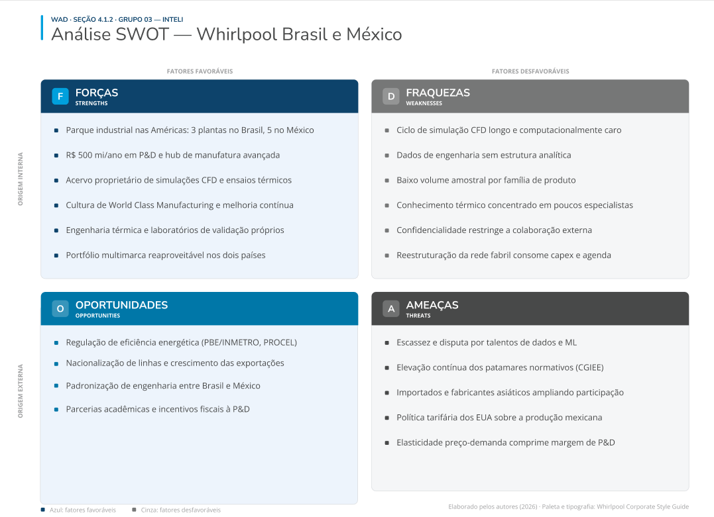
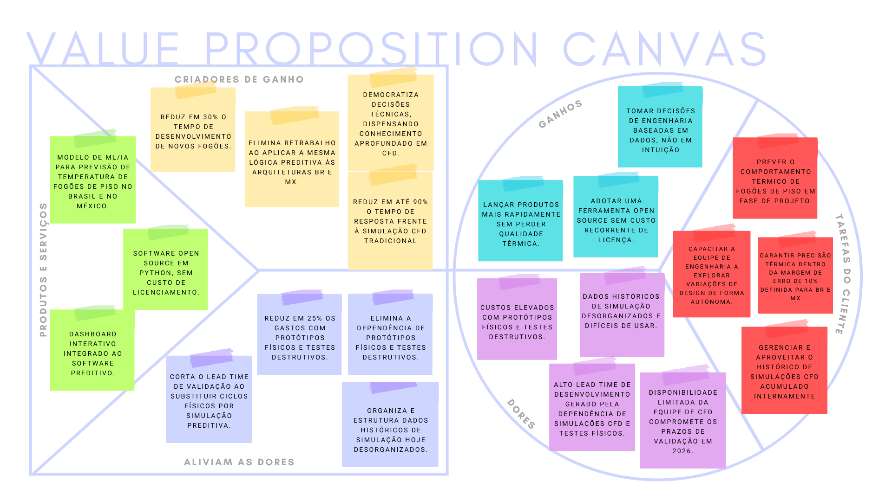

# Documentação Modelo Preditivo - Inteli

```
INSTRUÇÕES GERAIS (remova este trecho ao final)

Você deve editar este documento utilizando notação markdown - siga as convenções neste link 
https://docs.github.com/en/get-started/writing-on-github/getting-started-with-writing-and-formatting-on-github/basic-writing-and-formatting-syntax
```

## Nome da Solução
### Nome do grupo
#### (preencha aqui os nomes dos integrantes, em ordem alfabética, separados por vírgula)

## Sumário
[1. Introdução](#c1)

[2. Objetivos e Justificativa](#c2)

[3. Metodologia](#c3)

[4. Desenvolvimento e Resultados](#c4)

[5. Conclusões e Recomendações](#c5)

[6. Referências](#c6)

[Anexos](#attachments)


## <a name="c1"></a>1. Introdução
```
Apresente de forma sucinta o parceiro de negócio, seu porte, local, área de atuação e posicionamento no mercado. Maiores detalhes deverão ser descritos na seção 4. Descreva resumidamente o problema a ser resolvido (sem ainda mencionar a solução). 

Remova este bloco ao final
```

## <a name="c2"></a>2. Objetivos e Justificativa
### 2.1 Objetivos
```
Descreva resumidamente os objetivos gerais e específicos do seu parceiro de negócios.

Remova este bloco ao final
```

### 2.2 Proposta de solução
```
Descreva resumidamente sua proposta de modelo preditivo e como esse modelo pretende resolver o problema, atendendo os objetivos.

Remova este bloco ao final
```

### 2.3 Justificativa
```
Faça uma breve defesa de sua proposta de solução, escreva sobre seus potenciais, seus benefícios e como ela se diferencia.

Remova este bloco ao final
```

## <a name="c3"></a>3. Metodologia
```
Descreva a metodologia CRISP-DM e suas etapas de desenvolvimento, citando o referencial teórico. Você deve apenas enunciar os métodos, sem dizer ainda como eles foram aplicados, nem quais resultados foram obtidos.

Remova este bloco ao final
```

## <a name="c4"></a>4. Desenvolvimento e Resultados
### 4.1. Compreensão do Problema
#### 4.1.1. Contexto da indústria 

#### 4.1.2. Análise do contexto da Whirlpool segundo as cinco forças de Porter
#### 1. Rivalidade entre concorrentes existentes — Alta
 
A Whirlpool Latin America lidera a região com Brastemp, Consul e KitchenAid, mas opera em um oligopólio fragmentado e ativamente disputado por preço:
 
- **Multinacionais âncora:** Electrolux (europeia, com aposta estratégica declarada no Brasil apesar de tarifas), Mabe (mexicana, com investimento de US$ 668 milhões anunciado para 2025–2027 e liderança em fogões a gás via planta em Durango), BSH/Bosch e Midea (joint-venture sino-americana que se consolidou como terceira força relevante em linha branca).
- **Fabricantes nacionais robustos:** Esmaltec (líder em fogões no Nordeste), Mueller, Britânia, Philco, Atlas e Continental (marca do grupo Mabe).
- **Entrantes chinesas em expansão acelerada:** Hisense, TCL e Gree, competindo agressivamente por preço.
A evidência mais forte de rivalidade intensa é financeira, não anedótica: a compressão de margem EBIT de 6,0% para 3,0% em um ano, atribuída pela própria Whirlpool a "intensidade promocional" no Brasil, mostra uma guerra de preços ativa entre os players estabelecidos — não apenas concorrência latente [GuruFocus, Q2 2026](https://www.gurufocus.com/news/9002695/whirlpool-corp-whr-q2-2026-earnings-call-highlights-strategic-pricing-and-cost-actions-drive-sequential-margin-improvement-amid-market-headwinds). Em 2023, a Whirlpool reportava recuperação de quase 4 pontos de *market share* em refrigeradores, lavadoras e fogões em um único trimestre — o que só é possível em um mercado onde a disputa por participação é constante e o custo de reconquista de posição é alto [Bloomberg Línea, nov/2023](https://www.bloomberglinea.com.br/negocios/whirpool-ve-retomada-da-demanda-e-aposta-em-produtos-para-apartamentos-menores/).
 
O setor de linha branca no Brasil (fogões, lavadoras e geladeiras) recuou 1% em vendas em 2025 segundo a Eletros — um mercado maduro e de crescimento raso intensifica estruturalmente a rivalidade, pois o crescimento de um player passa a depender quase inteiramente da erosão de participação dos concorrentes, não da expansão da demanda agregada.
 
#### 2. Poder de negociação dos fornecedores — Moderado, com concentração pontual em componentes eletrônicos
 
A Whirlpool Latin America mantém uma base ampla de 3.730 fornecedores (750 de materiais diretos, 2.980 de indiretos), concentrados nos estados onde possui plantas — Amazonas, Santa Catarina e São Paulo [Whirlpool Corporation Brasil — Metas de qualidade e sustentabilidade para fornecedores](https://www.whirlpool.com.br/0000/00/whirlpool-apresenta-metas-de-qualidade-e-sustentabilidade-para-fornecedores/). Essa diversificação dilui o poder da maioria dos fornecedores, mas não de forma homogênea entre categorias de insumo:
 
- **Componentes eletrônicos (placas, sensores, semicondutores):** segmento historicamente sujeito a choques globais de oferta, elevando o poder de barganha de fornecedores especializados durante ciclos de escassez — relevante porque a própria estratégia de portfólio da Whirlpool vem incorporando cada vez mais sensores e eletrônica embarcada (ajuste automático de temperatura, detecção de carga em lavadoras), aumentando a dependência da companhia desses insumos [Bloomberg Línea, jan/2026](https://www.bloomberglinea.com.br/negocios/da-geladeira-ao-frigobar-canetas-emagrecedoras-ja-impactam-o-mercado-de-linha-branca/).
- **Aço e insumos de commodity:** menor poder de barganha, dado o caráter padronizado e substituível do material.
- O volume de compra da própria Whirlpool, como maior fabricante de eletrodomésticos da América Latina, gera poder de barganha reverso relevante sobre fornecedores de médio e pequeno porte.
#### 3. Poder de negociação dos compradores — Alto
 
Como o modelo é B2C indireto, o comprador relevante para fins de precificação e condição comercial é o canal varejista, não o consumidor final isolado:
 
- No Brasil, Magazine Luiza e Grupo Casas Bahia (via Via Varejo, ~1.073 lojas) concentram parcela relevante do volume de eletrodomésticos, com lojas físicas ainda decisivas em 87% da jornada de compra.
- É particularmente relevante notar que, entre os grandes varejistas, houve fragilidade financeira recente — Americanas em recuperação judicial e desvalorizações acionárias expressivas de Casas Bahia e Magazine Luiza — o que paradoxalmente pode elevar (não reduzir) o poder de barganha de curto prazo desses varejistas sobre fabricantes, que precisam sustentar volume de giro em parceiros financeiramente fragilizados via condições comerciais mais favoráveis, prazos e ações promocionais conjuntas [Bloomberg Línea, nov/2023](https://www.bloomberglinea.com.br/negocios/whirpool-ve-retomada-da-demanda-e-aposta-em-produtos-para-apartamentos-menores/).
- No México, cadeias como Liverpool e Elektra cumprem função equivalente.
- O consumidor final tem baixo custo de troca entre marcas no segmento econômico, o que reforça o papel do varejo como intermediário capaz de colocar fabricantes concorrentes em disputa direta — best exemplificado pela própria Whirlpool ao reconhecer que "as negociações de preços nunca são fáceis" com os grandes revendedores.
#### 4. Ameaça de novos entrantes — Moderada, em elevação estrutural
 
As barreiras tradicionais de entrada permanecem relevantes — intensidade de capital, certificação regulatória (INMETRO), rede de distribuição consolidada e fidelidade de marca (Brastemp e Consul têm mais de 70 anos de presença regional). Contudo, dois movimentos recentes reduzem a efetividade dessas barreiras:
 
- **Marcas chinesas** (Hisense, TCL, Midea, Gree) expandem agressivamente no varejo brasileiro, em parte redirecionando capacidade excedente originalmente destinada aos EUA em razão de tarifas americanas. Essas marcas entram via importação e parceria de varejo, contornando a barreira histórica de manufatura local — a própria Whirlpool reconhece que a presença chinesa "contribui para aumentar o mercado e expor os diferenciais das marcas", uma leitura que minimiza publicamente uma ameaça que, estruturalmente, é real.
- No México, o boom de *nearshoring* — puxado pelo USMCA e por investimentos como o programa de US$ 668 milhões da Mabe para 2025–2027 — eleva a barreira de entrada para quem não possui planta local, favorecendo incumbentes com operação física estabelecida (caso da própria Whirlpool), mas também sinaliza que o custo de entrada via manufatura doméstica está subindo, o que direciona novos entrantes para a rota de importação — o mesmo caminho já adotado pelas chinesas no Brasil.
#### 5. Ameaça de produtos e comportamentos substitutos — Alta e estruturalmente crescente
 
Esta é a força mais dinâmica e menos óbvia da análise, e onde a leitura simplista ("indução substitui gás") deixa de capturar a real amplitude do fenômeno. Há pelo menos quatro camadas distintas de substituição atuando simultaneamente sobre o portfólio de cocção e refrigeração da Whirlpool na América Latina, com evidência direta de que a própria companhia já reconhece e reage a três delas.
 
**a) Substituição tecnológica intra-categoria — fogão a gás por indução.** A indução deixou de ser artigo de nicho premium e ganha tração em 2026 por eficiência energética, segurança (sem risco de explosão por vazamento) e queda de preço de entrada, com modelos compactos a partir de R$ 180–350. A resposta da própria Whirlpool confirma a materialidade da ameaça: início de produção nacional de fogões por indução em Manaus a partir do segundo semestre de 2026 — uma migração de capacidade fabril, não apenas de portfólio de importação [Jornal do Commercio, 2026](https://jcam.com.br/colunas/whirlpool-acelera-a-era-das-casas-inteligentes-com-nova-linha-de-producao-de-inducao-em-manaus/).
 
**b) *Unbundling* funcional do fogão por eletroportáteis — a air fryer.** Este é o vetor de substituição com a evidência quantitativa mais robusta e o mais subestimado em análises convencionais do setor. A penetração de air fryers nos domicílios brasileiros saltou de 36,2% para 64% entre 2022 e 2025 — o maior avanço percentual entre todas as categorias de eletrodomésticos monitoradas —, com o mercado da categoria crescendo 340% no período. As ocasiões de preparo rápido de refeições já respondem por mais de 30% do total de preparos domésticos, enquanto a fritura tradicional (a função historicamente mais associada ao fogão e ao forno) caiu para 17% das ocasiões, recuo de três pontos percentuais apenas entre 2024 e 2025. Isso não é substituição de compra (o consumidor não deixa de ter fogão), mas substituição de **uso e intensidade de uso**: funções antes concentradas no fogão/forno migram para um eletroportátil dedicado, de ticket médio muito inferior, o que tende a alongar o ciclo de reposição do fogão principal e a pressionar para baixo a demanda por capacidade e robustez térmica do produto principal.
 
**c) Substituição do próprio ato de cozinhar — aplicativos de delivery.** A penetração de pedidos por aplicativo entre consumidores brasileiros passou de 80% em 2020 para 89% em 2022, e "não querer cozinhar" é a motivação declarada por 24% dos usuários — a razão mais citada. O efeito líquido sobre a demanda por eletrodomésticos é ambíguo e deve ser tratado com o devido rigor analítico: o consumo doméstico agregado de alimentos ainda cresceu 3,09% entre 2022 e 2023, sugerindo complementaridade mais do que substituição direta na média da população. Ainda assim, a motivação qualitativa é evidência de uma redução na *frequência* de uso do fogão em parcelas específicas do mercado — sobretudo domicílios urbanos menores e unipessoais —, o que modera, sem eliminar, a demanda por produtos de maior capacidade.
 
**d) Substituição por mudança de hábito alimentar e de moradia — o efeito GLP-1 e a compactação urbana.** Este é o sinal mais recente e mais diretamente confirmado pela própria liderança da Whirlpool no Brasil. Segundo executivos da companhia entrevistados em janeiro de 2026, a disseminação de medicamentos GLP-1 (Ozempic, Mounjaro, Wegovy — cuja importação cresceu 88% em 2025) já altera o padrão de compra de eletrodomésticos: consumidores priorizam freezers maiores para armazenar refeições congeladas em porções menores (*meal prep*) e **migram para fogões menores, com menos bocas** — nas palavras do diretor de marketing de categoria da companhia, "as pessoas não querem mais aqueles fogões enormes". Em resposta direta a esse insight, a Whirlpool renovou por completo as linhas de cooktop de Consul e Brastemp, e reposicionou o frigobar Brastemp Retrô (líder com mais de 50% de participação no segmento de compactos premium) como solução de armazenamento de medicamentos e produtos de skincare fora da cozinha. O relatório *Home Appliances Outlook 2026*, da NielsenIQ, corrobora a tendência em nível setorial: o consumidor latino-americano já prioriza "conveniência, multifuncionalidade e benefícios de saúde e bem-estar" acima de preço puro, com o valor das vendas globais de eletrodomésticos crescendo 5% no primeiro semestre de 2025 mesmo com volume estável (+1%) — evidência de premiumização funcional, não apenas de crescimento de mercado [Bloomberg Línea, jan/2026](https://www.bloomberglinea.com.br/negocios/da-geladeira-ao-frigobar-canetas-emagrecedoras-ja-impactam-o-mercado-de-linha-branca/). Esse mesmo movimento já havia sido antecipado em 2023, quando a Whirlpool declarou apostar em soluções de lavanderia e cocção voltadas a apartamentos de 30–40 m², um "mercado crescente" segundo a própria liderança regional [Bloomberg Línea, 2023](https://www.bloomberglinea.com.br/negocios/whirpool-ve-retomada-da-demanda-e-aposta-em-produtos-para-apartamentos-menores/).

#### 4.1.2. Análise SWOT 
 ### 4.1.2. Análise SWOT
#### Escopo e critério de classificação
 
A análise a seguir tem como unidade de análise a **Whirlpool Latin America**, que corresponde essencialmente às operações de **Brasil e México**. Forças e fraquezas descrevem fatores **internos**, sobre os quais a empresa exerce governança direta (ativos, processos, competências e decisões próprias); oportunidades e ameaças descrevem fatores **externos**, originados em mercado, regulação, concorrência e conjuntura macroeconômica.
 
O recorte adotado é o do **desenvolvimento de produtos de cocção**, com foco na etapa de avaliação térmica por simulação computacional (CFD), ponto do negócio em que a solução deste projeto se insere. Esse recorte é intencional: uma SWOT corporativa genérica produziria fatores válidos, porém pouco acionáveis para as decisões de escopo, dados e modelagem que o grupo precisa tomar.
 
<div align="center">
  <sub>Figura 1 — Matriz SWOT da Solução para Whirlpool Brasil/México </sub><br>
  <br>
  <sup>Fonte: Elaborado pelos autores (2026)</sup>
</div>
---
 
#### Forças (internas)
 
**F1 — Parque industrial integrado nas Américas.** No Brasil, a empresa opera plantas em Joinville (SC), Rio Claro (SP) e Manaus (AM); no México, mantém cinco unidades produtivas — três no campus de Apodaca (Nuevo León), uma em Celaya (Guanajuato) e uma em Ramos Arizpe (Coahuila). O México é descrito pela própria companhia como o terceiro país mais relevante em manufatura do grupo. Essa escala dilui o custo fixo de qualquer investimento em ferramentas de engenharia por um volume muito grande de unidades, tornando economicamente racional desenvolver internamente um modelo preditivo que uma empresa menor não conseguiria justificar.
 
**F2 — Investimento contínuo em P&D e manufatura avançada.** A operação brasileira investe cerca de R$ 500 milhões por ano em pesquisa, desenvolvimento e automação, e inaugurou em Rio Claro um centro de capacitação em manufatura avançada com meta de treinar milhares de profissionais. Há, portanto, orçamento, patrocínio executivo e precedente institucional para adoção de tecnologia digital na engenharia — o que reduz o risco de rejeição cultural da solução.
 
**F3 — Acervo proprietário de simulações CFD e ensaios térmicos.** Anos de simulações numéricas e de medições em bancada sobre os próprios produtos constituem a matéria-prima que viabiliza a abordagem de aprendizado de máquina. Sem histórico de casos já resolvidos por método numérico e validados experimentalmente, não haveria como treinar um modelo substituto. Trata-se de barreira de entrada difícil de replicar por concorrentes sem a mesma longevidade na categoria.
 
**F4 — Cultura de melhoria contínua consolidada (World Class Manufacturing).** A companhia opera sob o modelo WCM, no qual a planta de Ramos Arizpe é referência na América do Norte. Uma organização que já mede, padroniza e audita processos de forma sistemática tende a absorver com menos atrito uma ferramenta que exige disciplina de dados e de versionamento.
 
**F5 — Engenharia térmica e laboratórios de validação próprios.** Equipe especializada em simulação e infraestrutura de ensaio permitem confrontar internamente a saída do modelo com dados reais, encurtando o ciclo de verificação e aumentando a confiabilidade percebida da solução — condição indispensável para que um modelo estatístico seja aceito em um ambiente de engenharia.
 
**F6 — Portfólio multimarca reaproveitável nos dois países.** Com Brastemp, Consul, KitchenAid e Whirlpool, a empresa desenvolve simultaneamente famílias com requisitos térmicos distintos em Brasil e México. Uma ferramenta que acelere a análise térmica é reutilizável em todo esse portfólio, multiplicando o retorno sobre um mesmo esforço de desenvolvimento.
 
#### Fraquezas (internas)
 
**D1 — Ciclo de simulação térmica longo e computacionalmente caro.** A avaliação por CFD exige preparação de malha, processamento em máquinas de alto desempenho e um especialista dedicado por rodada. Na prática, limita o número de alternativas de projeto testáveis dentro do cronograma de um lançamento: a equipe converge para uma solução aceitável em vez de explorar o espaço de projeto até uma solução ótima. É o gargalo central que o projeto endereça.
 
**D2 — Dados de engenharia sem estrutura analítica.** O histórico de simulações não foi gerado com finalidade de modelagem. O material disponibilizado ao grupo apresenta estrutura transposta (variáveis em linhas), colunas com tipos mistos, referências quebradas entre planilhas e ausência de dicionário de dados. Não existe *pipeline* de ingestão nem governança orientada a ML, o que transfere para a etapa de preparação boa parte do esforço do projeto.
 
**D3 — Baixo volume amostral por família de produto.** Como cada registro corresponde a uma simulação custosa, o conjunto disponível é pequeno para os padrões de aprendizado de máquina. Isso restringe a complexidade dos modelos utilizáveis, eleva o risco de sobreajuste e limita a generalização para geometrias e condições de contorno não observadas no treino.
 
**D4 — Conhecimento térmico concentrado em poucos especialistas.** A interpretação dos resultados e o julgamento sobre plausibilidade física dependem de um número reduzido de engenheiros. Além do risco de descontinuidade, há um gargalo de agenda: a validação do modelo compete com as demais demandas dessas mesmas pessoas.
 
**D5 — Confidencialidade restringe a colaboração externa.** Geometrias, materiais e resultados de desempenho são informação concorrencialmente sensível. Isso impõe atrito a iniciativas de inovação aberta — inclusive a este projeto, que precisa conciliar entregas em repositório público com a proteção dos dados do parceiro.
 
**D6 — Reestruturação da rede fabril em curso consome capex e atenção gerencial.** Em 2026 a companhia comunicou ao regulador norte-americano o encerramento gradual de uma de suas plantas em Apodaca até o segundo trimestre de 2027, com custo estimado de reorganização em torno de US$ 165 milhões, como parte de um esforço de otimização da rede global de manufatura. Movimentos dessa natureza deslocam linhas entre plantas, exigem revalidação de produtos e processos e disputam recursos com projetos de inovação — um risco de agenda concreto para a implantação da solução.
 
#### Oportunidades (externas)
 
**O1 — Endurecimento e valorização da regulação de eficiência energética.** O Programa Brasileiro de Etiquetagem do INMETRO abrange, em 2026, dezenas de programas e produtos, e o Selo PROCEL tornou-se critério de decisão de compra e condição de acesso a programas habitacionais públicos. Melhorar classe de eficiência exige otimizar comportamento térmico, e otimizar exige iterar: quem avalia mais alternativas por unidade de tempo tem vantagem direta nesse jogo regulatório.
 
**O2 — Nacionalização de linhas e crescimento das exportações.** A absorção de linhas antes produzidas fora do país, incluindo modelos com padrão construtivo distinto do mercado local, amplia a variedade de produtos desenvolvidos no Brasil. Cada nova configuração é um conjunto adicional de análises térmicas e, portanto, um caso de uso a mais para a ferramenta.
 
**O3 — Padronização de engenharia entre Brasil e México.** Sendo os dois países o núcleo da operação regional, um modelo preditivo validado no Brasil é transferível para o portfólio mexicano com custo marginal baixo. Isso converte uma entrega local em um ativo regional e aumenta significativamente o retorno esperado do projeto.
 
**O4 — Ecossistema acadêmico e incentivos fiscais à P&D.** A proximidade com instituições de ensino e a existência de incentivos à inovação permitem testar hipóteses tecnológicas a custo e risco baixos antes de comprometer recursos internos — modelo do qual este próprio projeto é exemplo. Além do resultado técnico, a parceria dá acesso a métodos e literatura recentes sobre modelos substitutos aplicados à engenharia, área que amadureceu rapidamente e cujo custo de adoção vem caindo.
 
#### Ameaças (externas)
 
**A1 — Escassez e disputa por talentos de dados e aprendizado de máquina.** A sustentação da solução após a entrega depende de profissionais capazes de monitorar, retreinar e evoluir o modelo. Esse perfil é disputado por setores que remuneram acima da média da indústria, o que representa risco direto de continuidade para qualquer iniciativa de ML internalizada.
 
**A2 — Elevação contínua dos patamares normativos de eficiência e segurança.** Resoluções do CGIEE e revisões das portarias do INMETRO alteram periodicamente os requisitos mínimos. Erro de previsão térmica em fase de projeto pode gerar reprovação em certificação, retrabalho, atraso de lançamento ou, no limite, risco de campo.
 
**A3 — Avanço de importados e de fabricantes asiáticos.** A participação de produtos importados permanece elevada em vários segmentos do mercado interno, e concorrentes como Samsung, LG e Midea operam com estruturas de P&D de escala global — inclusive com capacidade de internalizar antes ferramentas de simulação acelerada. A pressão competitiva encurta janelas de lançamento e reduz a tolerância a ciclos longos de desenvolvimento.
 
**A4 — Exposição da produção mexicana à política tarifária dos Estados Unidos.** A planta de Ramos Arizpe destina a quase totalidade de sua produção aos mercados norte-americanos. Alterações tarifárias ou de regras de origem afetam diretamente a rentabilidade da operação regional e podem redirecionar prioridades de investimento — inclusive as de engenharia.
 
**A5 — Elasticidade preço-demanda comprimindo a margem disponível para P&D.** Levantamentos setoriais indicam que cada 1% de aumento de custo se traduz em queda de 0,7% a 1% na demanda por eletrodomésticos. Em ambiente de juros elevados e confiança do consumidor oscilante, sobra pouco espaço para repassar custos, o que expõe orçamentos de engenharia a corte.
 
---
 
#### Estratégias derivadas do cruzamento (matriz TOWS)
 
A matriz por si só é descritiva; o valor analítico está no cruzamento entre os fatores internos e externos. As quatro combinações abaixo indicam como a solução proposta neste projeto se posiciona.
 
| | **Forças (F)** | **Fraquezas (D)** |
|:---|:---|:---|
| **Oportunidades (O)** | **FO — ofensiva:** usar o acervo de simulações (F3) e a capacidade de validação própria (F5) para varrer rapidamente configurações de projeto e maximizar classe de eficiência energética (O1) antes de comprometer horas de CFD; estender o mesmo ativo às novas linhas nacionalizadas (O2) e ao portfólio mexicano (O3), transformando uma entrega local em ferramenta regional. | **DO — reforço:** aproveitar a parceria acadêmica e os incentivos à P&D (O4) para atacar as fraquezas de dados: estruturar dicionário de dados, padronizar a saída das simulações e planejar novas rodadas por delineamento de experimentos (DOE) nas regiões em que o modelo apresentar maior incerteza — convertendo o custo do CFD em investimento dirigido (D2, D3). |
| **Ameaças (A)** | **FA — confronto:** empregar escala industrial (F1), cultura de melhoria contínua (F4) e engenharia própria (F5) para encurtar o ciclo concepção-validação e responder ao encurtamento das janelas de lançamento imposto pela concorrência (A3), preservando margem em um cenário de repasse de custo limitado (A5). Manter o desenvolvimento internamente também mitiga exposição de propriedade intelectual. | **DA — defensiva:** posicionar o modelo como ferramenta de **triagem e priorização**, não como substituto do CFD na homologação — reportando faixa de erro explícita e definindo critério objetivo de escalonamento para simulação completa, o que limita o risco normativo (A2). Documentar o *pipeline* e automatizar o retreino reduz simultaneamente a dependência de especialistas (D4) e a exposição à rotatividade de talentos (A1). |
 
#### Implicação para o projeto
 
O cruzamento indica que o principal gargalo interno da Whirlpool no escopo analisado — o custo e a lentidão do ciclo de simulação térmica (D1) — coincide com o ponto em que as pressões externas mais crescem: exigência regulatória de eficiência (O1, A2), concorrência acelerada (A3) e necessidade de desenvolver mais variantes de produto por período (O2, O3). Simultaneamente, a empresa detém justamente os ativos necessários para atacar esse gargalo: acervo histórico de simulações (F3), engenharia térmica própria (F5) e orçamento de P&D consolidado (F2).
 
A solução proposta neste projeto — um modelo de aprendizado de máquina que estima a temperatura de componentes térmicos como alternativa rápida ao CFD — atua precisamente nessa interseção, convertendo uma fraqueza operacional em capacidade de resposta às oportunidades e ameaças do mercado. A principal condicionante de sucesso, evidenciada pela própria análise, **não é de natureza algorítmica, mas de qualidade e volume de dados** (D2 e D3), o que justifica a prioridade das etapas de estruturação do dataset no cronograma do projeto.
 
#### Limitações da análise
 
Três ressalvas devem acompanhar a leitura desta seção. Primeiro, os fatores internos relativos a dados e à concentração de conhecimento foram **inferidos a partir do material disponibilizado ao grupo** e da interação com o parceiro, não de auditoria formal, carecem de validação com o time de engenharia. Segundo, a seleção dos fatores reflete o recorte declarado no início da seção: elementos de alto impacto corporativo mas sem conexão com a etapa de simulação térmica foram deliberadamente deixados de fora. Terceiro, os dados externos referem-se ao período até meados de 2026 e o setor é sensível a juros, câmbio e política comercial, de modo que a análise deve ser revisitada ao longo do projeto.


#### 4.1.3. Planejamento Geral da Solução
```
a) quais os dados disponíveis (fonte e conteúdo - exemplo: dados da área de Compras da empresa descrevendo seus fornecedores).
b) qual a solução proposta (pode ser um resumo do texto da Seção 2.2).
c) como a solução proposta deverá ser utilizada.
d) quais os benefícios trazidos pela solução proposta.
e) qual será o critério de sucesso.

Remova este bloco ao final
```

#### 4.1.4. Value Proposition Canvas

<div align="center">
  <sub>Figura 1 - Canvas de Proposta de Valor da Whirlpool</sub><br>
  <br>
  <sup>Fonte: Autores, 2026.</sup>
</div>

**Produtos e Serviços**
O bloco reúne os três entregáveis definidos: o modelo preditivo de Machine Learning, o software distribuído em formato open source e o dashboard interativo.

**Criadores de Ganho**
Os indicadores de 90% de eficiência frente à simulação tradicional e de 30% de redução no tempo de desenvolvimento foram priorizados por representarem metas quantificadas, conferindo à proposta de valor um caráter mensurável e verificável. Os dois criadores adicionais, referentes à eliminação de retrabalho entre as arquiteturas de mercado (Brasil e México) e à democratização de decisões técnicas, derivam logicamente do desenho da solução: como um único modelo preditivo atende a duas arquiteturas distintas, o reaproveitamento da lógica preditiva representa um ganho de eficiência inerente à arquitetura da solução, ainda que não tenha sido formalmente quantificado no escopo original.

**Aliviadores de Dor**
Este bloco apresenta a maior aderência ao problema central do projeto, uma vez que endereça diretamente os dois fatores que motivam a iniciativa: o alto custo operacional e o extenso time associados à dependência de protótipos físicos e testes destrutivos. Cada aliviador foi redigido como resposta objetiva a esses fatores: redução de custo, eliminação da dependência física, compressão do tempo de validação e reorganização de dados históricos, esta última voltada a mitigar o risco de inconsistência de dados identificado na fase de planejamento do projeto.

**Ganhos do Cliente**
A construção deste bloco exigiu maior grau de inferência. A tradução do objetivo técnico em ganho estratégico segue a lógica de que uma previsão térmica confiável viabiliza o lançamento de produtos em menor tempo sem comprometer a qualidade. O ganho relacionado à ausência de custo recorrente de licenciamento obriga a tecnologia ser open source, em benefício percebido pelo cliente, alinhando a exigência técnica a uma vantagem competitiva de negócio.

**Dores do Cliente**
O bloco distingue-se dos aliviadores por descrever a dor sob a perspectiva do cliente, e não da solução proposta. Duas dores refletem diretamente o problema central do projeto (lead time elevado e custo de prototipagem física); as demais decorrem de riscos operacionais específicos identificados na fase de planejamento. A opção por ancorar essas dores em riscos reais do projeto, em vez de dores genéricas de mercado, confere maior credibilidade e rastreabilidade ao canvas.

**Tarefas do Cliente**
A tarefa relacionada à precisão térmica dentro da margem de 10% é o item de maior relevância em todo o canvas, pois corresponde ao critério que determinará, de forma mensurável, o sucesso ou insucesso da solução desenvolvida.

#### 4.1.5. Matriz de Riscos
```
Posicione aqui sua matriz.

Remova este bloco ao final
```

#### 4.1.6. Personas

As personas são representações fictícias dos diferentes perfis de usuários e pessoas
impactadas por uma solução. Elas funcionam como um guia para lembrar para quem o
produto está sendo desenvolvido e quem pode ser afetado por ele, orientando as
decisões de projeto a partir das necessidades, dores e objetivos reais desses perfis.

Para o Thermal Predictor, estamos usando proto-personas (suposições embasadas),
definidas com base no entendimento atual do problema e nos diferentes papéis que se
relacionam com a solução: o Engenheiro de Materiais, a Qualidade, o Design e o Marketing.


<div align="center">
  <sub>Figura 1 - Persona: Engenheira de Materiais</sub><br>
  <br>
  <sup>Fonte: Autores, 2026.</sup>
</div>

A persona de Estela foi escolhida, pois representa um dos cargos principais pelas decisões que o Thermal Predictor visa otimizar, levando em consideração que a validação de materiais depende diretamente da temperatura que cada componente vai atingir em uso. 
A escolha do material para os fogões está diretamente ligado com o projeto. Ela será quem utilizará as previsões do modelo para decidir se um material resiste termicamente ao ponto de ser aprovado, sem precisar esperar por um protótipo físico ou um teste destrutivo para confirmar essa informação. 
Diferente de outras personas que se relacionam com a solução de forma indireta, o Engenheiro de Materiais toma decisões técnicas a partir do resultado da previsão, sendo diretamente impactado pela margem de erro do modelo. Portanto, se trata da persona que representa o ganho central do projeto, cuja é substituir a dependência de testes físicos demorados e caros por uma validação rápida e confiável.


Esta persona foi escolhida porque o dashboard é um dos principais entregáveis do
Thermal Predictor, e a designer de interface é a responsável por mantê-lo e
atualizá-lo, garantindo que as previsões do modelo sejam apresentadas em telas
claras e confiáveis para os usuários. Embora a construção inicial do dashboard seja
feita pela equipe de desenvolvimento e ela não utilize as previsões para tomar
decisões, é uma persona importante porque assegura que os resultados do modelo
continuem sendo apresentados de forma compreensível e que gerem confiança em quem
consome a informação. É, portanto, a persona que garante a usabilidade e a adoção
contínua da solução.


#### 4.1.7. Jornadas do Usuário
```
Posicione aqui seus mapas de jornadas do usuário que utiliza o modelo.

Remova este bloco ao final
```

#### 4.1.8 Política de Privacidade
```
Posicione aqui sua política de privacidade em acordo com a LGPD

Remova este bloco ao final
```

### 4.2. Compreensão dos Dados

#### 4.2.1. Exploração de dados
```
Apresentar a estatística descritiva básica de cada coluna, identificar se a coluna é numérica ou categórica e pelo menos 3 gráficos para visualizar a relação entre colunas escolhidas pelo grupo.

Remova este bloco ao final
```

#### 4.2.2. Pré-processamento dos dados
```
Apresentar quais foram as ações realizadas de limpeza (tratamento de missing values e remoção de outliers) e transformação (normalização e codificação) das colunas. Se houverem outliers, cite quais são e qual(is) correção(ões) será(ão) aplicada(s).

Remova este bloco ao final
```

#### 4.2.3. Hipóteses
```
Descreva três hipóteses sobre a relação dos dados e o problema. Justifique cada uma delas. 

Remova este bloco ao final
```

### 4.3. Preparação dos Dados e Modelagem
```
Caso seu projeto seja Modelo Supervisionado, apresentar: 
a) Organização dos dados (conjunto de treinamento, validação e testes)
b) Modelagem para o problema (proposta de features com a explicação completa da linha de raciocínio).
c) Métricas relacionadas ao modelo (pelo menos 3).
d) Apresentar o primeiro modelo candidato, e uma discussão sobre os resultados deste modelo (discussão sobre as métricas para esse modelo candidato).

Caso seu projeto seja Modelo Não-Supervisionado, apresentar:
a) Modelagem para o problema (proposta de features com a explicação completa da linha de raciocínio).
b) Primeiro modelo candidato para o problema.
c) Justificativa para a definição do K do modelo.
d) Escolha de um tipo de sistema de recomendação e a justificativa para essa escolha.

Remova este bloco ao final
```

### 4.4. Comparação de Modelos
```
- Descrever e justificar a escolha da métrica de avaliação dos modelos com base no que é mais importante para o problema ao 
  se medir a qualidade desses modelos;
- Descrever ao menos três modelos candidatos, seus respectivos algoritmos, seus tunings de hiperparâmetros e suas métricas 
  alcançadas;

Remova este bloco ao final
```

### 4.5. Avaliação
```
- Descreva a solução final de modelo preditivo e justifique a escolha. Alinhe sua justificativa com a Seção 4.1, resgatando o entendimento 
  do negócio e das personas, explicando de que formas seu modelo atende os requisitos e definições. 
- Descreva também um plano de contingência para os casos em que o modelo falhar em suas predições.
- Além disso, discuta sobre a explicabilidade do modelo (se aplicável) e realize a verificação de aceitação ou refutação das hipóteses.
- Se aplicável, utilize equações, tabelas e gráficos de visualização de dados para melhor ilustrar seus argumentos. 

Remova este bloco ao final
```

## <a name="c5"></a>5. Conclusões e Recomendações
```
Escreva, de forma resumida, sobre os principais resultados do seu projeto e faça recomendações formais ao seu parceiro de negócios em relação ao uso desse modelo. Você pode aproveitar este espaço para comentar sobre possíveis materiais extras, como um manual de usuário mais detalhado na seção “Anexos”. Não se esqueça também das pessoas que serão potencialmente afetadas pelas decisões do modelo preditivo e elabore recomendações que ajudem seu parceiro a tratá-las de maneira estratégica e ética. 

Remova este bloco ao final
```

## <a name="c6"></a>6. Referências

- BLOOMBERG LÍNEA. *Whirlpool inaugura hub de inovação em Rio Claro e vê novo impulso para vendas.* Disponível em: https://www.bloomberglinea.com.br/negocios/whirlpool-inaugura-hub-de-inovacao-em-rio-claro-e-ve-novo-impulso-para-vendas/
- BLOOMBERG LÍNEA. *Whirlpool vê salto de exportação à Argentina com fábrica em Rio Claro.* Disponível em: https://www.bloomberglinea.com.br/negocios/whirlpool-ve-salto-de-exportacao-a-argentina-com-fabrica-em-rio-claro-afirma-vp/
- MEXICOINDUSTRY. *Whirlpool Ramos Arizpe.* Disponível em: https://mexicoindustry.com/hecho-en-mexico/whirlpool-ramos-arizpe-producen-los-refrigeradores-que-llegan-hasta-los-hogares-de-estados-unidos-
- XATAKA MÉXICO. *Whirlpool cerrará una planta en México.* Disponível em: https://www.xataka.com.mx/empresas-y-economia/whirlpool-quiere-fabricar-refrigeradores-forma-barata-eso-cerrara-planta-mexico
- INMETRO. *Programa Brasileiro de Etiquetagem (PBE) / ENCE.* Base legal: Lei nº 10.295/2001 e Decreto nº 9.864/2019.
- ELETROS — Associação Nacional de Fabricantes de Produtos Eletroeletrônicos. Dados setoriais de linha branca.
- WHIRLPOOL CORPORATION. *Corporate Style Guide.* Disponível em: https://style.whirlpoolcorp.com

## <a name="attachments"></a>Anexos
```
Utilize esta seção para anexar materiais como manuais de usuário, documentos complementares que ficaram grandes e não couberam no corpo do texto etc.

Remova este bloco ao final
```
