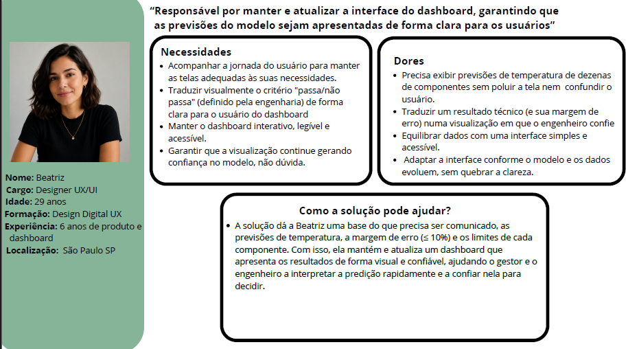

# Documentação Modelo Preditivo - Inteli

```
INSTRUÇÕES GERAIS (remova este trecho ao final)

Você deve editar este documento utilizando notação markdown - siga as convenções neste link 
https://docs.github.com/en/get-started/writing-on-github/getting-started-with-writing-and-formatting-on-github/basic-writing-and-formatting-syntax
```

## Nome da Solução
### Nome do grupo
#### (preencha aqui os nomes dos integrantes, em ordem alfabética, separados por vírgula)

## Sumário
[1. Introdução](#c1)

[2. Objetivos e Justificativa](#c2)

[3. Metodologia](#c3)

[4. Desenvolvimento e Resultados](#c4)

[5. Conclusões e Recomendações](#c5)

[6. Referências](#c6)

[Anexos](#attachments)


## <a name="c1"></a>1. Introdução
```
Apresente de forma sucinta o parceiro de negócio, seu porte, local, área de atuação e posicionamento no mercado. Maiores detalhes deverão ser descritos na seção 4. Descreva resumidamente o problema a ser resolvido (sem ainda mencionar a solução). 

Remova este bloco ao final
```

## <a name="c2"></a>2. Objetivos e Justificativa
### 2.1 Objetivos
```
Descreva resumidamente os objetivos gerais e específicos do seu parceiro de negócios.

Remova este bloco ao final
```

### 2.2 Proposta de solução
```
Descreva resumidamente sua proposta de modelo preditivo e como esse modelo pretende resolver o problema, atendendo os objetivos.

Remova este bloco ao final
```

### 2.3 Justificativa
```
Faça uma breve defesa de sua proposta de solução, escreva sobre seus potenciais, seus benefícios e como ela se diferencia.

Remova este bloco ao final
```

## <a name="c3"></a>3. Metodologia
```
Descreva a metodologia CRISP-DM e suas etapas de desenvolvimento, citando o referencial teórico. Você deve apenas enunciar os métodos, sem dizer ainda como eles foram aplicados, nem quais resultados foram obtidos.

Remova este bloco ao final
```

## <a name="c4"></a>4. Desenvolvimento e Resultados
### 4.1. Compreensão do Problema
#### 4.1.1. Contexto da indústria 

#### 4.1.2. Análise do contexto da Whirlpool segundo as cinco forças de Porter
#### 1. Rivalidade entre concorrentes existentes — Alta
 
A Whirlpool Latin America lidera a região com Brastemp, Consul e KitchenAid, mas opera em um oligopólio fragmentado e ativamente disputado por preço:
 
- **Multinacionais âncora:** Electrolux (europeia, com aposta estratégica declarada no Brasil apesar de tarifas), Mabe (mexicana, com investimento de US$ 668 milhões anunciado para 2025–2027 e liderança em fogões a gás via planta em Durango), BSH/Bosch e Midea (joint-venture sino-americana que se consolidou como terceira força relevante em linha branca).
- **Fabricantes nacionais robustos:** Esmaltec (líder em fogões no Nordeste), Mueller, Britânia, Philco, Atlas e Continental (marca do grupo Mabe).
- **Entrantes chinesas em expansão acelerada:** Hisense, TCL e Gree, competindo agressivamente por preço.
A evidência mais forte de rivalidade intensa é financeira, não anedótica: a compressão de margem EBIT de 6,0% para 3,0% em um ano, atribuída pela própria Whirlpool a "intensidade promocional" no Brasil, mostra uma guerra de preços ativa entre os players estabelecidos — não apenas concorrência latente [GuruFocus, Q2 2026](https://www.gurufocus.com/news/9002695/whirlpool-corp-whr-q2-2026-earnings-call-highlights-strategic-pricing-and-cost-actions-drive-sequential-margin-improvement-amid-market-headwinds). Em 2023, a Whirlpool reportava recuperação de quase 4 pontos de *market share* em refrigeradores, lavadoras e fogões em um único trimestre — o que só é possível em um mercado onde a disputa por participação é constante e o custo de reconquista de posição é alto [Bloomberg Línea, nov/2023](https://www.bloomberglinea.com.br/negocios/whirpool-ve-retomada-da-demanda-e-aposta-em-produtos-para-apartamentos-menores/).
 
O setor de linha branca no Brasil (fogões, lavadoras e geladeiras) recuou 1% em vendas em 2025 segundo a Eletros — um mercado maduro e de crescimento raso intensifica estruturalmente a rivalidade, pois o crescimento de um player passa a depender quase inteiramente da erosão de participação dos concorrentes, não da expansão da demanda agregada.
 
#### 2. Poder de negociação dos fornecedores — Moderado, com concentração pontual em componentes eletrônicos
 
A Whirlpool Latin America mantém uma base ampla de 3.730 fornecedores (750 de materiais diretos, 2.980 de indiretos), concentrados nos estados onde possui plantas — Amazonas, Santa Catarina e São Paulo [Whirlpool Corporation Brasil — Metas de qualidade e sustentabilidade para fornecedores](https://www.whirlpool.com.br/0000/00/whirlpool-apresenta-metas-de-qualidade-e-sustentabilidade-para-fornecedores/). Essa diversificação dilui o poder da maioria dos fornecedores, mas não de forma homogênea entre categorias de insumo:
 
- **Componentes eletrônicos (placas, sensores, semicondutores):** segmento historicamente sujeito a choques globais de oferta, elevando o poder de barganha de fornecedores especializados durante ciclos de escassez — relevante porque a própria estratégia de portfólio da Whirlpool vem incorporando cada vez mais sensores e eletrônica embarcada (ajuste automático de temperatura, detecção de carga em lavadoras), aumentando a dependência da companhia desses insumos [Bloomberg Línea, jan/2026](https://www.bloomberglinea.com.br/negocios/da-geladeira-ao-frigobar-canetas-emagrecedoras-ja-impactam-o-mercado-de-linha-branca/).
- **Aço e insumos de commodity:** menor poder de barganha, dado o caráter padronizado e substituível do material.
- O volume de compra da própria Whirlpool, como maior fabricante de eletrodomésticos da América Latina, gera poder de barganha reverso relevante sobre fornecedores de médio e pequeno porte.
#### 3. Poder de negociação dos compradores — Alto
 
Como o modelo é B2C indireto, o comprador relevante para fins de precificação e condição comercial é o canal varejista, não o consumidor final isolado:
 
- No Brasil, Magazine Luiza e Grupo Casas Bahia (via Via Varejo, ~1.073 lojas) concentram parcela relevante do volume de eletrodomésticos, com lojas físicas ainda decisivas em 87% da jornada de compra.
- É particularmente relevante notar que, entre os grandes varejistas, houve fragilidade financeira recente — Americanas em recuperação judicial e desvalorizações acionárias expressivas de Casas Bahia e Magazine Luiza — o que paradoxalmente pode elevar (não reduzir) o poder de barganha de curto prazo desses varejistas sobre fabricantes, que precisam sustentar volume de giro em parceiros financeiramente fragilizados via condições comerciais mais favoráveis, prazos e ações promocionais conjuntas [Bloomberg Línea, nov/2023](https://www.bloomberglinea.com.br/negocios/whirpool-ve-retomada-da-demanda-e-aposta-em-produtos-para-apartamentos-menores/).
- No México, cadeias como Liverpool e Elektra cumprem função equivalente.
- O consumidor final tem baixo custo de troca entre marcas no segmento econômico, o que reforça o papel do varejo como intermediário capaz de colocar fabricantes concorrentes em disputa direta — best exemplificado pela própria Whirlpool ao reconhecer que "as negociações de preços nunca são fáceis" com os grandes revendedores.
#### 4. Ameaça de novos entrantes — Moderada, em elevação estrutural
 
As barreiras tradicionais de entrada permanecem relevantes — intensidade de capital, certificação regulatória (INMETRO), rede de distribuição consolidada e fidelidade de marca (Brastemp e Consul têm mais de 70 anos de presença regional). Contudo, dois movimentos recentes reduzem a efetividade dessas barreiras:
 
- **Marcas chinesas** (Hisense, TCL, Midea, Gree) expandem agressivamente no varejo brasileiro, em parte redirecionando capacidade excedente originalmente destinada aos EUA em razão de tarifas americanas. Essas marcas entram via importação e parceria de varejo, contornando a barreira histórica de manufatura local — a própria Whirlpool reconhece que a presença chinesa "contribui para aumentar o mercado e expor os diferenciais das marcas", uma leitura que minimiza publicamente uma ameaça que, estruturalmente, é real.
- No México, o boom de *nearshoring* — puxado pelo USMCA e por investimentos como o programa de US$ 668 milhões da Mabe para 2025–2027 — eleva a barreira de entrada para quem não possui planta local, favorecendo incumbentes com operação física estabelecida (caso da própria Whirlpool), mas também sinaliza que o custo de entrada via manufatura doméstica está subindo, o que direciona novos entrantes para a rota de importação — o mesmo caminho já adotado pelas chinesas no Brasil.
#### 5. Ameaça de produtos e comportamentos substitutos — Alta e estruturalmente crescente
 
Esta é a força mais dinâmica e menos óbvia da análise, e onde a leitura simplista ("indução substitui gás") deixa de capturar a real amplitude do fenômeno. Há pelo menos quatro camadas distintas de substituição atuando simultaneamente sobre o portfólio de cocção e refrigeração da Whirlpool na América Latina, com evidência direta de que a própria companhia já reconhece e reage a três delas.
 
**a) Substituição tecnológica intra-categoria — fogão a gás por indução.** A indução deixou de ser artigo de nicho premium e ganha tração em 2026 por eficiência energética, segurança (sem risco de explosão por vazamento) e queda de preço de entrada, com modelos compactos a partir de R$ 180–350. A resposta da própria Whirlpool confirma a materialidade da ameaça: início de produção nacional de fogões por indução em Manaus a partir do segundo semestre de 2026 — uma migração de capacidade fabril, não apenas de portfólio de importação [Jornal do Commercio, 2026](https://jcam.com.br/colunas/whirlpool-acelera-a-era-das-casas-inteligentes-com-nova-linha-de-producao-de-inducao-em-manaus/).
 
**b) *Unbundling* funcional do fogão por eletroportáteis — a air fryer.** Este é o vetor de substituição com a evidência quantitativa mais robusta e o mais subestimado em análises convencionais do setor. A penetração de air fryers nos domicílios brasileiros saltou de 36,2% para 64% entre 2022 e 2025 — o maior avanço percentual entre todas as categorias de eletrodomésticos monitoradas —, com o mercado da categoria crescendo 340% no período. As ocasiões de preparo rápido de refeições já respondem por mais de 30% do total de preparos domésticos, enquanto a fritura tradicional (a função historicamente mais associada ao fogão e ao forno) caiu para 17% das ocasiões, recuo de três pontos percentuais apenas entre 2024 e 2025. Isso não é substituição de compra (o consumidor não deixa de ter fogão), mas substituição de **uso e intensidade de uso**: funções antes concentradas no fogão/forno migram para um eletroportátil dedicado, de ticket médio muito inferior, o que tende a alongar o ciclo de reposição do fogão principal e a pressionar para baixo a demanda por capacidade e robustez térmica do produto principal.
 
**c) Substituição do próprio ato de cozinhar — aplicativos de delivery.** A penetração de pedidos por aplicativo entre consumidores brasileiros passou de 80% em 2020 para 89% em 2022, e "não querer cozinhar" é a motivação declarada por 24% dos usuários — a razão mais citada. O efeito líquido sobre a demanda por eletrodomésticos é ambíguo e deve ser tratado com o devido rigor analítico: o consumo doméstico agregado de alimentos ainda cresceu 3,09% entre 2022 e 2023, sugerindo complementaridade mais do que substituição direta na média da população. Ainda assim, a motivação qualitativa é evidência de uma redução na *frequência* de uso do fogão em parcelas específicas do mercado — sobretudo domicílios urbanos menores e unipessoais —, o que modera, sem eliminar, a demanda por produtos de maior capacidade.
 
**d) Substituição por mudança de hábito alimentar e de moradia — o efeito GLP-1 e a compactação urbana.** Este é o sinal mais recente e mais diretamente confirmado pela própria liderança da Whirlpool no Brasil. Segundo executivos da companhia entrevistados em janeiro de 2026, a disseminação de medicamentos GLP-1 (Ozempic, Mounjaro, Wegovy — cuja importação cresceu 88% em 2025) já altera o padrão de compra de eletrodomésticos: consumidores priorizam freezers maiores para armazenar refeições congeladas em porções menores (*meal prep*) e **migram para fogões menores, com menos bocas** — nas palavras do diretor de marketing de categoria da companhia, "as pessoas não querem mais aqueles fogões enormes". Em resposta direta a esse insight, a Whirlpool renovou por completo as linhas de cooktop de Consul e Brastemp, e reposicionou o frigobar Brastemp Retrô (líder com mais de 50% de participação no segmento de compactos premium) como solução de armazenamento de medicamentos e produtos de skincare fora da cozinha. O relatório *Home Appliances Outlook 2026*, da NielsenIQ, corrobora a tendência em nível setorial: o consumidor latino-americano já prioriza "conveniência, multifuncionalidade e benefícios de saúde e bem-estar" acima de preço puro, com o valor das vendas globais de eletrodomésticos crescendo 5% no primeiro semestre de 2025 mesmo com volume estável (+1%) — evidência de premiumização funcional, não apenas de crescimento de mercado [Bloomberg Línea, jan/2026](https://www.bloomberglinea.com.br/negocios/da-geladeira-ao-frigobar-canetas-emagrecedoras-ja-impactam-o-mercado-de-linha-branca/). Esse mesmo movimento já havia sido antecipado em 2023, quando a Whirlpool declarou apostar em soluções de lavanderia e cocção voltadas a apartamentos de 30–40 m², um "mercado crescente" segundo a própria liderança regional [Bloomberg Línea, 2023](https://www.bloomberglinea.com.br/negocios/whirpool-ve-retomada-da-demanda-e-aposta-em-produtos-para-apartamentos-menores/).

#### 4.1.2. Análise SWOT 
```
Posicione aqui sua análise SWOT.

Remova este bloco ao final
```

#### 4.1.3. Planejamento Geral da Solução
```
a) quais os dados disponíveis (fonte e conteúdo - exemplo: dados da área de Compras da empresa descrevendo seus fornecedores).
b) qual a solução proposta (pode ser um resumo do texto da Seção 2.2).
c) como a solução proposta deverá ser utilizada.
d) quais os benefícios trazidos pela solução proposta.
e) qual será o critério de sucesso.

Remova este bloco ao final
```

#### 4.1.4. Value Proposition Canvas
```
Posicione aqui seu canvas.

Remova este bloco ao final
```

#### 4.1.5. Matriz de Riscos
```
Posicione aqui sua matriz.

Remova este bloco ao final
```

#### 4.1.6. Personas

As personas são representações fictícias dos diferentes perfis de usuários e pessoas
impactadas por uma solução. Elas funcionam como um guia para lembrar para quem o
produto está sendo desenvolvido e quem pode ser afetado por ele, orientando as
decisões de projeto a partir das necessidades, dores e objetivos reais desses perfis.

Para o Thermal Predictor, estamos usando proto-personas (suposições embasadas),
definidas com base no entendimento atual do problema e nos diferentes papéis que se
relacionam com a solução: o Engenheiro de Materiais, a Qualidade, o Design e o Marketing.




Esta persona foi escolhida porque o dashboard é um dos principais entregáveis do
Thermal Predictor, e a designer de interface é a responsável por mantê-lo e
atualizá-lo, garantindo que as previsões do modelo sejam apresentadas em telas
claras e confiáveis para os usuários. Embora a construção inicial do dashboard seja
feita pela equipe de desenvolvimento e ela não utilize as previsões para tomar
decisões, é uma persona importante porque assegura que os resultados do modelo
continuem sendo apresentados de forma compreensível e que gerem confiança em quem
consome a informação. É, portanto, a persona que garante a usabilidade e a adoção
contínua da solução.


#### 4.1.7. Jornadas do Usuário
```
Posicione aqui seus mapas de jornadas do usuário que utiliza o modelo.

Remova este bloco ao final
```

#### 4.1.8 Política de Privacidade
```
Posicione aqui sua política de privacidade em acordo com a LGPD

Remova este bloco ao final
```

### 4.2. Compreensão dos Dados

#### 4.2.1. Exploração de dados
```
Apresentar a estatística descritiva básica de cada coluna, identificar se a coluna é numérica ou categórica e pelo menos 3 gráficos para visualizar a relação entre colunas escolhidas pelo grupo.

Remova este bloco ao final
```

#### 4.2.2. Pré-processamento dos dados
```
Apresentar quais foram as ações realizadas de limpeza (tratamento de missing values e remoção de outliers) e transformação (normalização e codificação) das colunas. Se houverem outliers, cite quais são e qual(is) correção(ões) será(ão) aplicada(s).

Remova este bloco ao final
```

#### 4.2.3. Hipóteses
```
Descreva três hipóteses sobre a relação dos dados e o problema. Justifique cada uma delas. 

Remova este bloco ao final
```

### 4.3. Preparação dos Dados e Modelagem
```
Caso seu projeto seja Modelo Supervisionado, apresentar: 
a) Organização dos dados (conjunto de treinamento, validação e testes)
b) Modelagem para o problema (proposta de features com a explicação completa da linha de raciocínio).
c) Métricas relacionadas ao modelo (pelo menos 3).
d) Apresentar o primeiro modelo candidato, e uma discussão sobre os resultados deste modelo (discussão sobre as métricas para esse modelo candidato).

Caso seu projeto seja Modelo Não-Supervisionado, apresentar:
a) Modelagem para o problema (proposta de features com a explicação completa da linha de raciocínio).
b) Primeiro modelo candidato para o problema.
c) Justificativa para a definição do K do modelo.
d) Escolha de um tipo de sistema de recomendação e a justificativa para essa escolha.

Remova este bloco ao final
```

### 4.4. Comparação de Modelos
```
- Descrever e justificar a escolha da métrica de avaliação dos modelos com base no que é mais importante para o problema ao 
  se medir a qualidade desses modelos;
- Descrever ao menos três modelos candidatos, seus respectivos algoritmos, seus tunings de hiperparâmetros e suas métricas 
  alcançadas;

Remova este bloco ao final
```

### 4.5. Avaliação
```
- Descreva a solução final de modelo preditivo e justifique a escolha. Alinhe sua justificativa com a Seção 4.1, resgatando o entendimento 
  do negócio e das personas, explicando de que formas seu modelo atende os requisitos e definições. 
- Descreva também um plano de contingência para os casos em que o modelo falhar em suas predições.
- Além disso, discuta sobre a explicabilidade do modelo (se aplicável) e realize a verificação de aceitação ou refutação das hipóteses.
- Se aplicável, utilize equações, tabelas e gráficos de visualização de dados para melhor ilustrar seus argumentos. 

Remova este bloco ao final
```

## <a name="c5"></a>5. Conclusões e Recomendações
```
Escreva, de forma resumida, sobre os principais resultados do seu projeto e faça recomendações formais ao seu parceiro de negócios em relação ao uso desse modelo. Você pode aproveitar este espaço para comentar sobre possíveis materiais extras, como um manual de usuário mais detalhado na seção “Anexos”. Não se esqueça também das pessoas que serão potencialmente afetadas pelas decisões do modelo preditivo e elabore recomendações que ajudem seu parceiro a tratá-las de maneira estratégica e ética. 

Remova este bloco ao final
```

## <a name="c6"></a>6. Referências
```
Incluir as principais referências de seu projeto, para que seu parceiro possa consultar caso ele se interessar em aprofundar. Não se esqueça de formatar as referências conforme a ABNT.

Remova este bloco ao final
```

## <a name="attachments"></a>Anexos
```
Utilize esta seção para anexar materiais como manuais de usuário, documentos complementares que ficaram grandes e não couberam no corpo do texto etc.

Remova este bloco ao final
```
