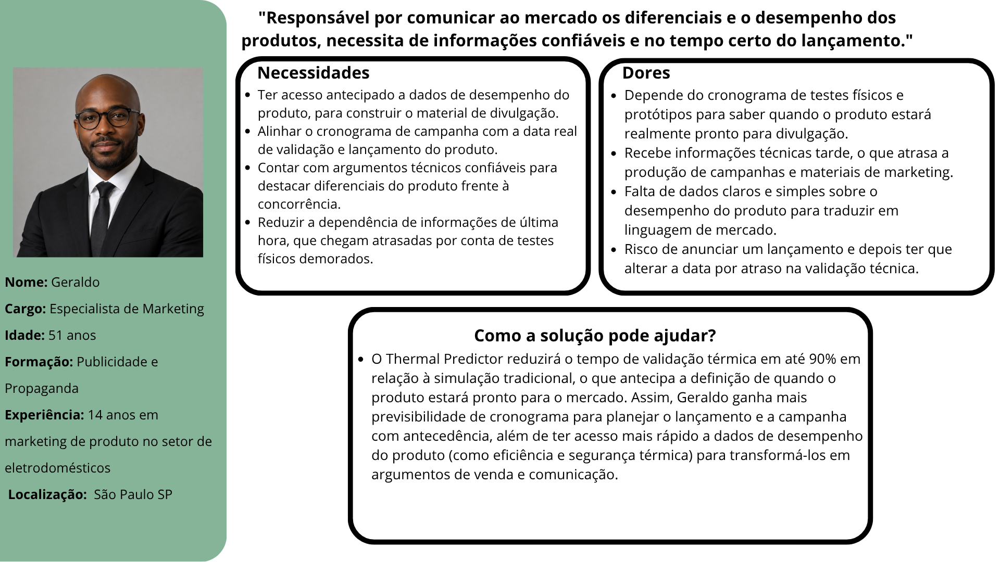

# Documentação Modelo Preditivo - Inteli

```
INSTRUÇÕES GERAIS (remova este trecho ao final)

Você deve editar este documento utilizando notação markdown - siga as convenções neste link 
https://docs.github.com/en/get-started/writing-on-github/getting-started-with-writing-and-formatting-on-github/basic-writing-and-formatting-syntax
```

## Whirlpool Thermal Predictor

### FOG

#### Felipe, Gabriel, Lucas Andrade, Nicolas, Samuel Chen, Vitor Medrado, Wiliam


## Sumário
[1. Introdução](#c1)

[2. Objetivos e Justificativa](#c2)

[3. Metodologia](#c3)

[4. Desenvolvimento e Resultados](#c4)

[5. Conclusões e Recomendações](#c5)

[6. Referências](#c6)

[Anexos](#attachments)


## <a name="c1"></a>1. Introdução

A Whirlpool Corporation é uma multinacional fundada nos EUA em 1911, inicialmente com o propósito de fabricar máquinas de lavar roupa manuais. Atualmente, ela é conhecida como empresa líder global na fabricação de eletrodomésticos para cozinha e lavanderia, com operações em cerca de 170 países e faturamento de R$12,9 bilhões no Brasil em 2024. Ela já está presente no Brasil há mais de 70 anos por meio de marcas amplamente reconhecidas no mercado brasileiro, como Brastemp, Consul, KitchenAid, B.blend etc, detendo cerca de 38% de participação no mercado de linha branca. A parceira direta no caso deste trabalho é a Divisão de Fogões da companhia, responsável pelo desenvolvimento de produtos para os mercados do Brasil e do México, com atuação voltada à engenharia e à pesquisa e desenvolvimento (P&D) de eletrodomésticos.

Nesse setor, o desenvolvimento de novos modelos de fogões de piso depende diretamente da construção de protótipos físicos e da realização de testes destrutivos para validar o comportamento térmico dos equipamentos. Esse processo é indispensável para validar se o fogão desenvolvido realmente se enquadra nos padrões de qualidade, segurança e desempenho exigidos. Porém, o desenvolvimento desses protótipos demanda grandes investimentos e é bem demorado, já que cada teste exige novos protótipos e ciclos completos de testes físicos. Portanto, o processo de um novo lançamento de um fogão é caro e lento, o que pode ser considerado uma fraqueza para esse setor do mercado, levantando um obstáculo que necessita de uma solução.


## <a name="c2"></a>2. Objetivos e Justificativa
### 2.1 Objetivos
```
Descreva resumidamente os objetivos gerais e específicos do seu parceiro de negócios.

Remova este bloco ao final
```

### 2.2 Proposta de solução
```
Descreva resumidamente sua proposta de modelo preditivo e como esse modelo pretende resolver o problema, atendendo os objetivos.

Remova este bloco ao final
```

### 2.3 Justificativa
```
Faça uma breve defesa de sua proposta de solução, escreva sobre seus potenciais, seus benefícios e como ela se diferencia.

Remova este bloco ao final
```

## <a name="c3"></a>3. Metodologia
```
Descreva a metodologia CRISP-DM e suas etapas de desenvolvimento, citando o referencial teórico. Você deve apenas enunciar os métodos, sem dizer ainda como eles foram aplicados, nem quais resultados foram obtidos.

Remova este bloco ao final
```

## <a name="c4"></a>4. Desenvolvimento e Resultados
### 4.1. Compreensão do Problema
#### 4.1.1. Contexto da indústria

O setor de linha branca (eletrodomésticos de grande porte) no Brasil e no México é dominado por um pequeno grupo de fabricantes multinacionais que competem simultaneamente em escala industrial, penetração de marca e velocidade de lançamento de produto. Nesse cenário, a Divisão de Fogões da Whirlpool — parceira direta deste projeto — atua como unidade de engenharia e P&D responsável pelo desenvolvimento de fogões de piso (Freestanding) para as arquiteturas de produto do Brasil e do México, operando sob o guarda-chuva comercial da Whirlpool Latin America e das marcas Brastemp, Consul e KitchenAid. 


##### 4.1.1.1 Análise do contexto da Whirlpool segundo as cinco forças de Porter
###### 1. Rivalidade entre concorrentes existentes — Alta
 
A Whirlpool Latin America lidera a região com Brastemp, Consul e KitchenAid, mas opera em um oligopólio fragmentado e ativamente disputado por preço:
 
- **Multinacionais âncora:** Electrolux (europeia, com aposta estratégica declarada no Brasil apesar de tarifas), Mabe (mexicana, com investimento de US$ 668 milhões anunciado para 2025–2027 e liderança em fogões a gás via planta em Durango), BSH/Bosch e Midea (joint-venture sino-americana que se consolidou como terceira força relevante em linha branca).
- **Fabricantes nacionais robustos:** Esmaltec (líder em fogões no Nordeste), Mueller, Britânia, Philco, Atlas e Continental (marca do grupo Mabe).
- **Entrantes chinesas em expansão acelerada:** Hisense, TCL e Gree, competindo agressivamente por preço.
A evidência mais forte de rivalidade intensa é financeira, não anedótica: a compressão de margem EBIT de 6,0% para 3,0% em um ano, atribuída pela própria Whirlpool a "intensidade promocional" no Brasil, mostra uma guerra de preços ativa entre os players estabelecidos — não apenas concorrência latente¹. Em 2023, a Whirlpool reportava recuperação de quase 4 pontos de *market share* em refrigeradores, lavadoras e fogões em um único trimestre — o que só é possível em um mercado onde a disputa por participação é constante e o custo de reconquista de posição é alto².
 
O setor de linha branca no Brasil (fogões, lavadoras e geladeiras) recuou 1% em vendas em 2025, segundo a Eletros³ — um mercado maduro e de crescimento raso intensifica estruturalmente a rivalidade, pois o crescimento de um player passa a depender quase inteiramente da erosão de participação dos concorrentes, não da expansão da demanda agregada.
 
###### 2. Poder de negociação dos fornecedores — Moderado, com concentração pontual em componentes eletrônicos
 
A Whirlpool Latin America mantém uma base ampla de 3.730 fornecedores (750 de materiais diretos, 2.980 de indiretos), concentrados nos estados onde possui plantas — Amazonas, Santa Catarina e São Paulo⁴. Essa diversificação dilui o poder da maioria dos fornecedores, mas não de forma homogênea entre categorias de insumo:
 
- **Componentes eletrônicos (placas, sensores, semicondutores):** segmento historicamente sujeito a choques globais de oferta, elevando o poder de barganha de fornecedores especializados durante ciclos de escassez — relevante porque a própria estratégia de portfólio da Whirlpool vem incorporando cada vez mais sensores e eletrônica embarcada (ajuste automático de temperatura, detecção de carga em lavadoras), aumentando a dependência da companhia desses insumos⁵.
- **Aço e insumos de commodity:** menor poder de barganha, dado o caráter padronizado e substituível do material.
- O volume de compra da própria Whirlpool, como maior fabricante de eletrodomésticos da América Latina, gera poder de barganha reverso relevante sobre fornecedores de médio e pequeno porte.
###### 3. Poder de negociação dos compradores — Alto
 
Como o modelo é B2C indireto, o comprador relevante para fins de precificação e condição comercial é o canal varejista, não o consumidor final isolado:
 
- No Brasil, Magazine Luiza e Grupo Casas Bahia (via Via Varejo, ~1.073 lojas) concentram parcela relevante do volume de eletrodomésticos, com lojas físicas ainda decisivas em 87% da jornada de compra.
- É particularmente relevante notar que, entre os grandes varejistas, houve fragilidade financeira recente — Americanas em recuperação judicial e desvalorizações acionárias expressivas de Casas Bahia e Magazine Luiza — o que paradoxalmente pode elevar (não reduzir) o poder de barganha de curto prazo desses varejistas sobre fabricantes, que precisam sustentar volume de giro em parceiros financeiramente fragilizados via condições comerciais mais favoráveis, prazos e ações promocionais conjuntas².
- No México, cadeias como Liverpool e Elektra cumprem função equivalente.
- O consumidor final tem baixo custo de troca entre marcas no segmento econômico, o que reforça o papel do varejo como intermediário capaz de colocar fabricantes concorrentes em disputa direta — bem exemplificado pela própria Whirlpool ao reconhecer que "as negociações de preços nunca são fáceis" com os grandes revendedores.
###### 4. Ameaça de novos entrantes — Moderada, em elevação estrutural
 
As barreiras tradicionais de entrada permanecem relevantes — intensidade de capital, certificação regulatória (INMETRO), rede de distribuição consolidada e fidelidade de marca (Brastemp e Consul têm mais de 70 anos de presença regional). Contudo, dois movimentos recentes reduzem a efetividade dessas barreiras:
 
- **Marcas chinesas** (Hisense, TCL, Midea, Gree) expandem agressivamente no varejo brasileiro, em parte redirecionando capacidade excedente originalmente destinada aos EUA em razão de tarifas americanas. Essas marcas entram via importação e parceria de varejo, contornando a barreira histórica de manufatura local — a própria Whirlpool reconhece que a presença chinesa "contribui para aumentar o mercado e expor os diferenciais das marcas", uma leitura que minimiza publicamente uma ameaça que é, estruturalmente, real.
- No México, o boom de *nearshoring* — puxado pelo USMCA e por investimentos como o programa de US$ 668 milhões da Mabe para 2025–2027 — eleva a barreira de entrada para quem não possui planta local, favorecendo incumbentes com operação física estabelecida (caso da própria Whirlpool), mas também sinaliza que o custo de entrada via manufatura doméstica está subindo, o que direciona novos entrantes para a rota de importação — o mesmo caminho já adotado pelas chinesas no Brasil.
###### 5. Ameaça de produtos e comportamentos substitutos — Alta e estruturalmente crescente
 
Esta é a força mais dinâmica e menos óbvia da análise, e onde a leitura simplista ("indução substitui gás") deixa de capturar a real amplitude do fenômeno. Há pelo menos quatro camadas distintas de substituição atuando simultaneamente sobre o portfólio de cocção e refrigeração da Whirlpool na América Latina, com evidência direta de que a própria companhia já reconhece e reage a três delas.
 
**a) Substituição tecnológica intra-categoria — fogão a gás por indução.** A indução deixou de ser artigo de nicho premium e ganha tração em 2026 por eficiência energética, segurança (sem risco de explosão por vazamento) e queda de preço de entrada, com modelos compactos a partir de R$ 180–350. A resposta da própria Whirlpool confirma a materialidade da ameaça: início de produção nacional de fogões por indução em Manaus a partir do segundo semestre de 2026 — uma migração de capacidade fabril, não apenas de portfólio de importação⁶.
 
**b) *Unbundling* funcional do fogão por eletroportáteis — a air fryer.** Este é o vetor de substituição com a evidência quantitativa mais robusta e o mais subestimado em análises convencionais do setor. A penetração de air fryers nos domicílios brasileiros saltou de 36,2% para 64% entre 2022 e 2025 — o maior avanço percentual entre todas as categorias de eletrodomésticos monitoradas —, com o mercado da categoria crescendo 340% no período⁷. As ocasiões de preparo rápido de refeições já respondem por mais de 30% do total de preparos domésticos, enquanto a fritura tradicional (a função historicamente mais associada ao fogão e ao forno) caiu para 17% das ocasiões, recuo de três pontos percentuais apenas entre 2024 e 2025. Isso não é substituição de compra (o consumidor não deixa de ter fogão), mas substituição de **uso e intensidade de uso**: funções antes concentradas no fogão/forno migram para um eletroportátil dedicado, de ticket médio muito inferior, o que tende a alongar o ciclo de reposição do fogão principal e a pressionar para baixo a demanda por capacidade e robustez térmica do produto principal.
 
**c) Substituição do próprio ato de cozinhar — aplicativos de delivery.** A penetração de pedidos por aplicativo entre consumidores brasileiros passou de 80% em 2020 para 89% em 2022, e "não querer cozinhar" é a motivação declarada por 24% dos usuários — a razão mais citada⁸. O efeito líquido sobre a demanda por eletrodomésticos é ambíguo e deve ser tratado com o devido rigor analítico: o consumo doméstico agregado de alimentos ainda cresceu 3,09% entre 2022 e 2023, sugerindo complementaridade mais do que substituição direta na média da população. Ainda assim, a motivação qualitativa é evidência de uma redução na *frequência* de uso do fogão em parcelas específicas do mercado — sobretudo domicílios urbanos menores e unipessoais —, o que modera, sem eliminar, a demanda por produtos de maior capacidade.
 
**d) Substituição por mudança de hábito alimentar e de moradia — o efeito GLP-1 e a compactação urbana.** Este é o sinal mais recente e mais diretamente confirmado pela própria liderança da Whirlpool no Brasil. Segundo executivos da companhia entrevistados em janeiro de 2026, a disseminação de medicamentos GLP-1 (Ozempic, Mounjaro, Wegovy — cuja importação cresceu 88% em 2025) já altera o padrão de compra de eletrodomésticos: consumidores priorizam freezers maiores para armazenar refeições congeladas em porções menores (*meal prep*) e **migram para fogões menores, com menos bocas** — nas palavras do diretor de marketing de categoria da companhia, "as pessoas não querem mais aqueles fogões enormes". Em resposta direta a esse insight, a Whirlpool renovou por completo as linhas de cooktop de Consul e Brastemp, e reposicionou o frigobar Brastemp Retrô (líder com mais de 50% de participação no segmento de compactos premium) como solução de armazenamento de medicamentos e produtos de skincare fora da cozinha. O relatório *Home Appliances Outlook 2026*, da NielsenIQ, corrobora a tendência em nível setorial: o consumidor latino-americano já prioriza "conveniência, multifuncionalidade e benefícios de saúde e bem-estar" acima de preço puro, com o valor das vendas globais de eletrodomésticos crescendo 5% no primeiro semestre de 2025 mesmo com volume estável (+1%) — evidência de premiumização funcional, não apenas de crescimento de mercado⁵. Esse mesmo movimento já havia sido antecipado em 2023, quando a Whirlpool declarou apostar em soluções de lavanderia e cocção voltadas a apartamentos de 30–40 m², um "mercado crescente" segundo a própria liderança regional².

###### Síntese e implicações estratégicas

O setor de linha branca na América Latina apresenta atratividade estrutural moderada a baixa sob a ótica de Porter: rivalidade alta, sustentada por evidência financeira concreta — compressão da margem EBIT da própria Whirlpool de 6,0% para 3,0% em um único ano —, poder de barganha elevado do canal varejista, poder de fornecedores concentrado em componentes eletrônicos críticos, barreiras de entrada em erosão frente a competidores asiáticos via importação, e uma ameaça de substituição multifacetada e ativa, que combina fatores tecnológicos (indução), comportamentais (air fryer, aplicativos de delivery) e sociodemográficos (efeito GLP-1, compactação urbana).

Duas dessas forças têm implicação mais diretas e específicas sobre o projeto Thermal Predictor.

Da segunda força (fornecedores) decorre uma dependência estrutural e crescente de componentes eletrônicos e sensores embarcados — insumos sujeitos a ciclos de escassez global e a concentração de fornecimento —, à medida que a Whirlpool amplia a eletrônica de seus produtos (ajuste automático de temperatura, sensoriamento de carga). Essa dependência eleva o custo e o risco de qualquer processo de desenvolvimento que dependa de iteração física repetida de protótipos, reforçando o valor estratégico de um modelo preditivo capaz de antecipar o comportamento térmico do produto sem depender de múltiplos ciclos de teste físico e digital twin.

Da quinta força (substitutos) decorre uma transição de portfólio já em curso e reconhecida publicamente pela própria liderança da Whirlpool no Brasil: migração para fogões mais compactos, com menor número de bocas, e para tecnologia de indução, motivada por pressão competitiva e por mudança de comportamento do consumidor. Essa transição amplia — e não reduz — a necessidade de um modelo preditivo robusto: sob o modelo tradicional de validação térmica, cada nova arquitetura de produto exigiria um novo ciclo completo de simulação e teste físico, incompatível com a velocidade de renovação de portfólio já imposta pelo mercado.

Em conjunto, essas duas forças convertem a leitura setorial em justificativa direta de negócio para o projeto: o Thermal Predictor não responde apenas a uma dor operacional interna de lead time e custo de prototipagem, mas a uma pressão estrutural de mercado que torna a velocidade de validação térmica um fator de competitividade. Reduzir a dependência de ciclos físicos de teste é, neste contexto, condição para que a Whirlpool consiga acompanhar o ritmo de transição de portfólio já imposto pela concorrência e pelo comportamento do consumidor.

##### 4.1.1.2. Concorrentes identificados

Para efeito de seleção, foram escolhidas três empresas do setor que atuam como concorrentes diretos da Whirlpool. Destaca-se, em primeiro lugar, a Electrolux: incumbente europeu com presença quase centenária no Brasil — 100 anos completados em 2026 — e a marca com maior penetração domiciliar do país, presente em 67% dos lares brasileiros somando o portfólio da marca Continental. O Brasil é, para o grupo global, o segundo mercado mais rentável, atrás apenas da Europa, o que indica que a operação regional não é periférica, e sim um dos pilares de rentabilidade da companhia mundialmente⁹. Em agosto de 2025, a Electrolux inaugurou sua quinta planta no país, em São José dos Pinhais (PR), com investimento de R$ 700 milhões, explicitamente para reduzir dependência de importação asiática e nacionalizar categorias hoje importadas (liquidificadores, ventiladores), com plano declarado de transformar a unidade em plataforma de exportação para o restante da América Latina¹⁰. Outra empresa concorrente que se destaca é a Midea, multinacional chinesa que já não deve ser tratada apenas como ameaça potencial de entrada (Força 4), mas como concorrente estabelecido: ocupa hoje a terceira posição no mercado brasileiro de eletrodomésticos, com cerca de 8% de participação em refrigeradores e 6%–7% em lavadoras¹¹. A companhia converteu deliberadamente sua estratégia de importação para manufatura local, inaugurando em Pouso Alegre (MG) sua primeira planta 100% própria no país — investimento de R$ 630 milhões, capacidade para 1,3 milhão de unidades por ano (700 mil refrigeradores, 600 mil lavadoras) —, movimento motivado explicitamente por contornar o custo do sistema tributário de importação e cumprir exigências de conteúdo local¹². A marca também amplia agressivamente sua linha de eletroportáteis — expansão de portfólio que a equipe recomenda revalidar diretamente com o parceiro, por não ter sido localizada uma fonte primária confiável até o fechamento desta versão. Por fim, identifica-se a Mabe, grupo mexicano fundado em 1946, historicamente o concorrente mais diretamente sobreposto ao escopo do Thermal Predictor por sua forte especialização em fogões e produtos de cocção a gás, com planta dedicada a essa categoria em Durango. Consolidou domínio de mercado na América Latina — chegou a deter cerca de 70% de participação em eletrodomésticos na região, excluindo Estados Unidos e México — por meio de uma joint venture histórica com a General Electric, firmada em 1986, que lhe deu acesso à rede de distribuição americana; em meados dos anos 1990, dois terços de todos os fogões a gás e refrigeradores importados pelos EUA eram projetados e fabricados pela Mabe¹³.


#### 4.1.2. Análise SWOT

##### Escopo e critério de classificação

A análise a seguir tem como unidade de análise a **Divisão de Fogões da Whirlpool**, parceira direta deste projeto, responsável pela engenharia e P&D de fogões de piso (Freestanding) para as arquiteturas de **Brasil e México**, contextualizada na operação mais ampla da **Whirlpool Latin America**, à qual essa divisão está subordinada comercial e industrialmente. Forças e fraquezas descrevem fatores **internos**, sobre os quais a empresa exerce governança direta (ativos, processos, competências e decisões próprias); oportunidades e ameaças descrevem fatores **externos**, originados em mercado, regulação, concorrência e conjuntura macroeconômica.

O recorte adotado é o do **desenvolvimento de produtos de cocção**, com foco na etapa de avaliação térmica por simulação computacional (CFD), ponto do negócio em que a solução deste projeto se insere. Esse recorte é intencional: uma SWOT corporativa genérica produziria fatores válidos, porém pouco acionáveis para as decisões de escopo, dados e modelagem que o grupo precisa tomar.

<div align="center">
  <sub>Figura 1 — Matriz SWOT da Solução para Whirlpool Brasil/México</sub><br>
  <br>
  <sup>Fonte: Elaborado pelos autores (2026).</sup>
</div>
---

##### S: Forças (internas)

**S1. Parque industrial integrado nas Américas.** No Brasil, a empresa opera plantas em Joinville (SC), Rio Claro (SP) e Manaus (AM); no México, mantém cinco unidades produtivas — três no campus de Apodaca (Nuevo León), uma em Celaya (Guanajuato) e uma em Ramos Arizpe (Coahuila). O México é descrito pela própria companhia como o terceiro país mais relevante em manufatura do grupo. Essa escala dilui o custo fixo de qualquer investimento em ferramentas de engenharia por um volume muito grande de unidades, tornando economicamente racional desenvolver internamente um modelo preditivo que uma empresa menor não conseguiria justificar.

**S2. Investimento contínuo em P&D e manufatura avançada.** A operação brasileira investe cerca de R$ 500 milhões por ano em pesquisa, desenvolvimento e automação, e inaugurou em Rio Claro um centro de capacitação em manufatura avançada com meta de treinar milhares de profissionais¹⁴. Há, portanto, orçamento, patrocínio executivo e precedente institucional para adoção de tecnologia digital na engenharia, o que reduz o risco de rejeição cultural da solução.

**S3. Acervo proprietário de simulações CFD e ensaios térmicos.** Anos de simulações numéricas e de medições em bancada sobre os próprios produtos constituem a matéria prima que viabiliza a abordagem de aprendizado de máquina. Sem histórico de casos já resolvidos por método numérico e validados experimentalmente, não haveria como treinar um modelo substituto. Trata-se de barreira de entrada difícil de replicar por concorrentes sem a mesma longevidade na categoria.

**S4. Cultura de melhoria contínua consolidada (World Class Manufacturing).** A companhia opera sob o modelo WCM, no qual a planta de Ramos Arizpe é referência na América do Norte¹⁵. Uma organização que já mede, padroniza e audita processos de forma sistemática tende a absorver com menos atrito uma ferramenta que exige disciplina de dados e de versionamento.

**S5. Engenharia térmica e laboratórios de validação próprios.** Equipe especializada em simulação e infraestrutura de ensaio permitem confrontar internamente a saída do modelo com dados reais, encurtando o ciclo de verificação e aumentando a confiabilidade percebida da solução, condição indispensável para que um modelo estatístico seja aceito em um ambiente de engenharia.

**S6. Portfólio multimarca reaproveitável nos dois países.** Com Brastemp, Consul, KitchenAid e Whirlpool, a empresa desenvolve simultaneamente famílias com requisitos térmicos distintos em Brasil e México. Uma ferramenta que acelere a análise térmica é reutilizável em todo esse portfólio, multiplicando o retorno sobre um mesmo esforço de desenvolvimento.

##### W: Fraquezas (internas)

**W1. Ciclo de simulação térmica longo e computacionalmente caro.** A avaliação por CFD exige preparação de malha, processamento em máquinas de alto desempenho e um especialista dedicado por rodada. Na prática, limita o número de alternativas de projeto testáveis dentro do cronograma de um lançamento: a equipe converge para uma solução aceitável em vez de explorar o espaço de projeto até uma solução ótima. É o gargalo central que o projeto endereça.

**W2. Dados de engenharia sem estrutura analítica.** O histórico de simulações não foi gerado com finalidade de modelagem. O material disponibilizado ao grupo apresenta estrutura transposta (variáveis em linhas), colunas com tipos mistos, referências quebradas entre planilhas e ausência de dicionário de dados. Não existe pipeline de ingestão nem governança orientada a ML, o que transfere para a etapa de preparação boa parte do esforço do projeto.

**W3. Baixo volume amostral por família de produto.** Como cada registro corresponde a uma simulação custosa, o conjunto disponível é pequeno para os padrões de aprendizado de máquina. Isso restringe a complexidade dos modelos utilizáveis, eleva o risco de sobreajuste e limita a generalização para geometrias e condições de contorno não observadas no treino.

**W4. Conhecimento térmico concentrado em poucos especialistas.** A interpretação dos resultados e o julgamento sobre plausibilidade física dependem de um número reduzido de engenheiros. Além do risco de descontinuidade, há um gargalo de agenda: a validação do modelo compete com as demais demandas dessas mesmas pessoas.

**W5. Confidencialidade restringe a colaboração externa.** Geometrias, materiais e resultados de desempenho são informação concorrencialmente sensível. Isso impõe atrito a iniciativas de inovação aberta, inclusive a este projeto, que precisa conciliar entregas em repositório público com a proteção dos dados do parceiro.

**W6. Reestruturação da rede fabril em curso consome capex e atenção gerencial.** Em 2026 a companhia comunicou ao regulador norte-americano o encerramento gradual de uma de suas plantas em Apodaca até o segundo trimestre de 2027, com custo estimado de reorganização em torno de US$ 165 milhões, como parte de um esforço de otimização da rede global de manufatura¹⁶. Movimentos dessa natureza deslocam linhas entre plantas, exigem revalidação de produtos e processos e disputam recursos com projetos de inovação, um risco de agenda concreto para a implantação da solução.

##### O: Oportunidades (externas)

**O1. Endurecimento e valorização da regulação de eficiência energética.** O Programa Brasileiro de Etiquetagem do INMETRO¹⁷ abrange dezenas de programas e produtos, e o Selo PROCEL tornou-se critério de decisão de compra e condição de acesso a programas habitacionais públicos. Melhorar classe de eficiência exige otimizar comportamento térmico, e otimizar exige iterar: quem avalia mais alternativas por unidade de tempo tem vantagem direta nesse jogo regulatório.

**O2. Nacionalização de linhas e crescimento das exportações.** A absorção de linhas antes produzidas fora do país, incluindo modelos com padrão construtivo distinto do mercado local, amplia a variedade de produtos desenvolvidos no Brasil. Cada nova configuração é um conjunto adicional de análises térmicas e, portanto, um caso de uso a mais para a ferramenta.

**O3. Padronização de engenharia entre Brasil e México.** Sendo os dois países o núcleo da operação regional, um modelo preditivo validado no Brasil é transferível para o portfólio mexicano com custo marginal baixo. Isso converte uma entrega local em um ativo regional e aumenta significativamente o retorno esperado do projeto.

**O4. Ecossistema acadêmico e incentivos fiscais à P&D.** A proximidade com instituições de ensino e a existência de incentivos à inovação permitem testar hipóteses tecnológicas a custo e risco baixos antes de comprometer recursos internos, modelo do qual este próprio projeto é exemplo. Além do resultado técnico, a parceria dá acesso a métodos e literatura recentes sobre modelos substitutos aplicados à engenharia, área que amadureceu rapidamente e cujo custo de adoção vem caindo.

##### T: Ameaças (externas)

**T1. Escassez e disputa por talentos de dados e aprendizado de máquina.** A sustentação da solução após a entrega depende de profissionais capazes de monitorar, retreinar e evoluir o modelo. Esse perfil é disputado por setores que remuneram acima da média da indústria, o que representa risco direto de continuidade para qualquer iniciativa de ML internalizada.

**T2. Elevação contínua dos patamares normativos de eficiência e segurança.** Resoluções do CGIEE e revisões das portarias do INMETRO¹⁷ alteram periodicamente os requisitos mínimos. Erro de previsão térmica em fase de projeto pode gerar reprovação em certificação, retrabalho, atraso de lançamento ou, no limite, risco de campo.

**T3. Avanço de importados e de fabricantes asiáticos.** A participação de produtos importados permanece elevada em vários segmentos do mercado interno, e concorrentes como Samsung, LG e Midea operam com estruturas de P&D de escala global, inclusive com capacidade de internalizar antes ferramentas de simulação acelerada. A pressão competitiva encurta janelas de lançamento e reduz a tolerância a ciclos longos de desenvolvimento.

**T4. Exposição da produção mexicana à política tarifária dos Estados Unidos.** A planta de Ramos Arizpe destina a quase totalidade de sua produção aos mercados norte-americanos¹⁵. Alterações tarifárias ou de regras de origem afetam diretamente a rentabilidade da operação regional e podem redirecionar prioridades de investimento, inclusive as de engenharia.

**T5. Elasticidade entre preço e demanda comprimindo a margem disponível para P&D.** Levantamentos setoriais indicam que cada 1% de aumento de custo se traduz em queda de 0,7% a 1% na demanda por eletrodomésticos. Em ambiente de juros elevados e confiança do consumidor oscilante, sobra pouco espaço para repassar custos, o que expõe orçamentos de engenharia a corte.

---

##### Estratégias derivadas do cruzamento (matriz TOWS)

A matriz por si só é descritiva; o valor analítico está no cruzamento entre os fatores internos e externos. As quatro combinações abaixo indicam como a solução proposta neste projeto se posiciona.

| | **Forças (S)** | **Fraquezas (W)** |
|:---|:---|:---|
| **Oportunidades (O)** | **SO — ofensiva:** usar o acervo de simulações (S3) e a capacidade de validação própria (S5) para varrer rapidamente configurações de projeto e maximizar classe de eficiência energética (O1) antes de comprometer horas de CFD; estender o mesmo ativo às novas linhas nacionalizadas (O2) e ao portfólio mexicano (O3), transformando uma entrega local em ferramenta regional. | **WO — reforço:** aproveitar a parceria acadêmica e os incentivos à P&D (O4) para atacar as fraquezas de dados: estruturar dicionário de dados, padronizar a saída das simulações e planejar novas rodadas por delineamento de experimentos (DOE) nas regiões em que o modelo apresentar maior incerteza, convertendo o custo do CFD em investimento dirigido (W2, W3). |
| **Ameaças (T)** | **ST — confronto:** empregar escala industrial (S1), cultura de melhoria contínua (S4) e engenharia própria (S5) para encurtar o ciclo de concepção e validação e responder ao encurtamento das janelas de lançamento imposto pela concorrência (T3), preservando margem em um cenário de repasse de custo limitado (T5). Manter o desenvolvimento internamente também mitiga exposição de propriedade intelectual. | **WT — defensiva:** posicionar o modelo como ferramenta de triagem e priorização, não como substituto do CFD na homologação, reportando faixa de erro explícita e definindo critério objetivo de escalonamento para simulação completa, o que limita o risco normativo (T2). Documentar o pipeline e automatizar o retreino reduz simultaneamente a dependência de especialistas (W4) e a exposição à rotatividade de talentos (T1). |

##### Implicação para o projeto

O cruzamento indica que o principal gargalo interno da Whirlpool no escopo analisado, o custo e a lentidão do ciclo de simulação térmica (W1), coincide com o ponto em que as pressões externas mais crescem: exigência regulatória de eficiência (O1, T2), concorrência acelerada (T3) e necessidade de desenvolver mais variantes de produto por período (O2, O3). Simultaneamente, a empresa detém justamente os ativos necessários para atacar esse gargalo: acervo histórico de simulações (S3), engenharia térmica própria (S5) e orçamento de P&D consolidado (S2).

A solução proposta neste projeto, um modelo de aprendizado de máquina que estima a temperatura de componentes térmicos como alternativa rápida ao CFD, atua precisamente nessa interseção, convertendo uma fraqueza operacional em capacidade de resposta às oportunidades e ameaças do mercado. A principal condicionante de sucesso, evidenciada pela própria análise, não é de natureza algorítmica, mas de qualidade e volume de dados (W2 e W3), o que justifica a prioridade das etapas de estruturação do dataset no cronograma do projeto.

##### Limitações da análise

Três ressalvas devem acompanhar a leitura desta seção. Primeiro, os fatores internos relativos a dados e à concentração de conhecimento foram **inferidos a partir do material disponibilizado ao grupo** e da interação com o parceiro, não de auditoria formal, carecem de validação com o time de engenharia. Segundo, a seleção dos fatores reflete o recorte declarado no início da seção: elementos de alto impacto corporativo mas sem conexão com a etapa de simulação térmica foram deliberadamente deixados de fora. Terceiro, os dados externos referem-se ao período até meados de 2026 e o setor é sensível a juros, câmbio e política comercial, de modo que a análise deve ser revisitada ao longo do projeto.


#### 4.1.3. Planejamento Geral da Solução
 
A base de dados disponibilizada pela Whirlpool reúne o histórico de simulações numéricas (CFD) e de testes físicos internos referentes aos fogões de piso (Freestanding) das arquiteturas do Brasil e do México. Ao todo, são 39 rodadas de teste (Runs), cada uma definida por sete variáveis de configuração, como direção do fluxo de ar do blower, estado do housing, posição da placa e formato do duct de ventilação, e acompanhada da leitura de temperatura de 78 sensores/termopares, distribuídos entre as áreas-chave do equipamento (Mainback, bobinas, sistemas de ventilação, componentes do IPC e região de HMI) — lista que a equipe recomenda confirmar com o parceiro caso alguma área-chave adicional exista além das cinco aqui identificadas. Trata-se de um conjunto de dados confidencial, de uso interno da Whirlpool, que deverá ser complementado e corrigido ao longo do projeto conforme alinhado com o parceiro.
 
A solução proposta é um modelo de machine learning supervisionado, treinado a partir desses dados históricos, capaz de aprender a relação entre a configuração de montagem do fogão e a temperatura resultante em cada sensor. Com isso, torna-se possível estimar a temperatura de uma nova configuração sem a necessidade de executar uma simulação CFD completa ou construir um protótipo físico para testá-la.
 
Do ponto de vista operacional, o dashboard funciona da seguinte forma: como input, o usuário seleciona os parâmetros de configuração do fogão que deseja avaliar, direção do fluxo de ar do blower, estado do housing, posição da placa, tipo de mesh duct, presença do furo do defletor e o caso/modo de operação (Run Case) simulado. Como output, o modelo retorna a temperatura estimada para os sensores/termopares das áreas-chave selecionadas, acompanhada de sua margem de erro esperada e de uma indicação de confiabilidade, sinalizando se a configuração consultada está dentro da faixa de combinações já testadas pela Whirlpool ou se representa uma extrapolação do modelo, caso em que a estimativa deve ser tratada com mais cautela.

O uso está previsto para múltiplas áreas da Whirlpool identificadas junto ao parceiro no kickoff do projeto, cada uma impactada de forma distinta pela solução. Para o time de Engenharia (CFD), hoje responsável por rodar as simulações numéricas completas, o impacto é a liberação de capacidade: em vez de simular todas as configurações candidatas, a equipe pode usar o dashboard para triar rapidamente quais delas realmente justificam o tempo de uma simulação CFD completa ou de um teste físico, concentrando seu esforço especializado nos casos mais críticos — o que é especialmente relevante diante da disponibilidade limitada já identificada para essa equipe no primeiro semestre de 2026. Para os times de Produtos e Design, o impacto é a redução do tempo de iteração: decisões de posicionamento de componentes que hoje dependem do ciclo completo de simulação ou protótipo passam a poder ser exploradas em minutos ainda na fase conceitual, permitindo avaliar mais alternativas de design dentro do mesmo prazo de projeto. Para o time de Qualidade, o impacto é a priorização mais informada de quais configurações merecem avançar para testes físicos e destrutivos, reduzindo o número de protótipos construídos apenas para serem descartados. Já para o time de Marketing, o impacto é o acesso antecipado a características térmicas do produto, antes da validação final, para embasar posicionamento e comunicação sem depender do cronograma de testes físicos.

Os principais benefícios esperados são a redução do tempo de desenvolvimento em até 30% e a diminuição dos gastos operacionais com protótipos em até 25%, conforme estimado pelo parceiro no Project Charter. Espera-se, ainda, uma contribuição indireta para a redução do desperdício de materiais associado à fabricação de protótipos físicos e à realização de testes destrutivos.
 
Como critério de sucesso, o modelo deverá prever a temperatura com margem de erro máxima de 10% e apresentar uma eficiência de tempo pelo menos 90% maior do que a simulação numérica tradicional. Por se tratar de uma prova de conceito (PoC), o sucesso desta primeira etapa também será avaliado pela validação consistente do modelo nos sensores e áreas priorizadas em conjunto com o parceiro, e não necessariamente pela cobertura de todos os 78 sensores monitorados.

#### 4.1.4. Value Proposition Canvas

<div align="center">
  <sub>Figura 2 — Canvas de Proposta de Valor da Whirlpool</sub><br>
  <br>
  <sup>Fonte: Elaborado pelos autores (2026).</sup>
</div>

**Produtos e Serviços** 

O bloco reúne os três entregáveis definidos: o modelo preditivo de Machine Learning, o software distribuído em formato open source e o dashboard interativo. Esse último é o ponto de contato direto com a persona Beatriz (Designer UX/UI), responsável por manter e atualizar a interface que traduz as previsões do modelo para os demais usuários. 

**Criadores de Ganho**

Os indicadores de 90% de eficiência frente à simulação tradicional e de 30% de redução no tempo de desenvolvimento sustentam diretamente as necessidades da persona Geraldo (Especialista de Marketing), cuja dor central é depender do cronograma de testes físicos para saber quando o produto estará pronto para divulgação. A pesquisa de gestão de produto melhora a competitividade de várias formas, reduz diretamente os custos de desenvolvimento, permite acesso antecipado ao potencial de mercado e garante vantagens de pioneirismo¹⁸. Os dois criadores adicionais (eliminação de retrabalho entre arquiteturas BR/MX e democratização de decisões técnicas) sustentam a necessidade de Estela (Engenheira de Materiais) de comparar diferentes materiais e espessuras sem depender de um novo protótipo para cada opção.

**Aliviadores de Dor**

Este bloco tem aderência direta às dores das personas técnicas do projeto. A eliminação da dependência de protótipos físicos e testes destrutivos responde precisamente à dor relatada por João (Engenheiro de Qualidade), que depende de testes físicos destrutivos, lentos e caros, para validar a segurança térmica, e por Estela, que enfrenta o mesmo gargalo ao validar resistência de materiais. Estudos sobre simulação digital no desenvolvimento de produto sustentam esse ganho: uma pesquisa da McKinsey, em conversas com líderes de P&D, mostra que gêmeos digitais já reduziram os prazos de desenvolvimento em até 50% para alguns usuários, com redução de custo associada, validando a lógica de que substituir ciclos físicos por simulação preditiva é uma estratégia de negócio consolidada, não apenas uma escolha técnica pontual do projeto¹⁹.

**Ganhos do Cliente**

O ganho de lançar produtos mais rapidamente sem perder qualidade térmica conecta-se novamente à persona Geraldo, cuja necessidade central é alinhar o cronograma de campanha à data real de validação do produto. Pesquisa publicada no IEEE Transactions on Engineering Management reforça essa relação: em estudo com 692 projetos de desenvolvimento de novos produtos, a velocidade de lançamento mostrou-se geralmente associada de forma positiva ao sucesso do novo produto, sustentando por que a previsibilidade de cronograma é um ganho estratégico, e não apenas operacional²⁰. O ganho de custo zero de licenciamento, por sua vez, sustenta a viabilidade orçamentária da solução como um todo.

**Dores do Cliente**

O bloco distingue-se dos aliviadores por descrever a dor sob a perspectiva do cliente, e não da solução proposta. Duas dores refletem diretamente o problema central do projeto (lead time elevado e custo de prototipagem física); as demais decorrem de riscos operacionais específicos identificados na fase de planejamento. A opção por ancorar essas dores em riscos reais do projeto, em vez de dores genéricas de mercado, confere maior credibilidade e rastreabilidade ao canvas.

**Tarefas do Cliente**

A tarefa relacionada à precisão térmica dentro da margem de 10% é o item de maior relevância em todo o canvas, pois corresponde ao critério que determinará, de forma mensurável, o sucesso ou insucesso da solução desenvolvida. Da mesma forma, é imprescindível olhar que diversas simulações são feitas em aplicativos licenciados e fisicamente, mas que ainda não são reaproveitadas para previsões de futuras combinações.


#### 4.1.5. Matriz de Riscos

A Matriz de Riscos é uma ferramenta que auxilia na identificação, análise e priorização dos principais riscos de um projeto, permitindo uma gestão mais estratégica e preventiva. Ela organiza os riscos com base em critérios como probabilidade de ocorrência e impacto, possibilitando classificá-los e definir planos de resposta adequados. No contexto deste projeto, a matriz de riscos foi utilizada para mapear ameaças e oportunidades relacionadas ao desenvolvimento do Thermal Predictor, modelo de Machine Learning para previsão da temperatura de fogões de piso (Freestanding) da Whirlpool nas arquiteturas do Brasil e do México. Entre os riscos mapeados, destacam-se a possível desorganização dos dados históricos de simulações numéricas (CFD) e testes físicos, que pode atrasar a construção da Prova de Conceito, e a disponibilidade limitada da equipe interna de CFD da Whirlpool no primeiro semestre de 2026, o que pode gerar gargalos na fase de validação dos modelos. O mapeamento desses riscos permite à equipe antecipar problemas críticos e tomar decisões mais seguras ao longo do desenvolvimento do projeto, contribuindo para o cumprimento das metas de acurácia (margem de erro ≤ 10%) e eficiência de tempo definidas com o parceiro.

<p align="center">
  <sub>Figura 3 — Matriz de Risco: Ameaças</sub><br>
  
  <br>
  <em>Fonte: Elaborado pelos autores (2026).</em>
</p>

**1. Inconsistência estrutural e perda de rastreabilidade da base histórica (R01):**

Trata-se de um risco de natureza tecnológica. Sua probabilidade de ocorrência foi estimada em 90%, uma vez que a inspeção da base fornecida já evidenciou o problema: cabeçalhos de coluna duplicados (Run 22, 43, 44 e 45 aparecem repetidos), erros #REF! na coluna identificadora dos termopares, aproximadamente 12% de células vazias e uma coluna de limite que mistura valores numéricos com texto. O impacto foi classificado como alto porque nenhum modelo pode ser treinado sobre uma base em formato wide, na qual cada simulação é uma coluna e não uma observação, e porque o descarte de execuções irrecuperáveis agrava diretamente a escassez amostral tratada em R02. A combinação desses fatores resulta em uma classificação geral alta. O impacto não foi classificado como muito alto porque o problema é integralmente detectável antes do treinamento, não podendo propagar-se silenciosamente até a decisão de engenharia. Como plano de ação, a equipe desenvolverá um pipeline de ETL versionado em Python que realizará o unpivot da planilha para o formato long, resolverá as duplicidades por sufixo de repetição, substituirá os identificadores corrompidos por chave estável documentada em dicionário de dados e aplicará validação automática com Pandera por regras nomeadas. Caso mais de 5% dos registros sejam reprovados na validação, o treinamento será interrompido até revisão manual da base junto à equipe de CFD da Whirlpool.

**2. Volume amostral insuficiente de simulações (R02):**

Trata-se de um risco de natureza de dados e Machine Learning. Sua probabilidade de ocorrência foi estimada em 70%, pois a obtenção de execuções históricas adicionais depende de extração nos servidores internos da Whirlpool e da priorização do parceiro, condição favorável à ocorrência mas ainda não confirmada, uma vez que o mapeamento do acervo disponível não foi concluído. O impacto foi classificado como muito alto porque a escassez de amostras impede estimar o erro de generalização com significância estatística e inviabiliza sustentar contratualmente a margem de 10% exigida no Project Charter. A combinação desses fatores resulta em uma classificação geral alta. A base disponibilizada contém trinta e nove execuções independentes, e não aproximadamente três mil e quinhentas observações, pois os termopares de uma mesma simulação compartilham geometria, malha e solver. Como plano de ação, a equipe solicitará formalmente ao Sponsor a extração de execuções adicionais, priorizará algoritmos de baixa variância — Ridge, Random Forest raso e Gradient Boosting regularizado — em vez de redes neurais, adotará validação cruzada Leave-One-Group-Out aninhada com agrupamento por configuração física e reportará toda métrica acompanhada de intervalo de confiança de 95%. Caso o número de execuções utilizáveis permaneça abaixo de sessenta, o escopo será renegociado com o Sponsor para um modelo restrito às condições de operação com maior densidade de dados.

**3. Superajuste do modelo com estimativa de erro otimista (R03):**

Trata-se de um risco de natureza de dados e Machine Learning. Sua probabilidade de ocorrência foi estimada em 70%, devido à alta razão entre o número de variáveis — parâmetros geométricos, direção do soprador, tipo de placa e modo de operação — e o número de execuções independentes disponíveis, condição estrutural presente desde o início do projeto. O impacto foi classificado como alto porque um modelo superajustado apresentaria métricas excelentes em laboratório e desempenho degradado em uso, comprometendo o critério de aceite e exigindo retrabalho de modelagem. A combinação desses fatores resulta em uma classificação geral alta. O risco é agravado pela existência de execuções muito semelhantes entre si na base, que vazam informação entre treino e validação quando o particionamento é feito por linha. Cabe registrar que o impacto não foi classificado como muito alto porque o superajuste, isoladamente, é detectável pelo protocolo de validação antes de qualquer entrega, sendo suas consequências de segurança tratadas em R04. Como plano de ação, a equipe aplicará regularização L1 e L2, separará o conjunto de teste por execução completa e nunca por linha, manterá um conjunto de teste congelado até a validação técnica e exigirá que o modelo supere dois baselines obrigatórios. Caso a diferença entre o erro de treino e o erro de validação ultrapasse cinco pontos percentuais, os hiperparâmetros serão reajustados e a complexidade do modelo reduzida antes de qualquer apresentação de resultados ao parceiro.

**4. Baixa generalização para novos modelos de fogão (R04):**

Trata-se de um risco de natureza de dados e Machine Learning. Sua probabilidade de ocorrência foi estimada em 50%, pois depende do comportamento de uso da ferramenta pelos engenheiros: consultas dentro do envelope de arquiteturas conhecidas não configuram extrapolação, e a proporção entre usos interpolados e extrapolados só será conhecida após a entrega. O impacto foi classificado como muito alto, uma vez que previsões extrapoladas e silenciosamente erradas poderiam levar à aprovação de um projeto termicamente inseguro sem emitir qualquer sinal de alerta ao engenheiro. A combinação desses fatores resulta em uma classificação geral alta. As arquiteturas do Brasil e do México possuem diferenças construtivas relevantes entre si, e o valor de negócio do projeto reside justamente na previsão de produtos ainda não prototipados. Como plano de ação, a equipe implementará um detector de extrapolação em duas camadas, combinando verificação de envelope marginal com detecção de novidade multivariada, e o dashboard exibirá três estados — interpolação, extrapolação moderada e fora de domínio —, suprimindo o valor numérico neste último e recomendando a simulação CFD tradicional, pois exibir um número acompanhado de ressalva textual não impede seu uso. Caso mais de 20% das consultas de teste caiam fora do envelope de treinamento, o domínio de validade será formalmente documentado e comunicado aos engenheiros usuários.

**5. Herança do erro sistemático do solver CFD (R05):**

Trata-se de um risco de natureza de dados e Machine Learning, e constitui a principal ameaça à validade física dos resultados do projeto. Sua probabilidade de ocorrência foi estimada em 50%, pois, embora o aprendizado supervisionado reproduza o alvo por construção, o solver empregado pela Whirlpool é calibrado internamente contra testes físicos, de modo que a magnitude do desvio residual é desconhecida e pode situar-se dentro da tolerância aceitável. O impacto foi classificado como muito alto porque, caso o desvio seja relevante, a previsão pode situar-se simultaneamente dentro da tolerância de 10% em relação ao CFD e fora da realidade física, conduzindo à aprovação de um projeto inseguro sem que nenhuma métrica interna acuse o problema. A combinação desses fatores resulta em uma classificação geral alta. O erro do próprio solver, decorrente da discretização de malha, do modelo de turbulência e das condições de contorno, estabelece o teto real de acurácia alcançável pela solução. Como plano de ação, a equipe reservará um subconjunto de testes físicos como conjunto de calibração independente, quantificará e reportará o desvio entre simulação e teste físico como erro irredutível de referência e declarará explicitamente no dashboard que a previsão estima a saída do CFD, e não a medição. Caso o desvio ultrapasse 5% em qualquer termopar com limite normativo definido, será aplicada camada de correção de viés calibrada sobre os testes físicos disponíveis.

**6. Critério de aceite de 10% não operacionalizável (R06):**

Trata-se de um risco de natureza estratégica. Sua probabilidade de ocorrência foi estimada em 90%, pois a ambiguidade não é uma possibilidade futura, mas uma condição já presente no documento vigente: o Project Charter estabelece erro máximo de 10% sem definir métrica, unidade ou nível de agregação. O impacto foi classificado como alto porque a acurácia é o principal indicador de sucesso do projeto e um critério não verificável impossibilita declarar objetivamente seu atingimento. A combinação desses fatores resulta em uma classificação geral alta. O erro percentual pressupõe escala de razão com zero absoluto, condição que a escala Celsius não satisfaz por ser intervalar: 10% de 150 °C correspondem a 15 °C, mas os mesmos 150 °C equivalem a 423,15 K, cujos 10% correspondem a 42,3 °C, de modo que a métrica se altera conforme a unidade adotada. O impacto não foi classificado como muito alto porque o risco é integralmente resolúvel por acordo documental, sem depender do desempenho técnico da solução. Como plano de ação, a equipe formalizará um aditivo ao Project Charter, antes do início da modelagem, definindo uma métrica tríplice: erro médio absoluto em graus Celsius por termopar, erro normalizado pela folga térmica e taxa de falsos-negativos de segurança. Caso o Sponsor mantenha contratualmente o critério percentual, as três métricas serão reportadas em paralelo e a limitação metodológica será formalmente registrada no relatório final.

**7. Falha de integração e ausência de sustentação do software (R07):**

Trata-se de um risco de natureza de engenharia de software. Sua probabilidade de ocorrência foi estimada em 50%, pois depende de decisão organizacional da Whirlpool quanto à designação de um mantenedor interno, além da formalização do contrato de interface entre o modelo preditivo e o dashboard, ainda pendente. O impacto foi classificado como moderado porque falhas de integração são detectáveis por testes automatizados e corrigíveis dentro do próprio ciclo de desenvolvimento, gerando retrabalho localizado sem comprometer o critério de aceite, enquanto a ausência de sustentação produz seus efeitos apenas após o encerramento do projeto. A combinação desses fatores resulta em uma classificação geral média. Ainda assim, em um ciclo de projeto de um único semestre, não há tempo hábil para tratar integração e sustentação como atividades de encerramento. Como plano de ação, a equipe definirá o contrato de interface com esquema de entrada e saída versionado, implementará testes de integração automatizados em pipeline de integração contínua, elaborará inventário de dependências e respectivas licenças submetido a validação jurídica e entregará plano formal de sustentação com mantenedor designado na Whirlpool. Caso seja identificada licença incompatível com o uso industrial interno ou falha de contrato nos testes automatizados, o componente será substituído antes da Prova de Conceito.

**8. Não adoção da ferramenta pela equipe de engenharia (R08):**

Trata-se de um risco de natureza estratégica e de experiência do usuário. Sua probabilidade de ocorrência foi estimada em 30%, pois a demanda partiu da própria liderança de engenharia e o patrocínio interno reduz substancialmente a resistência organizacional, ainda que a substituição de um processo consolidado exija confiança em previsões que o engenheiro precisa poder auditar. O impacto foi classificado como alto, uma vez que a não adoção anularia integralmente os benefícios previstos de redução de 30% no tempo de desenvolvimento e de 25% nos gastos com protótipos. A combinação desses fatores resulta em uma classificação geral média. Engenheiros tendem a rejeitar previsões que não conseguem auditar, sobretudo quando apresentadas como valor pontual, sem faixa de incerteza associada. Como plano de ação, os usuários finais serão envolvidos como co-criadores desde a Prova de Conceito, será implementada camada de explicabilidade com valores SHAP e exibição de casos análogos do conjunto de treino, os intervalos de predição serão exibidos obrigatoriamente junto a cada previsão, a hierarquia de informação seguirá o agrupamento por Key Area já utilizado pelo time e o dashboard contará com telemetria de uso instrumentada. Caso menos de 50% dos engenheiros treinados utilizem a ferramenta no primeiro mês após a entrega, será realizada nova rodada de treinamento com casos reais escolhidos pela própria equipe.

<p align="center">
  <sub>Figura 4 — Matriz de Risco: Oportunidades</sub><br>
  
  <br>
  <em>Fonte: Elaborado pelos autores (2026).</em>
</p>

**1. Avaliação em larga escala de configurações de projeto (R01)**

Trata-se de uma oportunidade de natureza de negócio e engenharia. Sua probabilidade de ocorrência foi estimada em 70%, pois decorre de uma característica intrínseca da solução e depende apenas de execução pela equipe: uma simulação CFD leva horas para ser concluída, enquanto uma previsão do modelo treinado é obtida em frações de segundo. O impacto foi classificado como muito alto porque permite avaliar centenas de configurações em uma única sessão de trabalho, volume inviável no processo atual, alterando a própria natureza do trabalho de engenharia. A combinação desses fatores resulta em uma classificação geral alta. Hoje o engenheiro seleciona previamente poucas alternativas e simula apenas essas, enquanto a ferramenta permite varrer sistematicamente o conjunto de possibilidades e identificar combinações que dificilmente seriam escolhidas para simulação individual. Como plano de ação, a equipe implementará no dashboard uma funcionalidade de avaliação em lote, capaz de processar simultaneamente múltiplas combinações de direção do soprador, tipo de placa e modo de operação, com resultados ordenados pela proximidade ao limite normativo. Caso a funcionalidade registre uso por mais de 50% dos engenheiros treinados no primeiro mês, será desenvolvido módulo complementar capaz de sugerir configurações que atendam a um alvo térmico especificado.

**2. Consolidação da base histórica como acervo permanente (R02)**

Trata-se de uma oportunidade de natureza de dados. Sua probabilidade de ocorrência foi estimada em 70%, uma vez que o pipeline de tratamento previsto como resposta ao risco R01 produzirá, como resultado necessário, uma base padronizada, documentada e versionada, dependendo apenas de sua formalização como entregável. O impacto foi classificado como alto porque a Whirlpool passará a dispor de um histórico de simulações organizado e consultável, condição hoje inexistente, cujo valor persiste independentemente do desempenho do modelo preditivo. A combinação desses fatores resulta em uma classificação geral alta. Trata-se da única entrega do projeto que gera valor mesmo na hipótese de a meta de 10% de erro não ser plenamente atingida, o que a torna especialmente relevante diante da concentração de riscos descrita na matriz de ameaças. Como plano de ação, a equipe tratará a base tratada e seu dicionário de dados como entregáveis formais do projeto, e não como artefatos internos de desenvolvimento, documentando-os para transferência à Whirlpool e estruturando o formato de modo a acomodar execuções futuras sem retrabalho. Caso a base tratada ultrapasse 95% de conformidade nas regras de validação e seja aprovada pela equipe de CFD na Prova de Conceito, será elaborado procedimento padronizado de ingestão para que novas simulações alimentem o acervo sem intervenção da equipe de dados.

**3. Priorização dos ensaios físicos a partir do modelo (R03)**

Trata-se de uma oportunidade de natureza de negócio. Sua probabilidade de ocorrência foi estimada em 50%, pois depende de resultado técnico ainda não verificado: o modelo precisa ordenar corretamente as configurações por criticidade térmica, ainda que não necessariamente acerte a temperatura absoluta de cada uma. O impacto foi classificado como muito alto porque permitiria concentrar os protótipos físicos remanescentes nas configurações de maior risco, superando a meta de redução de 25% prevista no Project Charter. A combinação desses fatores resulta em uma classificação geral alta. Cabe destacar que ordenar configurações por criticidade é tarefa substancialmente mais simples do que prever sua temperatura exata, de modo que esta oportunidade pode concretizar-se mesmo em cenário de atingimento apenas parcial do critério de aceite. Como plano de ação, a equipe avaliará não apenas o erro absoluto do modelo, mas também sua capacidade de ordenar corretamente as configurações por risco térmico, e desenvolverá no dashboard uma visão de priorização que classifique os casos candidatos por temperatura estimada e por grau de confiança associado. Caso a ordenação produzida pelo modelo coincida com a ordenação real em pelo menos 80% dos pares de configurações avaliados na validação técnica, a funcionalidade será proposta à Whirlpool como apoio formal ao planejamento dos ensaios.

**4. Replicação da solução para outras linhas de produto (R04)**

Trata-se de uma oportunidade de natureza estratégica. Sua probabilidade de ocorrência foi estimada em 30%, pois a decisão excede a alçada da equipe de projeto e depende de deliberação da liderança da Whirlpool, além de exigir a disponibilização de bases históricas de outras linhas, hoje não mapeadas. O impacto foi classificado como muito alto porque a maior parte do que está sendo construído — o processo de tratamento de dados, a arquitetura de modelagem, os alertas de uso fora do domínio válido e o dashboard — independe do produto ser um fogão de piso, podendo ser replicada a fornos, cooktops e demais linhas com esforço significativamente inferior ao do projeto inicial. A combinação desses fatores resulta em uma classificação geral alta, uma vez que a matriz mantém na faixa superior as oportunidades de ganho muito expressivo ainda que de ocorrência incerta. O valor desta oportunidade reside menos no modelo treinado e mais no método replicável que o projeto estabelece. Como plano de ação, a equipe documentará no relatório final quais componentes da solução são independentes do produto e quais foram desenvolvidos especificamente para fogões de piso. Caso o mapa de replicabilidade indique que mais de 70% dos componentes são reutilizáveis sem alteração, o esforço estimado para replicação será formalmente apresentado ao Sponsor na reunião de encerramento.

**5. Identificação de relações entre geometria e temperatura (R05)**

Trata-se de uma oportunidade de natureza de engenharia. Sua probabilidade de ocorrência foi estimada em 50%, pois o modelo analisa as trinta e nove execuções em conjunto, perspectiva indisponível na leitura individual de cada simulação, embora a relevância dos achados dependa de validação pelos especialistas e nem toda relação identificada seja necessariamente desconhecida deles. O impacto foi classificado como alto, uma vez que compreender como determinadas características construtivas influenciam a temperatura gera conhecimento aplicável a projetos futuros, independentemente da adoção da ferramenta preditiva. A combinação desses fatores resulta em uma classificação geral alta. Efeitos combinados entre parâmetros geométricos e modo de operação são particularmente difíceis de perceber na análise caso a caso, e tendem a emergir apenas quando os dados são examinados de forma agregada. Como plano de ação, a equipe aplicará técnicas de interpretabilidade para identificar quais características mais influenciam a temperatura prevista, registrará sistematicamente os padrões encontrados e os submeterá à equipe de CFD no marco de validação técnica, com a ressalva de que correlação estatística não estabelece, por si só, causalidade física. Caso alguma característica figure entre as cinco de maior influência e não seja reconhecida como esperada pela equipe de CFD, o achado será formalizado como entrega complementar no relatório final.

**6. Revisão das margens de segurança com base quantitativa (R06)**

Trata-se de uma oportunidade de natureza de engenharia e custo. Sua probabilidade de ocorrência foi estimada em 30%, pois não basta que o modelo informe sua margem de erro: é necessário que a engenharia esteja disposta a revisar folgas de segurança historicamente consolidadas, decisão que envolve critérios normativos e cultura técnica interna, e não apenas evidência numérica. O impacto foi classificado como alto porque margens excessivamente conservadoras implicam superdimensionamento de isolamento e de materiais, com custo unitário recorrente em toda a produção. A combinação desses fatores resulta em uma classificação geral média, uma vez que o ganho, embora relevante, depende de decisão organizacional pouco provável no horizonte do projeto. Projetos de engenharia térmica frequentemente adotam folgas generosas justamente por não disporem de estimativa formal da incerteza envolvida, de modo que quantificá-la é condição prévia para discutir sua redução. Como plano de ação, a equipe apresentará, junto a cada previsão, a faixa de variação esperada e a distribuição das folgas observadas no histórico, oferecendo à engenharia base quantitativa para avaliar seus critérios. Caso sejam identificados termopares cuja folga média em relação ao limite normativo seja superior ao dobro da incerteza estimada pelo modelo, a relação desses pontos será encaminhada como subsídio à revisão dos critérios de projeto, cabendo à Whirlpool a decisão final.

**7. Identificação de simulações históricas inconsistentes (R07)**

Trata-se de uma oportunidade de natureza de qualidade de dados. Sua probabilidade de ocorrência foi estimada em 50%, pois a comparação entre os valores previstos pelo modelo e os registrados na base evidencia naturalmente as execuções cujo comportamento diverge do padrão das demais, restando incerta a confirmação da inconsistência pela equipe de CFD. O impacto foi classificado como moderado porque não altera diretamente os objetivos definidos no Project Charter, mas contribui para a confiabilidade do próprio acervo de simulações da Whirlpool. A combinação desses fatores resulta em uma classificação geral média. Uma execução que diverge sistematicamente das demais admite duas explicações igualmente informativas: a ausência de alguma variável relevante na base ou uma inconsistência na configuração daquela simulação específica, hipótese de interesse direto para a equipe de CFD. Como plano de ação, a equipe listará as execuções com maior divergência entre valor previsto e valor registrado e as submeterá à equipe de CFD acompanhadas de sua configuração completa, sem presumir qual das duas explicações se aplica. Caso alguma execução apresente divergência superior a três desvios-padrão e a inconsistência seja confirmada pelo parceiro, esta será excluída do conjunto de treino e o achado registrado como contribuição do projeto à qualidade da base.

**8. Padronização de nomenclatura e indicadores entre Brasil e México (R08)**

Trata-se de uma oportunidade de natureza organizacional. Sua probabilidade de ocorrência foi estimada em 50%, pois o tratamento conjunto das bases das duas regiões exigirá, de qualquer forma, conciliar nomenclaturas de termopares, definições de Key Area e critérios de limite, restando incerta apenas a validação do resultado pelas duas unidades. O impacto foi classificado como alto porque uma nomenclatura comum permite comparar diretamente o desempenho térmico das arquiteturas das duas regiões, comparação atualmente dificultada por divergências terminológicas, e não apenas por diferenças construtivas reais. A combinação desses fatores resulta em uma classificação geral alta. Como essa conciliação é condição técnica prévia à modelagem conjunta, o trabalho será realizado de todo modo, restando incerta apenas sua adoção formal pela organização. Como plano de ação, a equipe consolidará em documento único a correspondência entre as nomenclaturas das duas unidades, distinguindo o que é divergência meramente terminológica do que reflete diferença construtiva efetiva, e o submeterá às equipes de engenharia de ambas as regiões. Caso o mapeamento seja validado sem divergências pendentes pelas duas equipes, será proposto à Whirlpool como padrão de referência para o registro de simulações futuras.

#### 4.1.6. Personas

As personas são representações fictícias dos diferentes perfis de usuários e pessoas
impactadas por uma solução. Elas funcionam como um guia para lembrar para quem o
produto está sendo desenvolvido e quem pode ser afetado por ele, orientando as
decisões de projeto a partir das necessidades, dores e objetivos reais desses perfis.

Para o Thermal Predictor, estamos usando proto-personas (suposições embasadas),
definidas com base no entendimento atual do problema e nos diferentes papéis que se
relacionam com a solução: a Engenheira de Materiais, o Especialista de Marketing, a Designer UX/UI e o Engenheiro de Qualidade.

##### Engenheira de Materiais

<div align="center">
  <sub>Figura 5 — Persona: Engenheira de Materiais</sub><br>
  <br>
  <sup>Fonte: Elaborado pelos autores (2026).</sup>
</div>

A persona de Estela foi escolhida por representar um dos cargos diretamente responsáveis pelas decisões que o Thermal Predictor visa otimizar, já que a escolha do material de cada componente do fogão depende diretamente da temperatura que ele vai atingir em uso.
Hoje, para aprovar ou descartar um material, Estela depende de um protótipo físico e, muitas vezes, de um teste destrutivo — um processo lento e caro que atrasa a decisão de engenharia. Sua necessidade é validar rapidamente se um material resiste termicamente ao ponto de ser aprovado, comparando diferentes materiais e espessuras sem precisar de um novo protótipo para cada opção. No dia a dia, ela consulta o dashboard antes de solicitar um teste físico, usando a previsão do modelo e sua margem de erro para priorizar quais combinações realmente justificam avançar para validação física completa.
Diferente de outras personas que se relacionam com a solução de forma mais indireta, Estela toma decisões técnicas diretamente a partir do resultado da previsão, sendo diretamente impactada pela margem de erro do modelo. Trata-se, portanto, da persona que representa o ganho central do projeto: substituir a dependência de testes físicos demorados e caros por uma validação rápida e confiável.

##### Especialista de Marketing

<div align="center">
  <sub>Figura 6 — Persona: Especialista de Marketing</sub><br>
  <br>
  <sup>Fonte: Elaborado pelos autores (2026).</sup>
</div>

Esta persona foi escolhida porque toda solução técnica só gera valor real para a empresa se esse ganho puder ser traduzido e comunicado ao mercado, e é justamente essa ponte entre resultado técnico e resultado de negócio que a persona de Marketing representa no projeto.
Geraldo depende do cronograma de testes físicos e de validação térmica para saber quando um produto está de fato pronto para divulgação, o que dificulta planejar campanhas e datas de lançamento com antecedência. Sua necessidade é ter acesso antecipado a características térmicas e de desempenho do produto, ainda na fase de desenvolvimento, para embasar o posicionamento e a comunicação da campanha sem depender da validação final. Por isso, acompanha os indicadores de prazo e de progresso da validação térmica do produto para ajustar o calendário de lançamento e os argumentos de diferenciação frente à concorrência.
Diferente das personas técnicas, que se relacionam diretamente com a previsão e a acurácia do modelo, Geraldo importa porque garante que a redução de lead time e de custo conquistada pelo Thermal Predictor não fique restrita à engenharia, mas se converta em velocidade de lançamento e em argumentos concretos de diferenciação frente à concorrência. Sua inclusão evita que o projeto seja avaliado apenas por métricas internas e assegura que ele também seja medido pelo impacto que gera na capacidade da empresa de chegar ao mercado mais rápido e de forma mais competitiva.

##### Designer UX/UI

<div align="center">
  <sub>Figura 7 — Persona: Designer UX/UI</sub><br>
  <br>
  <sup>Fonte: Elaborado pelos autores (2026).</sup>
</div>

Esta persona foi escolhida porque o dashboard é um dos principais entregáveis do
Thermal Predictor, e a designer de interface é a responsável por mantê-lo e
atualizá-lo, garantindo que as previsões do modelo sejam apresentadas em telas
claras e confiáveis para os usuários.
A dor de Beatriz é o risco de os engenheiros pararem de usar o dashboard caso a informação seja apresentada de forma confusa, especialmente quando a previsão vem acompanhada de faixa de erro e de estados como interpolação, extrapolação moderada ou fora de domínio (Seção 4.1.5, R04), que precisam ser compreendidos sem ambiguidade. Ela precisa de uma hierarquia de informação clara — agrupada por Key Area, como já é utilizado pelo time de engenharia — que comunique previsão, margem de erro e nível de confiabilidade de forma imediata, sem exigir interpretação técnica adicional do usuário. No dia a dia, atualiza a interface a partir do retorno dos usuários e da telemetria de uso do dashboard, priorizando ajustes nas telas e nos fluxos mais utilizados pelas equipes de Engenharia, Qualidade e Marketing.
Embora a construção inicial do dashboard seja
feita pela equipe de desenvolvimento e Beatriz não utilize as previsões para tomar
decisões, é uma persona importante porque assegura que os resultados do modelo
continuem sendo apresentados de forma compreensível e que gerem confiança em quem
consome a informação. É, portanto, a persona que garante a usabilidade e a adoção
contínua da solução.

##### Engenheiro de Qualidade

<div align="center">
  <sub>Figura 8 — Persona: Engenheiro de Qualidade</sub><br>
  <br>
  <sup>Fonte: Elaborado pelos autores (2026).</sup>
</div>

Esta persona foi escolhida por representar um dos usuários diretos e mais críticos do
projeto: o Engenheiro de Qualidade é responsável por validar a segurança
térmica dos produtos e decidir se um design pode ou não ser liberado.
João depende de testes físicos destrutivos — lentos e caros — para confirmar que cada componente se mantém dentro do limite térmico normativo antes de liberar um design. Sua necessidade é verificar rapidamente, para múltiplas configurações, se um componente ultrapassa seu limite térmico, com uma margem de erro clara (≤ 10%) que permita auditar a previsão antes de confiar nela. Por isso, usa o dashboard para triar quais configurações apresentam maior risco térmico e, a partir daí, decide quais ainda precisam de teste físico completo antes da liberação do produto.
É uma persona importante porque tanto usa a solução no dia a dia quanto é
diretamente impactada por ela: a confiabilidade da previsão (margem de erro ≤ 10%)
afeta diretamente sua decisão de aprovar ou reprovar um produto. Por atuar em um
ponto crítico do processo — a liberação do produto —, João garante que a solução contribua
para decisões mais rápidas e seguras.

#### 4.1.7. Jornadas do Usuário
```
Posicione aqui seus mapas de jornadas do usuário que utiliza o modelo.

Remova este bloco ao final
```

#### 4.1.8. Política de Privacidade


### 4.2. Compreensão dos Dados

#### 4.2.1. Exploração de dados
```
Apresentar a estatística descritiva básica de cada coluna, identificar se a coluna é numérica ou categórica e pelo menos 3 gráficos para visualizar a relação entre colunas escolhidas pelo grupo.

Remova este bloco ao final
```

#### 4.2.2. Pré-processamento dos dados
```
Apresentar quais foram as ações realizadas de limpeza (tratamento de missing values e remoção de outliers) e transformação (normalização e codificação) das colunas. Se houverem outliers, cite quais são e qual(is) correção(ões) será(ão) aplicada(s).

Remova este bloco ao final
```

#### 4.2.3. Hipóteses
```
Descreva três hipóteses sobre a relação dos dados e o problema. Justifique cada uma delas. 

Remova este bloco ao final
```

### 4.3. Preparação dos Dados e Modelagem
```
Caso seu projeto seja Modelo Supervisionado, apresentar: 
a) Organização dos dados (conjunto de treinamento, validação e testes)
b) Modelagem para o problema (proposta de features com a explicação completa da linha de raciocínio).
c) Métricas relacionadas ao modelo (pelo menos 3).
d) Apresentar o primeiro modelo candidato, e uma discussão sobre os resultados deste modelo (discussão sobre as métricas para esse modelo candidato).

Caso seu projeto seja Modelo Não-Supervisionado, apresentar:
a) Modelagem para o problema (proposta de features com a explicação completa da linha de raciocínio).
b) Primeiro modelo candidato para o problema.
c) Justificativa para a definição do K do modelo.
d) Escolha de um tipo de sistema de recomendação e a justificativa para essa escolha.

Remova este bloco ao final
```

### 4.4. Comparação de Modelos
```
- Descrever e justificar a escolha da métrica de avaliação dos modelos com base no que é mais importante para o problema ao 
  se medir a qualidade desses modelos;
- Descrever ao menos três modelos candidatos, seus respectivos algoritmos, seus tunings de hiperparâmetros e suas métricas 
  alcançadas;

Remova este bloco ao final
```

### 4.5. Avaliação
```
- Descreva a solução final de modelo preditivo e justifique a escolha. Alinhe sua justificativa com a Seção 4.1, resgatando o entendimento 
  do negócio e das personas, explicando de que formas seu modelo atende os requisitos e definições. 
- Descreva também um plano de contingência para os casos em que o modelo falhar em suas predições.
- Além disso, discuta sobre a explicabilidade do modelo (se aplicável) e realize a verificação de aceitação ou refutação das hipóteses.
- Se aplicável, utilize equações, tabelas e gráficos de visualização de dados para melhor ilustrar seus argumentos. 

Remova este bloco ao final
```

## <a name="c5"></a>5. Conclusões e Recomendações
```
Escreva, de forma resumida, sobre os principais resultados do seu projeto e faça recomendações formais ao seu parceiro de negócios em relação ao uso desse modelo. Você pode aproveitar este espaço para comentar sobre possíveis materiais extras, como um manual de usuário mais detalhado na seção “Anexos”. Não se esqueça também das pessoas que serão potencialmente afetadas pelas decisões do modelo preditivo e elabore recomendações que ajudem seu parceiro a tratá-las de maneira estratégica e ética. 

Remova este bloco ao final
```

## <a name="c6"></a>6. Referências

As referências abaixo estão numeradas na ordem em que aparecem citadas ao longo do texto.

1. GURUFOCUS. *Whirlpool Corp (WHR) Q2 2026 Earnings Call Highlights: Strategic Pricing and Cost Actions Drive Sequential Margin Improvement Amid Market Headwinds.* ago. 2026. Disponível em: https://www.gurufocus.com/news/9002695/whirlpool-corp-whr-q2-2026-earnings-call-highlights-strategic-pricing-and-cost-actions-drive-sequential-margin-improvement-amid-market-headwinds. Acesso em: 13 ago. 2026.
2. BLOOMBERG LÍNEA. *Whirlpool vê retomada da demanda e aposta em produtos para apartamentos menores.* nov. 2023. Disponível em: https://www.bloomberglinea.com.br/negocios/whirpool-ve-retomada-da-demanda-e-aposta-em-produtos-para-apartamentos-menores/. Acesso em: 13 ago. 2026.
3. ELETROS — Associação Nacional de Fabricantes de Produtos Eletroeletrônicos. *Dados setoriais de linha branca.* 2025.
4. WHIRLPOOL CORPORATION BRASIL. *Whirlpool apresenta metas de qualidade e sustentabilidade para fornecedores.* [201-?]. Disponível em: https://www.whirlpool.com.br/0000/00/whirlpool-apresenta-metas-de-qualidade-e-sustentabilidade-para-fornecedores/. Acesso em: 13 ago. 2026.
5. BLOOMBERG LÍNEA. *Da geladeira ao frigobar, canetas emagrecedoras já impactam o mercado de linha branca.* jan. 2026. Disponível em: https://www.bloomberglinea.com.br/negocios/da-geladeira-ao-frigobar-canetas-emagrecedoras-ja-impactam-o-mercado-de-linha-branca/. Acesso em: 13 ago. 2026.
6. JORNAL DO COMMERCIO. *Whirlpool acelera a era das casas inteligentes com nova linha de produção de indução em Manaus.* 2026. Disponível em: https://jcam.com.br/colunas/whirlpool-acelera-a-era-das-casas-inteligentes-com-nova-linha-de-producao-de-inducao-em-manaus/. Acesso em: 13 ago. 2026.
7. CENTRAL DO VAREJO. *Airfryer chega a 64% dos lares brasileiros e lidera nova onda de eletrodomésticos de conveniência.* 2025. Disponível em: https://centraldovarejo.com.br/airfryer-chega-a-64-dos-lares-brasileiros-e-lidera-nova-onda-de-eletrodomesticos-de-conveniencia/. Acesso em: 14 ago. 2026.
8. O TEMPO. *Delivery cresce e acende debate nas redes: o ato de cozinhar em casa vai acabar?* 2023. Disponível em: https://www.otempo.com.br/economia/delivery-cresce-e-acende-debate-nas-redes-o-ato-de-cozinhar-em-casa-vai-acabar-1.3336447. Acesso em: 14 ago. 2026.
9. DATA MERCANTIL. *Electrolux, a sueca que está dominando o Brasil; entenda.* mar. 2024. Disponível em: https://datamercantil.com.br/2024/03/04/electrolux-a-sueca-que-esta-dominando-o-brasil-entenda/. Acesso em: 14 ago. 2026.
10. ELECTROLUX GROUP. *Com investimentos de R$ 700 milhões, Electrolux Group inaugura planta 100% sustentável que marca sua maior expansão na América Latina.* ago. 2025. Disponível em: https://www.electroluxgroup.com/en/news/com-investimentos-de-r-700-milhoes-electrolux-group-inaugura-planta-100-sustentavel-que-marca-sua-maior-expansao-na-america-latina/. Acesso em: 14 ago. 2026.
11. TIMES BRASIL. *Diretora da Midea: somos o 3º player no Brasil, e iremos aumentar.* 2025. Disponível em: https://timesbrasil.com.br/empresas-e-negocios/midea-carrier-brasil-player/. Acesso em: 14 ago. 2026.
12. CORREIO DE MINAS. *Chinesa Midea investe R$ 630 milhões e inaugura nova fábrica em Pouso Alegre.* dez. 2024. Disponível em: https://correiodeminas.com.br/2024/12/14/chinesa-midea-investe-r-630-milhoes-e-inaugura-nova-fabrica-em-pouso-alegre-a-primeira-unidade-100-propria-no-brasil-promete-revolucionar-o-mercado-de-eletrodomesticos-no-pais/. Acesso em: 14 ago. 2026.
13. GEO-MEXICO. *Mexico's multinationals: Mabe, domestic appliance manufacturer.* Disponível em: https://geo-mexico.com/?p=11419. Acesso em: 14 ago. 2026.
14. BLOOMBERG LÍNEA. *Whirlpool inaugura hub de inovação em Rio Claro e vê novo impulso para vendas.* Disponível em: https://www.bloomberglinea.com.br/negocios/whirlpool-inaugura-hub-de-inovacao-em-rio-claro-e-ve-novo-impulso-para-vendas/. Acesso em: 14 ago. 2026.
15. MEXICOINDUSTRY. *Whirlpool Ramos Arizpe.* Disponível em: https://mexicoindustry.com/hecho-en-mexico/whirlpool-ramos-arizpe-producen-los-refrigeradores-que-llegan-hasta-los-hogares-de-estados-unidos-. Acesso em: 14 ago. 2026.
16. XATAKA MÉXICO. *Whirlpool cerrará una planta en México.* Disponível em: https://www.xataka.com.mx/empresas-y-economia/whirlpool-quiere-fabricar-refrigeradores-forma-barata-eso-cerrara-planta-mexico. Acesso em: 14 ago. 2026.
17. INMETRO. *Programa Brasileiro de Etiquetagem (PBE) / ENCE.* Base legal: Lei nº 10.295/2001 e Decreto nº 9.864/2019. 2026.
18. SELECTO GLOBAL. *The race to market: achieving speed and quality in product launch.* Disponível em: https://selectoglobal.com/blog-post/the-race-to-market-achieving-speed-and-quality-in-product-launch. Acesso em: 13 ago. 2026.
19. MCKINSEY & COMPANY. *Digital twins: the key to smart product development.* Disponível em: https://www.mckinsey.com.br/industries/industrials/our-insights/digital-twins-the-key-to-smart-product-development. Acesso em: 13 ago. 2026.
20. CHEN, Jiyao; REILLY, Richard R.; LYNN, Gary S. *The impacts of speed-to-market on new product success: the moderating effects of uncertainty.* IEEE Transactions on Engineering Management, v. 52, n. 2, p. 199-212, 2005.

## <a name="attachments"></a>Anexos
```
Utilize esta seção para anexar materiais como manuais de usuário, documentos complementares que ficaram grandes e não couberam no corpo do texto etc.

Remova este bloco ao final
```
