# Documentação Modelo Preditivo - Inteli

## Whirlpool Thermal Predictor

### FOG - A predição que nasce da névoa dos dados do Dataset

#### Felipe Sodré Pessôa, Gabriel Lorenzo Baglioli de Loyola, Lucas Andrade Silva, Nícolas Rigolin Carrascossa, Samuel Yenyu Chen, Vitor Medrado Lisbôa, William Martins Moraes


## Sumário

- [1. Introdução](#c1)
- [2. Objetivos e Justificativa](#c2)
  - [2.1. Objetivos](#c2_1)
  - [2.2. Proposta de solução](#c2_2)
  - [2.3. Justificativa](#c2_3)
- [3. Metodologia](#c3)
- [4. Desenvolvimento e Resultados](#c4)
  - [4.1. Compreensão do Problema](#c4_1)
    - [4.1.1. Contexto da indústria](#c4_1_1)
    - [4.1.2. Análise SWOT](#c4_1_2)
    - [4.1.3. Planejamento Geral da Solução](#c4_1_3)
    - [4.1.4. Value Proposition Canvas](#c4_1_4)
    - [4.1.5. Matriz de Riscos](#c4_1_5)
    - [4.1.6. Personas](#c4_1_6)
    - [4.1.7. Jornadas do Usuário](#c4_1_7)
    - [4.1.8. Política de Privacidade](#c4_1_8)
  - [4.2. Compreensão dos Dados](#c4_2)
    - [4.2.1. Exploração de dados](#c4_2_1)
    - [4.2.2. Pré-processamento dos dados](#c4_2_2)
    - [4.2.3. Processamento final dos dados](#c4_2_3)
    - [4.2.4. Hipóteses](#c4_2_4)
  - [4.3. Preparação dos Dados e Modelagem](#c4_3)
    - [4.3.1. Organização dos dados](#c4_3_1)
    - [4.3.2. Modelagem para o problema](#c4_3_2)
    - [4.3.3. Métricas de avaliação do modelo](#c4_3_3)
    - [4.3.4. Análise e interpretação dos resultados dos modelos candidatos](#c4_3_4)
  - [4.4. Comparação de Modelos](#c4_4)
    - [4.4.1. Decision Tree Regressor](#c4_4_1)
    - [4.4.2. Random Forest](#c4_4_2)
    - [4.4.3. Gradient Boosting](#c4_4_3)
    - [4.4.4. Comparação entre os candidatos e escolha do algoritmo por região](#c4_4_4)
  - [4.5. Avaliação](#c4_5)
- [5. Conclusões e Recomendações](#c5)
- [6. Estrutura da Solução Visual e Acesso ao Modelo Preditivo](#c6)
  - [6.1. Requisitos funcionais](#c6_1)
    - [6.1.1. Requisitos funcionais do dashboard](#c6_1_1)
    - [6.1.2. Requisitos funcionais do software preditivo](#c6_1_2)
  - [6.2. Regras de negócio](#c6_2)
    - [6.2.1. Regras de negócio do dashboard](#c6_2_1)
    - [6.2.2. Regras de negócio do software preditivo](#c6_2_2)
- [7. Referências](#c7)
- [Anexos](#attachments)


## <a name="c1"></a>1. Introdução

A Whirlpool Corporation é uma multinacional fundada nos EUA em 1911, inicialmente com o propósito de fabricar máquinas de lavar roupa manuais. Atualmente, ela é conhecida como empresa líder global na fabricação de eletrodomésticos para cozinha e lavanderia, com operações em cerca de 170 países e faturamento de R$12,9 bilhões no Brasil em 2024²¹. Ela já está presente no Brasil há mais de 70 anos por meio de marcas amplamente reconhecidas no mercado brasileiro, como Brastemp, Consul, KitchenAid, B.blend etc, detendo cerca de 38% de participação no mercado de linha branca. A parceira direta no caso deste trabalho é a Divisão de Fogões da companhia, responsável pelo desenvolvimento de produtos para os mercados do Brasil e do México, com atuação voltada à engenharia e à pesquisa e desenvolvimento (P&D) de eletrodomésticos.

Nesse setor, o desenvolvimento de novos modelos de fogões de piso depende diretamente da construção de protótipos físicos e da realização de testes destrutivos para validar o comportamento térmico dos equipamentos. Esse processo é indispensável para validar se o fogão desenvolvido realmente se enquadra nos padrões de qualidade, segurança e desempenho exigidos. Porém, o desenvolvimento desses protótipos demanda grandes investimentos e é bem demorado, já que cada teste exige novos protótipos e ciclos completos de testes físicos. Portanto, o processo de um novo lançamento de um fogão é caro e lento, o que pode ser considerado uma fraqueza para esse setor do mercado, levantando um obstáculo que necessita de uma solução.


## <a name="c2"></a>2. Objetivos e Justificativa
### <a name="c2_1"></a>2.1. Objetivos

**Objetivo geral**

Reduzir o custo e o tempo do ciclo de validação térmica de novos fogões de piso, hoje dependente da construção de protótipos físicos e de testes destrutivos, sem perda de confiabilidade sobre o comportamento térmico previsto, de modo que a Divisão de Fogões da Whirlpool consiga acompanhar o ritmo de renovação de portfólio exigido pela concorrência e pelas mudanças de comportamento do consumidor.

**Objetivos específicos**

- Reduzir em até 30% o tempo total de desenvolvimento de um novo fogão de piso, do início do projeto ao lançamento³³.
- Elevar a eficiência de tempo do ciclo de validação térmica (simulação CFD e ensaio físico) em até 90% em relação ao processo tradicional³³. Essa é a etapa de maior peso sobre o lead time de desenvolvimento.
- Reduzir em 25% os gastos operacionais com protótipos físicos e testes destrutivos³³, incluindo material, fabricação e o uso de malha, HPC e especialista dedicado por rodada de validação.
- Manter a temperatura prevista pelo modelo dentro de uma margem de erro máxima de 10% em relação aos dados de simulação e ensaio físico³³, garantindo que a validação térmica acelerada não comprometa a confiabilidade exigida para certificação e aprovação de projeto.

### <a name="c2_2"></a>2.2. Proposta de solução

O **Thermal Predictor** aprende, a partir do histórico de ensaios já realizados pelo Dataset de testes CFDs, a relação entre a forma como o fogão é montado e a temperatura que cada sensor atinge. O engenheiro informa uma configuração de montagem (direção do fluxo de ar do blower, estado do housing, posição da placa, material do suporte da bobina, presença do furo do defletor, entre outras) e recebe em segundos a temperatura estimada nos pontos monitorados, sem construir um protótipo nem rodar uma simulação CFD completa.

Não se trata de um único modelo para o fogão inteiro. O equipamento foi dividido nas **sete regiões** monitoradas pelos ensaios (Mainback, Coil Temps, IPC Comp, IPC Cooling, Main Vent Sys, CT Knobs e Oven HMI), cada uma com seu próprio modelo, porque elas se comportam de maneiras muito diferentes: a região mais quente varia em uma faixa de temperatura mais de oito vezes maior que a mais fria. Dos três algoritmos testados, dois ficaram em produção, cada um nas regiões em que se saiu melhor: **Random Forest** em três delas e **Gradient Boosting** nas outras quatro, ambos baseados em árvores de decisão, o que permite explicar quais características da montagem mais pesaram em cada previsão. O modelo é o mesmo para Brasil e México; o que muda entre os dois países são apenas os limites de temperatura aceitáveis com os quais a previsão é comparada.

A entrega é um **sistema único e inteiramente open source**: um núcleo preditivo em Python, que reúne pré-processamento, modelos treinados e rotina de predição, exposto por uma API que também alimenta o **dashboard interativo**. Nele, o usuário escolhe a configuração, o país e as regiões de interesse, e recebe a temperatura estimada, a margem de erro, o limite de engenharia aplicável e um indicador de confiabilidade que avisa quando a configuração consultada está fora do que já foi ensaiado. A equipe de Engenharia pode chamar o mesmo núcleo diretamente para prever vários cenários de uma vez ou retreinar os modelos com novos ensaios, sempre com o resultado idêntico ao da tela, sem custo de licenciamento.

Os resultados obtidos até aqui, detalhados nas Seções 4 e 5, sustentam essa proposta: avaliados sob o mesmo protocolo, os modelos erram em média cerca de **4 °C** (≈5% da temperatura medida) e mantêm **87%** das previsões dentro da margem de 10% acordada com o parceiro. Esse número ainda está abaixo dos 100% perseguidos pela meta de confiabilidade da Seção 2.1, mas já é muito acima do baseline (76% dentro da margem, erro de 6,55 °C), evidência de que o modelo aprendeu a reagir à montagem, e não apenas a decorar o patamar térmico de cada região. O retreinamento contínuo previsto no software é o mecanismo para fechar essa distância à medida que novos ensaios forem incorporados.

Cada elemento da proposta atende a um dos objetivos da Seção 2.1: a predição em segundos, no lugar da simulação CFD completa, é o que viabiliza o ganho de até 90% de eficiência no ciclo de validação térmica e sustenta a redução de até 30% no tempo total de desenvolvimento; eliminar a necessidade de protótipo físico a cada configuração testada é o que permite a redução de 25% nos gastos operacionais; e a margem de erro reportada acima mede o progresso, ainda parcial, em direção à meta de confiabilidade de erro máximo de 10%.

### <a name="c2_3"></a>2.3. Justificativa
```
Faça uma breve defesa de sua proposta de solução, escreva sobre seus potenciais, seus benefícios e como ela se diferencia.

Remova este bloco ao final
```

## <a name="c3"></a>3. Metodologia

O desenvolvimento deste projeto segue o CRISP-DM (Cross Industry Standard Process for Data Mining), metodologia amplamente reconhecida como a mais utilizada em projetos de mineração de dados, análise de dados e ciência de dados no mundo, sendo consistentemente apontada como a abordagem mais adotada em pesquisas conduzidas ao longo de mais de uma década. Seu objetivo é oferecer uma abordagem sistemática que garanta que projetos de dados sejam bem definidos, geridos de forma estruturada e capazes de entregar resultados de valor, reduzindo o risco de erros custosos e mantendo o alinhamento com os objetivos de negócio²⁵.
A metodologia consiste em seis fases, que embora normalmente sigam uma sequência lógica, podem ser revisitadas de forma iterativa ao longo do projeto, já que o resultado de uma fase frequentemente indica a necessidade de retornos²⁴:
1. Entendimento do Negócio (Business Understanding): fase inicial voltada a compreender, sob a perspectiva do negócio, os objetivos e requisitos do projeto. Envolve determinar os objetivos de negócio, avaliar a situação (recursos, riscos e restrições disponíveis), traduzir esses objetivos em metas técnicas de mineração de dados e produzir um plano de projeto.
2. Entendimento dos Dados (Data Understanding): etapa de coleta, descrição, exploração e verificação da qualidade dos dados disponíveis. Inclui identificar e acessar as fontes de dados relevantes, compreender o significado de cada variável, aplicar técnicas de visualização e análise estatística para identificar padrões e relações, e identificar problemas de qualidade, como valores ausentes ou outliers.
3. Preparação dos Dados (Data Preparation): é conhecida como a fase mais demorada do processo, na qual os dados brutos são selecionados, limpos, transformados e organizados em um formato adequado à modelagem. Contempla o tratamento de valores ausentes, a identificação e correção de outliers, a padronização de formatos e rótulos, a construção de novas variáveis (feature engineering), a normalização/padronização de escalas e a codificação de variáveis categóricas.
4. Modelagem (Modeling): fase em que técnicas de modelagem são selecionadas e aplicadas aos dados preparados, podendo envolver desde modelos estatísticos tradicionais até algoritmos de aprendizado de máquina. Inclui a definição do desenho de teste (divisão entre dados de treino, teste e validação), a construção dos modelos e a avaliação técnica de seu desempenho por meio de métricas apropriadas.
5. Avaliação (Evaluation): aqui os resultados obtidos são analisados de forma mais ampla, verificando se atendem aos critérios de sucesso definidos na fase de Entendimento do Negócio, e não apenas aos critérios técnicos da fase de Modelagem. Envolve revisar todo o processo executado e decidir os próximos passos, a fim de avançar para a implantação, iterar novamente ou explorar abordagens alternativas.
6. Implantação (Deployment): fase final, cuja complexidade pode variar desde a geração de um relatório até a implementação de um processo repetível dentro da organização. Contempla o planejamento da implantação, da manutenção e do monitoramento contínuo dos resultados, a produção de um relatório final e a revisão retrospectiva do projeto.


## <a name="c4"></a>4. Desenvolvimento e Resultados
### <a name="c4_1"></a>4.1. Compreensão do Problema
#### <a name="c4_1_1"></a>4.1.1. Contexto da indústria

O setor de linha branca no Brasil e no México é dominado por um pequeno grupo de fabricantes multinacionais que competem simultaneamente em escala industrial, penetração de marca e velocidade de lançamento de produto. Nesse cenário, a Divisão de Fogões da Whirlpool, parceira direta deste projeto, atua como unidade de engenharia e P&D responsável pelo desenvolvimento de fogões de piso (freestanding) para as arquiteturas de produto do Brasil e do México, sob o guarda-chuva comercial da Whirlpool Latin America e das marcas Brastemp, Consul e KitchenAid.


##### 4.1.1.1. Concorrentes identificados

Três empresas atuam como concorrentes diretos da Whirlpool. A Electrolux é a marca com maior penetração domiciliar do país, presente em 67% dos lares brasileiros⁹, e inaugurou em agosto de 2025 sua quinta planta no país, em São José dos Pinhais (PR), com investimento de R$ 700 milhões, para reduzir a dependência de importação asiática e nacionalizar categorias hoje importadas¹⁰. A Midea, multinacional chinesa, já não deve ser tratada apenas como ameaça potencial de entrada (Força 4): ocupa hoje a terceira posição no mercado brasileiro de eletrodomésticos, com cerca de 8% de participação em refrigeradores¹¹, e converteu sua estratégia de importação para manufatura local ao inaugurar em Pouso Alegre (MG) sua primeira planta 100% própria no país, investimento de R$ 630 milhões¹². Por fim, a Mabe, grupo mexicano com planta dedicada a fogões e produtos de cocção a gás em Durango, é historicamente o concorrente mais diretamente sobreposto ao escopo do Thermal Predictor: já deteve cerca de 70% de participação em eletrodomésticos na América Latina (excluindo Estados Unidos e México) e anuncia US$ 668 milhões em investimento para 2025–2027¹³.

##### 4.1.1.2. Análise do modelo de negócio do parceiro

A Whirlpool Latin America opera um modelo de negócio ancorado em três pilares: segmentação de marca multiportfólio, manufatura local verticalizada e diversificação incipiente para serviços e economia circular. Brastemp, Consul e KitchenAid ocupam territórios de posicionamento distintos e deliberadamente não concorrentes: Brastemp em design, tecnologia e aspiração; Consul em durabilidade, eficiência e acesso, com distribuição voltada à base da pirâmide; KitchenAid no extremo premium a super-premium de eletroportáteis. Essa arquitetura permite competir simultaneamente em múltiplas faixas de preço sem canibalizar a marca âncora, resposta direta à pressão de rivalidade (Força 1) e ao poder de barganha do canal varejista (Força 3). Mais de 95% dos produtos vendidos pela Whirlpool no Brasil são fabricados localmente, com cerca de 80% dos insumos adquiridos de fornecedores nacionais, historicamente a principal barreira de proteção contra concorrência via importação (Força 4) e resposta direta à exposição cambial. A companhia também opera canal de venda direta ao consumidor (Compra Certa) e programa de logística reversa que já coletou mais de 1 milhão de produtos usados, inclusive de marcas concorrentes, sinalizando tentativa de capturar valor além da venda única de hardware, ainda que como fração marginal da receita frente ao modelo tradicional de venda via grande varejo. Investe cerca de 4% da receita em pesquisa e inovação, mantém hub de inovação em Rio Claro (SP) e parcerias com universidades, sustentando um ritmo constante de lançamento de novos produtos.

##### 4.1.1.3. Análise das tendências do setor do parceiro

O setor de linha branca na América Latina converge, para 2026, em torno de quatro tendências estruturais: premiumização funcional, em que o consumidor prioriza conveniência, multifuncionalidade e benefícios de saúde e bem-estar acima do preço puro; conectividade e inteligência artificial embarcada (cozinha conectada, sensores de ajuste automático, monitoramento remoto via aplicativo), destacada na Eletrolar Show All Connected 2026 como principal eixo de diferenciação do setor; eficiência energética e sustentabilidade, que deixaram de ser diferencial competitivo e se consolidaram como requisito básico de mercado; e miniaturização/reconfiguração de portfólio, com migração observável para produtos mais compactos e tecnologias alternativas de cocção como a indução. Em conjunto, essas tendências reforçam a tese central desta análise: a competitividade no setor passou a exigir capacidade de iteração rápida de produto sobre novas arquiteturas térmicas e eletrônicas — exatamente a capacidade que o Thermal Predictor busca viabilizar.

##### 4.1.1.4. Análise do contexto da Whirlpool segundo as cinco forças de Porter
###### 1. Rivalidade entre concorrentes existentes — Alta

A Whirlpool Latin America lidera a região com Brastemp, Consul e KitchenAid, mas opera em um oligopólio fragmentado e ativamente disputado por preço:

- **Multinacionais âncora:** Electrolux, Mabe, BSH/Bosch e Midea (joint-venture sino-americana consolidada como terceira força relevante em linha branca).
- **Fabricantes nacionais robustos:** Esmaltec (líder em fogões no Nordeste), Mueller, Britânia, Philco, Atlas e Continental (marca do grupo Mabe).
- **Entrantes chinesas em expansão acelerada:** Hisense, TCL e Gree, competindo agressivamente por preço.

A evidência mais forte de rivalidade é financeira: a compressão de margem EBIT de 6,0% para 3,0% em um ano, atribuída pela própria Whirlpool a "intensidade promocional" no Brasil¹. Em 2023, a Whirlpool reportava recuperação de quase 4 pontos de *market share* em refrigeradores, lavadoras e fogões em um único trimestre, evidência de disputa constante por participação². O setor de linha branca no Brasil recuou 1% em vendas em 2025, segundo a Eletros³, mercado maduro em que o crescimento de um player passa a depender da erosão da fatia dos concorrentes.

###### 2. Poder de negociação dos fornecedores — Moderado, com concentração pontual em componentes eletrônicos

A Whirlpool Latin America mantém uma base ampla de 3.730 fornecedores (750 de materiais diretos, 2.980 de indiretos), concentrados nos estados onde possui plantas — Amazonas, Santa Catarina e São Paulo⁴. Essa diversificação dilui o poder da maioria dos fornecedores, mas não de forma homogênea entre categorias de insumo:

- **Componentes eletrônicos (placas, sensores, semicondutores):** segmento sujeito a choques globais de oferta, elevando o poder de barganha de fornecedores especializados em ciclos de escassez, à medida que a Whirlpool amplia a eletrônica embarcada de seus produtos.
- **Aço e insumos de commodity:** menor poder de barganha, dado o caráter padronizado e substituível do material.

O volume de compra da própria Whirlpool, como maior fabricante de eletrodomésticos da América Latina, gera poder de barganha reverso relevante sobre fornecedores de médio e pequeno porte.

###### 3. Poder de negociação dos compradores — Alto

Como o modelo é B2C indireto, o comprador relevante para fins de precificação e condição comercial é o canal varejista, não o consumidor final isolado:

- No Brasil, Magazine Luiza e Grupo Casas Bahia (via Via Varejo, ~1.073 lojas) concentram parcela relevante do volume de eletrodomésticos, com lojas físicas ainda decisivas em 87% da jornada de compra.
- A fragilidade financeira recente de grandes varejistas — Americanas em recuperação judicial, desvalorizações acionárias expressivas de Casas Bahia e Magazine Luiza — eleva, paradoxalmente, o poder de barganha de curto prazo desses varejistas, que passam a exigir condições comerciais mais favoráveis².
- No México, cadeias como Liverpool e Elektra cumprem função equivalente.
- O baixo custo de troca do consumidor final entre marcas no segmento econômico reforça o papel do varejo como intermediário capaz de colocar fabricantes concorrentes em disputa direta.

###### 4. Ameaça de novos entrantes — Moderada, em elevação estrutural

As barreiras tradicionais de entrada permanecem relevantes — intensidade de capital, certificação regulatória (INMETRO), rede de distribuição consolidada e fidelidade de marca (Brastemp e Consul têm mais de 70 anos de presença regional). Contudo, dois movimentos reduzem a efetividade dessas barreiras: marcas chinesas (Hisense, TCL, Midea, Gree) expandem agressivamente no varejo brasileiro, redirecionando capacidade excedente das tarifas americanas e contornando a barreira de manufatura local via importação, a própria Whirlpool reconhece que a presença chinesa "contribui para aumentar o mercado e expor os diferenciais das marcas". No México, o boom de *nearshoring*, puxado pelo USMCA, eleva a barreira para quem não possui planta local, mas também sinaliza custo crescente de entrada via manufatura doméstica, o que direciona novos entrantes à rota de importação, o mesmo caminho já adotado pelas chinesas no Brasil.

###### 5. Ameaça de produtos e comportamentos substitutos — Alta e estruturalmente crescente

A ameaça de substituição é alta e estruturalmente crescente, com quatro camadas atuando sobre o portfólio de cocção e refrigeração da Whirlpool na América Latina.

**a) Substituição tecnológica intra-categoria — fogão a gás por indução.** A indução ganha tração em 2026 por eficiência energética, segurança e queda de preço de entrada, com modelos compactos a partir de R$ 180–350. A própria Whirlpool responde com início de produção nacional de fogões por indução em Manaus a partir do segundo semestre de 2026, migração de capacidade fabril, não apenas de portfólio de importação⁶.

**b) *Unbundling* funcional do fogão por eletroportáteis — a air fryer.** A penetração de air fryers nos domicílios brasileiros saltou de 36,2% para 64% entre 2022 e 2025, com o mercado da categoria crescendo 340% no período⁷. As ocasiões de preparo rápido já respondem por mais de 30% dos preparos domésticos, enquanto a fritura tradicional caiu para 17% das ocasiões. Não é substituição de compra, mas de **uso e intensidade de uso**: funções do fogão migram para um eletroportátil dedicado, o que tende a alongar o ciclo de reposição e a pressionar para baixo a demanda por capacidade e robustez térmica do produto principal.

**c) Substituição do próprio ato de cozinhar — aplicativos de delivery.** A penetração de pedidos por aplicativo entre consumidores brasileiros passou de 80% em 2020 para 89% em 2022, e "não querer cozinhar" é a motivação declarada por 24% dos usuários, a razão mais citada⁸. O efeito líquido sobre a demanda por eletrodomésticos é ambíguo: o consumo doméstico agregado de alimentos ainda cresceu 3,09% entre 2022 e 2023, sugerindo complementaridade mais do que substituição direta na média da população. Ainda assim, evidencia redução na frequência de uso do fogão em domicílios urbanos menores e unipessoais.

**d) Substituição por mudança de hábito alimentar e de moradia — o efeito GLP-1 e a compactação urbana.** Segundo executivos da Whirlpool entrevistados em janeiro de 2026, a disseminação de impacto de medicamentos GLP-1 (Ozempic, Mounjaro, Wegovy), cuja importação cresceu 88% em 2025 já altera o padrão de compra de eletrodomésticos: consumidores priorizam freezers maiores e **migram para fogões menores, com menos bocas**, "as pessoas não querem mais aqueles fogões enormes", nas palavras do diretor de marketing de categoria da companhia. Em resposta, a Whirlpool renovou por completo as linhas de cooktop de Consul e Brastemp, e reposicionou o frigobar Brastemp Retrô como solução de armazenamento fora da cozinha. O relatório *Home Appliances Outlook 2026*, da NielsenIQ, corrobora a tendência: o consumidor latino-americano já prioriza conveniência, multifuncionalidade e bem-estar acima de preço puro, com o valor das vendas globais de eletrodomésticos crescendo 5% no primeiro semestre de 2025 mesmo com volume estável (+1%)⁵.

###### Síntese e implicações estratégicas

O setor de linha branca na América Latina apresenta atratividade moderada a baixa sob a ótica de Porter: rivalidade alta (compressão da margem EBIT de 6,0% para 3,0% em um ano), poder de barganha elevado do canal varejista, fornecedores concentrados em componentes eletrônicos críticos, barreiras de entrada em erosão frente a competidores asiáticos, e uma ameaça de substituição multifacetada que combina fatores tecnológicos, comportamentais e sociodemográficos.

Duas forças têm implicação mais direta sobre o Thermal Predictor. Da segunda (fornecedores) decorre dependência crescente de componentes eletrônicos e sensores embarcados, à medida que a Whirlpool amplia a eletrônica de seus produtos, dependência que eleva o custo e o risco de desenvolvimento baseado em iteração física repetida de protótipos, reforçando o valor de um modelo preditivo capaz de antecipar o comportamento térmico sem múltiplos ciclos de teste. Da quinta (substitutos) decorre uma transição de portfólio já em curso, fogões mais compactos, com menos bocas, e migração para indução, que amplia, e não reduz, a necessidade de um modelo preditivo robusto: cada nova arquitetura exige um novo ciclo de simulação e teste, incompatível com a velocidade de renovação de portfólio já imposta pelo mercado.

Em conjunto, essas duas forças convertem a leitura setorial em justificativa direta de negócio para o projeto: o Thermal Predictor não responde apenas a uma dor operacional interna de lead time e custo de prototipagem, mas a uma pressão estrutural de mercado que torna a velocidade de validação térmica um fator de competitividade. Reduzir a dependência de ciclos físicos de teste é, neste contexto, condição para que a Whirlpool consiga acompanhar o ritmo de transição de portfólio já imposto pela concorrência e pelo comportamento do consumidor.

#### <a name="c4_1_2"></a>4.1.2. Análise SWOT

##### Escopo e critério de classificação

A análise delimita-se à Divisão de Fogões da Whirlpool — engenharia e P&D de fogões de piso (Freestanding) para Brasil e México, subordinada à Whirlpool Latin America —, no recorte do desenvolvimento de produtos de cocção e da avaliação térmica por CFD, ponto do negócio em que a solução se insere.

<div align="center">
  <sub>Figura 1 — Matriz SWOT da Solução para Whirlpool Brasil/México</sub><br>
  <br>
  <sup>Fonte: Elaborado pelos autores (2026).</sup>
</div>

---

##### S: Forças (internas)

- **S1. Parque industrial integrado nas Américas** — Joinville (SC), Rio Claro (SP), Manaus (AM); cinco unidades no México (três em Apodaca/Nuevo León, uma em Celaya/Guanajuato, uma em Ramos Arizpe/Coahuila), 3º país mais relevante em manufatura do grupo: escala que dilui o custo fixo de investimento em ferramentas de engenharia por um volume grande de unidades.
- **S2. Investimento contínuo em P&D e manufatura avançada** — cerca de R$500 milhões/ano em pesquisa, desenvolvimento e automação; centro de capacitação em manufatura avançada em Rio Claro¹⁴: reduz o risco de rejeição cultural à tecnologia digital.
- **S3. Acervo proprietário de simulações CFD e ensaios térmicos** — matéria-prima que viabiliza o aprendizado de máquina e barreira de entrada de difícil replicação por concorrentes sem a mesma longevidade na categoria.
- **S4. Cultura de melhoria contínua consolidada (WCM)** — planta de Ramos Arizpe é referência na América do Norte¹⁵: favorece disciplina de dados e versionamento.
- **S5. Engenharia térmica e laboratórios de validação próprios** — permitem confrontar internamente a saída do modelo com dados reais e encurtar o ciclo de verificação.
- **S6. Portfólio multimarca reaproveitável em BR/MX** — Brastemp, Consul, KitchenAid e Whirlpool desenvolvem simultaneamente famílias com requisitos térmicos distintos, multiplicando o retorno de uma mesma ferramenta.

##### W: Fraquezas (internas)

- **W1. Ciclo de simulação térmica longo e caro** — malha, HPC e especialista dedicado por rodada; limita o número de alternativas testáveis no cronograma — gargalo central que o projeto endereça.
- **W2. Dados de engenharia sem estrutura analítica** — base transposta (variáveis em linhas), tipos mistos, referências quebradas, sem dicionário de dados nem pipeline de ingestão orientado a ML.
- **W3. Baixo volume amostral por família de produto** — cada registro é uma simulação custosa; eleva o risco de sobreajuste e limita a generalização para geometrias não observadas no treino.
- **W4. Conhecimento térmico concentrado em poucos especialistas** — risco de descontinuidade e gargalo de agenda, pois a validação do modelo compete com as demais demandas dessas pessoas.
- **W5. Confidencialidade restringe a colaboração externa** — geometrias, materiais e desempenho são informação sensível, tensionando entregas em repositório público com a proteção dos dados do parceiro.
- **W6. Reestruturação da rede fabril em curso** — encerramento de planta em Apodaca até o 2T2027, custo estimado de US$165 milhões¹⁶: desloca linhas, exige revalidação e disputa capex e atenção gerencial com projetos de inovação.

##### O: Oportunidades (externas)

- **O1. Regulação de eficiência energética em endurecimento** — Etiquetagem INMETRO¹⁷ e Selo PROCEL como critério de compra e de acesso a programas habitacionais: favorece quem itera mais alternativas por unidade de tempo.
- **O2. Nacionalização de linhas e crescimento das exportações** — amplia a variedade de produtos desenvolvidos no Brasil; cada nova configuração é um caso de uso adicional para a ferramenta.
- **O3. Padronização de engenharia entre Brasil e México** — modelo validado no Brasil, transferível ao portfólio mexicano a custo marginal baixo, convertendo entrega local em ativo regional.
- **O4. Ecossistema acadêmico e incentivos fiscais à P&D** — testam hipóteses tecnológicas a custo e risco baixos e dão acesso a métodos e literatura recentes sobre modelos substitutos aplicados à engenharia.

##### T: Ameaças (externas)

- **T1. Escassez e disputa por talentos de dados e ML** — perfil necessário para monitorar, retreinar e evoluir o modelo, remunerado acima da média da indústria.
- **T2. Elevação contínua dos patamares normativos** — resoluções do CGIEE e revisões das portarias do INMETRO¹⁷: erro de previsão térmica em fase de projeto pode gerar reprovação em certificação, retrabalho ou risco de campo.
- **T3. Avanço de importados e de fabricantes asiáticos** — Samsung, LG e Midea operam com estruturas de P&D de escala global, encurtando janelas de lançamento e reduzindo a tolerância a ciclos longos.
- **T4. Exposição da produção mexicana à política tarifária dos EUA** — Ramos Arizpe destina quase toda a produção aos mercados norte-americanos¹⁵; alterações tarifárias redirecionam prioridades de investimento.
- **T5. Elasticidade preço-demanda comprime o orçamento de P&D** — cada 1% de aumento de custo reduz a demanda em 0,7% a 1%; juros elevados deixam pouco espaço para repassar custos.

---

##### Matriz TOWS

| | **Forças (S)** | **Fraquezas (W)** |
|:---|:---|:---|
| **Oportunidades (O)** | **SO —** Usar o acervo de CFD (S3) e a validação própria (S5) para maximizar a classe de eficiência energética (O1) antes de comprometer horas de CFD, estendendo o ganho às linhas nacionalizadas (O2) e ao portfólio mexicano (O3). | **WO —** Estruturar o dicionário de dados, padronizar a saída das simulações e planejar novas rodadas por DOE nas regiões de maior incerteza (W2, W3), apoiando-se na parceria acadêmica e nos incentivos à P&D (O4). |
| **Ameaças (T)** | **ST —** Encurtar o ciclo de concepção e validação com escala industrial (S1), cultura de melhoria contínua (S4) e engenharia própria (S5), respondendo à concorrência asiática (T3), preservando margem (T5) e mitigando exposição de propriedade intelectual. | **🛡 WT —** Posicionar o modelo como ferramenta de triagem e priorização, não substituto do CFD na homologação, reportando faixa de erro explícita e critério objetivo de escalonamento para simulação completa, para conter o risco normativo (T2); documentar o pipeline e automatizar o retreino reduz a dependência de especialistas (W4) e a exposição à rotatividade de talentos (T1). |

##### Implicação para o projeto

O gargalo de custo e lentidão do ciclo de simulação térmica (W1) coincide com as pressões externas que mais crescem: exigência regulatória de eficiência (O1, T2), concorrência acelerada (T3) e necessidade de mais variantes de produto por período (O2, O3). A empresa detém os ativos para atacá-lo, acervo histórico de simulações (S3), engenharia térmica própria (S5) e orçamento de P&D consolidado (S2). O modelo preditivo converte essa fraqueza operacional em capacidade de resposta ao mercado; a principal condicionante de sucesso, evidenciada pela própria análise, não é algorítmica, mas de qualidade e volume de dados (W2, W3), o que justifica a prioridade das etapas de estruturação do dataset no cronograma do projeto.

##### Limitações da análise

Os fatores internos relativos a dados e à concentração de conhecimento foram inferidos a partir do material disponibilizado e da interação com o parceiro, não de auditoria formal, e carecem de validação com o time de engenharia. A seleção de fatores reflete o recorte declarado: elementos de alto impacto corporativo sem conexão com a etapa de simulação térmica foram deliberadamente excluídos. Os dados externos referem-se ao período até meados de 2026, e o setor é sensível a juros, câmbio e política comercial, de modo que a análise deve ser revisitada ao longo do projeto.


#### <a name="c4_1_3"></a>4.1.3. Planejamento Geral da Solução
 
A base de dados disponibilizada pela Whirlpool reúne o histórico de simulações numéricas (CFD) e de testes físicos internos referentes aos fogões de piso (Freestanding) das arquiteturas do Brasil e do México. Ao todo, são 39 rodadas de teste (Runs), cada uma definida por sete variáveis de configuração, como direção do fluxo de ar do blower, estado do housing, posição da placa e material do suporte da bobina, e acompanhada da leitura de temperatura de 78 sensores/termopares, distribuídos entre as seis áreas-chave do equipamento identificadas no dicionário de dados: Mainback, bobinas, sistemas de ventilação, componentes do IPC, comandos do cooktop (CT Knobs) e região de HMI. Trata-se de um conjunto de dados confidencial, de uso interno da Whirlpool, que deverá ser complementado e corrigido ao longo do projeto conforme alinhado com o parceiro.
 
A solução proposta é um modelo de machine learning supervisionado, treinado a partir desses dados históricos, capaz de aprender a relação entre a configuração de montagem do fogão e a temperatura resultante em cada sensor. Com isso, torna-se possível estimar a temperatura de uma nova configuração sem a necessidade de executar uma simulação CFD completa ou construir um protótipo físico para testá-la.
 
Do ponto de vista operacional, o dashboard funciona da seguinte forma: como input, o usuário seleciona os parâmetros de configuração do fogão que deseja avaliar, direção do fluxo de ar do blower, estado do housing, posição da placa, material do suporte da bobina e presença do furo do defletor. Como output, o modelo retorna a temperatura estimada para os sensores/termopares das áreas-chave selecionadas, acompanhada de sua margem de erro esperada e de uma indicação de confiabilidade, sinalizando se a configuração consultada está dentro da faixa de combinações já testadas pela Whirlpool ou se representa uma extrapolação do modelo, caso em que a estimativa deve ser tratada com mais cautela.

O uso está previsto para múltiplas áreas da Whirlpool identificadas junto ao parceiro no kickoff do projeto, cada uma impactada de forma distinta pela solução. Para o time de Engenharia (CFD), hoje responsável por rodar as simulações numéricas completas, o impacto é a liberação de capacidade: em vez de simular todas as configurações candidatas, a equipe pode usar o dashboard para triar rapidamente quais delas realmente justificam o tempo de uma simulação CFD completa ou de um teste físico, concentrando seu esforço especializado nos casos mais críticos — o que é especialmente relevante diante da disponibilidade limitada já identificada para essa equipe no primeiro semestre de 2026. Para os times de Produtos e Design, o impacto é a redução do tempo de iteração: decisões de posicionamento de componentes que hoje dependem do ciclo completo de simulação ou protótipo passam a poder ser exploradas em minutos ainda na fase conceitual, permitindo avaliar mais alternativas de design dentro do mesmo prazo de projeto. Para o time de Qualidade, o impacto é a priorização mais informada de quais configurações merecem avançar para testes físicos e destrutivos, reduzindo o número de protótipos construídos apenas para serem descartados. Já para o time de Marketing, o impacto é o acesso antecipado a características térmicas do produto, antes da validação final, para embasar posicionamento e comunicação sem depender do cronograma de testes físicos.

Os principais benefícios esperados são a redução do tempo de desenvolvimento em até 30% e a diminuição dos gastos operacionais com protótipos em até 25%, conforme estimado pelo parceiro no Project Charter. Espera-se, ainda, uma contribuição indireta para a redução do desperdício de materiais associado à fabricação de protótipos físicos e à realização de testes destrutivos.
 
Como critério de sucesso, o modelo deverá prever a temperatura com margem de erro máxima de 10% e apresentar uma eficiência de tempo pelo menos 90% maior do que a simulação numérica tradicional. Por se tratar de uma prova de conceito (PoC), o sucesso desta primeira etapa também será avaliado pela validação consistente do modelo nos sensores e áreas priorizadas em conjunto com o parceiro, e não necessariamente pela cobertura de todos os 78 sensores monitorados.

#### <a name="c4_1_4"></a>4.1.4. Value Proposition Canvas

<div align="center">
  <sub>Figura 2 — Canvas de Proposta de Valor da Whirlpool</sub><br>
  <br>
  <sup>Fonte: Elaborado pelos autores (2026).</sup>
</div>

**Segmento de clientes.** O cliente primário da solução são as áreas de Engenharia e Qualidade, que operam diretamente o modelo e tomam a decisão técnica a partir da previsão gerada. Produtos, Design e Marketing são beneficiários secundários, que consomem o resultado da previsão sem operar a ferramenta.

**Produtos e Serviços** 

O bloco reúne os três entregáveis definidos: o modelo preditivo de Machine Learning, o software distribuído em formato open source e o dashboard interativo. O dashboard é a interface pela qual Engenharia e Qualidade operam o modelo, tendo em Beatriz (Designer UX/UI) a persona responsável por mantê-la e evoluí-la. 

**Criadores de Ganho**

Os dois criadores centrais — eliminação de retrabalho entre arquiteturas BR/MX e democratização de decisões técnicas — sustentam a necessidade de Estela (Engenheira de Materiais), operadora direta do modelo, de comparar diferentes materiais e espessuras sem depender de um novo protótipo para cada opção. Em posição de apoio, os indicadores de 90% de eficiência frente à simulação tradicional e de 30% de redução no tempo de desenvolvimento sustentam as necessidades da persona Geraldo (Especialista de Marketing), cuja dor central é depender do cronograma de testes físicos para saber quando o produto estará pronto para divulgação. A pesquisa de gestão de produto reforça essa relação: reduz diretamente os custos de desenvolvimento, permite acesso antecipado ao potencial de mercado e garante vantagens de pioneirismo¹⁸.

**Aliviadores de Dor**

Este bloco tem aderência direta às dores das personas técnicas do projeto. A eliminação da dependência de protótipos físicos e testes destrutivos responde precisamente à dor relatada por João (Engenheiro de Qualidade), que depende de testes físicos destrutivos, lentos e caros, para validar a segurança térmica, e por Estela, que enfrenta o mesmo gargalo ao validar resistência de materiais. Estudos sobre simulação digital no desenvolvimento de produto sustentam esse ganho: uma pesquisa da McKinsey, em conversas com líderes de P&D, mostra que gêmeos digitais já reduziram os prazos de desenvolvimento em até 50% para alguns usuários, com redução de custo associada, validando a lógica de que substituir ciclos físicos por simulação preditiva é uma estratégia de negócio consolidada, não apenas uma escolha técnica pontual do projeto¹⁹.

**Ganhos do Cliente**

O ganho de tomar decisões de engenharia baseadas em dados, e não em intuição, conecta-se diretamente a João (Engenheiro de Qualidade) e Estela (Engenheira de Materiais), que passam a aprovar ou priorizar configurações com base em um número verificável, em vez de aguardar o ciclo completo de teste físico. Em posição de apoio, o ganho de lançar produtos mais rapidamente sem perder qualidade térmica conecta-se à persona Geraldo, cuja necessidade central é alinhar o cronograma de campanha à data real de validação do produto — relação sustentada por pesquisa publicada no IEEE Transactions on Engineering Management: em estudo com 692 projetos de desenvolvimento de novos produtos, a velocidade de lançamento mostrou-se geralmente associada de forma positiva ao sucesso do novo produto²⁰. O ganho de custo zero de licenciamento, por sua vez, sustenta a viabilidade orçamentária da solução como um todo.

**Dores do Cliente**

O bloco distingue-se dos aliviadores por descrever a dor sob a perspectiva do cliente, e não da solução proposta. Duas dores refletem diretamente o problema central do projeto (lead time elevado e custo de prototipagem física); as demais decorrem de riscos operacionais específicos identificados na fase de planejamento. A opção por ancorar essas dores em riscos reais do projeto, em vez de dores genéricas de mercado, confere maior credibilidade e rastreabilidade ao canvas.

**Tarefas do Cliente**

A tarefa relacionada à precisão térmica dentro da margem de 10% é o item de maior relevância em todo o canvas, pois corresponde ao critério que determinará, de forma mensurável, o sucesso ou insucesso da solução desenvolvida. Da mesma forma, é imprescindível olhar que diversas simulações são feitas em aplicativos licenciados e fisicamente, mas que ainda não são reaproveitadas para previsões de futuras combinações.


#### <a name="c4_1_5"></a>4.1.5. Matriz de Riscos

A Matriz de Riscos é uma ferramenta que auxilia na identificação, análise e priorização dos principais riscos de um projeto, permitindo uma gestão mais estratégica e preventiva. Ela organiza os riscos com base em critérios como probabilidade de ocorrência e impacto, possibilitando classificá-los e definir planos de resposta adequados. No contexto deste projeto, a matriz de riscos foi utilizada para mapear ameaças e oportunidades relacionadas ao desenvolvimento do Thermal Predictor, modelo de Machine Learning para previsão da temperatura de fogões de piso (Freestanding) da Whirlpool nas arquiteturas do Brasil e do México. Entre os riscos mapeados, destacam-se a possível desorganização dos dados históricos de simulações numéricas (CFD) e testes físicos, que pode atrasar a construção da Prova de Conceito, e a disponibilidade limitada da equipe interna de CFD da Whirlpool no primeiro semestre de 2026, o que pode gerar gargalos na fase de validação dos modelos. O mapeamento desses riscos permite à equipe antecipar problemas críticos e tomar decisões mais seguras ao longo do desenvolvimento do projeto, contribuindo para o cumprimento das metas de acurácia (margem de erro ≤ 10%) e eficiência de tempo definidas com o parceiro.

<p align="center">
  <sub>Figura 3 — Matriz de Risco: Ameaças</sub><br>
  
  <br>
  <em>Fonte: Elaborado pelos autores (2026).</em>
</p>

**1. Inconsistência estrutural e perda de rastreabilidade da base histórica (R01):**

Trata-se de um risco de natureza tecnológica. Sua probabilidade de ocorrência foi estimada em 90%, uma vez que a inspeção da base fornecida já evidenciou o problema: cabeçalhos de coluna duplicados (Run 22, 43, 44 e 45 aparecem repetidos), erros #REF! na coluna identificadora dos termopares, aproximadamente 12% de células vazias e uma coluna de limite que mistura valores numéricos com texto. O impacto foi classificado como alto porque nenhum modelo pode ser treinado sobre uma base em formato wide, na qual cada simulação é uma coluna e não uma observação, e porque o descarte de execuções irrecuperáveis agrava diretamente a escassez amostral tratada em R02. A combinação desses fatores resulta em uma classificação geral alta. O impacto não foi classificado como muito alto porque o problema é integralmente detectável antes do treinamento, não podendo propagar-se silenciosamente até a decisão de engenharia. Como plano de ação, a equipe desenvolverá um pipeline de ETL versionado em Python que realizará o unpivot da planilha para o formato long, resolverá as duplicidades por sufixo de repetição, substituirá os identificadores corrompidos por chave estável documentada em dicionário de dados e aplicará validação automática com Pandera por regras nomeadas. Caso mais de 5% dos registros sejam reprovados na validação, o treinamento será interrompido até revisão manual da base junto à equipe de CFD da Whirlpool.

**2. Volume amostral insuficiente de simulações (R02):**

Trata-se de um risco de natureza de dados e Machine Learning. Sua probabilidade de ocorrência foi estimada em 70%, pois a obtenção de execuções históricas adicionais depende de extração nos servidores internos da Whirlpool e da priorização do parceiro, condição favorável à ocorrência mas ainda não confirmada, uma vez que o mapeamento do acervo disponível não foi concluído. O impacto foi classificado como muito alto porque a escassez de amostras impede estimar o erro de generalização com significância estatística e inviabiliza sustentar contratualmente a margem de 10% exigida no Project Charter. A combinação desses fatores resulta em uma classificação geral alta. A base disponibilizada contém trinta e nove execuções independentes, e não aproximadamente três mil e quinhentas observações, pois os termopares de uma mesma simulação compartilham geometria, malha e solver. Como plano de ação, a equipe solicitará formalmente ao Sponsor a extração de execuções adicionais, priorizará algoritmos de baixa variância — Ridge, Random Forest raso e Gradient Boosting regularizado — em vez de redes neurais, adotará validação cruzada Leave-One-Group-Out aninhada com agrupamento por configuração física e reportará toda métrica acompanhada de intervalo de confiança de 95%. Caso o número de execuções utilizáveis permaneça abaixo de sessenta, o escopo será renegociado com o Sponsor para um modelo restrito às condições de operação com maior densidade de dados.

**3. Superajuste do modelo com estimativa de erro otimista (R03):**

Trata-se de um risco de natureza de dados e Machine Learning. Sua probabilidade de ocorrência foi estimada em 70%, devido à alta razão entre o número de variáveis — parâmetros geométricos, direção do soprador, tipo de placa e modo de operação — e o número de execuções independentes disponíveis, condição estrutural presente desde o início do projeto. O impacto foi classificado como alto porque um modelo superajustado apresentaria métricas excelentes em laboratório e desempenho degradado em uso, comprometendo o critério de aceite e exigindo retrabalho de modelagem. A combinação desses fatores resulta em uma classificação geral alta. O risco é agravado pela existência de execuções muito semelhantes entre si na base, que vazam informação entre treino e validação quando o particionamento é feito por linha. Cabe registrar que o impacto não foi classificado como muito alto porque o superajuste, isoladamente, é detectável pelo protocolo de validação antes de qualquer entrega, sendo suas consequências de segurança tratadas em R04. Como plano de ação, a equipe aplicará regularização L1 e L2, separará o conjunto de teste por execução completa e nunca por linha, manterá um conjunto de teste congelado até a validação técnica e exigirá que o modelo supere dois baselines obrigatórios. Caso a diferença entre o erro de treino e o erro de validação ultrapasse cinco pontos percentuais, os hiperparâmetros serão reajustados e a complexidade do modelo reduzida antes de qualquer apresentação de resultados ao parceiro.

**4. Baixa generalização para novos modelos de fogão (R04):**

Trata-se de um risco de natureza de dados e Machine Learning. Sua probabilidade de ocorrência foi estimada em 50%, pois depende do comportamento de uso da ferramenta pelos engenheiros: consultas dentro do envelope de arquiteturas conhecidas não configuram extrapolação, e a proporção entre usos interpolados e extrapolados só será conhecida após a entrega. O impacto foi classificado como muito alto, uma vez que previsões extrapoladas e silenciosamente erradas poderiam levar à aprovação de um projeto termicamente inseguro sem emitir qualquer sinal de alerta ao engenheiro. A combinação desses fatores resulta em uma classificação geral alta. As arquiteturas do Brasil e do México possuem diferenças construtivas relevantes entre si, e o valor de negócio do projeto reside justamente na previsão de produtos ainda não prototipados. Como plano de ação, a equipe implementará um detector de extrapolação em duas camadas, combinando verificação de envelope marginal com detecção de novidade multivariada, e o dashboard exibirá três estados — interpolação, extrapolação moderada e fora de domínio —, suprimindo o valor numérico neste último e recomendando a simulação CFD tradicional, pois exibir um número acompanhado de ressalva textual não impede seu uso. Caso mais de 20% das consultas de teste caiam fora do envelope de treinamento, o domínio de validade será formalmente documentado e comunicado aos engenheiros usuários.

**5. Herança do erro sistemático do solver CFD (R05):**

Trata-se de um risco de natureza de dados e Machine Learning, e constitui a principal ameaça à validade física dos resultados do projeto. Sua probabilidade de ocorrência foi estimada em 50%, pois, embora o aprendizado supervisionado reproduza o alvo por construção, o solver empregado pela Whirlpool é calibrado internamente contra testes físicos, de modo que a magnitude do desvio residual é desconhecida e pode situar-se dentro da tolerância aceitável. O impacto foi classificado como muito alto porque, caso o desvio seja relevante, a previsão pode situar-se simultaneamente dentro da tolerância de 10% em relação ao CFD e fora da realidade física, conduzindo à aprovação de um projeto inseguro sem que nenhuma métrica interna acuse o problema. A combinação desses fatores resulta em uma classificação geral alta. O erro do próprio solver, decorrente da discretização de malha, do modelo de turbulência e das condições de contorno, estabelece o teto real de acurácia alcançável pela solução. Como plano de ação, a equipe reservará um subconjunto de testes físicos como conjunto de calibração independente, quantificará e reportará o desvio entre simulação e teste físico como erro irredutível de referência e declarará explicitamente no dashboard que a previsão estima a saída do CFD, e não a medição. Caso o desvio ultrapasse 5% em qualquer termopar com limite normativo definido, será aplicada camada de correção de viés calibrada sobre os testes físicos disponíveis.

**6. Critério de aceite de 10% não operacionalizável (R06):**

Trata-se de um risco de natureza estratégica. Sua probabilidade de ocorrência foi estimada em 90%, pois a ambiguidade não é uma possibilidade futura, mas uma condição já presente no documento vigente: o Project Charter estabelece erro máximo de 10% sem definir métrica, unidade ou nível de agregação. O impacto foi classificado como alto porque a acurácia é o principal indicador de sucesso do projeto e um critério não verificável impossibilita declarar objetivamente seu atingimento. A combinação desses fatores resulta em uma classificação geral alta. O erro percentual pressupõe escala de razão com zero absoluto, condição que a escala Celsius não satisfaz por ser intervalar: 10% de 150 °C correspondem a 15 °C, mas os mesmos 150 °C equivalem a 423,15 K, cujos 10% correspondem a 42,3 °C, de modo que a métrica se altera conforme a unidade adotada. O impacto não foi classificado como muito alto porque o risco é integralmente resolúvel por acordo documental, sem depender do desempenho técnico da solução. Como plano de ação, a equipe formalizará um aditivo ao Project Charter, antes do início da modelagem, definindo uma métrica tríplice: erro médio absoluto em graus Celsius por termopar, erro normalizado pela folga térmica e taxa de falsos-negativos de segurança. Caso o Sponsor mantenha contratualmente o critério percentual, as três métricas serão reportadas em paralelo e a limitação metodológica será formalmente registrada no relatório final.

**7. Falha de integração e ausência de sustentação do software (R07):**

Trata-se de um risco de natureza de engenharia de software. Sua probabilidade de ocorrência foi estimada em 50%, pois depende de decisão organizacional da Whirlpool quanto à designação de um mantenedor interno, além da formalização do contrato de interface entre o modelo preditivo e o dashboard, ainda pendente. O impacto foi classificado como moderado porque falhas de integração são detectáveis por testes automatizados e corrigíveis dentro do próprio ciclo de desenvolvimento, gerando retrabalho localizado sem comprometer o critério de aceite, enquanto a ausência de sustentação produz seus efeitos apenas após o encerramento do projeto. A combinação desses fatores resulta em uma classificação geral média. Ainda assim, em um ciclo de projeto de um único semestre, não há tempo hábil para tratar integração e sustentação como atividades de encerramento. Como plano de ação, a equipe definirá o contrato de interface com esquema de entrada e saída versionado, implementará testes de integração automatizados em pipeline de integração contínua, elaborará inventário de dependências e respectivas licenças submetido a validação jurídica e entregará plano formal de sustentação com mantenedor designado na Whirlpool. Caso seja identificada licença incompatível com o uso industrial interno ou falha de contrato nos testes automatizados, o componente será substituído antes da Prova de Conceito.

**8. Não adoção da ferramenta pela equipe de engenharia (R08):**

Trata-se de um risco de natureza estratégica e de experiência do usuário. Sua probabilidade de ocorrência foi estimada em 30%, pois a demanda partiu da própria liderança de engenharia e o patrocínio interno reduz substancialmente a resistência organizacional, ainda que a substituição de um processo consolidado exija confiança em previsões que o engenheiro precisa poder auditar. O impacto foi classificado como alto, uma vez que a não adoção anularia integralmente os benefícios previstos de redução de 30% no tempo de desenvolvimento e de 25% nos gastos com protótipos. A combinação desses fatores resulta em uma classificação geral média. Engenheiros tendem a rejeitar previsões que não conseguem auditar, sobretudo quando apresentadas como valor pontual, sem faixa de incerteza associada. Como plano de ação, os usuários finais serão envolvidos como co-criadores desde a Prova de Conceito, será implementada camada de explicabilidade com valores SHAP e exibição de casos análogos do conjunto de treino, os intervalos de predição serão exibidos obrigatoriamente junto a cada previsão, a hierarquia de informação seguirá o agrupamento por Key Area já utilizado pelo time e o dashboard contará com telemetria de uso instrumentada. Caso menos de 50% dos engenheiros treinados utilizem a ferramenta no primeiro mês após a entrega, será realizada nova rodada de treinamento com casos reais escolhidos pela própria equipe.

<p align="center">
  <sub>Figura 4 — Matriz de Risco: Oportunidades</sub><br>
  
  <br>
  <em>Fonte: Elaborado pelos autores (2026).</em>
</p>

**1. Avaliação em larga escala de configurações de projeto (R01)**

Trata-se de uma oportunidade de natureza de negócio e engenharia. Sua probabilidade de ocorrência foi estimada em 70%, pois decorre de uma característica intrínseca da solução e depende apenas de execução pela equipe: uma simulação CFD leva horas para ser concluída, enquanto uma previsão do modelo treinado é obtida em frações de segundo. O impacto foi classificado como muito alto porque permite avaliar centenas de configurações em uma única sessão de trabalho, volume inviável no processo atual, alterando a própria natureza do trabalho de engenharia. A combinação desses fatores resulta em uma classificação geral alta. Hoje o engenheiro seleciona previamente poucas alternativas e simula apenas essas, enquanto a ferramenta permite varrer sistematicamente o conjunto de possibilidades e identificar combinações que dificilmente seriam escolhidas para simulação individual. Como plano de ação, a equipe implementará no dashboard uma funcionalidade de avaliação em lote, capaz de processar simultaneamente múltiplas combinações de direção do soprador, tipo de placa e modo de operação, com resultados ordenados pela proximidade ao limite normativo. Caso a funcionalidade registre uso por mais de 50% dos engenheiros treinados no primeiro mês, será desenvolvido módulo complementar capaz de sugerir configurações que atendam a um alvo térmico especificado.

**2. Consolidação da base histórica como acervo permanente (R02)**

Trata-se de uma oportunidade de natureza de dados. Sua probabilidade de ocorrência foi estimada em 70%, uma vez que o pipeline de tratamento previsto como resposta ao risco R01 produzirá, como resultado necessário, uma base padronizada, documentada e versionada, dependendo apenas de sua formalização como entregável. O impacto foi classificado como alto porque a Whirlpool passará a dispor de um histórico de simulações organizado e consultável, condição hoje inexistente, cujo valor persiste independentemente do desempenho do modelo preditivo. A combinação desses fatores resulta em uma classificação geral alta. Trata-se da única entrega do projeto que gera valor mesmo na hipótese de a meta de 10% de erro não ser plenamente atingida, o que a torna especialmente relevante diante da concentração de riscos descrita na matriz de ameaças. Como plano de ação, a equipe tratará a base tratada e seu dicionário de dados como entregáveis formais do projeto, e não como artefatos internos de desenvolvimento, documentando-os para transferência à Whirlpool e estruturando o formato de modo a acomodar execuções futuras sem retrabalho. Caso a base tratada ultrapasse 95% de conformidade nas regras de validação e seja aprovada pela equipe de CFD na Prova de Conceito, será elaborado procedimento padronizado de ingestão para que novas simulações alimentem o acervo sem intervenção da equipe de dados.

**3. Priorização dos ensaios físicos a partir do modelo (R03)**

Trata-se de uma oportunidade de natureza de negócio. Sua probabilidade de ocorrência foi estimada em 50%, pois depende de resultado técnico ainda não verificado: o modelo precisa ordenar corretamente as configurações por criticidade térmica, ainda que não necessariamente acerte a temperatura absoluta de cada uma. O impacto foi classificado como muito alto porque permitiria concentrar os protótipos físicos remanescentes nas configurações de maior risco, superando a meta de redução de 25% prevista no Project Charter. A combinação desses fatores resulta em uma classificação geral alta. Cabe destacar que ordenar configurações por criticidade é tarefa substancialmente mais simples do que prever sua temperatura exata, de modo que esta oportunidade pode concretizar-se mesmo em cenário de atingimento apenas parcial do critério de aceite. Como plano de ação, a equipe avaliará não apenas o erro absoluto do modelo, mas também sua capacidade de ordenar corretamente as configurações por risco térmico, e desenvolverá no dashboard uma visão de priorização que classifique os casos candidatos por temperatura estimada e por grau de confiança associado. Caso a ordenação produzida pelo modelo coincida com a ordenação real em pelo menos 80% dos pares de configurações avaliados na validação técnica, a funcionalidade será proposta à Whirlpool como apoio formal ao planejamento dos ensaios.

**4. Replicação da solução para outras linhas de produto (R04)**

Trata-se de uma oportunidade de natureza estratégica. Sua probabilidade de ocorrência foi estimada em 30%, pois a decisão excede a alçada da equipe de projeto e depende de deliberação da liderança da Whirlpool, além de exigir a disponibilização de bases históricas de outras linhas, hoje não mapeadas. O impacto foi classificado como muito alto porque a maior parte do que está sendo construído — o processo de tratamento de dados, a arquitetura de modelagem, os alertas de uso fora do domínio válido e o dashboard — independe do produto ser um fogão de piso, podendo ser replicada a fornos, cooktops e demais linhas com esforço significativamente inferior ao do projeto inicial. A combinação desses fatores resulta em uma classificação geral alta, uma vez que a matriz mantém na faixa superior as oportunidades de ganho muito expressivo ainda que de ocorrência incerta. O valor desta oportunidade reside menos no modelo treinado e mais no método replicável que o projeto estabelece. Como plano de ação, a equipe documentará no relatório final quais componentes da solução são independentes do produto e quais foram desenvolvidos especificamente para fogões de piso. Caso o mapa de replicabilidade indique que mais de 70% dos componentes são reutilizáveis sem alteração, o esforço estimado para replicação será formalmente apresentado ao Sponsor na reunião de encerramento.

**5. Identificação de relações entre geometria e temperatura (R05)**

Trata-se de uma oportunidade de natureza de engenharia. Sua probabilidade de ocorrência foi estimada em 50%, pois o modelo analisa as trinta e nove execuções em conjunto, perspectiva indisponível na leitura individual de cada simulação, embora a relevância dos achados dependa de validação pelos especialistas e nem toda relação identificada seja necessariamente desconhecida deles. O impacto foi classificado como alto, uma vez que compreender como determinadas características construtivas influenciam a temperatura gera conhecimento aplicável a projetos futuros, independentemente da adoção da ferramenta preditiva. A combinação desses fatores resulta em uma classificação geral alta. Efeitos combinados entre parâmetros geométricos e modo de operação são particularmente difíceis de perceber na análise caso a caso, e tendem a emergir apenas quando os dados são examinados de forma agregada. Como plano de ação, a equipe aplicará técnicas de interpretabilidade para identificar quais características mais influenciam a temperatura prevista, registrará sistematicamente os padrões encontrados e os submeterá à equipe de CFD no marco de validação técnica, com a ressalva de que correlação estatística não estabelece, por si só, causalidade física. Caso alguma característica figure entre as cinco de maior influência e não seja reconhecida como esperada pela equipe de CFD, o achado será formalizado como entrega complementar no relatório final.

**6. Revisão das margens de segurança com base quantitativa (R06)**

Trata-se de uma oportunidade de natureza de engenharia e custo. Sua probabilidade de ocorrência foi estimada em 30%, pois não basta que o modelo informe sua margem de erro: é necessário que a engenharia esteja disposta a revisar folgas de segurança historicamente consolidadas, decisão que envolve critérios normativos e cultura técnica interna, e não apenas evidência numérica. O impacto foi classificado como alto porque margens excessivamente conservadoras implicam superdimensionamento de isolamento e de materiais, com custo unitário recorrente em toda a produção. A combinação desses fatores resulta em uma classificação geral média, uma vez que o ganho, embora relevante, depende de decisão organizacional pouco provável no horizonte do projeto. Projetos de engenharia térmica frequentemente adotam folgas generosas justamente por não disporem de estimativa formal da incerteza envolvida, de modo que quantificá-la é condição prévia para discutir sua redução. Como plano de ação, a equipe apresentará, junto a cada previsão, a faixa de variação esperada e a distribuição das folgas observadas no histórico, oferecendo à engenharia base quantitativa para avaliar seus critérios. Caso sejam identificados termopares cuja folga média em relação ao limite normativo seja superior ao dobro da incerteza estimada pelo modelo, a relação desses pontos será encaminhada como subsídio à revisão dos critérios de projeto, cabendo à Whirlpool a decisão final.

**7. Identificação de simulações históricas inconsistentes (R07)**

Trata-se de uma oportunidade de natureza de qualidade de dados. Sua probabilidade de ocorrência foi estimada em 50%, pois a comparação entre os valores previstos pelo modelo e os registrados na base evidencia naturalmente as execuções cujo comportamento diverge do padrão das demais, restando incerta a confirmação da inconsistência pela equipe de CFD. O impacto foi classificado como moderado porque não altera diretamente os objetivos definidos no Project Charter, mas contribui para a confiabilidade do próprio acervo de simulações da Whirlpool. A combinação desses fatores resulta em uma classificação geral média. Uma execução que diverge sistematicamente das demais admite duas explicações igualmente informativas: a ausência de alguma variável relevante na base ou uma inconsistência na configuração daquela simulação específica, hipótese de interesse direto para a equipe de CFD. Como plano de ação, a equipe listará as execuções com maior divergência entre valor previsto e valor registrado e as submeterá à equipe de CFD acompanhadas de sua configuração completa, sem presumir qual das duas explicações se aplica. Caso alguma execução apresente divergência superior a três desvios-padrão e a inconsistência seja confirmada pelo parceiro, esta será excluída do conjunto de treino e o achado registrado como contribuição do projeto à qualidade da base.

**8. Padronização de nomenclatura e indicadores entre Brasil e México (R08)**

Trata-se de uma oportunidade de natureza organizacional. Sua probabilidade de ocorrência foi estimada em 50%, pois o tratamento conjunto das bases das duas regiões exigirá, de qualquer forma, conciliar nomenclaturas de termopares, definições de Key Area e critérios de limite, restando incerta apenas a validação do resultado pelas duas unidades. O impacto foi classificado como alto porque uma nomenclatura comum permite comparar diretamente o desempenho térmico das arquiteturas das duas regiões, comparação atualmente dificultada por divergências terminológicas, e não apenas por diferenças construtivas reais. A combinação desses fatores resulta em uma classificação geral alta. Como essa conciliação é condição técnica prévia à modelagem conjunta, o trabalho será realizado de todo modo, restando incerta apenas sua adoção formal pela organização. Como plano de ação, a equipe consolidará em documento único a correspondência entre as nomenclaturas das duas unidades, distinguindo o que é divergência meramente terminológica do que reflete diferença construtiva efetiva, e o submeterá às equipes de engenharia de ambas as regiões. Caso o mapeamento seja validado sem divergências pendentes pelas duas equipes, será proposto à Whirlpool como padrão de referência para o registro de simulações futuras.

#### <a name="c4_1_6"></a>4.1.6. Personas

As personas são representações fictícias dos diferentes perfis de usuários e pessoas
impactadas por uma solução. Elas funcionam como um guia para lembrar para quem o
produto está sendo desenvolvido e quem pode ser afetado por ele, orientando as
decisões de projeto a partir das necessidades, dores e objetivos reais desses perfis.

Para o Thermal Predictor, estamos usando proto-personas (suposições embasadas),
definidas com base no entendimento atual do problema e nos diferentes papéis que se
relacionam com a solução: a Engenheira de Materiais, o Especialista de Marketing, a Designer UX/UI, o Engenheiro de Qualidade e o Engenheiro de Produtos.

##### Engenheira de Materiais

<div align="center">
  <sub>Figura 5 — Persona: Engenheira de Materiais</sub><br>
  <br>
  <sup>Fonte: Elaborado pelos autores (2026).</sup>
</div>

A persona de Estela foi escolhida por representar um dos cargos diretamente responsáveis pelas decisões que o Thermal Predictor visa otimizar, já que a escolha do material de cada componente do fogão depende diretamente da temperatura que ele vai atingir em uso.
Hoje, para aprovar ou descartar um material, Estela depende de um protótipo físico e, muitas vezes, de um teste destrutivo, um processo lento e caro que atrasa a decisão de engenharia. Sua necessidade é validar rapidamente se um material resiste termicamente ao ponto de ser aprovado, comparando diferentes materiais e espessuras sem precisar de um novo protótipo para cada opção. No dia a dia, ela consulta o dashboard antes de solicitar um teste físico, usando a previsão do modelo e sua margem de erro para priorizar quais combinações realmente justificam avançar para validação física completa.
Diferente de outras personas que se relacionam com a solução de forma mais indireta, Estela toma decisões técnicas diretamente a partir do resultado da previsão, sendo diretamente impactada pela margem de erro do modelo. Trata-se, portanto, da persona que representa o ganho central do projeto: substituir a dependência de testes físicos demorados e caros por uma validação rápida e confiável.

##### Especialista de Marketing

<div align="center">
  <sub>Figura 6 — Persona: Especialista de Marketing</sub><br>
  <br>
  <sup>Fonte: Elaborado pelos autores (2026).</sup>
</div>

Esta persona foi escolhida porque toda solução técnica só gera valor real para a empresa se esse ganho puder ser traduzido e comunicado ao mercado, e é justamente essa ponte entre resultado técnico e resultado de negócio que a persona de Marketing representa no projeto.
Geraldo depende do cronograma de testes físicos e de validação térmica para saber quando um produto está de fato pronto para divulgação, o que dificulta planejar campanhas e datas de lançamento com antecedência. Sua necessidade é ter acesso antecipado a características térmicas e de desempenho do produto, ainda na fase de desenvolvimento, para embasar o posicionamento e a comunicação da campanha sem depender da validação final. Por isso, acompanha os indicadores de prazo e de progresso da validação térmica do produto para ajustar o calendário de lançamento e os argumentos de diferenciação frente à concorrência.
Diferente das personas técnicas, que se relacionam diretamente com a previsão e a acurácia do modelo, Geraldo importa porque garante que a redução de lead time e de custo conquistada pelo Thermal Predictor não fique restrita à engenharia, mas se converta em velocidade de lançamento e em argumentos concretos de diferenciação frente à concorrência. Sua inclusão evita que o projeto seja avaliado apenas por métricas internas e assegura que ele também seja medido pelo impacto que gera na capacidade da empresa de chegar ao mercado mais rápido e de forma mais competitiva.

##### Designer UX/UI

<div align="center">
  <sub>Figura 7 — Persona: Designer UX/UI</sub><br>
  <br>
  <sup>Fonte: Elaborado pelos autores (2026).</sup>
</div>

Esta persona foi escolhida porque o dashboard é um dos principais entregáveis do
Thermal Predictor, e a designer de interface é a responsável por mantê-lo e
atualizá-lo, garantindo que as previsões do modelo sejam apresentadas em telas
claras e confiáveis para os usuários.
A dor de Beatriz é o risco de os engenheiros pararem de usar o dashboard caso a informação seja apresentada de forma confusa, especialmente quando a previsão vem acompanhada de faixa de erro e de estados como interpolação, extrapolação moderada ou fora de domínio (Seção 4.1.5, R04), que precisam ser compreendidos sem ambiguidade. Ela precisa de uma hierarquia de informação clara, agrupada por Key Area, como já é utilizado pelo time de engenharia, que comunique previsão, margem de erro e nível de confiabilidade de forma imediata, sem exigir interpretação técnica adicional do usuário. No dia a dia, atualiza a interface a partir do retorno dos usuários e da telemetria de uso do dashboard, priorizando ajustes nas telas e nos fluxos mais utilizados pelas equipes de Engenharia, Qualidade e Marketing.
Embora a construção inicial do dashboard seja
feita pela equipe de desenvolvimento e Beatriz não utilize as previsões para tomar
decisões, é uma persona importante porque assegura que os resultados do modelo
continuem sendo apresentados de forma compreensível e que gerem confiança em quem
consome a informação. É, portanto, a persona que garante a usabilidade e a adoção
contínua da solução.

##### Engenheiro de Qualidade

<div align="center">
  <sub>Figura 8 — Persona: Engenheiro de Qualidade</sub><br>
  <br>
  <sup>Fonte: Elaborado pelos autores (2026).</sup>
</div>

Esta persona foi escolhida por representar um dos usuários diretos e mais críticos do
projeto: o Engenheiro de Qualidade é responsável por validar a segurança
térmica dos produtos e decidir se um design pode ou não ser liberado.
João depende de testes físicos destrutivos, lentos e caros, para confirmar que cada componente se mantém dentro do limite térmico normativo antes de liberar um design. Sua necessidade é verificar rapidamente, para múltiplas configurações, se um componente ultrapassa seu limite térmico, com uma margem de erro clara (≤ 10%) que permita auditar a previsão antes de confiar nela. Por isso, usa o dashboard para triar quais configurações apresentam maior risco térmico e, a partir daí, decide quais ainda precisam de teste físico completo antes da liberação do produto.
É uma persona importante porque tanto usa a solução no dia a dia quanto é
diretamente impactada por ela: a confiabilidade da previsão (margem de erro ≤ 10%)
afeta diretamente sua decisão de aprovar ou reprovar um produto. Por atuar em um
ponto crítico do processo, a liberação do produto, João garante que a solução contribua
para decisões mais rápidas e seguras.

##### Engenheiro de Produtos

<div align="center">
  <sub>Figura 9 — Persona: Engenheiro de Produtos</sub><br>
  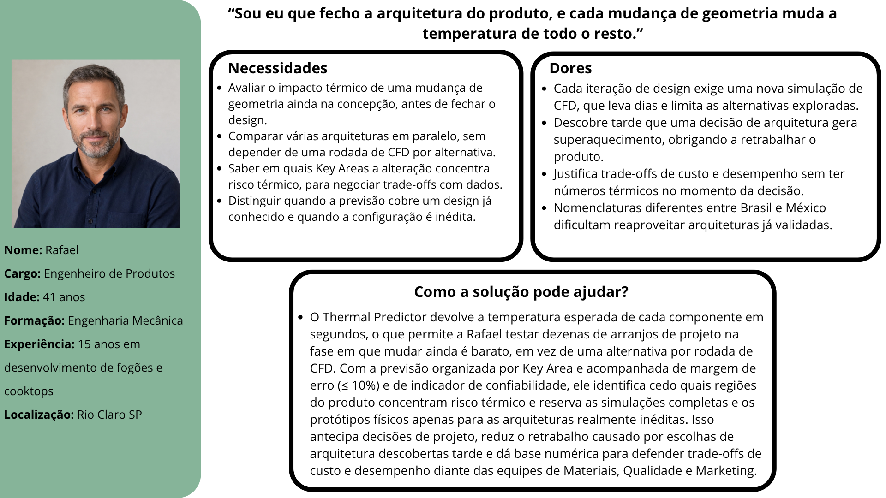<br>
  <sup>Fonte: Elaborado pelos autores (2026).</sup>
</div>

Esta persona foi escolhida por representar o profissional que define a arquitetura do produto e, portanto, toma as decisões que originam o comportamento térmico que todas as demais personas depois avaliam: a geometria, o arranjo dos componentes e a configuração construtiva do fogão.
Hoje, cada alteração de arquitetura proposta por Rafael exige uma nova rodada de simulação de CFD, processo que leva dias e restringe o número de alternativas que ele consegue explorar antes de congelar o design. Sua necessidade é estimar o efeito térmico de uma mudança de geometria ou de arranjo ainda na concepção, comparando múltiplas arquiteturas em paralelo e sabendo em quais Key Areas o risco se concentra. No dia a dia, ele usa o dashboard para varrer configurações candidatas logo no início do projeto, observando a margem de erro e o indicador de confiabilidade (Seção 4.1.5, R04) para distinguir os casos em que a previsão é interpolação daqueles em que o design é inédito e ainda exige validação por simulação completa.
Diferente de Estela e João, que consultam a previsão para aprovar ou reprovar uma escolha já feita, Rafael atua um passo antes: ele usa a previsão para gerar e descartar alternativas de projeto, no momento em que mudar o produto ainda é barato. É a persona que desloca o ganho do Thermal Predictor da etapa de validação para a etapa de concepção, evitando que decisões de arquitetura tomadas no início se revelem termicamente inviáveis apenas ao final do ciclo de desenvolvimento.

#### <a name="c4_1_7"></a>4.1.7. Jornadas do Usuário

Um mapa de jornada do usuário representa, em uma linha do tempo, as ações, pensamentos e emoções de uma persona ao buscar um objetivo, evidenciando onde surgem dúvida, confiança e decisão ao longo da experiência, e não apenas o funcionamento técnico do sistema. Essa ferramenta é especialmente relevante para o Thermal Predictor porque a solução não devolve uma resposta definitiva, e sim uma previsão de aprendizado de máquina com margem de erro e indicador de confiabilidade (Seção 4.1.5, R04). O valor do produto depende de como cada persona interpreta essa previsão e a converte em uma decisão real de engenharia, e o mapa torna esse processo de interpretação e decisão explícito, permitindo identificar onde a solução pode reduzir incerteza e apoiar decisões mais rápidas e seguras, sem tratar a previsão do modelo como verdade absoluta.

##### Jornada do Usuário — Engenheiro de Qualidade (João) — Cenário Atual (As Is)

**Cenário:** João recebe da equipe de Design um pedido de validação térmica para uma nova configuração de fogão. Sem uma previsão inicial disponível, ele precisa levantar manualmente o histórico de validações semelhantes, acionar a equipe de CFD para simulação e prototipagem física, aguardar a fila de agenda dessas equipes e, dentro do prazo e do orçamento de protótipos disponíveis, testar apenas algumas das alternativas possíveis antes de emitir seu parecer para as equipes de módulos e produto.

<div align="center">
  <sub>Figura 10 — Mapa de Jornada do Usuário (As Is): Engenheiro de Qualidade (João)</sub><br>
  <br>
  <sup>Fonte: Elaborado pelos autores (2026).</sup>
</div>

**Fase 1 — Recebimento do Design**

- *Ações:* Recebe o pedido de validação térmica, identifica a arquitetura (BR ou MX) e os componentes no escopo.
- *Pensamento:* "A assinatura é minha. Se passar algo errado, a responsabilidade vem para cá."
- *Emoção:* Neutra.
- *Ponto de dor:* Assume a responsabilidade da liberação sem saber se já existe validação semelhante para aquela configuração.

**Fase 2 — Preparação da Validação**

- *Ações:* Levanta os limites normativos por Key Area e busca no histórico ensaios de configurações semelhantes.
- *Pensamento:* "Tenho certeza de que já validamos algo parecido, mas achar essa evidência é uma caçada."
- *Emoção:* Frustração.
- *Ponto de dor:* Evidência histórica dispersa em pastas e planilhas; refaz um contexto que a empresa já produziu.

**Fase 3 — Solicitação e Espera**

- *Ações:* Aciona a equipe de CFD e/ou solicita o protótipo, e aguarda a fila de agenda dessas equipes.
- *Pensamento:* "Meu prazo não depende de mim. Fico parado esperando outra área, e quem cobra o cronograma não vê a espera, vê o atraso."
- *Emoção:* Impotência.
- *Ponto de dor:* Cobrado por um prazo que não controla: depende da fila da equipe de CFD e da agenda de protótipos.

**Fase 4 — Ensaio e Verificação**

- *Ações:* Acompanha o ensaio térmico e compara a temperatura de cada sensor com o limite, identificando extrapolações.
- *Pensamento:* "Cada ensaio consome um protótipo caro e só me responde sobre esta configuração. Sei o que falhou, mas não bem por quê."
- *Emoção:* Tensão.
- *Ponto de dor:* Cada teste destrutivo consome um protótipo caro e responde por uma única configuração; mostra a falha, não a causa.

**Fase 5 — Triagem Limitada e Retrabalho**

- *Ações:* Seleciona manualmente as poucas alternativas que cabem no prazo; se reprovado, reporta o resultado e retorna à fase 3.
- *Pensamento:* "Testo três alternativas, não trinta. Posso estar reprovando algo viável, ou liberando a pior das opções que não olhei. E cada volta custa mais um protótipo."
- *Emoção:* Vale da jornada — o ponto mais baixo do processo.
- *Ponto de dor:* Avalia poucas alternativas por limite de prazo e custo; cada reprovação reinicia fila, protótipo e ensaio.

**Fase 6 — Entrega da Decisão**

- *Ações:* Registra as combinações aprovadas e excluídas e emite o parecer para as equipes de módulos e produto.
- *Pensamento:* "Decidi com segurança, mas atrasado e caro. E esse aprendizado fica na minha planilha, comigo."
- *Emoção:* Alívio parcial.
- *Ponto de dor:* Decisão correta, mas tardia e cara; o aprendizado fica preso na planilha pessoal e não é reaproveitado.

Essa jornada atual evidencia os gargalos que o Thermal Predictor busca endereçar: dependência de filas de outras equipes, custo e escassez de protótipos físicos, evidência histórica dispersa e aprendizado que não é reaproveitado entre configurações. A jornada a seguir (To Be) mostra como esses pontos de dor são reduzidos com o uso da solução.

##### Jornada do Usuário — Engenheiro de Qualidade (João) — Cenário com o Thermal Predictor (To Be)

**Cenário:** João recebe da equipe de Design uma nova configuração de fogão para avaliar antes da liberação do produto. Em vez de aguardar uma bateria completa de testes físicos destrutivos, ele usa o Thermal Predictor para gerar uma previsão térmica por sensor, com margem de erro e indicador de confiabilidade, e a partir dela decide quais componentes podem ser aprovados diretamente e quais ainda exigem confirmação por teste físico antes do encerramento do parecer.

<div align="center">
  <sub>Figura 11 — Mapa de Jornada do Usuário (To Be): Engenheiro de Qualidade (João)</sub><br>
  <br>
  <sup>Fonte: Elaborado pelos autores (2026).</sup>
</div>

**Fase 1 — Acessar e Triar**

- *Ações:* Acessa a plataforma e faz login com suas credenciais, abre a configuração recebida da equipe da Beatriz do Design no dashboard, confere o identificador e a revisão da configuração recebida, e verifica na tela de "casos similares" se já existe parecer emitido para configurações parecidas.
- *Pensamento:* "Já vi algo parecido com isso antes? Existe parecer anterior que eu deva consultar antes de começar do zero?"
- *Emoção:* Neutra, modo organização.
- *Ponto de dor:* Sem esse filtro, revisaria pareceres antigos manualmente e correria o risco de duplicar uma análise já feita.

**Fase 2 — Configurar Parâmetros**

- *Ações:* Seleciona as áreas-chave a avaliar (Mainback, bobinas, ventilação, área do cooktop, painel de comandos), preenche os parâmetros da configuração (direção do fluxo de ar, estado do housing, posição da placa, material do suporte da bobina, presença do furo do defletor), confere no resumo da tela se todos os campos obrigatórios foram preenchidos e clica em "Gerar previsão".
- *Pensamento:* "Um campo errado invalida a previsão inteira — preciso conferir antes de enviar."
- *Emoção:* Atenção concentrada.
- *Ponto de dor:* Sem validação prévia, o erro só apareceria depois de gerada a previsão, obrigando a repetir o ciclo.

**Fase 3 — Explorar Resultados**

- *Ações:* Na tela de resultados, visualiza a lista de sensores com temperatura estimada e selo de confiabilidade, ordena por proximidade do limite normativo e identifica o da área do cooktop (IPC) destacado em "extrapolação moderada".
- *Pensamento:* "A maioria está tranquila, mas esse ponto está no limite — preciso olhar com mais cuidado."
- *Emoção:* Alívio parcial; atenção no ponto crítico.
- *Ponto de dor:* Sem ordenação por criticidade, o sensor de risco passaria despercebido em meio aos demais.

**Fase 4 — Conferir o Ponto Crítico**

- *Ações:* Abre o detalhe do sensor da área do cooktop (IPC), confere o valor previsto e sua margem de erro (10%) contra o limite térmico normativo cadastrado para aquele componente, e registra no campo de anotações o motivo da dúvida.
- *Pensamento:* "Com essa margem de erro, esse valor ainda está dentro do que a norma permite?"
- *Emoção:* Atenção redobrada antes de decidir.
- *Ponto de dor:* Sem o limite normativo exibido junto ao valor previsto, teria que consultar a norma em outro documento para confirmar a folga real.

**Fase 5 — Decidir (decisão crítica)**

- *Ações:* Marca o sensor da área do cooktop (IPC) como "pendente de teste físico", os demais como "aprovado por previsão", preenche o campo obrigatório de justificativa da pendência e clica em "Salvar decisão parcial".
- *Pensamento:* "Só esse ponto precisa de confirmação física — o resto já pode seguir."
- *Emoção:* Segurança na decisão, com peso do ponto em aberto.
- *Ponto de dor:* Sem status por componente, seria forçado a aprovar ou reprovar tudo de uma vez.

**Fase 6 — Encaminhar e Encerrar**

- *Ações:* Clica em "Gerar parecer", confere o documento consolidado, envia à equipe de engenharia da produção pelo próprio dashboard e acompanha o status "pendente" na tela de acompanhamento até a equipe registrar o resultado do teste físico; então atualiza o status do componente pendente e clica em "Encerrar parecer".
- *Pensamento:* "Reduzi de uma bateria completa de testes para um único ponto crítico — agora só falta confirmar."
- *Emoção:* Dever cumprido e fechamento do ciclo.
- *Ponto de dor:* Sem notificação de retorno e trava de encerramento, o parecer ficaria "aberto" indefinidamente, sem sinalizar quando a decisão final está de fato concluída.

**Oportunidades identificadas**

- Tela de "casos similares" com busca por parecer anterior, evitando retrabalho de análise (Fase 1).
- Validação de campos obrigatórios antes da geração da previsão, evitando ciclos de repetição (Fase 2).
- Ordenação da lista de sensores por proximidade do limite normativo, destacando o ponto mais crítico (Fase 3).
- Exibição do limite térmico normativo junto ao valor previsto e sua margem de erro, dispensando consulta a documento externo (Fase 4).
- Status de decisão por componente (aprovado por previsão / pendente de teste físico), permitindo decisões parciais em vez de tudo-ou-nada (Fase 5).
- Notificação de retorno do teste físico e trava de encerramento do parecer, garantindo rastreabilidade até a decisão final (Fase 6).

##### Comparação entre as Jornadas As Is e To Be

As duas jornadas foram construídas pela própria equipe do projeto, como exercício analítico de UX, e não a partir de entrevista ou observação direta de um engenheiro de qualidade real; a leitura a seguir deve ser tratada como uma síntese comparativa das fases descritas acima, não como medição validada de ganho. A tabela abaixo organiza lado a lado o que já está descrito em cada fase, para facilitar a leitura cruzada.

| Dimensão | Cenário Atual (As Is) | Cenário com o Thermal Predictor (To Be) |
|---|---|---|
| Ponto de partida | Nenhuma estimativa disponível antes de acionar CFD e/ou teste físico (Fase 1) | Previsão térmica disponível assim que a configuração é preenchida (Fase 2) |
| Dependência de outras equipes | Aguarda fila da equipe de CFD e agenda de protótipos para avançar (Fase 3) | Gera e interpreta a previsão sem depender de outra equipe; teste físico é acionado só para o(s) ponto(s) marcado(s) como pendente (Fase 5) |
| Uso de evidência histórica | Busca manual em pastas e planilhas, sem garantia de encontrar o caso equivalente (Fase 2) | Consulta a uma tela de "casos similares" antes de iniciar a análise (Fase 1) |
| Abrangência avaliada | Poucas alternativas testadas fisicamente, limitadas por prazo e custo de protótipo (Fase 5) | Todos os sensores da configuração informada recebem previsão simultânea (Fase 3) |
| Granularidade da decisão | Tudo-ou-nada por rodada de teste: uma reprovação reinicia fila, protótipo e ensaio (Fase 5) | Por componente: aprova por previsão o que está dentro do limite e marca como pendente só o que exige confirmação física (Fase 5) |
| Fase de maior tensão | Fase 5 — Triagem Limitada e Retrabalho | Fase 2 — Configurar Parâmetros e Fase 4 — Conferir o Ponto Crítico |
| Registro e encerramento | Combinações aprovadas/excluídas registradas pelo próprio João; conhecimento fica com ele (Fase 6) | Parecer, decisões parciais e retorno do teste físico registrados no dashboard até o encerramento (Fase 6) |

A leitura cruzada aponta três diferenças descritas nas próprias jornadas: menor dependência de fila de terceiros para obter uma primeira estimativa, decisão por componente em vez de tudo-ou-nada, e um registro centralizado no lugar do conhecimento disperso em planilhas pessoais. Essas diferenças coincidem com as oportunidades já listadas para as Fases 1 e 5 da jornada To Be, o que é esperado, já que ambas as jornadas partem da mesma análise.

<h5 align="center">Demais Jornadas de Usuário</h5>

O mapa de jornada completo, com todas as fases, ações, pensamentos, emoções e oportunidades detalhadas, foi construído para João (Engenheiro de Qualidade) por ele representar o usuário mais crítico da solução: é quem interage diretamente com a previsão do modelo para tomar a decisão de liberação do produto, o cenário em que a margem de erro e o indicador de confiabilidade (R04) têm maior peso. O mínimo exigido pelo WAD — uma jornada detalhada — está atendido por essa jornada. Para as demais personas (Geraldo, Estela e Beatriz), que também interagem com a solução mas em pontos de decisão menos críticos ou mais indiretos, optou-se por um resumo objetivo de suas jornadas, preservando o cenário, o principal ponto de decisão e a oportunidade central identificada em cada uma.

**Geraldo (Especialista de Marketing):** Ao planejar o lançamento de um novo fogão, Geraldo depende de dados técnicos de desempenho térmico e de uma data confiável de validação para montar o cronograma de campanha; com o Thermal Predictor, passa a acessar essas previsões ainda na fase de modelagem, antes da conclusão dos testes físicos. Seu momento crítico é decidir o que pode ser afirmado publicamente com base numa previsão e não numa validação física, por isso opta por ancorar a comunicação em atributos (ex.: "segurança ao toque") em vez de números absolutos, mantendo margem para ajuste. A oportunidade central é exibir o intervalo de confiança da previsão no dashboard, hoje ausente, que é justamente o dado que separaria uma decisão de campanha segura de uma aposta reputacional.

**Estela (Engenheira de Materiais):** Estela usa o dashboard para comparar combinações candidatas de material e espessura antes de enviá-las a teste físico, e seu momento de maior tensão ocorre quando um resultado contraintuitivo diverge da sua experiência prévia, gerando desconfiança momentânea no modelo até que ela consiga confrontar a previsão com casos históricos semelhantes. A oportunidade central é oferecer explicabilidade da previsão (quais variáveis mais influenciaram o resultado) e comparação com casos históricos do dataset, ancorando previsões contraintuitivas em precedentes reais e acelerando a recuperação de confiança na ferramenta.

**Beatriz (Designer UX/UI):** Beatriz não usa o dashboard para gerar previsões, mas para evoluí-lo: cruza feedback qualitativo das demais equipes com telemetria de uso para diagnosticar problemas de hierarquia de informação e ambiguidade nos estados do modelo (interpolação, extrapolação, fora de domínio; R04), redesenha as telas priorizadas e valida com testes de usabilidade se engenheiros e profissionais de marketing conseguem interpretar previsão, margem de erro e confiabilidade sem explicação adicional. A oportunidade central é um painel de métricas de adoção pós-lançamento (acesso por Key Area, tempo de permanência, dúvidas recorrentes), que fecha o ciclo de melhoria contínua da interface de volta ao diagnóstico.

#### <a name="c4_1_8"></a>4.1.8. Política de Privacidade

Projeto Thermal Predictor

**Informações Gerais:**

Esta política de privacidade informa como o projeto Thermal Predictor, desenvolvido pelo grupo FOG em parceria com a Whirlpool (Divisão de Fogões BR/MX), trata os dados pessoais coletados durante o uso da solução. Está em conformidade com a Lei nº 13.709/2018 – LGPD²².

A solução envolve duas naturezas de dados, submetidas a regimes jurídicos distintos. Os dados técnicos e operacionais de produto, temperaturas de sensores, limites de engenharia, configurações de teste e identificadores de componentes que compõem o dataset, não são dados pessoais e, portanto, não estão sob a incidência da LGPD; sua proteção decorre dos acordos de confidencialidade e de propriedade intelectual firmados com a Whirlpool. Os dados pessoais, únicos regidos por esta política, limitam-se às informações de identificação dos usuários que operam o sistema. Nenhum registro do dataset de temperatura se refere a pessoa natural identificada ou identificável, nos termos do art. 5º, I, da LGPD.

**Dados Coletados:**

Dados fornecidos diretamente: nome e e-mail, informados no cadastro e no login da solução.

Dados coletados automaticamente: data, hora e identificador de sessão dos acessos (logs de sistema), para fins de segurança e rastreabilidade.

Os dados de componentes e temperaturas inseridos na solução são dados técnicos de produto, e não dados pessoais, conforme a distinção acima.

**Finalidade do Tratamento:**

Autenticar usuários e controlar o acesso ao dashboard preditivo, assegurando que apenas profissionais autorizados das áreas de Engenharia e Qualidade utilizem a ferramenta.

O tratamento apoia-se em duas bases legais. O nome e o e-mail são tratados com fundamento na execução de contrato e de procedimentos preliminares (art. 7º, V), pois o usuário adere aos Termos de Uso da solução e o cadastro é condição para a prestação do serviço. Os logs de acesso apoiam-se no legítimo interesse do controlador (art. 7º, IX), voltado à segurança da informação e à auditoria, limitado ao mínimo necessário e sem sobrepor-se aos direitos e liberdades do titular. Observam-se os princípios do art. 6º, em especial finalidade, adequação, necessidade, transparência e segurança. Não há elaboração de perfil, publicidade ou decisão automatizada sobre pessoas: o modelo prevê a temperatura de componentes do produto, não o comportamento de indivíduos, de modo que não incide a hipótese do art. 20 da Lei.

**Armazenamento e Retenção:**

Local: ambiente local em que o sistema é executado, sem hospedagem em nuvem pública. O dataset fornecido pelo parceiro não é versionado no repositório público do projeto.

Prazo: durante a vigência do módulo acadêmico, com eliminação ao término, em observância ao princípio da necessidade (art. 6º, III) e às hipóteses de término do tratamento previstas nos arts. 15 e 16 da LGPD.

**Compartilhamento de Dados:**

Equipe do projeto, orientadores e supervisores acadêmicos do Inteli e Whirlpool. Não há venda, cessão ou compartilhamento com terceiros.

Como o parceiro desenvolve produtos para as arquiteturas de Brasil e México, dados de engenharia podem transitar entre as duas jurisdições. Os dados técnicos de produto são regidos pelos acordos de confidencialidade corporativos da Whirlpool. Eventual transferência internacional de dados pessoais observaria os arts. 33 a 36 da LGPD, que a condicionam a país com grau de proteção adequado ou à adoção de garantias contratuais específicas, como cláusulas-padrão contratuais ou normas corporativas globais; no México, aplica-se a Ley Federal de Protección de Datos Personales en Posesión de los Particulares (LFPDPPP)²³. No escopo atual, os dados pessoais permanecem armazenados no Brasil e não há transferência internacional ativa; caso o piloto seja estendido às equipes mexicanas, a base de transferência será formalizada antes da liberação de acesso.

**Segurança dos Dados:**

Autenticação individual com senha armazenada em formato de hash criptográfico; controle de acesso por perfil, segundo o princípio do menor privilégio, de modo que cada usuário acesse apenas as funcionalidades pertinentes à sua área; registro de logs de acesso para auditoria; e segregação entre o repositório público do projeto e os dados do parceiro, que não são publicados. Em caso de incidente de segurança com risco relevante aos titulares, a equipe comunicará o Encarregado, o parceiro e, quando aplicável, a Autoridade Nacional de Proteção de Dados (ANPD) e os titulares afetados, nos termos do art. 48 da LGPD.

**Direitos dos Titulares:**

Acesso, correção, exclusão e revogação de consentimento, além de confirmação da existência de tratamento, anonimização, bloqueio, portabilidade e informação sobre compartilhamento, nos termos do art. 18 da LGPD. Como o tratamento se apoia em execução de contrato e em legítimo interesse, e não em consentimento, não há consentimento em vigor a ser revogado; caso alguma finalidade futura passe a depender dele, a revogação será garantida a qualquer momento, por procedimento gratuito e facilitado (art. 8º, § 5º). Ao titular assegura-se, ainda, o direito de oposição ao tratamento realizado com dispensa de consentimento (art. 18, § 2º).

Solicitações via e-mail: felipe.pessoa@sou.inteli.edu.br

**Encarregado de Dados (DPO):**

Nome: Felipe Sodré Pessôa

E-mail: felipe.pessoa@sou.inteli.edu.br

### <a name="c4_2"></a>4.2. Compreensão dos Dados

#### <a name="c4_2_1"></a>4.2.1. Exploração de dados

##### Classificação das colunas

A classificação abaixo foi obtida com `df.dtypes` como ponto de partida, seguida de revisão manual para corrigir casos ambíguos (ex.: identificadores numéricos que não são quantidades, colunas com sujeira de formatação). Fonte: `data/dataset_pre_processado.csv` (formato tidy, uma linha por combinação Run x TC), gerado na Seção 0 e classificado na Seção 1.1 de [`notebooks/expl_preprocessamenro_hipote.ipynb`](../notebooks/expl_preprocessamenro_hipote.ipynb).

| Coluna | Tipo |
|---|---|
| run_id | Categórica |
| tc_number | Categórica |
| tc_name | Categórica |
| key_area | Categórica |
| active_limit | Numérica |
| temp | Numérica |
| reason | Categórica |
| blower_direction | Categórica |
| housing | Categórica |
| board_position | Categórica |
| run_case | Categórica |
| losses | Categórica |
| deflector_hole | Categórica |
| material_coil_support | Categórica |

**Observações da revisão manual:**

- `tc_number` parece numérico mas é um **identificador** do sensor (rótulo), não uma quantidade — não faz sentido calcular média/desvio dele, por isso ficou como Categórica apesar de o `dtype` bruto ser inteiro.
- `active_limit` é majoritariamente numérica (limite de temperatura em °C), mas ainda tem 1 valor residual de texto (`"Monitor (150 C)"`) — sensor sem limite de segurança definido. Precisa virar `NaN` (ou um flag `is_monitor` à parte) no pré-processamento da Seção 4.2.2 antes de qualquer cálculo estatístico.
- `reason` (138→134 ausentes conforme a limpeza mais recente) e `losses` (418 ausentes) têm muitos valores faltantes — considerar no tratamento de missing values da Seção 4.2.2.
- `material_coil_support` (material do suporte da bobina: alumínio vs. plástico) **está presente e preenchida** no dataset — é a variável central de uma das hipóteses de negócio do projeto de referência, e pode ser testada com estes dados (relevante para a Seção 4.2.4).


##### Estatística descritiva das colunas

Para cada coluna já classificada, foram calculadas as métricas descritivas correspondentes: média, desvio-padrão e quartis para as numéricas; moda, valores únicos e frequência para as categóricas. Cálculo na Seção 1.2 de [`notebooks/expl_preprocessamenro_hipote.ipynb`](../notebooks/expl_preprocessamenro_hipote.ipynb), a partir de `data/dataset_pre_processado.csv`.

###### Colunas numéricas

| Estatística | temp | active_limit |
|---|---|---|
| Contagem | 4065 | 4009 |
| Média | 81,77 | 184,43 |
| Desvio-padrão | 33,28 | 235,17 |
| Mínimo | 27,69 | 60,00 |
| Q1 (25%) | 59,11 | 100,00 |
| Mediana (50%) | 76,50 | 110,00 |
| Q3 (75%) | 96,02 | 150,00 |
| Máximo | 273,60 | 1000,00 |

###### Colunas categóricas — resumo

| Coluna | Moda | Nulos | Valores únicos |
|---|---|---|---|
| `run_id` | Run 20 | 0 | 56 |
| `tc_number` | 1 | 0 | 77 |
| `tc_name` | AC Blower HES Connector | 0 | 77 |
| `key_area` | IPC Comp | 0 | 7 |
| `reason` | Baseline new Duct | 134 | 34 |
| `blower_direction` | To Front | 0 | 4 |
| `housing` | Closed | 0 | 3 |
| `board_position` | Center | 0 | 3 |
| `run_case` | Broil Qualitative | 0 | 7 |
| `losses` | Simone Losses | 418 | 14 |
| `deflector_hole` | Closed | 0 | 2 |
| `material_coil_support` | Aluminium | 0 | 3 |

###### Distribuição das principais categóricas

**`key_area`** (região do fogão onde o sensor está):

| Valor | Frequência |
|---|---|
| IPC Comp | 1979 |
| Mainback | 610 |
| Coil Temps | 420 |
| CT Knobs | 330 |
| Main Vent Sys | 288 |
| Oven HMI | 220 |
| IPC Cooling | 218 |

**`housing`** (configuração da carcaça):

| Valor | Frequência |
|---|---|
| Closed | 2063 |
| Open | 1328 |
| Open - Updated | 674 |

**`run_case`** (tipo de caso de teste):

| Valor | Frequência |
|---|---|
| Broil Qualitative | 1444 |
| Broil C2 | 1176 |
| Pyro | 569 |
| Broil Case 2 | 355 |
| Qualitative | 225 |
| Broil C1 | 148 |
| Broil Qual | 148 |

###### Gráficos exploratórios — relação entre variáveis

Além das tabelas de estatística descritiva, foram produzidos gráficos para investigar como a temperatura (`temp`) se relaciona com variáveis de configuração e localização do ensaio. Código completo na Seção 1.3 de [`notebooks/expl_preprocessamenro_hipote.ipynb`](../notebooks/expl_preprocessamenro_hipote.ipynb).

<div align="center">
  <sub>Figura 12 — Temperatura por área do produto (key_area)</sub><br>
  <br>
  <sup>Fonte: Elaborado pelos autores (2026), a partir de data/dataset_pre_processado.csv.</sup>
</div>

`key_area` é a variável que mais separa os patamares de temperatura: a mediana varia de 47,1 °C em `CT Knobs` a 123,8 °C em `Coil Temps`, e `Mainback` concentra a maior parte dos valores extremos acima de 200 °C — coerente com o papel dessa região como destino do calor redistribuído, discutido na H1 (Seção 4.2.4).

<div align="center">
  <sub>Figura 13 — Temperatura média por housing e direção do blower</sub><br>
  <br>
  <sup>Fonte: Elaborado pelos autores (2026), a partir de data/dataset_pre_processado.csv.</sup>
</div>

As duas configurações interagem: com o housing `Closed`, o blower para trás (`To back`, 81,5 °C) aquece um pouco mais que para frente (`To front`, 79,8 °C); com o housing `Open`, essa ordem se inverte (86,2 °C para frente contra 83,4 °C para trás). Nenhuma combinação isolada é a mais fria em todas as áreas, o que antecipa o resultado da H2 (Seção 4.2.4): as configurações não têm efeito independente entre si.

<div align="center">
  <sub>Figura 14 — Taxa de excedência do limite por material do suporte da bobina</sub><br>
  <br>
  <sup>Fonte: Elaborado pelos autores (2026), a partir de data/dataset_pre_processado.csv.</sup>
</div>

Sensores com suporte de bobina em `Aluminium` excedem o `active_limit` em 8,4% das leituras, cerca do dobro da taxa observada em `Aluminium Plate` (4,1%) e `Plastic` (4,1%). O gráfico não isola causalidade — `material_coil_support` está confundido com outras configurações do ensaio, como discutido na H2 —, mas evidencia que o material é uma variável relevante para priorizar testes físicos.

<div align="center">
  <sub>Figura 15 — Temperatura medida vs. limite de engenharia por sensor</sub><br>
  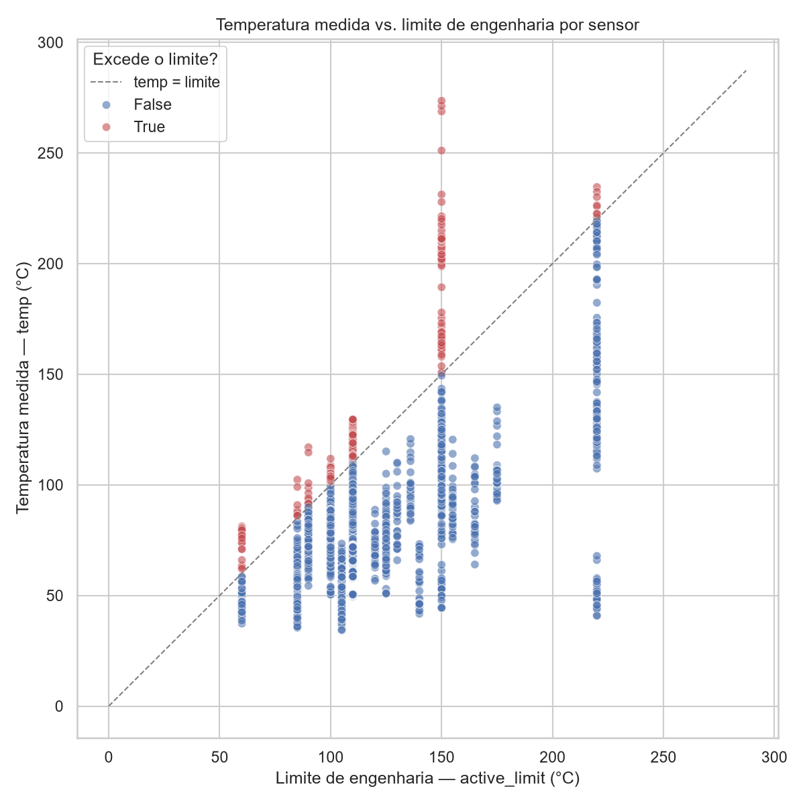<br>
  <sup>Fonte: Elaborado pelos autores (2026), a partir de data/dataset_pre_processado.csv.</sup>
</div>

Cada ponto é uma leitura de sensor; a linha tracejada marca `temp = active_limit`. Excluídas as leituras sem `active_limit` registrado e o placeholder `active_limit = 1000` (sensores sem limite definido, Seção 4.2.1), restam 3.707 leituras com limite físico válido; dessas, 309 (8,3%) ficam acima da diagonal, ou seja, excedem o limite de engenharia do próprio sensor — a maior concentração de excedências ocorre nos sensores com limite de 150 °C, componente central da ressalva metodológica tratada na Seção 4.2.2.

#### <a name="c4_2_2"></a>4.2.2. Pré-processamento dos dados

O pré-processamento dos dados foi realizado para organizar a base, tratar valores ausentes e registrar inconsistências sem alterar informações que podem representar comportamentos reais dos testes. As etapas foram conduzidas sobre o arquivo `dataset_pre_processado.csv`, gerado na reestruturação da planilha original, mantendo uma linha por combinação entre Run e TC. Implementação completa na Seção 2 de [`notebooks/expl_preprocessamenro_hipote.ipynb`](../notebooks/expl_preprocessamenro_hipote.ipynb).

Primeiramente foi feito o **tratamento de valores ausentes** nas colunas categóricas `reason`, `blower_direction`, `housing`, `board_position`, `run_case`, `losses`, `deflector_hole` e `material_coil_support`. Os valores `NaN` dessas colunas foram substituídos por **"Não informado"**, preservando os registros na base sem atribuir a eles uma categoria (como a moda) que não corresponde ao que foi de fato registrado no ensaio. Os valores nulos de `temp` já haviam sido retirados durante a reestruturação da planilha, pois, por ser a variável-alvo do modelo, preenchê-la com média, mediana ou outra estimativa introduziria um valor artificial exatamente na grandeza que o Thermal Predictor deve prever, o que poderia distorcer tanto a análise exploratória quanto o treinamento do modelo.

Em seguida, foi realizada a **identificação de outliers** nas temperaturas por `tc_name` utilizando o método do **Intervalo Interquartil (IQR)**. Para cada termopar, foram calculados o primeiro quartil (Q1), o terceiro quartil (Q3) e o intervalo interquartil, com os limites definidos por `[Q1 - 1,5 × IQR, Q3 + 1,5 × IQR]`. Os valores abaixo do limite inferior ou acima do limite superior foram contabilizados por `tc_name`, mas não foram removidos. A remoção comprometeria o aprendizado do modelo, pois cada tipo de teste pode apresentar um comportamento térmico diferente para cada peça. Por exemplo, testes com `run_case` **Pyro** apresentam temperaturas de Coil temperatures próximas de 50 °C, enquanto testes **Broil C2** podem atingir aproximadamente 220 °C. Portanto, valores classificados como outliers quando analisados em conjunto podem representar condições reais de um teste específico.

Também foram documentados **dados confusos ou insuficientes**:

 - O `active_limit` do componente Turbo Duct / AC Blower Outlet aparece como `Monitor (150 C)`, sem deixar claro se o componente não possui limite de temperatura ou se o limite é 150 °C. 
 
-  O componente Dedicated IPC/CKTP Outlet, por sua vez, estava completamente sem informações e foi retirado durante a reestruturação. 

- Para o Oven RTD Connector Body, foi observada uma divergência entre o `active_limit` de 150 °C e temperaturas próximas de 200 °C. A anotação disponível sugere que o componente provavelmente não atingirá 150 °C e poderia ser removido em uma simulação inicial, mas essa orientação é subjetiva. Por isso, o grupo optou por manter os dados do componente sem alterações até obter uma validação técnica.


Como tratamento pontual, o valor textual `Monitor (150 C)` da coluna `active_limit` foi convertido para o valor numérico `150`, permitindo manter um padrão numérico nessa coluna. As linhas que continham esse valor foram armazenadas e exibidas para conferência antes da substituição. 

#### <a name="c4_2_3"></a>4.2.3. Processamento final dos dados

Nesta nova etapa de limpeza dos dados, a equipe consolidou um conjunto de ajustes voltados a simplificar a identificação dos registros e a reorganizar a base por área do produto. Em primeiro lugar, foram removidas as colunas “tc_id” e “tc_number”, que atuavam como identificadores redundantes do sensor: como ambas cumpriam a mesma função de rótulo já desempenhada por “tc_name”, sem agregar informação adicional e sem possuir significado quantitativo, sua manutenção apenas aumentava a redundância da base sem trazer ganho analítico. A partir dessa mudança, a identificação de cada termopar passa a ser feita exclusivamente pelo “tc_name”, simplificando o esquema de colunas sem perda de rastreabilidade.

Em relação à coluna “key_area”, o grupo optou por decompor a base única em sete novas tabelas, uma para cada área-chave do fogão: “Mainback”, “Coil Temps”, “Main Vent Sys”, “IPC Cooling”, “IPC Comp”, “CT Knobs” e “Oven HMI”. Essa separação reorganiza os dados originalmente consolidados em “key_area” de modo que cada tabela reúna apenas os sensores e leituras pertencentes à sua respectiva região do produto, facilitando análises e comparações centradas em cada área térmica sem exigir filtragem repetida da base principal.

Dentro de cada uma dessas sete tabelas, a coluna “tc_name” foi mantida como identificador do sensor, mas passou por uma reestruturação adicional: em vez de permanecer como uma coluna categórica com um valor de temperatura por linha (formato longo), cada tipo de termopar presente na área passou a ocupar uma coluna própria, e as leituras de temperatura passaram a ser organizadas como linhas da tabela (formato largo). Essa reorganização, definida como a versão final da estruturação do dataset destinado ao treino do modelo, evita a repetição do rótulo do sensor a cada linha e alinha cada observação às temperaturas simultâneas de todos os termopares daquela área, facilitando o uso direto da base pelas próximas etapas de modelagem (Seção 4.3).

Nessa tabela larga, cada linha passa a representar uma combinação das variáveis de configuração (“VAR.CONFIG”: `housing`, `blower_direction`, `deflector_hole`, `material_coil_support`, `run_case`, `losses` e `board_position`), e cada coluna de termopar guarda a temperatura observada para aquela combinação. Para o treino do modelo, essa tabela larga é achatada em uma tabela longa auxiliar com três colunas — “tc_name”, “VAR.CONFIG” e “TEMP” —, deixando explícita a relação `(tc_name) x (VAR.CONFIG) → TEMP`: a temperatura é o alvo, determinado pela combinação entre o termopar e a configuração testada. A coluna “active_limit” acompanha essa mesma chave (termopar x configuração), servindo de referência para calcular o quanto cada leitura se aproxima ou ultrapassa o limite de engenharia do sensor correspondente. Na modelagem (Seção 4.3), essa estrutura se traduz em um problema de regressão multi-saída: o vetor das sete variáveis de configuração (x₁, ..., x₇) é usado para prever simultaneamente o vetor de temperaturas de todos os termopares da área (y₁, ..., yₙ).

#### <a name="c4_2_4"></a>4.2.4. Hipóteses

Hipóteses em um projeto de análise preditiva de dados são extremamente importantes, porque definem as premissas e expectativas que vão guiar todo o processo de pré-processamento, engenharia de features e construção do modelo. Assim, essa etapa garante que as variáveis selecionadas, as métricas de avaliação e as decisões de modelagem estejam alinhadas aos objetivos definidos junto ao parceiro na Seção 4.1.

Sobre o projeto, a temperatura observada em cada sensor do fogão depende de um conjunto de variáveis de configuração e de operação que atuam em conjunto sobre o comportamento térmico do produto. Fatores como a localização física do componente (key_area), a configuração da carcaça (housing), a direção do fluxo de ar do blower (blower_direction), o material do suporte da bobina (material_coil_support) e o modo de operação simulado (run_case) influenciam diretamente o quanto cada região do fogão aquece e o quão perto ela fica do limite de engenharia do próprio sensor. Diante disso, as hipóteses a seguir buscam explorar como cada uma dessas variáveis se relaciona com a temperatura medida e com o risco de superaquecimento, permitindo identificar padrões de comportamento térmico e fornecer subsídios tanto para a etapa de modelagem preditiva quanto para a priorização de testes físicos junto ao parceiro.

O resumo abaixo apresenta o que cada hipótese afirma e a conclusão obtida; os testes, gráficos e valores completos estão na Seção 3 de [`notebooks/expl_preprocessamenro_hipote.ipynb`](../notebooks/expl_preprocessamenro_hipote.ipynb).

| # | Hipótese | Resultado |
|---|---|---|
| **H1** | O efeito de uma configuração muda de sinal conforme a área do produto: a mesma alteração aquece uma área e resfria outra. | Confirmada |
| **H2** | As sete configurações não são variáveis independentes — o desenho dos 56 ensaios as confunde, ao ponto de `losses` ser redundante com `deflector_hole`. | Confirmada |
| **H3** | A temperatura depende do modo de operação: `run_case` varia a média de ~71 °C (Pyro) a ~85 °C (Broil). | Confirmada |
| **H4** | A carcaça aberta eleva a temperatura do IGBT 1: com o housing aberto, o componente opera ~9,6 °C mais quente que fechado, o contrário do esperado. | Confirmada |

##### H1 — Configurações redistribuem calor, não o eliminam

A hipótese é de que nenhuma configuração deixa o fogão inteiro mais quente ou mais frio: cada mudança move calor de uma região para outra. Escolher uma configuração seria, portanto, escolher qual área proteger, e não reduzir o aquecimento como um todo.

A hipótese se confirmou. Em todas as configurações testadas o efeito aparece com sinais opostos entre áreas: abrir o `deflector_hole`, por exemplo, aquece a área do IPC e resfria o sistema de ventilação principal, com diferença estatisticamente significativa entre as duas. O mesmo padrão se repete em `blower_direction`, `housing` e `material_coil_support`, e vale também em risco, não só em temperatura — a mesma mudança aumenta a excedência do limite em uma área enquanto a reduz em outra. A área de ventilação principal aparece de forma recorrente como aquela que recebe o calor retirado das demais, comportamento coerente com conservação de energia.

Nem toda configuração, porém, é uma troca: `blower_direction = To Back` piora simultaneamente as duas áreas eletrônicas sem melhorar nenhuma outra, ou seja, é uma condição pior em termos absolutos.

A consequência direta para a modelagem (Seção 4.3) é que a predição precisa ser condicionada à área. Um modelo que ignore a interação entre área e configuração estimaria um efeito médio que não descreve nenhuma das áreas e erra o sinal em pelo menos uma delas.

##### H2 — As configurações não são independentes entre si

A hipótese é de que as configurações estão confundidas no desenho experimental, porque os 56 ensaios não vêm de um experimento fatorial planejado: são um histórico de testes, em que cada run respondia a uma pergunta específica e mudanças em uma peça vinham acompanhadas de mudanças em outras.

A hipótese se confirmou, no caso mais extremo possível. Cada categoria de `losses` corresponde a um único valor de `deflector_hole`, sem nenhum ensaio que separe as duas variáveis — não é apenas associação forte, é identidade. Outros pares também aparecem fortemente associados (`run_case` com `losses`, `housing` com `losses`, `blower_direction` com `deflector_hole`), e o espaço de combinações é esparso: das 36 combinações possíveis entre as três variáveis principais, apenas 11 foram ensaiadas, e metade dos runs se concentra em duas delas.

Isso não invalida a H1, mas delimita o que ela mede: os efeitos são reais e reproduzíveis, porém pertencem a blocos de configuração inteiros, não a peças isoladas. A base permite identificar configurações de risco, não atribuir a causa a um componente específico.

As decisões que isso gera para a modelagem são: manter as sete variáveis de configuração como preditoras — `losses` e `board_position` inclusos —, já que a redundância estatística observada reflete uma limitação do desenho experimental (ensaios não fatoriais, histórico), não a ausência de relevância física dessas variáveis; não apresentar ranking de importância de variáveis ao parceiro como evidência de causa, já que modelos de árvore distribuem o crédito arbitrariamente entre variáveis redundantes; e recomendar que os próximos ensaios sejam planejados para quebrar essas dependências.

##### H3 — O modo de operação eleva a temperatura, mas é um fator secundário

A hipótese é de que o modo de operação afeta a temperatura medida nos componentes: os modos Broil (grelhar), que acionam o elemento superior em alta potência, operariam mais quentes que o Pyro (autolimpeza) e os casos Qualitative.

A hipótese se confirmou. Os modos Broil operam a 83,5 °C em média contra 74,5 °C nos demais, uma diferença de 9,1 °C, e a amplitude entre o modo mais quente (Broil C2, 84,7 °C) e o mais frio (Pyro, 71,4 °C) chega a 13,3 °C. A separação é muito significativa, confirmada por ANOVA, Kruskal-Wallis e pelo contraste Broil vs. demais (Welch e Mann-Whitney), todos com p < 0,001.

<div align="center">
  <sub>Figura 16 — Temperatura por modo de operação (run_case) e contraste Broil vs. demais</sub><br>
  <br>
  <sup>Fonte: Elaborado pelos autores (2026), a partir de data/dataset_pre_processado.csv.</sup>
</div>

A ressalva é sobre a magnitude: o modo explica apenas cerca de 2% da variância da temperatura (η² ≈ 0,02; Cohen's d ≈ 0,28). Com mais de quatro mil leituras, a significância é quase garantida, então a leitura honesta se apoia no efeito absoluto em °C, não no p-valor. A maior parte da variação vem da área do sensor (key_area), não do modo.

Para a modelagem (Seção 4.3), isso significa manter run_case como preditor, é um fator real e consistente, porém com peso secundário frente à área do sensor. Como nas demais hipóteses, os fatores estão confundidos entre si, de modo que o resultado identifica um padrão associado ao modo, não uma causa isolada.

##### H4 — A carcaça aberta aquece o IGBT 1, contra a intuição

A hipótese é de que a configuração da carcaça (housing) influencia a temperatura do IGBT 1, o sensor de maior presença na base, na área IPC Comp (~49% dos registros). A intuição inicial seria de que a carcaça fechada, ao prender o calor, deixaria o componente mais quente; a hipótese testa se ocorre o oposto, com a carcaça aberta redirecionando o fluxo de ar de forma a aquecer o IGBT 1 em vez de resfriá-lo. O recorte fixa o sensor (uma leitura por run, n = 56, limite constante de 110 °C), evitando pseudo-replicação.

A hipótese se confirmou, na direção contra-intuitiva. Com a carcaça aberta o IGBT 1 opera a 91,7 °C em média, contra 82,1 °C com ela fechada, uma diferença de +9,6 °C, ou seja, aberto é mais quente, não o contrário. O efeito é estatisticamente significativo no teste de médias (Welch, p ≈ 0,03) e de magnitude média (Cohen's d ≈ 0,59), maior que o observado na H3.

<div align="center">
  <sub>Figura 17 — Temperatura do IGBT 1 por configuração da carcaça (housing)</sub><br>
  <br>
  <sup>Fonte: Elaborado pelos autores (2026), a partir de data/dataset_pre_processado.csv.</sup>
</div>

A ressalva é o tamanho da amostra: com apenas 56 leituras (28 por grupo), os testes mais conservadores ficam no limite, o Mann-Whitney não alcança significância (p ≈ 0,08) e o Fisher exato na taxa de excedência do limite (110 °C) também não (p ≈ 0,67, com poucos pontos acima do limite em ambos os grupos). A leitura honesta se apoia no efeito absoluto em °C e no Welch/Cohen's d, não numa convergência de todos os testes. Vale registrar ainda que, apesar de o IGBT 1 dominar a base em volume, ele é o mais frio dos 16 IGBTs, sua relevância vem da quantidade de dados, não da severidade térmica.

Para a modelagem (Seção 4.3), isso indica que a interação entre housing e a posição do componente deve ser considerada: o efeito da carcaça sobre a temperatura não é uniforme nem segue a intuição de "fechado aquece". Como nas demais hipóteses, housing está confundido com outras configurações no desenho dos ensaios, de modo que o resultado identifica uma associação, não uma causa isolada.

### <a name="c4_3"></a>4.3. Preparação dos Dados e Modelagem

O Thermal Predictor é um modelo supervisionado: a variável a ser prevista (temperatura de cada termopar) é conhecida no histórico de ensaios, o que permite treinar o modelo por aprendizado supervisionado sobre esses exemplos rotulados.

#### <a name="c4_3_1"></a>4.3.1. Organização dos dados

Antes do treinamento, as sete variáveis de configuração de entrada são codificadas ordinalmente: cada categoria de uma variável recebe um número inteiro (0, 1, 2...) em ordem alfabética. Essa codificação não atribui significado ao valor numérico em si, o que não é um problema para um modelo baseado em árvores como o `RandomForestRegressor`: a árvore aprende limiares de decisão sobre esse número, não uma relação linear com ele. A justificativa da escolha de cada uma das sete features está detalhada em Features de entrada, abaixo.

Os dados de cada `key_area` são então divididos em três conjuntos disjuntos: 70% para treino, 20% para teste e 10% para verificação. O treino é o único conjunto usado para ajustar o modelo. Teste e verificação ficam totalmente fora do treinamento e são avaliados apenas ao final, sobre dados que o modelo nunca viu.

Dentro do conjunto de treino, os hiperparâmetros do modelo (número de árvores, profundidade máxima, mínimo de amostras por folha, número de features consideradas em cada divisão) são escolhidos por validação cruzada via `GridSearchCV`: o treino é dividido internamente em partições, o modelo é treinado e avaliado em cada combinação de hiperparâmetros da grade, e a combinação com melhor erro médio absoluto (MAE) entre as partições é escolhida. Esse processo nunca toca os dados de teste ou verificação. O número de partições é reduzido automaticamente quando o conjunto de treino de uma `key_area` é pequeno demais para o número de partições padrão.

#### <a name="c4_3_2"></a>4.3.2. Modelagem para o problema

**Enquadramento do problema**

O modelo precisa prever a temperatura de cada termopar, uma variável numérica contínua, não uma categoria. Por isso o problema é enquadrado como **regressão**, não classificação: o objetivo é estimar um valor em °C, não decidir entre rótulos discretos.

Dentro de cada `key_area`, cada ensaio produz uma leitura simultânea de vários termopares para a mesma configuração de entrada. Chegou a se cogitar treinar **um modelo por termopar**, mas essa abordagem foi descartada: tratar cada sensor como um problema isolado ignoraria que todos os termopares de uma mesma região respondem à mesma física de transferência de calor e à mesma configuração de ensaio, desperdiçando o sinal que um sensor carrega sobre os demais da sua área. Por isso o problema foi modelado como **regressão multi-output**: um único `RandomForestRegressor` por `key_area`, cuja saída é um vetor com a temperatura de todos os termopares daquela região simultaneamente — cada folha da árvore armazena um vetor de médias, uma por termopar, em vez de uma única média.

**Por que um modelo por `key_area`**

As sete `key_area` do produto correspondem a regimes térmicos distintos, não a um recorte arbitrário do conjunto de dados. A hipótese H1, confirmada na Seção 4.2.4, mostra isso diretamente: o efeito de uma mesma configuração de montagem muda de sinal conforme a área. Uma alteração que aquece um componente em uma região esfria outro em outra região. Um modelo único, treinado sobre o conjunto completo, estimaria um efeito médio entre as áreas, que não descreveria corretamente nenhuma delas e erraria o sinal do efeito em pelo menos uma.

A tabela de parâmetros por `key_area` (Anexos, subseção de Escalonamento) quantifica essa heterogeneidade: a amplitude de temperatura vai de 28,37 °C em `Oven HMI` a 238,19 °C em `Mainback`, uma diferença de 8,4 vezes, e o coeficiente de variação varia de 0,068 a 0,590 entre as sete regiões. Por isso o pipeline treina **um `RandomForestRegressor` por `key_area`** (sete modelos), em vez de um único modelo global: cada modelo aprende a relação entre configuração e temperatura dentro do regime térmico da sua própria região, sem que esse sinal seja diluído ou invertido pelas demais áreas. A justificativa para cada modelo prever, de uma vez, todos os termopares da sua área (abordagem multi-output) já foi apresentada em Enquadramento do problema, acima.


**Features de entrada**

O modelo recebe como entrada as sete variáveis de configuração registradas no
dataset, todas categóricas e codificadas ordinalmente antes do treinamento
(Célula 3 de `notebooks/Random_for_regre.ipynb`). A variável-alvo é `temp`, a
temperatura em graus Celsius, prevista simultaneamente para todos os termopares
da `key_area`, conforme a modelagem multi-output descrita acima.

| Variável | O que descreve | Categorias |
| --- | --- | --- |
| `blower_direction` | Sentido do fluxo de ar do ventilador | 2 |
| `housing` | Estado do compartimento, aberto ou fechado | 2 |
| `board_position` | Posição da placa eletrônica | 2 |
| `run_case` | Modo de operação ensaiado | 4 |
| `losses` | Perfil de perdas térmicas do ensaio | 14 |
| `deflector_hole` | Presença do furo no defletor | 2 |
| `material_coil_support` | Material do suporte da bobina | 3 |

A contagem acima é a observada dentro de cada `key_area` — a granularidade em
que o modelo é de fato treinado (Célula 3 dos notebooks de modelagem) — e por
isso é menor do que a contagem sobre a base completa apresentada na Seção
4.2.1: nem toda categoria de uma variável aparece em toda região do produto,
reflexo do desenho não fatorial dos ensaios já discutido na H2 (Seção 4.2.4).

Todas descrevem decisões de montagem que alteram a troca de calor no interior do
produto, e as hipóteses da Seção 4.2.4 confirmam esse efeito com dados. A H1
mostra que abrir o furo do defletor eleva a temperatura em 7,9 °C na região
`IPC Comp` e a reduz em 5,1 °C em `Main Vent Sys`, efeito que inverte de sinal
conforme a área. A H4 mostra que o compartimento aberto aquece o IGBT 1 em 9,6 °C,
resultado contraintuitivo que reforça a relevância de `housing` como preditora. A
H3 confirma que `run_case` diferencia os patamares térmicos, ainda que com efeito
secundário. As demais variáveis descrevem geometria e material no caminho térmico,
e seu efeito é discutido adiante à luz da importância atribuída pelos modelos.

Não houve, portanto, seleção de um subconjunto: as sete disponíveis são mantidas,
apesar de a hipótese H2 ter recomendado retirar `losses` e `board_position`.

O confundimento que motivou aquela recomendação é real e está medido. A associação
entre `losses` e `deflector_hole` alcança V de Cramér de 0,89: doze das quatorze
categorias de `losses` correspondem a um único valor de `deflector_hole`, e as
outras duas misturam os dois valores, de modo que a relação é de associação quase
perfeita, não de identidade. Apenas onze das trinta e seis combinações possíveis
entre as quatro variáveis principais foram ensaiadas. Ocorre que retirar uma
variável por redundância pressupõe que a redundância seja do fenômeno, e não do
desenho experimental. Com esse nível de cobertura, não há como distinguir as duas
coisas: as variáveis aparecem associadas porque nunca foram ensaiadas em
combinações que as separassem. Remover antes de medir eliminaria a evidência
necessária para decidir a remoção. Este primeiro candidato mantém as sete para
observar o comportamento de cada uma, decisão a ser revista quando o espaço de
configurações estiver mais preenchido.

A importância de variáveis apoia a escolha: nenhuma zera nos três algoritmos
avaliados, e as duas que a H2 recomendara retirar aparecem entre as mais
relevantes, `losses` em segundo na floresta aleatória (0,2217) e `board_position`
em terceiro na árvore de decisão (0,1423). Sob confundimento, porém, a importância
atribuída a uma variável pode pertencer àquela com que ela se confunde, de modo
que esses valores indicam apenas que nenhuma variável é dispensável à luz dos
dados atuais, e não uma relação causal.

Duas categorias são raras no conjunto, `board_position` igual a *Right* (5,5% das
leituras) e `material_coil_support` igual a *Aluminium Plate* (1,8%); predições que
dependam delas apoiam-se em poucos ensaios e devem ser lidas com a cautela
prevista na classificação de confiabilidade (R04, Seção 4.1.5). A codificação
atribui a cada categoria um inteiro sequencial em ordem alfabética; optou-se pela
forma ordinal porque modelos baseados em árvores aprendem limiares sobre o valor
codificado, sem pressupor ordem entre os códigos.

#### <a name="c4_3_3"></a>4.3.3. Métricas de avaliação do modelo

A avaliação do Thermal Predictor responde a três perguntas distintas, e
nenhuma métrica isolada responde às três: se o erro médio é pequeno, se há erros
grandes escondidos atrás desse erro médio, e se o modelo aprendeu a relação entre
configuração e temperatura ou apenas reproduz o comportamento médio de cada
sensor. As três métricas abaixo cobrem uma pergunta cada e são reportadas em
conjunto, sempre por termopar (`tc_name`), sobre o conjunto de teste e em graus
Celsius, a unidade em que a decisão de engenharia é tomada. Estão implementadas
com a biblioteca scikit-learn²⁶ na seção de métricas do notebook do modelo
candidato, que acompanha ainda o afastamento entre o erro de treino e o de teste,
indicador de sobreajuste, risco elevado aqui pelo número reduzido de execuções
disponíveis (R02, Seção 4.1.5).

Onde $y_i$ é a temperatura registrada, $\hat{y}_i$ a temperatura prevista e $n$
o número de leituras do termopar avaliado:

**MAE (Erro Absoluto Médio)** média das diferenças absolutas entre valores
reais e previstos. Responde a quantos graus, em média, a previsão erra. Por não
elevar o erro ao quadrado, é a mais robusta das três diante de valores extremos.
É a primeira das métricas oficiais formalizadas no plano de ação do risco R06; as outras duas métricas desse plano, o erro normalizado pela folga até o limite de engenharia e a taxa de falsos-negativos de segurança, compõem o critério formal de aceite reportado a cada nova versão do modelo, não este comparativo entre candidatos. RMSE e R², descritos a seguir, servem exclusivamente à seleção do modelo nesta fase de modelagem, e não substituem essas duas métricas de aceite.

$$
MAE = \frac{1}{n} \sum_{i=1}^{n} \left| y_i - \hat{y}_i \right|
$$

**RMSE (Raiz do Erro Quadrático Médio)** mede a mesma distância, mas elevando
cada erro ao quadrado antes da média, com a raiz devolvendo o resultado à unidade
do alvo. Erros grandes passam a pesar desproporcionalmente, o que expõe previsões
pontualmente ruins que uma média simples esconderia. É sempre maior ou igual ao
MAE, e a igualdade só ocorre quando todos os erros têm a mesma magnitude²⁷.

$$
RMSE = \sqrt{\frac{1}{n} \sum_{i=1}^{n} \left( y_i - \hat{y}_i \right)^2}
$$

**R² (Coeficiente de Determinação)** indica quanto da variação da temperatura
o modelo explica, comparando seu erro com o de um preditor que ignora as
entradas e responde sempre a média do alvo. R² = 1 é previsão perfeita, R² = 0 é
empate com essa média e R² negativo significa desempenho pior que ela. MAE e
RMSE informam o tamanho do erro; o R² informa se houve aprendizado.

$$
R^{2} = 1 - \frac{\sum_{i=1}^{n} (y_i - \hat{y}_i)^2}{\sum_{i=1}^{n} (y_i - \bar{y})^2}
$$

##### Por que a escolha dessas métricas para avaliar o modelo?

O MAE é a métrica principal por estar na unidade em que a decisão é tomada: um
erro em graus Celsius é confrontável com a folga até o limite normativo do
componente, o que não ocorreria com uma métrica adimensional ou em °C². Sua
limitação é tratar todos os erros com o mesmo peso.

O RMSE cobre exatamente essa cegueira. A razão RMSE/MAE revela se o erro está
concentrado em poucos pontos ou distribuído: quanto mais ela se afasta de 1,
maior a cauda de previsões ruins. Isso importa porque uma única previsão que
subestime um componente crítico pode liberar um projeto termicamente inseguro
(R04), e por isso ambas são calculadas por termopar, e não só como média entre
alvos, para localizar o componente problemático.

O R² é o único que distingue aprendizado de reprodução da média. Sua referência
é a média do próprio conjunto de teste, um preditor-oráculo que ninguém conhece
antes de medir; por isso `notebooks/Random_for_regre.ipynb` — um dos três
notebooks de modelagem — reporta em paralelo um
`DummyRegressor(strategy="mean")` ajustado no treino, contraparte realista que
é o primeiro dos dois baselines exigidos pelo risco R03, ficando o segundo
registrado como pendência; o notebook da Árvore de Decisão faz a mesma comparação
(Seção 4.4.1), e generalizá-la ao notebook de Gradient Boosting é um ajuste ainda
pendente. É medido por
termopar porque, agregado, o preditor de
referência seria a média de todos os sensores do produto, valor que nenhum
engenheiro usaria como estimativa. Como as regiões operam em patamares distintos
(amplitude de 28,37 °C em `Oven HMI` contra 238,19 °C em `Mainback`, Anexos), o
R² agregado mediria essa diferença de patamar, já conhecida, e não o que o modelo
aprendeu.

O erro percentual (MAPE) foi descartado como **critério de avaliação e de escolha
de modelo** por incorrer na crítica do risco R06: a escala Celsius é intervalar,
logo 10% de 150 °C são 15 °C, mas os mesmos 150 °C valem 423,15 K, cujos 10% são
42,3 °C. MAE e RMSE contornam o problema por reportarem erro absoluto, e o R² por
ser invariante a transformações afins do alvo. O MAPE e a fração de previsões
dentro de 10% continuam nas tabelas da Seção 4.4 apenas como **leitura auxiliar**:
a margem de 10% é a que foi acordada com o parceiro, e reportá-la facilita a
comunicação dos resultados, mas nenhuma decisão entre modelos se apoia nelas. A
escolha segue a ordem desta seção: MAE como métrica principal, R² para distinguir
aprendizado de reprodução da média, e RMSE para localizar a cauda de erros
grandes. O notebook reporta ainda o afastamento entre o MAE de treino e o de teste,
indicador de sobreajuste. O R03 fixa esse gatilho em cinco pontos percentuais sem
definir a grandeza sobre a qual o percentual incide, ambiguidade análoga à do
critério de 10%, razão pela qual o afastamento é reportado em graus Celsius e
em variação relativa, sem converter um no outro.

#### <a name="c4_3_4"></a>4.3.4. Análise e interpretação dos resultados dos modelos candidatos

O Thermal Predictor tem três modelos candidatos, todos de regressão multi-saída e treinados em sete instâncias independentes, uma por `key_area`: Decision Tree, Random Forest e Gradient Boosting. Cada algoritmo tem notebook próprio, com o histórico de experimentos e os hiperparâmetros escolhidos por busca em grade ([`Decision_tree_regre.ipynb`](../notebooks/Decision_tree_regre.ipynb), [`Random_for_regre.ipynb`](../notebooks/Random_for_regre.ipynb) e [`Grad_Boosting_Regre.ipynb`](../notebooks/Grad_Boosting_Regre.ipynb)). A comparação entre os três, sob um único protocolo, está em [`notebooks/comparacao_modelos.ipynb`](../notebooks/comparacao_modelos.ipynb). Esta subseção resume o que esse comparativo mostra; a leitura detalhada de cada algoritmo está nas Seções 4.4.1 a 4.4.3, e a escolha do algoritmo por região, na Seção 4.4.4.

##### Desempenho comparado

A Figura 18 e a tabela abaixo trazem as métricas dos três candidatos e de um baseline que prevê sempre a média do treino, ignorando a configuração de entrada. A comparação é direta porque os quatro são avaliados no mesmo processo, sobre as mesmas planilhas, com a mesma codificação one-hot e a mesma validação: LOGO (Leave-One-Group-Out), em que cada uma das 32 configurações de uma região serve de teste uma vez, treinando com as outras 31. Cada métrica é calculada por termopar e resumida para a região pela **mediana** entre termopares, a mesma agregação para os quatro; a tabela traz a média dessas medianas entre as sete regiões. O MAPE fica de fora por ser apenas leitura auxiliar (Seção 4.3.3).

<div align="center">
  <sub>Figura 18 — Comparativo entre os modelos candidatos e o baseline sob validação LOGO, por região</sub><br>
  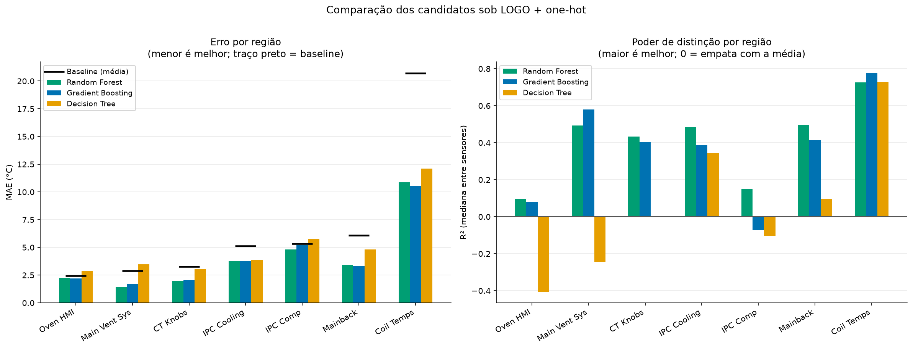<br>
  <sup>Fonte: Elaborado pelos autores (2026), a partir de notebooks/comparacao_modelos.ipynb (Seção 5).</sup>
</div>

| Modelo | MAE (°C) ↓ | RMSE (°C) ↓ | R² ↑ | Dentro de 10% ↑ | Regiões em que supera o baseline (MAE) |
|---|---|---|---|---|---|
| **Random Forest** | **4,08** | **5,79** | **0,412** | **87,6%** | 7 de 7 |
| Gradient Boosting | 4,12 | 5,89 | 0,368 | 86,9% | 7 de 7 |
| Decision Tree | 5,14 | 6,80 | 0,060 | 82,3% | 4 de 7 |
| Baseline (média do treino) | 6,55 | 9,49 | −0,066 | 75,9% | — |

<sup>Fonte: Elaborado pelos autores (2026), a partir de `notebooks/comparacao_modelos.ipynb` (Seção 5). Média entre as sete regiões; em cada região, mediana entre termopares.</sup>

Random Forest e Gradient Boosting ficam praticamente empatados na média, e ambos superam o baseline nas sete regiões: a diferença de MAE entre os dois (0,04 °C) é muito menor que a diferença entre qualquer um deles e o baseline (cerca de 2,5 °C). O Decision Tree fica atrás em todas as métricas e supera o baseline em só quatro regiões. Como o empate na média esconde diferenças região a região, não há um único vencedor: a Seção 4.4.4 escolhe o algoritmo de cada região. Em todos os casos, o R² modesto mostra que os modelos acertam bem o patamar térmico de cada região, mas ainda não distinguem com segurança duas configurações parecidas.

As três figuras abaixo documentam a explicabilidade do Gradient Boosting, geradas na Seção 9 de `Grad_Boosting_Regre.ipynb`: importância por impureza (Figura 19), validação independente com SHAP (Figura 20) e a mesma leitura SHAP estendida às sete áreas (Figura 23). A interpretação está na Seção 4.4.3; a explicabilidade do Random Forest e do Decision Tree, nas Seções 4.4.2 e 4.4.1.

<div align="center">
  <sub>Figura 19 — Explicabilidade do Gradient Boosting: importância das variáveis na área Mainback</sub><br>
  <br>
  <sup>Fonte: Elaborado pelos autores (2026), a partir de notebooks/Grad_Boosting_Regre.ipynb.</sup>
</div>

<div align="center">
  <sub>Figura 20 — Validação da explicabilidade com SHAP: contribuição média das variáveis na área Mainback, em °C</sub><br>
  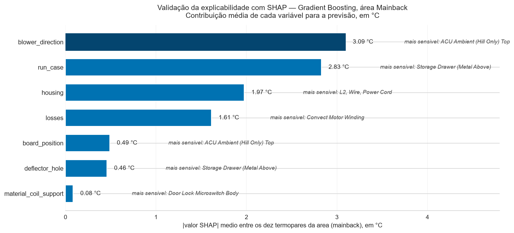<br>
  <sup>Fonte: Elaborado pelos autores (2026), a partir de notebooks/Grad_Boosting_Regre.ipynb.</sup>
</div>

<div align="center">
  <sub>Figura 23 — Participação de cada variável na importância SHAP, por área (Gradient Boosting)</sub><br>
  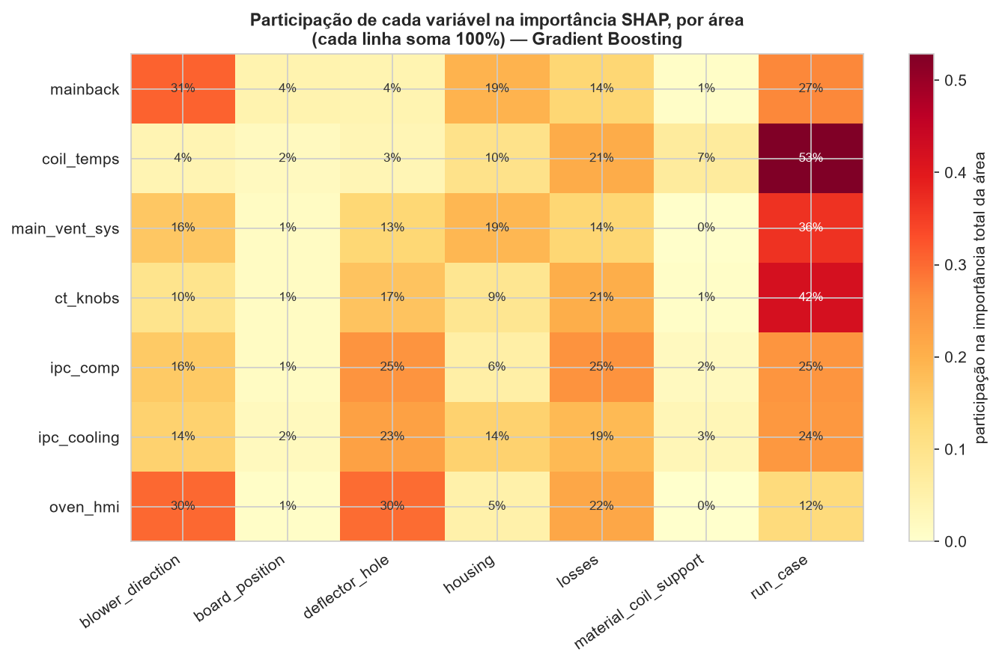<br>
  <sup>Fonte: Elaborado pelos autores (2026), a partir de notebooks/Grad_Boosting_Regre.ipynb.</sup>
</div>

A discussão a seguir cobre os três modelos candidatos treinados para prever a temperatura de cada termopar do fogão:

* Decision Tree Regressor
* Random Forest Regressor
* Gradient Boosting Regressor

Os três foram treinados e avaliados sobre a mesma base, as sete planilhas em formato wide geradas anteriormente, uma por key_area, com uma linha por run e uma coluna por termopar, partindo das mesmas sete variáveis de configuração como entrada e da mesma divisão entre treino e teste. Cada modelo estima simultaneamente as temperaturas de todos os termopares de uma área a partir dessa configuração, seguindo a estrutura multi-saída já definida. As próximas partes trazem, para cada algoritmo, as métricas alcançadas e a leitura dos resultados obtidos.

### <a name="c4_4"></a>4.4. Comparação de Modelos

A comparação entre os três candidatos está consolidada em [`notebooks/comparacao_modelos.ipynb`](../notebooks/comparacao_modelos.ipynb), que recalcula todas as métricas desta seção no mesmo processo, a partir das mesmas planilhas. Os notebooks por algoritmo seguem como referência do histórico de experimentos de cada modelo; o comparativo abaixo e o roteamento por região da Seção 4.4.4 vêm do notebook consolidado.

Os três modelos foram ajustados por **busca em grade** (`GridSearchCV`), rodada de forma independente para cada uma das sete `key_area` e com `neg_mean_absolute_error` como critério de seleção — nunca tocando os conjuntos de teste ou verificação (Seção 4.3.1). As grades variam conforme os hiperparâmetros relevantes a cada algoritmo:

| Modelo | Hiperparâmetros buscados |
|---|---|
| Decision Tree | `max_depth` (2, 3, 5, 8, sem limite), `min_samples_split`, `min_samples_leaf`, `max_features` |
| Random Forest | `n_estimators`, `max_depth`, `min_samples_leaf`, `max_features` |
| Gradient Boosting | `n_estimators` (100, 300), `learning_rate` (0,03, 0,05, 0,1), `max_depth` (2, 3), `subsample` (1,0, 0,8) |

Nenhum dos três usa os hiperparâmetros padrão do scikit-learn: todos passam pela mesma busca automatizada. As subseções abaixo detalham, para cada modelo, como ele evoluiu a partir desse ponto de partida comum, quanto erra e o que a explicabilidade revela sobre suas decisões.

#### <a name="c4_4_1"></a>4.4.1. Decision Tree Regressor

A árvore de decisão (*Decision Tree*, `DecisionTreeRegressor`) é o candidato mais simples e o mais fácil de auditar: cada previsão corresponde a um caminho de regras do tipo `variável ≤ limiar`, que pode ser lido diretamente²⁸. Em vez de um comitê ou de uma sequência de correções, há uma única árvore, que agrupa os ensaios parecidos em folhas e prevê, para cada folha, a média das temperaturas do grupo. O ganho é a transparência; o custo é que uma árvore sozinha, sem outras para compensar seus erros, tende a decorar os ensaios de treino.

Como nos outros dois modelos, existe uma árvore por região do fogão, sete no total, e cada uma estima de uma só vez a temperatura de todos os sensores daquela região (multi-saída) a partir da configuração de montagem informada. A base é a mesma da Seção 4.3, com semente 42 e divisão 70/20/10, implementada com o scikit-learn²⁶ em [`notebooks/Decision_tree_regre.ipynb`](../notebooks/Decision_tree_regre.ipynb). Após a unificação das réplicas (ensaios com configuração idêntica têm as leituras substituídas pela média), cada região tem **19 configurações únicas**: 13 linhas para treino, 4 para teste e 2 para verificação. Esse tamanho condiciona a leitura de todos os resultados abaixo.

As mudanças feitas nesta sprint estão registradas no notebook a partir da **Seção 10** ("Decision Tree vs. baseline 'média do termopar'") até o final (Seção 18). As nove primeiras seções — leitura da planilha, codificação das categorias, separação treino/teste/verificação, treino do modelo, leitura das regras da árvore e avaliação estatística por termopar e por setor — já existiam antes desta sprint.

##### Como se chegou à versão atual

O modelo não nasceu pronto. Como no Random Forest, cada mudança foi testada isoladamente contra uma referência, mas com o protocolo do notebook (Seção 16): 30 sementes (20 no último experimento) sobre as sete regiões, mesma divisão para todas as variantes e comparação pareada pelo teste de Wilcoxon²⁹, **sem correção para múltiplas comparações**. O critério é o erro em ensaios que a árvore não viu (teste e verificação) e o **gap**, isto é, quanto esse erro excede o erro de treino, a medida direta de memorização.

1. **Conter a complexidade (grade restrita e validação cruzada repetida, via `GridSearchCV`).** A grade inicial deixava a árvore crescer até `max_depth = 8`, com 13 folhas para 13 linhas de treino — cada folha memorizava um ensaio. A grade atual busca `max_depth` em 1, 2 e 3, `min_samples_leaf` em 2, 3 e 4 e `min_samples_split` em 4, 6 e 8 (27 combinações, com o MAE como critério), e a validação cruzada passou a ser repetida cinco vezes, porque com ~13 linhas de treino uma validação simples tem folds de ~4 linhas e a escolha vira sorteio. O gap médio caiu de 3,47 para 2,06 °C, ao custo de um erro fora do treino ligeiramente maior (5,67 para 6,00 °C). Como o espaço é pequeno, a busca exaustiva é viável e dispensa a amostragem aleatória (`RandomizedSearchCV`), vantajosa sobretudo em espaços grandes³⁰. Ficaram de fora da grade `max_features` (sortear 2 ou 3 de 7 variáveis é ruído numa árvore única), `criterion` (efeito marginal com tão poucas linhas) e a poda por custo-complexidade `ccp_alpha`, que na validação cruzada escolhia podar a árvore até uma folha única, equivalente a prever a média e só "eliminar" o superajuste porque o modelo deixa de usar as variáveis. Profundidades fixas (2 ou 3) e o tronco de uma divisão só (`max_depth = 1`) também foram testados e não superaram a grade adotada em erro.
2. **Mudar como as variáveis de entrada são representadas (codificação one-hot em vez de ordinal).** Mesma motivação do Random Forest: a codificação ordinal numera as opções em ordem alfabética, e a árvore passa a enxergar uma hierarquia inexistente entre, por exemplo, modos de operação. Com a one-hot, cada opção vira uma coluna sim/não. Foi a única mudança com ganho de erro estatisticamente significativo: o erro fora do treino caiu de 5,94 para 5,45 °C (−0,49 °C; p = 0,028) e o gap, de 1,98 para 1,70 °C. Variantes que mexiam em `deflector_hole` (removê-la, agrupar categorias raras ou agrupar por família) não superaram a one-hot completa.
3. **Regra do 1 erro-padrão.** Em vez de ficar com a combinação de menor erro na validação cruzada — que, com ~13 linhas, muitas vezes premia sorte —, a árvore final é a **mais simples** cujo erro está a até um erro-padrão da melhor (menor profundidade, depois folhas maiores). Reduziu o erro fora do treino de 5,54 para 5,38 °C (p = 0,018) e o gap de 1,82 para 1,41 °C (p < 0,001). Variantes testadas e não adotadas: padronizar os alvos, encolher as previsões para a média, combinar as duas e treinar uma árvore por termopar, que perdeu a leitura numa única árvore por região sem ganho relevante de erro.

As três mudanças compõem a **versão atual**, discutida daqui em diante. As medidas valem para a base atual, de 19 linhas por região; se os dados mudarem, os experimentos precisam ser refeitos. O experimento 1 foi feito ainda com codificação ordinal, e o 3 já parte da one-hot.

<div align="center">
  <sub>Figura 28 — Experimentos de redução de superajuste do Decision Tree</sub><br>
  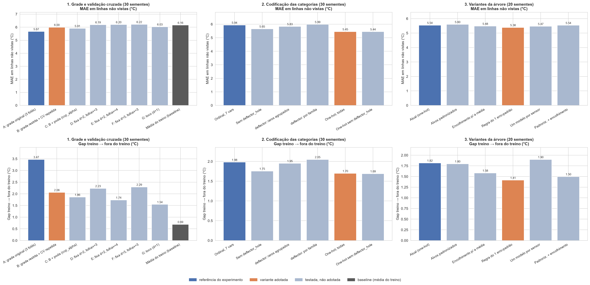<br>
  <sup>Fonte: Elaborado pelos autores (2026), a partir de notebooks/Decision_tree_regre.ipynb (Seção 16).</sup>
</div>

##### Quanto o modelo erra

As tabelas abaixo mostram o mesmo algoritmo em dois momentos: a **versão de referência**, com os hiperparâmetros padrão do scikit-learn, e a **versão atual**, com as três mudanças, ambas avaliadas no conjunto de teste (4 linhas por região) com a semente 42. Antes delas, o que cada coluna quer dizer:

- **Erro médio absoluto (MAE — Mean Absolute Error)** — de quantos graus a previsão erra, em média. É a métrica principal, por estar na mesma unidade da decisão de engenharia.
- **Raiz do erro quadrático médio (RMSE — Root Mean Squared Error)** — semelhante ao MAE, mas penaliza erros grandes com peso maior. Quanto mais o RMSE se afasta do MAE, mais concentradas em poucos sensores estão as falhas.
- **Coeficiente de determinação (R²)**, aqui chamado de poder de distinção — o quanto o modelo diferencia uma configuração de outra dentro da mesma região. O valor 1 é o ideal; 0 significa não fazer melhor do que sempre chutar a média histórica daquela região; abaixo de 0, pior do que isso.
- **Erro percentual médio absoluto (MAPE — Mean Absolute Percentage Error)** e **dentro de 10%** — o erro em proporção da temperatura medida, e a fatia de previsões que cai dentro da margem acordada com o parceiro.

**Versão de referência** — hiperparâmetros padrão do scikit-learn

| Região | Erro médio (°C) ↓ | RMSE (°C) ↓ | Poder de distinção ↑ | MAPE (%) ↓ |
|---|---|---|---|---|
| Main Vent Sys | 1,82 | 2,35 | −1,031 | 2,40 |
| Mainback | 2,56 | 3,22 | −1,157 | 4,04 |
| Oven HMI | 2,98 | 3,45 | −3,333 | 4,95 |
| IPC Cooling | 3,66 | 4,16 | −16,869 | 5,90 |
| CT Knobs | 4,16 | 5,11 | −3,362 | 7,98 |
| IPC Comp | 4,91 | 5,65 | −2,078 | 6,45 |
| Coil Temps | 9,28 | 12,45 | −3,311 | 7,06 |
| **Média das sete regiões** | **4,20** | **5,20** | **−4,449** | **5,54** |

**Versão atual** — grade restrita, one-hot e regra do 1 erro-padrão

| Região | Erro médio (°C) ↓ | RMSE (°C) ↓ | Poder de distinção ↑ | MAPE (%) ↓ | Dentro de 10% ↑ |
|---|---|---|---|---|---|
| Oven HMI | 2,19 | 2,70 | −1,681 | 3,63 | 100,0% |
| CT Knobs | 2,25 | 3,26 | −1,182 | 4,28 | 79,2% |
| IPC Cooling | 2,81 | 3,31 | −3,863 | 4,21 | 93,8% |
| Main Vent Sys | 2,90 | 4,37 | −0,877 | 3,63 | 90,0% |
| Mainback | 5,20 | 7,00 | −1,452 | 8,03 | 67,5% |
| IPC Comp | 5,94 | 6,64 | −2,488 | 7,67 | 69,3% |
| Coil Temps | 9,68 | 12,07 | −7,309 | 7,18 | 65,6% |
| **Média das sete regiões** | **4,42** | **5,62** | **−2,693** | **5,52** | **80,8%** |

<sup>Fonte: Elaborado pelos autores (2026), a partir de `notebooks/Decision_tree_regre.ipynb` (Seções 9 e 13). A fração dentro de 10% não foi calculada para a versão de referência. As duas tabelas não são somáveis nem intercambiáveis: descrevem configurações diferentes da mesma árvore.</sup>

<div align="center">
  <sub>Figura 24 — Erro no teste antes e depois da otimização de hiperparâmetros, por setor</sub><br>
  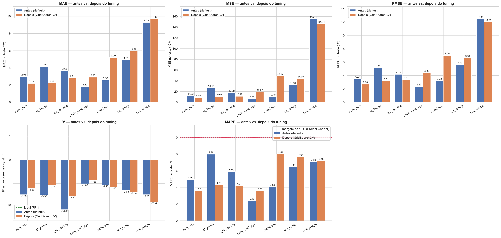<br>
  <sup>Fonte: Elaborado pelos autores (2026), a partir de notebooks/Decision_tree_regre.ipynb (semente 42). O painel de R² usa escala logarítmica simétrica.</sup>
</div>

**Leitura.** O erro típico fica entre 2 °C e 3 °C em quatro das sete regiões e sobe em Mainback, IPC Comp e, sobretudo, nas bobinas, a região mais quente. Na média, oito em cada dez previsões caem dentro da margem de 10% acordada com o parceiro — a menor taxa entre os três modelos. Com a semente 42, o erro médio da versão atual (4,42 °C) é até **um pouco maior** que o da referência (4,20 °C): quatro das sete regiões pioraram no teste (Mainback, Main Vent Sys, IPC Comp e Coil Temps) e apenas CT Knobs, IPC Cooling e Oven HMI melhoraram. Isso não invalida as mudanças, porque elas foram escolhidas pelo erro em ensaios não vistos e pelo gap, medidos ao longo de dezenas de sementes, e não por essa única divisão de 4 linhas por região (ver "Robustez à semente"). Mas mostra que, com uma base tão pequena, o resultado de uma divisão isolada diz pouco.

##### O número que parece alarmante, e o que ele quer dizer

O poder de distinção é negativo nas sete regiões, nas duas versões, e chega a −7,31 em Coil Temps. Lido ao pé da letra, isso diria que a árvore é pior do que chutar sempre a média da região.

Aqui o diagnóstico é mais duro do que o do Random Forest, e vale separar duas causas. A primeira é de **medição**: com apenas 4 ensaios de teste por região, o R² usa como referência a média desses mesmos 4 ensaios, e um ensaio atípico distorce a conta inteira, enquanto o erro médio (MAE) segue na faixa das demais regiões — o modelo acerta o patamar de temperatura. A segunda é de **modelo**, e não desaparece com uma medição melhor: ao longo de 217 casos (31 sementes × 7 regiões), o R² da árvore é positivo em só 5,5% deles, e a comparação pareada com o baseline, que sempre prevê a média do treino de cada sensor, dá R² mediano de −1,07 para a árvore contra −0,86 para o baseline (p < 0,001). O baseline também é negativo, então parte do problema é da referência; mas a árvore não explica mais variação do que a média histórica da região.

O recado, portanto, é mais restrito do que no Random Forest: a árvore serve para dizer **em que patamar térmico uma região vai operar**, e não para escolher entre configurações parecidas.

##### Robustez à semente

Com 4 linhas de teste por região, cada semente sorteia um teste diferente e o desempenho varia muito: entre 31 sementes, o MAPE médio no teste vai de 4,0% a 13,6% (Figura 25). A semente 42 (5,5%) ocupa a 13ª posição, no meio da distribuição. A semente vencedora no teste (30, com 4,0%) chega a 7,2% na verificação, e a correlação de Spearman entre os dois conjuntos, ao longo das sementes, é −0,17 (p = 0,35). Escolher a "melhor semente" seleciona, portanto, um sorteio favorável, não um modelo melhor. A semente 42 foi mantida porque é a mesma dos demais candidatos, condição para compará-los e combiná-los sobre as mesmas linhas, e o desempenho esperado é reportado pela média entre sementes.

<div align="center">
  <sub>Figura 25 — Sensibilidade do desempenho à semente da divisão treino/teste/verificação</sub><br>
  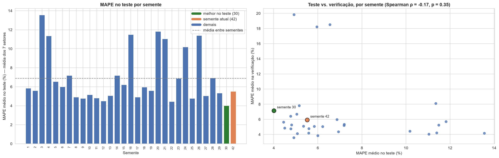<br>
  <sup>Fonte: Elaborado pelos autores (2026), a partir de notebooks/Decision_tree_regre.ipynb (Seção 11).</sup>
</div>

| Média dos 7 setores | Semente 42 | 31 sementes |
|---|---|---|
| MAE no teste (°C) | 4,42 | 5,36 ± 1,41 |
| MAPE no teste (%) | 5,52 | 6,90 ± 2,71 |
| Previsões dentro de 10% | 80,8% | 82,3% |

Os valores da semente 42 não devem ser tomados como desempenho esperado; a coluna da direita é a estimativa a ser usada.

##### Comparação com o baseline

O baseline mostra o que o modelo acrescenta além do patamar do setor. Em 217 casos, a árvore vence o baseline em MAE em 52,5% deles (diferença média de 0,86 °C a favor da árvore; p = 0,19, sem significância) e fica no mesmo patamar no MAPE (6,9% contra 7,6%) e na fração dentro de 10% (82,3% contra 81,8%). O ganho se concentra em `coil_temps` e `mainback`, onde a árvore vence em 97% e 74% das sementes; em `ipc_comp`, o baseline é melhor (a árvore vence em 13%), e nas demais regiões o resultado é próximo de um empate (Figura 26). Na divisão da semente 42, apenas `coil_temps` e `ct_knobs` superam o baseline.

<div align="center">
  <sub>Figura 26 — Decision Tree contra o baseline da média do termopar, entre sementes</sub><br>
  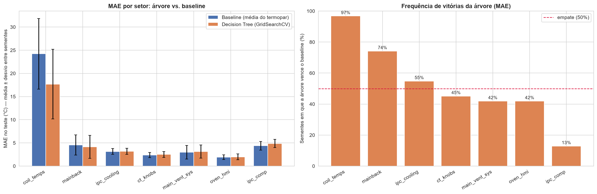<br>
  <sup>Fonte: Elaborado pelos autores (2026), a partir de notebooks/Decision_tree_regre.ipynb (Seção 12).</sup>
</div>

##### Decorar não é aprender

A grade restrita foi desenhada justamente contra a memorização, e o efeito aparece: a árvore escolhida tem **profundidade 1 e duas folhas em todas as sete regiões** — uma única pergunta, com uma média para cada resposta. Com a semente 42, o erro médio de treino (4,53 °C) fica praticamente igual ao de teste (4,42 °C), mas essa média esconde os extremos: o gap é de +2,13 °C em IPC Comp, +1,33 °C em Mainback e +0,94 °C em Oven HMI, e é negativo em Coil Temps (−5,85 °C), o que indica que os 4 ensaios de teste caíram em configurações menos quentes que as de treino. Ao longo das sementes, o gap sobre ensaios não vistos é de +1,41 °C, contra +3,47 °C da grade original.

A causa do que sobra é o tamanho da base, não o algoritmo. São poucas configurações distintas por região, o limite já registrado como risco R02. Nenhum ajuste de hiperparâmetro substitui novos ensaios, e a recomendação ao parceiro segue a mesma: que os próximos sejam planejados para cobrir combinações ainda não testadas, em vez de repetir as já frequentes.

##### O que o modelo olha para decidir

Diferente das florestas e do boosting, a árvore dispensa técnica adicional de explicabilidade: a própria estrutura é a explicação (Figura 27). Em `mainback`, a árvore escolhida tem profundidade 1 e duas folhas: pergunta apenas se o modo de operação é `run_case = Broil Qualitative`. As oito linhas de treino que respondem "não" e as cinco que respondem "sim" recebem médias diferentes por termopar — por exemplo, 56,7 °C contra 61,9 °C em um sensor, e 103,4 °C contra 97,9 °C em outro. Toda a importância (1,0) fica em `run_case`; as outras seis variáveis têm importância zero. A leitura é coerente com a hipótese H3, que já apontava o modo de operação como fator real de elevação térmica, mas é uma leitura de um único corte, sustentada por 13 linhas.

<div align="center">
  <sub>Figura 27 — Explicabilidade do Decision Tree na área Mainback: importância das variáveis e regras de decisão</sub><br>
  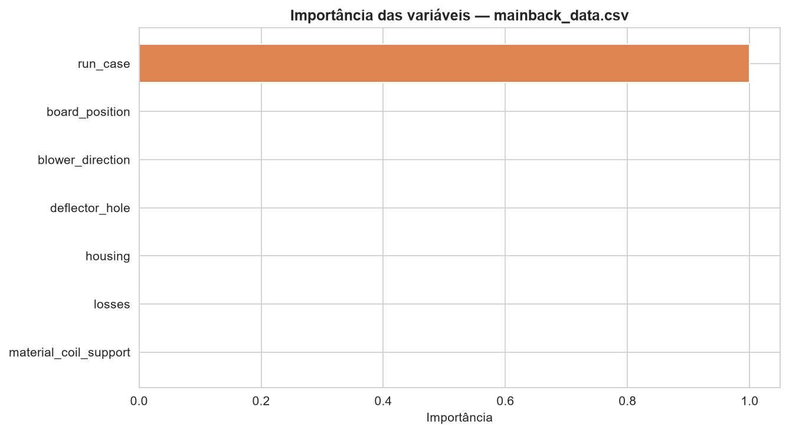<br>
  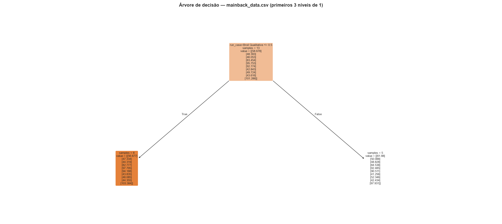<br>
  <sup>Fonte: Elaborado pelos autores (2026), a partir de notebooks/Decision_tree_regre.ipynb (semente 42).</sup>
</div>

**O que essa leitura não autoriza a dizer.** Vale a mesma ressalva registrada para o Random Forest e o Gradient Boosting, apoiada na hipótese H2: as sete configurações estão confundidas no desenho dos ensaios — `losses` é redundante com `deflector_hole`, e das 36 combinações possíveis entre as três variáveis principais apenas 11 foram ensaiadas. A árvore escolhe uma entre variáveis redundantes de forma arbitrária, e a importância zero de uma variável indica que a árvore **não precisou** dela, não que seja termicamente irrelevante. A figura descreve **como o modelo decide**, não **como o fogão aquece**.

##### Em resumo

O Decision Tree erra entre 2 °C e 3 °C em quatro das sete regiões, entre 5 °C e 6 °C em duas e quase 10 °C em Coil Temps, e entrega cerca de oito em cada dez previsões dentro da margem de 10% acordada com o parceiro — a menor taxa entre os três modelos, com MAPE médio de 6,9% entre sementes. É o candidato de leitura mais direta e, com a grade restrita, o menos propenso a decorar os ensaios.

Seus limites vêm da base de 19 linhas por região: o desempenho depende da divisão dos dados, o R² é negativo em quase todos os casos e, no agregado, a árvore não se distingue do baseline da média (p = 0,19), com vantagem consistente apenas em `coil_temps` e `mainback`. Isso sustenta seu uso para triagem do patamar térmico, não para substituir ensaios. A comparação com Random Forest e Gradient Boosting deve usar as mesmas sementes e o mesmo baseline. Sob a validação LOGO usada no comparativo entre os três candidatos ([`comparacao_modelos.ipynb`](../notebooks/comparacao_modelos.ipynb), Seção 4.4.4), o quadro é mais favorável: a árvore supera o baseline nas 7 regiões — os dois resultados não são incompatíveis, pois usam protocolos de validação diferentes (holdout com múltiplas sementes aqui, Leave-One-Group-Out lá).

#### <a name="c4_4_2"></a>4.4.2. Random Forest

A floresta aleatória (*Random Forest*, `RandomForestRegressor`) funciona como um comitê. Em vez de uma única árvore de decisão estimar sozinha a temperatura esperada, centenas de árvores são treinadas sobre recortes diferentes dos mesmos ensaios, e a previsão final é o consenso entre elas. O ganho é que os erros individuais de cada árvore tendem a se cancelar; o custo é que um comitê é mais difícil de auditar do que uma árvore isolada — por isso a explicabilidade recebe uma parte inteira mais adiante.

Como nos outros dois modelos, existe uma floresta por região do fogão, sete no total, e cada uma estima de uma só vez a temperatura de todos os sensores daquela região a partir da configuração de montagem informada.

As mudanças feitas nesta sprint estão registradas em [`notebooks/Random_for_regre.ipynb`](../notebooks/Random_for_regre.ipynb) a partir da **Seção 10** ("Tuning de hiperparâmetros por Grid Search") até o final do notebook (Seção 23 e Conclusão). As nove primeiras seções — leitura da planilha, codificação das categorias, separação treino/teste/verificação, treino do modelo, avaliação estatística por termopar, métricas do modelo candidato e sobreajuste em lote — já existiam antes desta sprint.

##### Como se chegou à versão atual

O modelo não nasceu pronto. Foram seis mudanças testadas uma a uma, cada uma medida isoladamente antes de ser combinada com as outras.

1. **Ajuste fino dos parâmetros (tuning de hiperparâmetros, via `GridSearchCV`).** Quantas árvores usar (`n_estimators`), quão profunda cada uma pode crescer (`max_depth`), quantos ensaios exigir no mínimo em cada ramo (`min_samples_leaf`). Foram testadas quase cem combinações por região, e o ganho foi pequeno e inconstante: em várias regiões o ajuste apenas reorganizou ruído, sem melhorar a previsão de fato.
2. **Enxugar a lista de variáveis de entrada.** A ideia era remover as duas que o modelo menos usava — a posição da placa (`board_position`) e o material do suporte da bobina (`material_coil_support`) — para simplificar. O erro piorou na maioria das regiões, e a mudança foi descartada. A lição é sobre o tamanho da base: com poucos ensaios, abrir mão de informação custa mais do que a simplificação rende.
3. **Alinhar o critério de divisão da árvore ao erro que será cobrado.** Por padrão, a árvore decide onde dividir os ensaios minimizando o erro quadrático (`criterion="squared_error"`), enquanto o compromisso com o parceiro é medido em erro absoluto, em graus de diferença. Trocar o critério para `criterion="absolute_error"` é uma mudança de uma linha de código, e melhorou o resultado em cinco das sete regiões.
4. **Estimador híbrido — tratar os ensaios fora da curva.** Cada árvore termina agrupando ensaios parecidos numa folha e prevendo a média do grupo. Quando um ensaio atípico cai nesse grupo, ele puxa a média para longe do que o restante indica. O estimador híbrido detecta esse caso — quando a média da folha cai fora do intervalo interquartil (IQR) dos valores de treino daquela folha — e passa a usar a mediana, que resiste a valores extremos, mantendo a média quando o grupo é bem-comportado. Foi a melhor das três opções (média, mediana, híbrido) em quatro das sete regiões, e melhor que a média pura em seis das sete.
5. **Mudar a forma de validar o modelo (Leave-One-Group-Out, ou LOGO).** Até aqui o desempenho era medido por um corte fixo de treino/teste (*holdout*), separando 20% dos ensaios uma única vez — cerca de seis ensaios por região. Um punhado tão pequeno faz a nota final depender de sorteio. O LOGO retreina o modelo excluindo um ensaio por vez e tenta prevê-lo, repetindo o processo até que todos tenham servido de teste. Isso não muda o modelo, muda o quanto se pode confiar na medição dele.
6. **Mudar como as variáveis de entrada são representadas (codificação one-hot em vez de ordinal).** Cada variável de entrada é uma opção de texto, e o modelo só trabalha com números. A codificação original (ordinal) numerava as opções em ordem alfabética, o que faz a árvore enxergar uma hierarquia que não existe no fogão — como se um modo de operação (`run_case`) fosse "maior" que outro. A codificação one-hot corrige isso: cada opção vira sua própria coluna binária (sim/não), sem ordem entre elas. Isso pesa mais justamente onde o modo de operação é decisivo, que é o caso das bobinas.

As três últimas mudanças — estimador híbrido, validação LOGO e codificação one-hot — compõem a **versão atual**, discutida daqui em diante. As mudanças 3 e 4 (critério `absolute_error` e estimador híbrido) seguem como alternativas em aberto entre si: nenhuma das duas se mostrou superior à outra nos testes feitos até aqui, e compará-las lado a lado, já sobre a versão atual, é o próximo passo natural.

##### Quanto o modelo erra

As tabelas abaixo mostram o mesmo algoritmo em dois momentos: a **versão de referência**, avaliada pela separação simples de 20% dos ensaios, e a **versão atual**, com as três últimas mudanças. As cinco métricas são as definidas na Seção 4.4.1.

**Versão de referência** — separação simples entre treino e teste

| Região | Erro médio (°C) ↓ | RMSE (°C) ↓ | Poder de distinção ↑ | MAPE (%) ↓ | Dentro de 10% ↑ |
|---|---|---|---|---|---|
| CT Knobs | 1,54 | 1,99 | 0,389 | 3,02 | 100,0% |
| Main Vent Sys | 1,86 | 2,27 | 0,160 | 2,19 | 97,6% |
| IPC Cooling | 2,51 | 3,23 | 0,106 | 4,19 | 95,8% |
| Oven HMI | 2,63 | 3,29 | −0,256 | 4,27 | 95,8% |
| Mainback | 3,74 | 5,94 | −5,981 | 7,07 | 90,0% |
| IPC Comp | 5,13 | 6,41 | 0,044 | 6,54 | 75,8% |
| Coil Temps | 8,93 | 11,04 | 0,359 | 7,14 | 72,9% |
| **Média das sete regiões** | **3,76** | **4,88** | **−0,740** | **4,92** | **89,7%** |

**Versão atual** — valores atípicos tratados, configurações sem ordem artificial, avaliação ensaio a ensaio

| Região | Erro médio (°C) ↓ | RMSE (°C) ↓ | Poder de distinção ↑ | MAPE (%) ↓ | Dentro de 10% ↑ |
|---|---|---|---|---|---|
| Main Vent Sys | 1,96 | 3,24 | 0,367 | 2,35 | 95,5% |
| Oven HMI | 2,20 | 2,80 | 0,122 | 3,75 | 96,1% |
| CT Knobs | 2,30 | 3,05 | 0,384 | 4,53 | 89,1% |
| Mainback | 3,30 | 5,46 | 0,512 | 5,02 | 86,6% |
| IPC Cooling | 3,64 | 5,72 | 0,327 | 5,77 | 89,8% |
| IPC Comp | 4,85 | 6,70 | 0,158 | 6,38 | 82,2% |
| Coil Temps | 10,54 | 14,88 | 0,666 | 9,63 | 72,3% |
| **Média das sete regiões** | **4,11** | **5,98** | **0,362** | **5,35** | **87,4%** |

<sup>Fonte: Elaborado pelos autores (2026), a partir de `notebooks/Random_for_regre.ipynb`. As duas tabelas não são somáveis nem intercambiáveis: descrevem configurações e formas de avaliação diferentes.</sup>

**Leitura.** O erro típico depende muito da região: fica entre 2 °C e 4 °C em cinco das sete, e sobe em IPC Comp, a região com mais sensores, e nas bobinas, a mais quente. Isso é esperado — uma diferença de 3 °C não significa a mesma coisa em uma região que opera perto da temperatura ambiente e em outra que ultrapassa os 150 °C. Na média, cerca de nove em cada dez previsões caem dentro da margem de 10% acordada com o parceiro. A diferença mais visível entre as duas tabelas está no poder de distinção, tratado a seguir.

##### O número que parece alarmante, e o que ele quer dizer

Na versão de referência, duas regiões aparecem com poder de distinção negativo, e uma delas, Mainback, com um valor muito abaixo de zero. Lido ao pé da letra, isso diria que o modelo é pior do que simplesmente chutar sempre a média histórica da região.

Não é o que acontece. O erro médio (MAE) dessa mesma região está na faixa das demais: o modelo acerta bem o patamar de temperatura. O número negativo vem de **como ele foi medido**, não do que ele aprendeu — com apenas seis ensaios reservados para teste (o corte fixo de *holdout*), um único ensaio atípico distorce a conta inteira. A versão atual confirma o diagnóstico: avaliada com o LOGO (que usa todos os ensaios como teste, um de cada vez, em vez de um corte fixo), a mesma região sai de um R² fortemente negativo para 0,51, e nenhuma das sete fica negativa.

Ainda assim, o recado de fundo permanece, e é o mesmo já registrado para o Gradient Boosting (Seção 4.4.3): o poder de distinção é modesto em várias regiões. O modelo é confiável para dizer **em que patamar térmico uma região vai operar**, e ainda não para **escolher com segurança entre duas configurações parecidas**. Na prática, isso o qualifica para priorizar quais ensaios físicos rodar primeiro, não para substituí-los.

##### Decorar não é aprender

O modelo erra bem menos nos ensaios que usou para aprender do que nos que nunca viu: em Mainback, quase três vezes mais nos ensaios novos. É o sinal clássico de memorização, e ele aparece com mais força justamente nas regiões com mais sensores e maior variação de temperatura.

A causa é o tamanho da base, não o algoritmo. São poucos ensaios e poucas combinações distintas de configuração — o limite já registrado como risco R02. Nenhum ajuste de parâmetro substitui novos ensaios, e a recomendação ao parceiro segue a mesma: que os próximos sejam planejados para cobrir combinações ainda não testadas, em vez de repetir as já frequentes.

##### O que o modelo olha para decidir

Uma previsão isolada não diz por que saiu daquele jeito. Para abrir essa caixa-preta, a versão atual foi analisada com SHAP (SHapley Additive exPlanations)³¹, uma técnica baseada nos valores de Shapley que reparte cada previsão entre as variáveis de entrada: ela mostra quanto cada uma empurrou a temperatura estimada para cima ou para baixo, de modo que a soma das partes reconstrói exatamente o valor previsto. Para uma floresta aleatória, o SHAP tem um algoritmo exato e rápido, o `TreeExplainer`, que percorre a estrutura das árvores em vez de estimar por amostragem.

A **leitura global** (importância agregada das variáveis, olhando todas as previsões) resume o que mais pesa em cada região:

- Nas bobinas, o modo de operação (`run_case`) domina com folga — é de longe o fator mais influente de toda a análise, cerca de cinco vezes mais forte que o segundo colocado. O resultado é coerente com a hipótese H3, que já apontava o modo de operação como fator real de elevação térmica.
- Em Mainback e na região de HMI, quem manda é a direção do fluxo de ar do ventilador (`blower_direction`).
- Nas demais regiões a diferença entre as variáveis é pequena, sem uma dominante clara.

A **leitura local** (a decomposição de uma previsão específica) explica um caso concreto. No caso de maior erro registrado nas bobinas, o modelo estimou cerca de 14 °C a menos do que o ensaio mediu, e a decomposição aponta o modo de operação (`run_case`) e o material do suporte da bobina (`material_coil_support`) como as variáveis que puxaram a estimativa para baixo. Um detalhe técnico com consequência prática apareceu aí: a previsão padrão do modelo (`.predict()`) e o estimador híbrido chegam a valores de temperatura próximos, mas a decomposição SHAP de cada um aponta uma ordem diferente de variáveis mais influentes. Cada estimador precisa da própria explicação; não é válido explicar um e apresentar o resultado como se valesse para o outro.

**O que essa leitura não autoriza a dizer.** Vale a mesma ressalva registrada para o Gradient Boosting, apoiada na hipótese H2: as variáveis de entrada estão confundidas entre si nos ensaios — variar uma quase sempre implicou variar outra —, e diante de informação redundante o modelo distribui o crédito entre elas de forma arbitrária. Uma variável aparecer com peso baixo (SHAP ou `feature_importances_`) significa que o modelo **não precisou** dela para prever, não que ela seja irrelevante para o aquecimento do fogão. A leitura descreve como o modelo decide, não como o fogão aquece.

##### Em resumo

O Random Forest erra entre 2 °C e 4 °C na maior parte das regiões do fogão e entrega cerca de nove em cada dez previsões dentro da margem de 10% acordada com o parceiro. Seu ponto fraco é distinguir configurações parecidas dentro de uma mesma região, e a origem disso é a base de ensaios disponível, não o algoritmo.

A sequência de melhorias rendeu onde podia render: o ajuste de parâmetros contribuiu pouco, mas alinhar o critério de erro, tratar os ensaios fora da curva e corrigir a forma de representar as configurações resolveram o problema de medição que fazia a região de Mainback, por exemplo, parecer um fracasso.

#### <a name="c4_4_3"></a>4.4.3. Gradient Boosting

O Gradient Boosting (`GradientBoostingRegressor`) funciona por correção sequencial³², não por comitê: cada árvore nova é treinada para corrigir o erro que as anteriores ainda deixam, uma de cada vez, em vez de várias árvores independentes votarem juntas. O ganho é que o modelo persegue diretamente o erro residual; o custo é precisar de um regressor por termopar — `GradientBoostingRegressor` não aceita várias saídas de uma vez, ao contrário do Random Forest —, o que o `MultiOutputRegressor` resolve por fora, treinando um `GradientBoostingRegressor` independente para cada sensor da região.

Como nos outros dois modelos, existe um conjunto de regressores por região do fogão, sete no total, e a arquitetura por termopar tem uma consequência que reaparece na explicabilidade, adiante: diferente do Random Forest, dá para saber qual variável pesa mais **para cada sensor**, não só para a região como um todo.

##### Como se chegou à versão atual

Diferente do Random Forest, o ajuste de hiperparâmetros por `GridSearchCV` já fazia parte do modelo desde a primeira versão — não é uma mudança desta rodada, é o ponto de partida (Seções 5 e 7 de [`notebooks/Grad_Boosting_Regre.ipynb`](../notebooks/Grad_Boosting_Regre.ipynb)). Cinco mudanças foram testadas depois disso:

1. **Mudar como as variáveis de entrada são representadas (one-hot em vez de ordinal).** Mesma motivação do Random Forest: a codificação ordinal original numerava as categorias em ordem alfabética, criando uma hierarquia artificial entre elas — como se um modo de operação fosse "maior" que outro. Testado sob protocolo rigoroso (LOGO + intervalo de confiança de 95%, `documents/extras/hipotese_onehot.md`), o resultado foi estatisticamente neutro em todas as sete regiões — nem para melhor, nem para pior. A mudança foi adotada mesmo assim, por ser mais correta em princípio e sem custo medido.
2. **Corrigir uma categoria mal rotulada em `material_coil_support`.** Um ensaio (Run 48) já vinha rotulado "Aluminium Plate" no dado bruto, antes de qualquer correção do grupo; foi normalizado para "Aluminium", batendo com o glossário do parceiro, que documenta só dois níveis para essa variável.
3. **Manter as sete variáveis originais, apesar da recomendação da H2.** A H2 (Seção 4.2.4) identificou `losses` como redundante com `deflector_hole` no desenho dos ensaios. Removê-las antes de medir o efeito eliminaria a própria evidência necessária para decidir a remoção — com só 32 configurações distintas por região, a base ainda não permite separar "redundante no fenômeno" de "redundante só porque nunca foi ensaiado de outro jeito".
4. **Adotar a validação Leave-One-Group-Out (LOGO) como avaliação oficial, no lugar do corte fixo de treino/teste.** Mesma motivação do Random Forest: com só seis ensaios no corte de teste (holdout de 20%), a nota de uma região pode depender de sorteio. O LOGO, com grupo = configuração de ensaio, usa todos os 32 ensaios de cada região como teste, um de cada vez — como cada ensaio é uma configuração distinta, equivale a Leave-One-Out. Os hiperparâmetros são fixos e iguais nas sete regiões (`n_estimators = 100`, `learning_rate = 0,03`, `max_depth = 3`, `subsample = 0,8`), definidos nos testes do grupo com o Gradient Boosting, e não são re-tunados a cada rodada.
5. **Confirmar esses hiperparâmetros por busca em grade avaliada pelo próprio LOGO.** O `GridSearchCV` do holdout escolhe os hiperparâmetros com validação cruzada de 3 folds dentro de ~22 linhas de treino, o que deixa ~7 linhas por fold. Para ligar a configuração oficial à otimização, a mesma grade — ampliada com `learning_rate = 0,03`, somando 24 combinações — foi rodada com o LOGO como validação cruzada do `GridSearchCV`, e as combinações foram ordenadas pelo MAE médio entre as sete regiões (Seção 8.2 do notebook). A configuração oficial fica em **3º de 24**, a 0,05 °C (cerca de 1%) da primeira colocada (`learning_rate = 0,05`, `subsample = 1,0`); as sete primeiras usam `max_depth = 3`, e as quatro primeiras usam `n_estimators = 100` com `learning_rate` entre 0,03 e 0,05. O topo do ranking é, portanto, um empate técnico, e a busca confirma a região escolhida — o `GridSearchCV` do holdout, com a grade ampliada, também escolhe exatamente a configuração oficial em Mainback. A configuração não foi trocada pela primeira colocada: a diferença é menor que a variação entre regiões, e escolher a vencedora pelo mesmo LOGO que depois é reportado deixaria a métrica otimista.

As mudanças 1, 2, 4 e 5 compõem a **versão atual**, discutida daqui em diante. A mudança 3 é uma decisão de manter o modelo como está, não uma mudança de fato — fica registrada porque delimita o que o modelo pode e não pode dizer sobre causa, retomado na explicabilidade, adiante. Ficou de fora da versão atual uma oitava variável (`fan_level`) com ganho estatístico validado em teste controlado, porque depende de uma reclassificação de material que o glossário do parceiro ainda não confirma — registrada como pendência para a próxima rodada de ensaios, não como parte do modelo oficial.

##### Quanto o modelo erra

As tabelas usam as mesmas cinco métricas definidas na Seção 4.4.1, na mesma unidade e com o mesmo agrupamento por região, com uma diferença de agregação: cada métrica é calculada por termopar e resumida para a região pela **média** entre termopares, exceto o poder de distinção (R²), resumido pela **mediana**. O R² de um termopar que varia pouco no conjunto avaliado tem denominador perto de zero e pode chegar a centenas negativas; numa média, esse único sensor dominaria o valor da região sem dizer nada sobre os demais. A mesma agregação é usada nas duas tabelas. O notebook do Random Forest (Seção 4.4.2) resume o R² pela média, de modo que os valores de R² das duas seções não são comparáveis diretamente; o comparativo entre os candidatos sob uma agregação única está em [`notebooks/comparacao_modelos.ipynb`](../notebooks/comparacao_modelos.ipynb) (Seção 3).

**Versão de referência** — separação simples entre treino e teste (holdout 70/20/10), hiperparâmetros escolhidos pelo `GridSearchCV` de cada região

| Região | Erro médio (°C) ↓ | RMSE (°C) ↓ | Poder de distinção ↑ | MAPE (%) ↓ | Dentro de 10% ↑ |
|---|---|---|---|---|---|
| Main Vent Sys | 1,70 | 2,33 | 0,000 | 2,04 | 97,6% |
| CT Knobs | 1,97 | 2,36 | 0,145 | 3,98 | 97,2% |
| Oven HMI | 2,28 | 3,00 | −0,026 | 3,68 | 95,8% |
| IPC Cooling | 2,70 | 3,33 | 0,157 | 4,32 | 95,8% |
| Mainback | 4,02 | 6,80 | −7,100 | 7,67 | 85,0% |
| IPC Comp | 5,27 | 6,61 | 0,026 | 6,60 | 73,5% |
| Coil Temps | 9,79 | 12,82 | 0,564 | 7,38 | 72,9% |
| **Média das sete regiões** | **3,96** | **5,32** | **−0,891** | **5,10** | **88,3%** |

**Versão atual** — avaliação ensaio a ensaio (LOGO), hiperparâmetros oficiais fixos

| Região | Erro médio (°C) ↓ | RMSE (°C) ↓ | Poder de distinção ↑ | MAPE (%) ↓ | Dentro de 10% ↑ |
|---|---|---|---|---|---|
| Main Vent Sys | 2,07 | 3,29 | 0,591 | 2,48 | 94,2% |
| Oven HMI | 2,17 | 2,81 | 0,074 | 3,70 | 96,1% |
| CT Knobs | 2,20 | 3,02 | 0,397 | 4,35 | 89,1% |
| Mainback | 3,44 | 5,89 | 0,410 | 5,33 | 85,3% |
| IPC Cooling | 3,84 | 6,05 | 0,391 | 6,05 | 86,7% |
| IPC Comp | 5,01 | 7,36 | −0,056 | 6,59 | 81,7% |
| Coil Temps | 9,55 | 13,67 | 0,785 | 8,56 | 77,0% |
| **Média das sete regiões** | **4,04** | **6,01** | **0,370** | **5,29** | **87,1%** |

<sup>Fonte: Elaborado pelos autores (2026), a partir de `notebooks/Grad_Boosting_Regre.ipynb` — Seção 7 (referência) e Seção 8 (versão atual). Ambas com codificação one-hot e material corrigido. As duas tabelas não são somáveis nem intercambiáveis: descrevem formas de avaliação diferentes.</sup>

**Leitura.** O erro médio quase não muda entre as duas formas de avaliação (3,96 °C no holdout, 4,04 °C no LOGO): o LOGO fica ligeiramente acima porque testa todas as 32 configurações de cada região, inclusive as mais difíceis, e não só as seis que o sorteio do holdout reservou. O que muda é o poder de distinção, que sai de negativo na média para 0,37, tratado a seguir. Sob LOGO, o erro típico fica entre 2,1 °C e 5,0 °C em seis das sete regiões e sobe para 9,6 °C em Coil Temps, a região mais quente do produto; cerca de 87% das previsões caem dentro da margem de 10% acordada com o parceiro. A troca de codificação ordinal por one-hot não aparece nas tabelas porque, no teste controlado do item 1, seu efeito foi estatisticamente neutro.

##### O número que parece alarmante, e o que ele quer dizer

O poder de distinção de Mainback na versão de referência é −7,10 — o mais negativo das duas tabelas. Lido ao pé da letra, diria que o modelo é várias vezes pior que chutar a média histórica da região.

Não é o que acontece. Dos dez termopares de Mainback, quatro (`ACU Ambient (Hill Only) Top`, `ACU K8 Housing / Double Line Break`, `Ambient Below Terminal Block` e `L2, Wire, Power Cord`) quase não variam entre os seis ensaios sorteados para teste: o desvio-padrão deles no teste fica entre 0,8 °C e 2,4 °C, contra 7,3 °C a 12,3 °C na base inteira. O R² divide o erro do modelo pela variação do próprio conjunto de teste, então, com um denominador tão pequeno, erros médios de 5,6 °C a 10,7 °C nesses sensores produzem R² entre −63 e −162. Nesses mesmos sensores, o RMSE fica entre 1,6 e 1,9 vez o MAE, sinal de que o erro se concentra em poucos ensaios de teste. A mediana entre os dez termopares já contém parte do efeito (pela média, a região ficaria em −41,8), mas não o elimina, porque quatro dos dez sensores estão nessa situação. O erro médio (MAE) da região, 4,02 °C, está dentro da faixa das demais: o modelo continua acertando o patamar de temperatura.

A validação por LOGO (item 4, acima) confirma o diagnóstico, como no Random Forest: usando os 32 ensaios como teste, um de cada vez, a variação de cada sensor passa a ser a da base inteira, e o poder de distinção de Mainback sobe de −7,10 para **0,41**. A média entre as sete regiões passa de −0,89 para **0,37**, restando só IPC Comp (−0,06) ligeiramente abaixo de zero.

Ainda assim, o recado de fundo é o mesmo do Random Forest: o poder de distinção é modesto mesmo sob a validação mais estável. O modelo é confiável para dizer **em que patamar térmico uma região vai operar**, e ainda não para **escolher com segurança entre duas configurações parecidas** — em Mainback, essa segunda tarefa continua sem sustentação nem sob LOGO.

##### Decorar não é aprender

O modelo erra bem menos nos ensaios que usou para aprender do que nos que nunca viu: no holdout, o erro médio de treino é 1,35 °C contra 3,96 °C no teste, um gap de 2,61 °C na média das sete regiões. O gap é maior justamente nas regiões de maior variação de temperatura — Coil Temps (2,08 °C no treino contra 9,79 °C no teste) e Mainback (0,82 °C contra 4,02 °C, quase cinco vezes mais) — e fica abaixo de 1,2 °C em CT Knobs, Oven HMI e Main Vent Sys.

A causa é a mesma dos outros dois modelos: tamanho da base, não o algoritmo. Nenhum ajuste de hiperparâmetro substitui novos ensaios, e a recomendação ao parceiro é a mesma — planejar os próximos ensaios para cobrir combinações ainda não testadas, não repetir as já frequentes.

##### O que o modelo olha para decidir

Uma previsão isolada não diz por que saiu daquele jeito. A versão atual foi analisada com SHAP, do mesmo modo que o Random Forest: o `TreeExplainer` reparte cada previsão entre as sete variáveis de entrada, de forma que a soma das partes reconstrói exatamente o valor previsto. A diferença estrutural em relação ao Random Forest é que o `MultiOutputRegressor` já treina um regressor por termopar — a leitura por sensor nasce da própria arquitetura, sem precisar do eixo extra que o SHAP monta sobre o modelo único da floresta.

A **leitura global por área** (Figura 20, Seção 4.3.4, para Mainback; Figura 23, para as sete áreas) mostra que nenhuma variável decide de forma uniforme entre regiões:

- Nas bobinas (Coil Temps), o modo de operação (`run_case`) domina com folga — 53% de toda a importância da região, a maior concentração do mapa inteiro, coerente com a mesma hipótese H3 que explica o domínio de `run_case` no Random Forest. `run_case` também lidera em CT Knobs (42%) e Main Vent Sys (36%), e por margem mínima em IPC Cooling (24%, contra 23% de `deflector_hole`).
- Em Mainback e Oven HMI, quem lidera é a direção do fluxo de ar do ventilador (`blower_direction`, 31% e 30%) — a mesma variável que domina essas duas regiões no Random Forest. Em Oven HMI, `deflector_hole` vem praticamente empatada (30%).
- Em IPC Comp, nenhuma variável domina: `losses`, `deflector_hole` e `run_case` dividem a importância quase em partes iguais (25% cada).

Essa alternância de qual variável decide, região por região, é a mesma leitura que a H1 (Seção 4.2.4) já fizera sobre o efeito medido nos dados — aqui reaparece também na estrutura interna do modelo, sem que essa alternância tenha sido informada ao treinamento. `board_position` e `material_coil_support` são as duas variáveis de menor participação em cinco das sete áreas. As exceções são Mainback, onde `deflector_hole` fica abaixo de `board_position`, e Coil Temps, onde `material_coil_support` responde por 7% da importância, à frente de `blower_direction`, `deflector_hole` e `board_position`.

Uma segunda técnica, a importância por impureza nativa do `GradientBoostingRegressor` (Figura 19), foi comparada ao SHAP (Figura 20) só para Mainback, como checagem cruzada: as quatro variáveis líderes coincidem nas duas técnicas, mas a ordem entre as duas primeiras (`run_case` e `blower_direction`) se inverte de uma técnica para outra, e o termopar mais sensível a cada variável muda em quatro das sete — indício de que o ranking agregado de variáveis é mais estável entre técnicas do que o detalhe por sensor.

**O que essa leitura não autoriza a dizer.** Vale a mesma ressalva registrada para o Random Forest, apoiada na H2: as variáveis de entrada estão confundidas entre si nos ensaios, e diante de informação redundante o modelo distribui o crédito de forma arbitrária — a própria inversão de ordem entre `run_case` e `blower_direction` ao trocar de técnica de explicabilidade é uma demonstração disso. Uma variável com peso baixo (SHAP ou impureza) significa que o modelo **não precisou** dela, não que seja irrelevante para o aquecimento do fogão.

##### Em resumo

Sob a avaliação oficial (LOGO), o Gradient Boosting erra entre 2,1 °C e 5,0 °C em seis das sete regiões, chegando a 9,6 °C em Coil Temps, e entrega cerca de 87% das previsões dentro da margem de 10% acordada com o parceiro. Seu ponto fraco, como nos outros dois, é distinguir configurações parecidas dentro de uma mesma região — o poder de distinção mediano é 0,37, e negativo em IPC Comp —, e a base de ensaios disponível é a causa, não o algoritmo.

Os hiperparâmetros oficiais, definidos nos testes do grupo, foram confirmados por busca em grade avaliada pelo próprio LOGO: ficam entre os três melhores de 24 combinações, a 0,05 °C da primeira. O número mais alarmante das tabelas, o R² de −7,10 em Mainback no holdout, é um problema de medição — quatro sensores quase constantes nos seis ensaios de teste — e desaparece sob LOGO. O superajuste, por outro lado, é real, sobretudo em Coil Temps e Mainback, e seria atacado, entre outras formas, pela mesma simplificação de variáveis (item 3 acima) que a H2 já recomendava e que o Random Forest testou e descartou por outro motivo — um teste ainda pendente para o Gradient Boosting especificamente.

#### <a name="c4_4_4"></a>4.4.4. Comparação entre os candidatos e escolha do algoritmo por região

As três partes anteriores avaliaram cada algoritmo isoladamente. Esta reúne os três lado a lado e registra a decisão que decorre da comparação — entre Random Forest e Gradient Boosting, os dois candidatos com desempenho próximo o bastante para justificar a escolha por região; o Decision Tree fica de fora do comparativo numérico direto, pelo motivo explicado adiante.

##### Por que não um único algoritmo para o produto inteiro

A Seção 4.3 já estabeleceu que existe **um modelo por região**, porque as sete regiões correspondem a regimes térmicos distintos — a amplitude de temperatura varia em mais de oito vezes entre a região mais fria e a mais quente, e a hipótese H1 mostrou que uma mesma alteração de montagem aquece uma região e esfria outra. Uma vez aceito que cada região tem o próprio modelo, escolher um único algoritmo para todas as sete deixa de ser uma exigência técnica e passa a ser apenas um hábito.

##### Por que o Decision Tree fica fora da tabela

O Decision Tree fica atrás dos outros dois em todas as métricas médias, mas supera o baseline nas **7 de 7** regiões — o mesmo placar do Random Forest e do Gradient Boosting —, e seu R² médio (0,15) fica bem abaixo dos outros dois. Vale registrar que, no notebook consolidado, a árvore recebeu uma **vantagem** sobre os outros dois — seus hiperparâmetros foram buscados sobre todas as configurações da região, inclusive as que depois serviriam de teste — e ainda assim ficou atrás, o que reforça a conclusão.

Por isso o Decision Tree não entra como terceiro candidato à produção; seu valor está na leitura direta das regras (Seção 4.4.1, "O que o modelo olha para decidir"), não no desempenho preditivo.

##### A comparação, região a região

Os dois candidatos são comparados sob o mesmo protocolo — codificação one-hot e validação LOGO (Leave-One-Group-Out, equivalente a Leave-One-Out nesta base de 32 configurações por região) —, a validação oficial adotada em ambas as seções anteriores por ser a mais estável com poucos ensaios. Uma diferença de configuração permanece entre os dois candidatos: o Random Forest usa o estimador híbrido (mediana nas folhas fora do intervalo interquartil, média nas demais), enquanto o Gradient Boosting usa sempre a previsão padrão, com hiperparâmetros fixos entre regiões e sem retunagem por fold nesta rodada. Em ambos os casos trata-se da melhor versão de cada algoritmo medida até aqui, e não de duas configurações espelhadas ponto a ponto.

| Região | MAE RF (°C) | MAE GB (°C) | R² RF | R² GB | Escolhido |
|---|---|---|---|---|---|
| Main Vent Sys | **1,96** | 2,07 | 0,367 | **0,591** | Gradient Boosting |
| CT Knobs | 2,30 | **2,20** | 0,384 | **0,397** | Gradient Boosting |
| Oven HMI | 2,20 | **2,17** | **0,122** | 0,074 | Gradient Boosting |
| Mainback | **3,30** | 3,44 | **0,512** | 0,410 | Random Forest |
| IPC Cooling | **3,64** | 3,84 | 0,327 | **0,391** | Random Forest |
| IPC Comp | **4,85** | 5,01 | **0,158** | −0,056 | Random Forest |
| Coil Temps | 10,54 | **9,55** | 0,666 | **0,785** | Gradient Boosting |
| **Média das sete regiões** | 4,11 | **4,04** | 0,362 | **0,370** | — |

<sup>Fonte: Elaborado pelos autores (2026), a partir da validação LOGO de `notebooks/Random_for_regre.ipynb` (Seção 21) e `notebooks/Grad_Boosting_Regre.ipynb` (Seção 8). O negrito marca o melhor valor entre os dois candidatos em cada métrica.</sup>

**Uma ressalva sobre a comparação do R².** Os dois notebooks de origem agregam o R² dos sensores de formas diferentes: o Random Forest reporta a **média** entre termopares, o Gradient Boosting a **mediana**. Como cada região tem de 4 a 22 sensores e alguns são mal medidos, os dois critérios divergem — a mediana é mais alta justamente quando um sensor ruim puxa a média para baixo. As colunas de R² acima, portanto, não são estritamente comparáveis entre si. O notebook consolidado ([`comparacao_modelos.ipynb`](../notebooks/comparacao_modelos.ipynb), Seção 3) mede o tamanho desse efeito e reavalia os três algoritmos sob uma convenção única. As colunas de MAE, que não dependem dessa escolha, não são afetadas.

**Uma segunda ressalva, sobre a codificação de `material_coil_support`.** Os dados brutos trazem essa variável com espaço sobrando em duas das três grafias (`"Aluminium "` e `"Plastic "`, com espaço à direita), e nenhum dos três notebooks de origem removia esse espaço antes do one-hot. O `pd.get_dummies` trata `"Aluminium "` e `"Aluminium"` (a forma corrigida de `"Aluminium Plate"`) como duas colunas diferentes para a mesma categoria — sem erro nenhum, só um sensor com peso diluído em duas colunas quase vazias. O efeito é pequeno em Random Forest e Gradient Boosting (modelos de conjunto absorvem uma coluna espúria entre muitas árvores), mas relevante no Decision Tree, mais sensível por depender de uma única árvore: corrigido, ele passa a superar o baseline nas 7 regiões, contra 4 antes da correção, e seu MAE médio cai 0,41 °C. O notebook consolidado normaliza espaços em todas as variáveis categóricas antes de qualquer correção de grafia, e traz uma checagem que falha a execução se alguma categoria com espaço sobrando sobreviver à padronização. **A tabela e o roteamento por região abaixo continuam vindo dos notebooks de origem, que não foram corrigidos** — a correção foi aplicada e verificada só no notebook consolidado. Como o efeito é pequeno em Random Forest e Gradient Boosting, a decisão de roteamento não muda; a divergência de valores entre a tabela abaixo e o notebook consolidado tem, portanto, duas causas somadas: a padronização de categorias tratada aqui e outras fontes de variação entre execuções já registradas nesta seção.

##### O critério de decisão

Onde MAE e R² concordam, a escolha é direta. Onde divergem, o R² decide quando a diferença entre os dois candidatos é de pelo menos **0,05** — porque é a métrica que informa se o modelo distingue configurações dentro da região, e não só acerta o patamar médio —, e o MAE decide abaixo disso. É o mesmo limiar que [`comparacao_modelos.ipynb`](../notebooks/comparacao_modelos.ipynb) (Seção 5) aplica em código, junto com um teste de quanto a escolha de cada região depende desse valor.

- **Mainback e IPC Comp** — o Random Forest vence em MAE e em R² nas duas, sem ambiguidade. Em IPC Comp a diferença é qualitativa: R² positivo (0,158) contra negativo (−0,056), a única região em que o R² do Gradient Boosting é negativo, isto é, pior que prever a média dos próprios ensaios.
- **Coil Temps** — o Gradient Boosting vence nas duas métricas (9,55 contra 10,54 °C; R² 0,785 contra 0,666), com a maior margem de MAE da tabela. É a região mais quente e de maior amplitude térmica, a única em que o boosting tem sinal suficiente para levar vantagem clara.
- **Main Vent Sys** — o MAE favorece o Random Forest por margem estreita (0,11 °C), mas o R² do Gradient Boosting é 0,224 mais alto, acima do limiar e o maior salto de poder de distinção do comparativo.
- **IPC Cooling** — as duas métricas discordam: MAE 0,20 °C melhor no Random Forest, R² 0,064 maior no Gradient Boosting. Aplicado a esta tabela, o limiar daria a região ao Gradient Boosting; a escolha registrada é o Random Forest porque essa vantagem de R² vem da diferença de agregação entre os notebooks de origem (ressalva acima). No recomputo sob agregação única ([`comparacao_modelos.ipynb`](../notebooks/comparacao_modelos.ipynb)), é o Random Forest que tem o R² maior, com margem acima do limiar, e as duas métricas passam a concordar.
- **Oven HMI** — as duas margens são mínimas: 0,03 °C no MAE, a favor do Gradient Boosting, e 0,048 no R², a favor do Random Forest. Como a diferença de R² fica abaixo do limiar, o MAE decide, e a escolha é o Gradient Boosting. É a região em que o comparativo menos separa os candidatos: a escolha se apoia menos em vantagem medida do que na ausência de diferença relevante entre os dois — leitura confirmada pelo teste de sensibilidade do notebook consolidado.
- **CT Knobs** — o Gradient Boosting leva as duas métricas, mas por margens mínimas (0,10 °C no MAE e 0,013 no R²). A escolha fica registrada como Gradient Boosting por concordância entre as duas, e não por força do sinal: é a divisão mais fraca do comparativo.

##### O que este comparativo ainda não resolve

**A base continua pequena.** Mesmo sob LOGO, que usa as 32 configurações de cada região como teste, são 32 — não 320. As margens de MAE de Oven HMI (0,03 °C), CT Knobs (0,10 °C) e Main Vent Sys (0,11 °C) são pequenas demais para sustentar decisão de roteamento sozinhas — em Main Vent Sys a escolha se apoia no R², não no MAE; as de Mainback (0,14 °C), IPC Comp (0,16 °C), IPC Cooling (0,20 °C) e Coil Temps (0,99 °C) têm mais sustentação.

##### A decisão registrada

O roteamento por região adotado em produção é o seguinte, e vive em um único lugar no repositório — o mapa `AREA_ALGORITHMS` em [`scripts/export_models.py`](../scripts/export_models.py), que o grava no manifesto consumido pelo back-end e pelo front-end. Nem a API nem o dashboard reescrevem esse mapa à mão; ambos leem do manifesto, de modo que a decisão documentada aqui e o modelo que efetivamente responde a uma requisição não podem divergir.

| Região | Algoritmo em produção | Artefato |
|---|---|---|
| Main Vent Sys | Gradient Boosting | `gradient_boosting__main_vent_sys.joblib` |
| CT Knobs | Gradient Boosting | `gradient_boosting__ct_knobs.joblib` |
| Oven HMI | Gradient Boosting | `gradient_boosting__oven_hmi.joblib` |
| Coil Temps | Gradient Boosting | `gradient_boosting__coil_temps.joblib` |
| Mainback | Random Forest | `random_forest__mainback.joblib` |
| IPC Comp | Random Forest | `random_forest__ipc_comp.joblib` |
| IPC Cooling | Random Forest | `random_forest__ipc_cooling.joblib` |

<sup>Fonte: Elaborado pelos autores (2026), a partir de `models/manifest.json`.</sup>


##### Em resumo

O placar final é **quatro regiões para Gradient Boosting** (Main Vent Sys, CT Knobs, Oven HMI, Coil Temps) e **três para Random Forest** (Mainback, IPC Comp, IPC Cooling), como registrado no mapa `AREA_ALGORITHMS`. Random Forest e Gradient Boosting são os dois candidatos viáveis para produção; o Decision Tree fica de fora por ficar atrás dos dois em todas as métricas médias.

O recomputo sob agregação única ([`comparacao_modelos.ipynb`](../notebooks/comparacao_modelos.ipynb)) concorda com esse roteamento em seis das sete regiões. A exceção é **CT Knobs**, em que o Random Forest passa a liderar as duas métricas por margem mínima (0,06 °C no MAE). A região segue com Gradient Boosting em produção: a diferença está muito abaixo do que a base de 32 configurações distingue de forma confiável, e trocar o algoritmo exigiria reexportar os artefatos sem ganho perceptível — o erro típico da região é de cerca de 2 °C. Fica registrado como ponto a reavaliar quando houver ensaios novos.

### <a name="c4_5"></a>4.5. Avaliação
```
- Descreva a solução final de modelo preditivo e justifique a escolha. Alinhe sua justificativa com a Seção 4.1, resgatando o entendimento 
  do negócio e das personas, explicando de que formas seu modelo atende os requisitos e definições. 
- Descreva também um plano de contingência para os casos em que o modelo falhar em suas predições.
- Além disso, discuta sobre a explicabilidade do modelo (se aplicável) e realize a verificação de aceitação ou refutação das hipóteses.
- Se aplicável, utilize equações, tabelas e gráficos de visualização de dados para melhor ilustrar seus argumentos. 

Remova este bloco ao final
```

## <a name="c5"></a>5. Conclusões e Recomendações
```
Escreva, de forma resumida, sobre os principais resultados do seu projeto e faça recomendações formais ao seu parceiro de negócios em relação ao uso desse modelo. Você pode aproveitar este espaço para comentar sobre possíveis materiais extras, como um manual de usuário mais detalhado na seção “Anexos”. Não se esqueça também das pessoas que serão potencialmente afetadas pelas decisões do modelo preditivo e elabore recomendações que ajudem seu parceiro a tratá-las de maneira estratégica e ética. 

Remova este bloco ao final
```

## <a name="c6"></a>6. Estrutura da Solução Visual e Acesso ao Modelo Preditivo

O Thermal Predictor é entregue em duas partes que operam em conjunto: um **dashboard interativo**, que é a camada visual da solução, e um **software preditivo open source**, que é o seu núcleo. O software abriga o pré-processamento, os modelos treinados e a rotina de predição; o dashboard traduz esse núcleo em uma interface de consulta. Ambos são construídos apenas com bibliotecas de código aberto em Python, sem qualquer dependência de software licenciado.

Essa divisão define duas formas distintas de acesso ao modelo. Pelo dashboard, o usuário consulta a temperatura estimada de uma configuração de fogão sem escrever uma linha de código: informa os parâmetros de montagem que deseja avaliar e recebe as previsões dos sensores de interesse. É o caminho dos times de Produtos, Design, Qualidade e Marketing. Pelo software, o usuário chama o modelo diretamente, integrando-o a rotinas próprias, executando predições em lote e retreinando o modelo à medida que novos dados de simulação e de teste físico ficam disponíveis. É o caminho da equipe de Engenharia (CFD).

Esta primeira parte da documentação enuncia os requisitos funcionais das duas partes, isto é, o que a solução deve permitir que o usuário faça. Cada requisito descreve uma única capacidade e recebe um nível de prioridade — alta para o que sustenta o fluxo essencial de predição, média para o que amplia o uso analítico da solução e baixa para o que agrega conveniência. As tabelas estão ordenadas por prioridade. A arquitetura de implementação, o layout das telas e a escolha das bibliotecas serão definidos nas etapas seguintes do projeto.

### <a name="c6_1"></a>6.1. Requisitos funcionais

#### <a name="c6_1_1"></a>6.1.1. Requisitos funcionais do dashboard

| ID | Requisito funcional | Prioridade |
| --- | --- | --- |
| RF01 | Permitir que o usuário informe os parâmetros de configuração do fogão a ser avaliado: direção do fluxo de ar do blower, estado do housing, posição da placa, material do suporte da bobina e presença do furo do defletor. | Alta |
| RF02 | Permitir que o usuário selecione quais sensores ou áreas-chave deseja consultar, em vez de exigir a leitura dos 78 sensores a cada consulta. | Alta |
| RF03 | Exibir a temperatura estimada para cada sensor ou área-chave selecionada, desde que a confiabilidade da predição permita a exibição de um valor numérico. | Alta |
| RF04 | Exibir, junto de cada predição, a margem de erro esperada. | Alta |
| RF05 | Controlar o acesso ao dashboard por autenticação individual, com usuário e senha. | Alta |
| RF06 | Classificar e sinalizar a confiabilidade de cada predição em um dos três estados possíveis: interpolação (a configuração está dentro da faixa já testada), extrapolação moderada (está próxima dessa faixa) ou fora de domínio (está fora de qualquer faixa testada). No estado fora de domínio, o valor numérico é suprimido e o sistema recomenda simulação CFD completa. | Alta |
| RF07 | Exibir o limite de engenharia aplicável a cada sensor consultado, destacando as predições que o excedem. | Média |
| RF08 | Permitir a consulta simultânea de duas ou mais configurações, exibindo os resultados lado a lado. | Média |
| RF09 | Registrar o histórico de acessos ao dashboard, incluindo a data e o horário de cada acesso. | Baixa |
| RF10 | Permitir a exportação dos resultados da consulta em formato tabular. | Baixa |
| RF11 | Exibir, junto de cada predição, um aviso de que o valor representa uma estimativa da saída da simulação numérica (CFD) — conforme mitigação do risco R05, Seção 4.1.5 — e não uma medição física direta. | Média |

#### <a name="c6_1_2"></a>6.1.2. Requisitos funcionais do software preditivo

| ID | Requisito funcional | Prioridade |
| --- | --- | --- |
| RF12 | Expor uma rotina de predição que receba uma configuração de montagem e retorne as temperaturas estimadas, permitindo uso programático independente do dashboard. | Alta |
| RF13| Aplicar, sobre os dados de entrada da predição, o mesmo pré-processamento usado no treinamento. | Alta |
| RF14| Ser distribuído exclusivamente com bibliotecas de código aberto, sem depender de nenhum software licenciado. | Alta |
| RF15| Carregar os dados de simulação e os históricos de teste a partir de uma fonte externa ao repositório de código, ou permitir que o usuário anexe novos dados de teste diretamente no sistema para que passem a integrar o conjunto de treinamento. | Alta |
| RF16| Permitir o retreinamento dos modelos com novos dados de simulação (CFD) ou de testes físicos, sem exigir alteração do código-fonte. | Média |
| RF17| Permitir a predição em lote, a partir de um conjunto de configurações fornecido pelo usuário. | Média |
| RF18| Calcular e registrar as métricas de avaliação do modelo sobre um conjunto de dados de referência, para acompanhar sua evolução entre versões. | Média |

### <a name="c6_2"></a>6.2. Regras de negócio

Enquanto os requisitos funcionais descrevem o que a solução deve permitir que o usuário faça, as regras de negócio descrevem as condições, restrições e critérios que governam como essas ações são executadas e validadas. Cada regra está associada ao(s) requisito(s) funcional(is) que ela restringe ou complementa.

#### <a name="c6_2_1"></a>6.2.1. Regras de negócio do dashboard

| ID | Regra de negócio | RF relacionado(s) |
| --- | --- | --- |
| RN01 | Uma consulta só pode ser submetida se todos os parâmetros de configuração forem informados; o dashboard não deve aceitar o envio com algum desses campos em branco. | RF01 |
| RN02 | A seleção do país de referência é obrigatória em toda consulta realizada no dashboard. | RF02 |
| RN03 | O país selecionado determina os limites de temperatura de engenharia aplicáveis a cada sensor consultado; o modelo preditivo usado na predição é o mesmo para os dois países, apenas os limites de comparação variam. | RF02, RF13 |
| RN04 | Ao menos um sensor ou área-chave deve ser selecionado para que a consulta seja realizada, dentro das áreas-chave já mapeadas: Mainback, bobinas, sistemas de ventilação, componentes do IPC, comandos do cooktop (CT Knobs) e região de HMI. | RF03 |
| RN05 | Toda temperatura estimada exibida deve vir acompanhada de sua margem de erro; não é permitido exibir uma predição sem indicar sua incerteza associada. | RF04, RF05 |
| RN06 | A margem de erro exibida deve ser apresentada em formato comparável ao critério de aceite oficial do projeto, o erro máximo de 10%. | RF04, RF05 |
| RN07 | Toda predição deve passar pela classificação de confiabilidade antes de ser exibida ao usuário; o dashboard não deve apresentar um resultado que ainda não tenha sido classificado. | RF07 |
| RN08 | No estado fora de domínio, o valor numérico da temperatura não pode ser exibido, devendo ser substituído pela recomendação de simulação CFD completa. | RF07 |
| RN09 | Toda predição com valor numérico exibido que exceda o limite de engenharia definido para o sensor consultado deve ser destacada visualmente, esteja a configuração em interpolação ou em extrapolação moderada. | RF08 |
| RN10 | Na consulta simultânea de múltiplas configurações, cada uma deve ser validada individualmente pelas mesmas regras antes de ser exibida lado a lado com as demais. | RF09 |
| RN11 | Nenhuma ação do dashboard pode ser realizada sem uma sessão autenticada válida, com usuário e senha individuais. | RF06 |
| RN12 | Não é permitido o acesso anônimo ao dashboard, nem o compartilhamento de credenciais entre usuários. | RF06 |
| RN13 | Toda tentativa de acesso ao dashboard, bem-sucedida ou não, deve ser registrada no histórico com identificação do usuário, data e horário, de modo a permitir auditoria de uso. | RF06, RF10 |
| RN14 | A exportação de resultados deve incluir, além da temperatura estimada, a configuração consultada, a margem de erro e a indicação de confiabilidade, nunca apenas o valor bruto da predição. | RF04, RF05, RF07, RF11 |

#### <a name="c6_2_2"></a>6.2.2. Regras de negócio do software preditivo

| ID | Regra de negócio | RF relacionado(s) |
| --- | --- | --- |
| RN15 | Toda avaliação de uma predição contra os limites de engenharia deve informar obrigatoriamente o país de referência, Brasil ou México, usado exclusivamente para selecionar a tabela de limites aplicável, e não para escolher entre modelos preditivos distintos. | RF13 |
| RN16 | Uma predição é considerada inválida se os dados de entrada não tiverem passado pelo mesmo pré-processamento aplicado no treinamento. | RF14 |
| RN17 | A vedação a bibliotecas proprietárias ou licenciadas vale para todas as etapas do software: pré-processamento, treinamento e predição. | RF15 |
| RN18 | Os dados de simulação (CFD), de testes físicos e os anexados pelo usuário não podem ser versionados junto ao código-fonte; devem sempre residir na fonte de dados externa ao repositório. | RF16 |
| RN19 | O retreinamento dos modelos não pode exigir alteração do código-fonte da rotina de predição; a atualização deve se limitar à fonte de dados externa e ao disparo do retreinamento. | RF16, RF17 |
| RN20 | Na predição em lote, cada configuração do conjunto deve ser validada e processada de forma independente, de modo que uma configuração inválida ou malformada não invalide o resultado das demais configurações do lote. | RF18, RF12 |
| RN21 | Toda nova versão do modelo deve reportar as métricas que operacionalizam o critério de aceite de erro máximo de 10%: o erro médio absoluto em °C por termopar, o erro normalizado pela folga entre a temperatura prevista e o limite de engenharia do sensor, e a taxa de falsos-negativos de segurança (a proporção de predições não sinalizadas como excedentes que, no teste físico correspondente, ultrapassam o limite de engenharia). | RF08, RF19 |
| RN22 | As métricas de avaliação de uma nova versão do modelo devem ser calculadas sobre o mesmo conjunto de dados de referência utilizado em versões anteriores. | RF19 |
| RN23 | Toda predição exibida deve comunicar explicitamente que o valor representa uma estimativa da saída da simulação CFD e não uma medição física direta, para que o usuário não a interprete como dado de campo. | RF20 |

## <a name="c7"></a>7. Referências

As referências abaixo estão numeradas na ordem em que aparecem citadas ao longo do texto.

1. GURUFOCUS. *Whirlpool Corp (WHR) Q2 2026 Earnings Call Highlights: Strategic Pricing and Cost Actions Drive Sequential Margin Improvement Amid Market Headwinds.* ago. 2026. Disponível em: https://www.gurufocus.com/news/9002695/whirlpool-corp-whr-q2-2026-earnings-call-highlights-strategic-pricing-and-cost-actions-drive-sequential-margin-improvement-amid-market-headwinds. Acesso em: 13 ago. 2026.
2. BLOOMBERG LÍNEA. *Whirlpool vê retomada da demanda e aposta em produtos para apartamentos menores.* nov. 2023. Disponível em: https://www.bloomberglinea.com.br/negocios/whirpool-ve-retomada-da-demanda-e-aposta-em-produtos-para-apartamentos-menores/. Acesso em: 13 ago. 2026.
3. ELETROS — Associação Nacional de Fabricantes de Produtos Eletroeletrônicos. *Dados setoriais de linha branca.* 2025.
4. WHIRLPOOL CORPORATION BRASIL. *Whirlpool apresenta metas de qualidade e sustentabilidade para fornecedores.* [201-?]. Disponível em: https://www.whirlpool.com.br/0000/00/whirlpool-apresenta-metas-de-qualidade-e-sustentabilidade-para-fornecedores/. Acesso em: 13 ago. 2026.
5. BLOOMBERG LÍNEA. *Da geladeira ao frigobar, canetas emagrecedoras já impactam o mercado de linha branca.* jan. 2026. Disponível em: https://www.bloomberglinea.com.br/negocios/da-geladeira-ao-frigobar-canetas-emagrecedoras-ja-impactam-o-mercado-de-linha-branca/. Acesso em: 13 ago. 2026.
6. JORNAL DO COMMERCIO. *Whirlpool acelera a era das casas inteligentes com nova linha de produção de indução em Manaus.* 2026. Disponível em: https://jcam.com.br/colunas/whirlpool-acelera-a-era-das-casas-inteligentes-com-nova-linha-de-producao-de-inducao-em-manaus/. Acesso em: 13 ago. 2026.
7. CENTRAL DO VAREJO. *Airfryer chega a 64% dos lares brasileiros e lidera nova onda de eletrodomésticos de conveniência.* 2025. Disponível em: https://centraldovarejo.com.br/airfryer-chega-a-64-dos-lares-brasileiros-e-lidera-nova-onda-de-eletrodomesticos-de-conveniencia/. Acesso em: 14 ago. 2026.
8. O TEMPO. *Delivery cresce e acende debate nas redes: o ato de cozinhar em casa vai acabar?* 2023. Disponível em: https://www.otempo.com.br/economia/delivery-cresce-e-acende-debate-nas-redes-o-ato-de-cozinhar-em-casa-vai-acabar-1.3336447. Acesso em: 14 ago. 2026.
9. DATA MERCANTIL. *Electrolux, a sueca que está dominando o Brasil; entenda.* mar. 2024. Disponível em: https://datamercantil.com.br/2024/03/04/electrolux-a-sueca-que-esta-dominando-o-brasil-entenda/. Acesso em: 14 ago. 2026.
10. ELECTROLUX GROUP. *Com investimentos de R$ 700 milhões, Electrolux Group inaugura planta 100% sustentável que marca sua maior expansão na América Latina.* ago. 2025. Disponível em: https://www.electroluxgroup.com/en/news/com-investimentos-de-r-700-milhoes-electrolux-group-inaugura-planta-100-sustentavel-que-marca-sua-maior-expansao-na-america-latina/. Acesso em: 14 ago. 2026.
11. TIMES BRASIL. *Diretora da Midea: somos o 3º player no Brasil, e iremos aumentar.* 2025. Disponível em: https://timesbrasil.com.br/empresas-e-negocios/midea-carrier-brasil-player/. Acesso em: 14 ago. 2026.
12. CORREIO DE MINAS. *Chinesa Midea investe R$ 630 milhões e inaugura nova fábrica em Pouso Alegre.* dez. 2024. Disponível em: https://correiodeminas.com.br/2024/12/14/chinesa-midea-investe-r-630-milhoes-e-inaugura-nova-fabrica-em-pouso-alegre-a-primeira-unidade-100-propria-no-brasil-promete-revolucionar-o-mercado-de-eletrodomesticos-no-pais/. Acesso em: 14 ago. 2026.
13. GEO-MEXICO. *Mexico's multinationals: Mabe, domestic appliance manufacturer.* Disponível em: https://geo-mexico.com/?p=11419. Acesso em: 14 ago. 2026.
14. BLOOMBERG LÍNEA. *Whirlpool inaugura hub de inovação em Rio Claro e vê novo impulso para vendas.* Disponível em: https://www.bloomberglinea.com.br/negocios/whirlpool-inaugura-hub-de-inovacao-em-rio-claro-e-ve-novo-impulso-para-vendas/. Acesso em: 14 ago. 2026.
15. MEXICOINDUSTRY. *Whirlpool Ramos Arizpe.* Disponível em: https://mexicoindustry.com/hecho-en-mexico/whirlpool-ramos-arizpe-producen-los-refrigeradores-que-llegan-hasta-los-hogares-de-estados-unidos-. Acesso em: 14 ago. 2026.
16. XATAKA MÉXICO. *Whirlpool cerrará una planta en México.* Disponível em: https://www.xataka.com.mx/empresas-y-economia/whirlpool-quiere-fabricar-refrigeradores-forma-barata-eso-cerrara-planta-mexico. Acesso em: 14 ago. 2026.
17. INMETRO. *Programa Brasileiro de Etiquetagem (PBE) / ENCE.* Base legal: Lei nº 10.295/2001 e Decreto nº 9.864/2019. 2026.
18. SELECTO GLOBAL. *The race to market: achieving speed and quality in product launch.* Disponível em: https://selectoglobal.com/blog-post/the-race-to-market-achieving-speed-and-quality-in-product-launch. Acesso em: 13 ago. 2026.
19. MCKINSEY & COMPANY. *Digital twins: the key to smart product development.* Disponível em: https://www.mckinsey.com.br/industries/industrials/our-insights/digital-twins-the-key-to-smart-product-development. Acesso em: 13 ago. 2026.
20. CHEN, Jiyao; REILLY, Richard R.; LYNN, Gary S. *The impacts of speed-to-market on new product success: the moderating effects of uncertainty.* IEEE Transactions on Engineering Management, v. 52, n. 2, p. 199-212, 2005.
21. COMO a Whirlpool, dona de Brastemp e Consul, cresce 12% com dólar e juros altos. Brazil Economy, [s.l.], 10 abr. 2025. Disponível em: https://brazileconomy.com.br/empresas/2025/04/o-segredo-da-whirlpool-dona-de-brastemp-e-consul-para-crescer-com-juro-alto-e-dolar-caro/. Acesso em: 6 ago. 2026.
22. BRASIL. **Lei nº 13.709, de 14 de agosto de 2018.** Lei Geral de Proteção de Dados Pessoais (LGPD). Brasília, DF: Presidência da República, 2018. Disponível em: https://www.planalto.gov.br/ccivil_03/_ato2015-2018/2018/lei/l13709.htm. Acesso em: 1 set. 2026.
23. MÉXICO. **Ley Federal de Protección de Datos Personales en Posesión de los Particulares.** Diario Oficial de la Federación, Ciudad de México, 5 jul. 2010. Disponível em: https://www.diputados.gob.mx/LeyesBiblio/pdf/LFPDPPP.pdf. Acesso em: 1 set. 2026.
24. HOTZ, Nick. What is CRISP DM?. Data Science PM, 9 dez. 2024. Disponível em: https://www.datascience-pm.com/crisp-dm-2/. Acesso em: 8 set. 2026.
25. SHARMA, Rajat. CRISP-DM Explained: A Proven Data Mining Methodology. Udacity Blog, 13 mar. 2025. Disponível em: https://www.udacity.com/blog/crisp-dm-explained-a-proven-data-mining-methodology/. Acesso em: 8 set. 2026.
26. PEDREGOSA, F. et al. Scikit-learn: Machine Learning in Python. Journal of Machine Learning Research, v. 12, p. 2825-2830, 2011. Disponível em: https://jmlr.org/papers/v12/pedregosa11a.html. Acesso em: 11 set. 2026.
27. CHAI, T.; DRAXLER, R. R. Root mean square error (RMSE) or mean absolute error (MAE)? – Arguments against avoiding RMSE in the literature. Geoscientific Model Development, v. 7, p. 1247-1250, 2014. Disponível em: https://gmd.copernicus.org/articles/7/1247/2014/. Acesso em: 11 set. 2026.
28. BREIMAN, Leo; FRIEDMAN, Jerome H.; OLSHEN, Richard A.; STONE, Charles J. *Classification and regression trees.* Belmont: Wadsworth International Group, 1984.
29. WILCOXON, Frank. *Individual comparisons by ranking methods.* Biometrics Bulletin, v. 1, n. 6, p. 80-83, 1945.
30. BERGSTRA, James; BENGIO, Yoshua. *Random search for hyper-parameter optimization.* Journal of Machine Learning Research, v. 13, p. 281-305, 2012. Disponível em: https://jmlr.org/papers/v13/bergstra12a.html. Acesso em: 25 set. 2026.
31. LUNDBERG, Scott M.; LEE, Su-In. *A unified approach to interpreting model predictions.* In: CONFERENCE ON NEURAL INFORMATION PROCESSING SYSTEMS (NIPS), 31., 2017, Long Beach. Advances in Neural Information Processing Systems 30. Red Hook: Curran Associates, 2017. p. 4765-4774. Disponível em: https://papers.nips.cc/paper/7062-a-unified-approach-to-interpreting-model-predictions. Acesso em: 25 set. 2026.
32. FRIEDMAN, Jerome H. *Greedy function approximation: a gradient boosting machine.* The Annals of Statistics, v. 29, n. 5, p. 1189-1232, 2001.
33. WHIRLPOOL; INTELI. *Project Charter: Thermal Predictor.* Whirlpool - Divisão Fogões (Brasil & México), fev. 2026. Documento interno de projeto.

## <a name="attachments"></a>Anexos

#### Análise e teste de normalidade da variável quantitativa

Esta subseção descreve os procedimentos de análise estatística aplicados ao conjunto de dados do grupo, organizados em duas etapas principais: o teste de normalidade e o escalonamento das variáveis quantitativas. Primeiro, verifica-se se as variáveis seguem uma distribuição normal, combinando métodos estatísticos formais e representações gráficas. Em seguida, aplica-se o escalonamento (normalização) dos dados, de modo a colocar as variáveis em escalas comparáveis e adequadas para a construção de modelos preditivos e para as análises subsequentes.

**Nota sobre o número de variáveis analisadas.** O roteiro deste anexo pede a análise de três variáveis quantitativas. O dataset fornecido pela Whirlpool Latin America, porém, possui apenas **uma** variável quantitativa contínua de fato: `temp`. As outras duas colunas numéricas do `dtype` bruto foram descartadas dessa categoria já na classificação da Seção 4.2.1, por motivos estruturais do dado, não por escolha do grupo:

- `tc_number` é um identificador de sensor (rótulo), não uma quantidade — média, desvio-padrão e normalização não têm significado sobre ele.
- `active_limit` é um parâmetro de especificação de engenharia atribuído a cada termopar (constante para o mesmo sensor em todas as execuções), não uma grandeza medida no experimento; além disso, carrega placeholders sem significado físico (`"Monitor (150 C)"` e `active_limit = 1000` para "sem limite definido"), o que tornaria qualquer teste de normalidade ou escalonamento sobre essa coluna pouco interpretável.

Diante disso, o grupo optou por aprofundar a análise em `temp` — a única variável quantitativa contínua e também a variável-alvo do modelo — em vez de forçar testes estatísticos sobre colunas que não representam grandezas contínuas. O grupo tomou essa decisão ciente de que ela diverge do número de variáveis pedido no roteiro, e a registra aqui para validação explícita com o professor.

**a) Hipóteses**


**Afirmação:**

O objetivo deste estudo é verificar se a variável quantitativa "Temperatura" (`temp`), medida em graus Celsius nos termopares posicionados nos componentes térmicos do forno, segue uma distribuição normal. Essa variável é a única variável quantitativa contínua do conjunto de dados fornecido pela Whirlpool Latin America, sendo também a variável-alvo (*target*) do modelo preditivo desenvolvido pelo grupo.

**Hipóteses Estatísticas do Teste de Normalidade:**

Para testar isso de forma rigorosa, foram formuladas duas hipóteses mutuamente excludentes para a variável. De um lado, temos a hipótese nula ($H_0$), que assume que a variável segue uma distribuição normal. Do outro, a hipótese alternativa ($H_a$), que defende que ela não segue.

- Para a variável "Temperatura" (`temp`):
    - $H_0$ (Hipótese Nula): A variável "Temperatura" segue uma distribuição normal.
    - $H_a$ (Hipótese Alternativa): A variável "Temperatura" não segue uma distribuição normal.

O nível de significância adotado é $\alpha = 0{,}05$. Dessa forma, se o *p-valor* obtido no teste for menor que $0{,}05$, rejeita-se $H_0$, concluindo-se que há evidência estatística de que a variável não segue uma distribuição normal. Caso contrário, não há evidências suficientes para rejeitar $H_0$.

**b) Nível de significância**

Nível de significância (α): 0,05 (5%).

Regra de decisão:

Se $p \geq 0{,}05$: não rejeita $H_0$ (ausência de evidência contra a normalidade).

Se $p < 0{,}05$: rejeita $H_0$ (não segue distribuição normal).

**c) Teste de Normalidade**

Foram aplicados três testes formais, todos com $H_0$ = "a amostra vem de uma distribuição normal": Shapiro-Wilk (W = 0,8669; p = 2,72 × 10⁻⁵⁰), D'Agostino-Pearson (K² = 1.484,31; p ≈ 0) e Anderson-Darling (A² = 93,89, acima do valor crítico de 0,752 a 5%). Os três convergem na mesma decisão: rejeita-se $H_0$, ou seja, temp não segue distribuição normal.

**Observação:** o Shapiro-Wilk é o mais indicado para bases desse tamanho e é o mais sensível para perceber quando os dados fogem da normalidade; o D'Agostino-Pearson olha para o formato da distribuição, unindo assimetria (se os dados pendem mais para um lado) e curtose (se há muitos valores extremos) em um único resultado; e o Anderson-Darling é parecido com os outros dois, mas dá atenção especial às pontas da distribuição, ou seja, aos valores mais altos e mais baixos.

Variáveis analisadas (conforme o dataset):

- `temp` (temperatura dos sensores/termopares)

A classificação da Seção 1.1 identifica duas colunas numéricas, `temp` e `active_limit`. Apenas `temp` é submetida a teste de normalidade e escalonamento: `active_limit` não é uma medição repetida com distribuição própria, e sim um limite de engenharia por sensor, usado como referência de excedência (`temp > active_limit`). Além disso, após o tratamento do valor `"Monitor (150 °C)"` na Seção 2 (Pré-processamento), o placeholder de "sem limite definido" deixou de ser distinguível do limite real de 150 °C em 361 linhas, o que tornaria qualquer teste de normalidade sobre essa coluna pouco interpretável.

Resultados do teste (valores fornecidos):

| Variável | p-valor (científico) | Conclusão (α = 0,05) |
|:---|:---|:---|
| `temp` | 2,72 × 10⁻⁵⁰ | Rejeita $H_0$ — não normal |

Interpretação: o p-valor encontrado é astronomicamente pequeno (um número com dezenas de zeros após a vírgula antes de chegar ao primeiro dígito). Ele é muito, mas muito menor que o nosso nível de significância de 0,05. Portanto, com base no teste de Shapiro-Wilk, temos evidências estatísticas avassaladoras para rejeitar a hipótese de normalidade da variável `temp`.

Código utilizado para execução (Python):

```python
from scipy import stats

alpha = 0.05
temp = df['temp'].dropna()

# Shapiro-Wilk
w_stat, p_shapiro = stats.shapiro(temp)

# D'Agostino-Pearson
k2_stat, p_dagostino = stats.normaltest(temp)

# Anderson-Darling
resultado_ad = stats.anderson(temp, dist='norm')

print(f"Shapiro-Wilk: W = {w_stat:.4f}, p = {p_shapiro:.3e}")
print(f"D'Agostino-Pearson: K² = {k2_stat:.2f}, p = {p_dagostino:.3e}")
print(f"Anderson-Darling: A² = {resultado_ad.statistic:.2f}, "
      f"valor crítico (5%) = {resultado_ad.critical_values[2]:.3f}")

conclusao = ("Rejeita H₀ — evidência de não normalidade" if p_shapiro < alpha
             else "Não rejeita H₀ — sem evidência suficiente para afastar a normalidade")
print(f"Conclusão (α = {alpha}): {conclusao}")
```

**d) Histogramas e resultados dos testes estatísticos de normalidade**

O item c) registrou uma única variável quantitativa analisada, `temp`. O histograma abaixo usa os dados originais dessa variável, sem escalonamento, e serve para confrontar o formato visual da distribuição com o resultado dos testes formais. Gerado em [`notebooks/expl_preprocessamenro_hipote.ipynb`](../notebooks/expl_preprocessamenro_hipote.ipynb), Seção 4.

<div align="center">
  <sub>Figura 21 — Distribuição de temp em dados originais, sem escalonamento (n = 4.065)</sub><br>
  <br>
  <sup>Fonte: Elaborado pelos autores (2026), a partir de data/dataset_pre_processado.csv.</sup>
</div>

**`temp` — o formato visual reforça o resultado do teste.**

O Shapiro-Wilk rejeitou H₀ (W = 0,8669; p = 2,72 × 10⁻⁵⁰), e o histograma mostra, por evidência independente, as quatro características que explicam essa rejeição:

- **Não há formato de sino.** Uma normal é simétrica em torno da média; aqui o corpo da distribuição se concentra entre 40 °C e 132 °C, com pico na faixa de 70,7 °C a 76,9 °C (434 leituras), e os dois lados do pico se comportam de maneira diferente.
- **Assimetria à direita.** O coeficiente de assimetria é +1,76 e a média (81,77 °C) fica 5,27 °C acima da mediana (76,50 °C) — numa distribuição simétrica as duas coincidiriam. Três quartos das leituras estão até 96,02 °C, mas o máximo chega a 273,60 °C.
- **Cauda longa à direita.** 95% das leituras estão até 132,24 °C, e ainda assim a distribuição se estende por mais 141 °C acima desse ponto. A curtose em excesso é de 4,90, bem acima do zero esperado para uma normal, o que confirma o peso dos valores extremos.
- **Corte abrupto à esquerda.** A primeira barra começa em 27,69 °C e não há nada abaixo disso, porque a temperatura ambiente do ensaio funciona como piso físico. Uma normal não tem limite inferior, e essa barreira sozinha já inviabiliza o ajuste.

Há ainda um quinto elemento que os testes formais não separam, mas que o histograma revela: um **modo secundário** entre 206,0 °C e 212,1 °C (45 leituras), destacado de uma faixa esparsa entre 138 °C e 200 °C. A distribuição não é unimodal, o que é coerente com o fato de `temp` agregar sete `key_area` com regimes térmicos distintos — conforme o item a) da subseção seguinte, a amplitude por região vai de 28,37 °C em `Oven HMI` a 238,19 °C em `Mainback`. O que o gráfico mostra é uma mistura de distribuições, não uma distribuição única deformada.

**Ressalva metodológica.** Com n = 4.065, o Shapiro-Wilk rejeita H₀ mesmo diante de desvios pequenos, de modo que um p-valor baixo, isoladamente, não prova que o afastamento seja grande. É justamente o histograma que resolve essa dúvida: o desvio aqui é estrutural e visível a olho nu (assimetria, cauda longa, piso físico e bimodalidade), não um artefato do tamanho da amostra. Visual e teste apontam na mesma direção — **`temp` não segue distribuição normal** —, e métodos que pressupõem normalidade ficam desaconselhados para essa variável em escala global.

**e) Comparação entre a média e a mediana**

Em uma distribuição normal, por ser simétrica, a média e a mediana coincidem. Quanto maior a distância entre as duas medidas, maior a assimetria da distribuição e mais forte o indício de afastamento da normalidade. A comparação abaixo funciona, portanto, como uma verificação independente do resultado dos testes formais do item c).

O código usado para essa métrica, está no notebook em baixo da sessão da hipotese 4.

| Variável | Média | Mediana | Diferença (Média − Mediana) |
|:---|:---|:---|:---|
| `temp` | 81,77 °C | 76,50 °C | +5,27 °C |

A média fica 5,27 °C acima da mediana. Esse sinal, média maior que a mediana, é a assinatura de uma distribuição **assimétrica à direita**: os valores extremos elevados (a cauda que se estende até 273,60 °C, evidenciada no histograma do item d) puxam a média para cima, enquanto a mediana, por depender apenas da posição central dos dados, permanece resistente a esses extremos. Se a temperatura seguisse uma distribuição normal, as duas medidas seriam praticamente iguais.

Os valores, portanto, **reforçam os resultados dos testes estatísticos de normalidade**: a diferença entre média e mediana é coerente com a assimetria positiva (coeficiente de +1,76) já apontada, e converge com a rejeição de H₀ pelos três testes do item c). Tanto a evidência formal quanto as medidas de tendência central levam à mesma conclusão: `temp` não segue uma distribuição normal.

Embora a média ≈ mediana seja condição necessária para simetria, ela não bastaria sozinha para provar normalidade; no caso da temp, porém, a diferença é clara (+5,27 °C) e aponta na mesma direção dos testes formais.

**f) Diagnóstico comparativo por segmentação da variável**

Os itens c) a e) trataram `temp` como uma distribuição única. O roteiro, porém, pede **diversidade de diagnóstico comparativo**, e a base não a oferece pela via usual: como registrado na nota de abertura desta subseção, há uma só variável quantitativa contínua. A alternativa adotada aqui é obter essa diversidade **dentro da própria variável** — em vez de comparar `temp` com outras colunas, comparam-se recortes de `temp` por região do produto, por configuração de ensaio e por período da campanha de ensaios. Cada recorte é uma distribuição própria, submetida às mesmas hipóteses do item a), ao mesmo $\alpha = 0{,}05$ do item b) e aos mesmos três testes do item c).

A motivação não é apenas cumprir o roteiro. O item d) mostrou que a `temp` global é uma **mistura de sete regimes térmicos**, e uma mistura de normais pode ser fortemente não normal ainda que cada componente seja normal. Testar apenas o agregado não distingue as duas causas possíveis da rejeição:

- **(i)** cada subpopulação é, ela própria, não normal; ou
- **(ii)** as subpopulações são normais e a rejeição vem exclusivamente da mistura.

Segmentar responde a essa pergunta. Ao todo foram testados **75 recortes** de `temp`: 7 por região, 16 por configuração, 3 por período, 21 no cruzamento região × período e 28 no cruzamento região × modo de operação.

**f.1) Segmentação por região do produto (`key_area`)**

| `key_area` | n | W (Shapiro-Wilk) | p (SW) | K² (D'Agostino) | p (DP) | A² (Anderson-Darling) | Crítico 5% | Decisão |
|---|---:|---:|---:|---:|---:|---:|---:|:---|
| Mainback | 610 | 0,7496 | 2,33 × 10⁻²⁹ | 215,98 | 1,26 × 10⁻⁴⁷ | 47,90 | 0,751 | Rejeita $H_0$ |
| Coil Temps | 420 | 0,9539 | 3,54 × 10⁻¹⁰ | 8,18 | 1,67 × 10⁻² | 6,71 | 0,751 | Rejeita $H_0$ |
| Main Vent Sys | 288 | 0,9533 | 5,90 × 10⁻⁸ | 21,10 | 2,62 × 10⁻⁵ | 4,59 | 0,750 | Rejeita $H_0$ |
| IPC Cooling | 218 | 0,9319 | 1,59 × 10⁻⁸ | 14,62 | 6,68 × 10⁻⁴ | 5,45 | 0,749 | Rejeita $H_0$ |
| IPC Comp | 1.979 | 0,9815 | 2,40 × 10⁻¹⁵ | 61,76 | 3,89 × 10⁻¹⁴ | 11,24 | 0,752 | Rejeita $H_0$ |
| CT Knobs | 330 | 0,9418 | 4,24 × 10⁻¹⁰ | 29,65 | 3,64 × 10⁻⁷ | 6,71 | 0,750 | Rejeita $H_0$ |
| Oven HMI | 220 | 0,9561 | 2,87 × 10⁻⁶ | 21,88 | 1,77 × 10⁻⁵ | 2,31 | 0,749 | Rejeita $H_0$ |

<sup>Fonte: Elaborado pelos autores (2026). Referência global do item c): W = 0,8669; A² = 93,89.</sup>

As sete regiões rejeitam $H_0$, o que **descarta a hipótese (ii) pura**: a não normalidade não é apenas efeito da mistura. Mas a comparação entre segmentos, que o teste global não permitia fazer, revela duas coisas:

- **O grau de afastamento varia muito.** O W vai de 0,7496 (`Mainback`) a 0,9815 (`IPC Comp`) — o W global de 0,8669 não representa nenhuma região em particular, é um valor intermediário que não descreve nem a pior nem a melhor.
- **A mistura responde por boa parte do afastamento.** O A² global é 93,89; nenhuma região isolada passa de 47,90, seis das sete ficam abaixo de 11,3 e `Oven HMI` chega a 2,31 — cerca de 40 vezes menor que o agregado. Separar os regimes térmicos reduz muito a distância para a normal, sem eliminá-la.

**f.2) Segmentação por configuração de ensaio**

Cada run tem uma combinação de parâmetros de configuração. A tabela abaixo aplica o Shapiro-Wilk e o Anderson-Darling a cada categoria das seis configurações com mais de uma categoria efetiva.

| Configuração | Categoria | n | W | p (SW) | A² | Crítico 5% | Decisão |
|---|---|---:|---:|---:|---:|---:|:---|
| `run_case` | Broil C1 | 148 | 0,8253 | 5,33 × 10⁻¹² | 5,67 | 0,748 | Rejeita $H_0$ |
| `run_case` | Broil C2 | 1.531 | 0,8061 | 2,09 × 10⁻³⁹ | 71,47 | 0,752 | Rejeita $H_0$ |
| `run_case` | Broil Qualitative | 1.817 | 0,9344 | 1,44 × 10⁻²⁷ | 14,70 | 0,752 | Rejeita $H_0$ |
| `run_case` | Pyro | 569 | 0,7519 | 2,42 × 10⁻²⁸ | 28,45 | 0,751 | Rejeita $H_0$ |
| `housing` | Closed | 2.063 | 0,8332 | 4,73 × 10⁻⁴² | 63,74 | 0,752 | Rejeita $H_0$ |
| `housing` | Open | 1.328 | 0,9161 | 1,71 × 10⁻²⁶ | 17,04 | 0,752 | Rejeita $H_0$ |
| `housing` | Open - Updated | 674 | 0,8500 | 9,18 × 10⁻²⁵ | 19,84 | 0,751 | Rejeita $H_0$ |
| `blower_direction` | To back | 1.212 | 0,8938 | 4,18 × 10⁻²⁸ | 24,33 | 0,752 | Rejeita $H_0$ |
| `blower_direction` | To front | 2.853 | 0,8525 | 1,16 × 10⁻⁴⁵ | 72,73 | 0,752 | Rejeita $H_0$ |
| `deflector_hole` | Closed | 2.714 | 0,8351 | 1,47 × 10⁻⁴⁶ | 83,63 | 0,752 | Rejeita $H_0$ |
| `deflector_hole` | Open | 1.351 | 0,9195 | 3,11 × 10⁻²⁶ | 17,52 | 0,752 | Rejeita $H_0$ |
| `board_position` | Center | 3.843 | 0,8574 | 2,02 × 10⁻⁵⁰ | 96,40 | 0,752 | Rejeita $H_0$ |
| `board_position` | Right | 222 | 0,9529 | 1,17 × 10⁻⁶ | 2,31 | 0,749 | Rejeita $H_0$ |
| `material_coil_support` | Aluminium | 3.397 | 0,8774 | 9,81 × 10⁻⁴⁶ | 70,10 | 0,752 | Rejeita $H_0$ |
| `material_coil_support` | Aluminium Plate | 74 | 0,8439 | 2,40 × 10⁻⁷ | 2,42 | 0,744 | Rejeita $H_0$ |
| `material_coil_support` | Plastic | 594 | 0,8066 | 4,76 × 10⁻²⁶ | 24,93 | 0,751 | Rejeita $H_0$ |

<sup>Fonte: Elaborado pelos autores (2026).</sup>

As 16 categorias rejeitam $H_0$, e o resultado relevante aqui é **negativo**: segmentar por configuração **não reduz** o afastamento da normal. O W permanece na faixa de 0,81 a 0,95, em torno do valor global de 0,8669, e o A² de `board_position = Center` (96,40) chega a superar o do conjunto completo (93,89). A explicação é estrutural: configuração é propriedade do *run*, não do ponto de medição — cada fatia por configuração continua contendo as sete regiões térmicas e, portanto, continua sendo uma mistura. O contraste com o item f.1 é o achado: **a fonte dominante da não normalidade é espacial (a região), não operacional (a configuração)**.

Vale registrar o caso extremo: `run_case = Pyro` tem o pior W da tabela (0,7519), com assimetria de +3,06 e curtose em excesso de +15,40. É coerente com o comportamento descrito no tratamento de outliers da Seção 4.2.2 — no modo de autolimpeza as *coils* operam muito mais frias que nos modos Broil, o que acentua a bimodalidade dentro da fatia.

**f.3) Segmentação por período da campanha de ensaios**

A base não tem coluna de data; o que existe é a ordem de execução codificada em `run_id` (Run 1 a Run 75, com lacunas, totalizando 56 runs). "Período", aqui, significa **posição na campanha**, não tempo de calendário. Os runs foram ordenados e divididos em três terços.

| Período | Runs | n | W | p (SW) | A² | Crítico 5% | Assimetria | Média (°C) | Decisão |
|---|---|---:|---:|---:|---:|---:|---:|---:|:---|
| P1 | Run 1 – Run 19 (17 runs) | 1.351 | 0,9195 | 3,11 × 10⁻²⁶ | 17,52 | 0,752 | +1,27 | 83,79 | Rejeita $H_0$ |
| P2 | Run 20 – Run 35 (16 runs) | 1.227 | 0,8641 | 2,62 × 10⁻³¹ | 30,73 | 0,752 | +1,67 | 84,43 | Rejeita $H_0$ |
| P3 | Run 38 – Run 75 (16 runs) | 1.487 | 0,7989 | 1,83 × 10⁻³⁹ | 59,34 | 0,752 | +2,29 | 77,75 | Rejeita $H_0$ |

<sup>Fonte: Elaborado pelos autores (2026).</sup>

Os três períodos rejeitam $H_0$, mas há uma **tendência monotônica** que nenhum outro corte revelou: o afastamento da normal **cresce ao longo da campanha** (W cai de 0,9195 para 0,7989; A² sobe de 17,52 para 59,34; a assimetria vai de +1,27 a +2,29). A leitura mais provável é de cobertura, não de deterioração do ensaio: os runs finais introduzem configurações e condições mais severas — o máximo global de 273,60 °C, por exemplo, só aparece em P3 —, ampliando a cauda direita. O ponto é retomado no item f) da subseção de escalonamento, porque tem consequência direta sobre a escolha dos parâmetros de normalização.

**f.4) Cruzamentos: região × período e região × modo de operação**

Os três cortes anteriores são unidimensionais e cada um deixa a mistura parcialmente intacta. Cruzar região com condição de ensaio isola ao mesmo tempo o regime térmico e o regime de operação — é o recorte mais próximo de "uma distribuição, um mecanismo".

*Região × período (21 segmentos)*

| Segmento | n | W | p (SW) | p (DP) | A² | Crítico 5% | Decisão |
|---|---:|---:|---:|---:|---:|---:|:---|
| Oven HMI × P1 | 76 | 0,9695 | 0,0644 | 0,0769 | 0,542 | 0,744 | **Não rejeita $H_0$** |
| Oven HMI × P2 | 64 | 0,9793 | 0,3578 | 0,4564 | 0,495 | 0,743 | **Não rejeita $H_0$** |
| Oven HMI × P3 | 80 | 0,8435 | 9,88 × 10⁻⁸ | 1,04 × 10⁻⁶ | 4,559 | 0,745 | Rejeita $H_0$ |
| Main Vent Sys × P1 | 103 | 0,9697 | 0,0183 | 0,6677 | 0,845 | 0,746 | Rejeita $H_0$ (SW e AD) |
| Coil Temps × P1 | 124 | 0,9636 | 0,0020 | 0,5864 | 1,858 | 0,747 | Rejeita $H_0$ (SW e AD) |
| Mainback × P2 | 186 | 0,7184 | 1,66 × 10⁻¹⁵ | 4,72 × 10⁻²⁶ | 16,828 | 0,749 | Rejeita $H_0$ |

<sup>Fonte: Elaborado pelos autores (2026). Recorte dos segmentos que sustentam a leitura; os 21 estão no notebook.</sup>

O contraste dentro de `Oven HMI` é o resultado mais informativo do item: a mesma região passa de **compatível com a normal** em P1 e P2 para **rejeição inequívoca** em P3 (p = 9,88 × 10⁻⁸), com a assimetria virando de +0,59 para −1,47. Não é a região que mudou de natureza: é a campanha que, no terço final, passou a incluir condições que deslocam a cauda esquerda dessa região.

*Região × modo de operação (`run_case`, 28 segmentos)*

Oito dos 28 segmentos não rejeitam $H_0$ em **nenhum** dos três testes:

| Segmento | n | W | p (SW) | p (DP) | A² | Crítico 5% |
|---|---:|---:|---:|---:|---:|---:|
| Coil Temps × Pyro | 52 | 0,9723 | 0,2641 | 0,2694 | 0,370 | 0,741 |
| Main Vent Sys × Pyro | 44 | 0,9690 | 0,2799 | 0,3151 | 0,405 | 0,739 |
| IPC Cooling × Pyro | 30 | 0,9449 | 0,1235 | 0,5050 | 0,431 | 0,732 |
| IPC Comp × Broil C1 | 72 | 0,9701 | 0,0845 | 0,3807 | 0,649 | 0,744 |
| CT Knobs × Broil C1 | 12 | 0,8912 | 0,1221 | 0,3294 | 0,527 | 0,698 |
| Main Vent Sys × Broil C1 | 10 | 0,8766 | 0,1192 | 0,4742 | 0,545 | 0,685 |
| IPC Cooling × Broil C1 | 8 | 0,8622 | 0,1264 | 0,2464 | 0,477 | 0,666 |
| Oven HMI × Broil C1 | 8 | 0,8892 | 0,2301 | 0,6540 | 0,520 | 0,666 |

<sup>Fonte: Elaborado pelos autores (2026).</sup>

**Ressalva de poder estatístico.** Cinco desses oito segmentos têm n < 50 — `Broil C1` tem apenas 148 linhas no total, distribuídas entre sete regiões. Com amostras desse tamanho o teste tem pouco poder, e "não rejeitar" reflete tanto ausência de evidência contra a normalidade quanto incapacidade de detectá-la. Os casos que sustentam conclusão são os de amostra maior: `Oven HMI × P1` (n = 76), `IPC Comp × Broil C1` (n = 72), `Oven HMI × P2` (n = 64), `Coil Temps × Pyro` (n = 52) e `Main Vent Sys × Pyro` (n = 44).

**Ressalva de multiplicidade.** Foram 75 testes ao nível de 5%; se $H_0$ fosse verdadeira em todos, esperar-se-iam cerca de 3,75 rejeições apenas por acaso. Com correção de Bonferroni ($\alpha_{ajustado} = 0{,}05 / 75 = 6{,}67 \times 10^{-4}$), 17 dos 75 segmentos deixariam de rejeitar pelo Shapiro-Wilk, contra 10 no critério não corrigido — entrariam no grupo casos como `Coil Temps × P1` (p = 0,0020) e `Main Vent Sys × P1` (p = 0,0183). A correção, portanto, **reforça** a leitura desta subseção em vez de enfraquecê-la: quanto mais rigoroso o critério, mais segmentos sobrevivem como compatíveis com a normal. A conclusão global do item c) não se altera, porque lá os p-valores são da ordem de 10⁻⁵⁰, muitas ordens de grandeza abaixo de qualquer limiar corrigido.

**Síntese do diagnóstico comparativo**

| Nível de recorte | Segmentos | Rejeitam $H_0$ nos 3 testes | Faixa de W | Leitura |
|---|---:|---:|---|---|
| Global (item c) | 1 | 1 | 0,8669 | Não normal |
| Região | 7 | 7 | 0,7496 – 0,9815 | Não normal em toda parte, com grau muito desigual |
| Configuração | 16 | 16 | 0,8061 – 0,9529 | Não normal; segmentar por configuração não ajuda |
| Período | 3 | 3 | 0,7989 – 0,9195 | Não normal; afastamento cresce ao longo da campanha |
| Região × período | 21 | 15 | 0,7184 – 0,9793 | 2 segmentos compatíveis com a normal |
| Região × modo | 28 | 15 | 0,6979 – 0,9723 | 8 segmentos compatíveis com a normal |
| **Total** | **75** | **56** | — | **10 segmentos sem rejeição em nenhum dos 3 testes** |

<sup>Fonte: Elaborado pelos autores (2026).</sup>

A resposta à pergunta formulada no início do item é **"as duas causas, em proporções diferentes"**: cada região é individualmente não normal (causa i), mas a mistura amplifica bastante o afastamento (causa ii) — o A² cai de 93,89 no agregado para no máximo 47,90 em qualquer região isolada e para 2,31 em `Oven HMI`. E, quando se fixam simultaneamente região e condição de ensaio, a não normalidade deixa de ser universal: em 10 dos 75 recortes nenhum dos três testes rejeita $H_0$.

**Consequências para o projeto**

1. **Confirma a decisão de modelar por `key_area`.** A variação de W entre regiões (0,7496 a 0,9815) mostra que as sete regiões não são realizações da mesma distribuição, que é exatamente a premissa do argumento 4 do item a) da subseção de escalonamento.
2. **Confirma o Min-Max no lugar do Z-score.** A rejeição não é marginal em nenhuma região: mesmo a melhor delas (`IPC Comp`, W = 0,9815) rejeita com p = 2,40 × 10⁻¹⁵. Não há região em que a leitura "em número de desvios-padrão" do Z-score seja estatisticamente confortável sobre a variável bruta.
3. **Segmentar por configuração não substitui segmentar por região.** O item f.2 mostra que a configuração isolada não reduz o afastamento; usá-la como chave de escalonamento seria trocar uma mistura por outra equivalente.
4. **Abre espaço para métodos paramétricos em escopo restrito.** Nas células região × modo com amostra suficiente e sem rejeição (`Coil Temps × Pyro`, `Main Vent Sys × Pyro`, `IPC Comp × Broil C1`), técnicas que pressupõem normalidade — intervalos de confiança de regressão, cartas de controle — passam a ser defensáveis *dentro daquele escopo*, o que não vale para a variável global.
5. **Alerta sobre o período.** A tendência do item f.3 indica que os runs finais ampliam a faixa observada. Isso é tratado como risco operacional no item f) da subseção seguinte.

**Código utilizado (Python):**

```python
import numpy as np
import pandas as pd
from scipy import stats

ALPHA = 0.05


def testar_normalidade(serie, rotulo):
    """Aplica os tres testes do item c) a um segmento de temp."""
    s = serie.dropna()
    if len(s) < 8:                       # n minimo exigido pelo Shapiro-Wilk
        return None
    w, p_sw = stats.shapiro(s)
    k2, p_dp = stats.normaltest(s)
    ad = stats.anderson(s, dist='norm')
    critico_5 = ad.critical_values[2]    # indice 2 = nivel de 5%
    return {
        'segmento': rotulo, 'n': len(s), 'W': w, 'p_sw': p_sw,
        'K2': k2, 'p_dp': p_dp, 'A2': ad.statistic, 'critico_5': critico_5,
        # so conta como "nao rejeita" quando os tres testes concordam
        'nao_rejeita': (p_sw >= ALPHA) and (p_dp >= ALPHA)
                       and (ad.statistic <= critico_5),
    }


# Periodo = posicao na campanha (a base nao tem data): terco da ordem de execucao.
df['run_num'] = df['run_id'].str.extract(r'Run\s*(\d+)').astype(float)
tercos = np.array_split(np.array(sorted(df['run_num'].dropna().unique())), 3)
df['periodo'] = np.select(
    [df['run_num'].isin(tercos[0]), df['run_num'].isin(tercos[1])],
    ['P1', 'P2'], default='P3')

CONFIGS = ['run_case', 'housing', 'blower_direction', 'deflector_hole',
           'board_position', 'material_coil_support']

resultados = []
for area, g in df.groupby('key_area'):                        # f.1 — 7 segmentos
    resultados.append(testar_normalidade(g['temp'], area))
for col in CONFIGS:                                           # f.2 — 16 segmentos
    for cat, g in df.groupby(col):
        resultados.append(testar_normalidade(g['temp'], f'{col}={cat}'))
for periodo, g in df.groupby('periodo'):                      # f.3 — 3 segmentos
    resultados.append(testar_normalidade(g['temp'], periodo))
for chave in ['periodo', 'run_case']:                         # f.4 — 21 + 28 segmentos
    for (area, valor), g in df.groupby(['key_area', chave]):
        resultados.append(testar_normalidade(g['temp'], f'{area} x {valor}'))

tabela = pd.DataFrame([r for r in resultados if r is not None])
print(f"{len(tabela)} segmentos testados | "
      f"{tabela['nao_rejeita'].sum()} sem rejeicao nos tres testes")
print(tabela[tabela['nao_rejeita']].to_string(index=False))
```


#### Escalonamento (Padronização ou normalização) da variável quantitativa

Assim como no teste de normalidade, esta subseção aplica o escalonamento apenas a `temp`, pela mesma razão registrada na nota da subseção anterior: é a única variável quantitativa contínua do dataset (`tc_number` é identificador, `active_limit` é parâmetro de engenharia com placeholders sem significado físico).

**a) Tipo de Escalonamento e Justificativa**

**Método escolhido: Min-Max Scaling (normalização para o intervalo [0, 1]), aplicado
por `key_area`, e não sobre o conjunto global.**

A escolha se apoia em quatro argumentos:

**1. `temp` é uma variável fisicamente limitada.** A temperatura medida nos termopares
possui limite inferior natural (temperatura ambiente do ensaio) e limite superior
determinado pelas propriedades dos materiais e pelos limites normativos (`active_limit`).
Variáveis com fronteiras físicas conhecidas são adequadamente representadas por uma
normalização que preserva esse caráter delimitado, mapeando os valores para um
intervalo fechado [0, 1].

**2. A distribuição não é normal.** O conjunto completo apresenta assimetria
(skewness) de **+1,76**, com cauda longa à direita. A padronização Z-score
(`StandardScaler`) pressupõe distribuição aproximadamente simétrica para que os
valores resultantes tenham interpretação estatística clara (desvios em torno da média).
Com assimetria dessa magnitude, o Z-score produziria valores cuja leitura em "número
de desvios-padrão" é enganosa.

**3. As escalas variam drasticamente entre regiões do produto.** A amplitude de
`temp` vai de **28,37 °C** em `Oven HMI` a **238,19 °C** em `Mainback` — diferença de
~8,4×. O coeficiente de variação vai de 0,068 (`Oven HMI`) a 0,590 (`Mainback`) —
diferença de ~8,7×. Um escalonamento global comprimiria as regiões de baixa variância
(`Oven HMI`, `CT Knobs`) para uma faixa quase constante, eliminando a capacidade do
modelo de discriminar variações relevantes nessas áreas. O escalonamento por
`key_area` preserva o poder discriminativo dentro de cada região.

**4. Coerência com a arquitetura de modelagem adotada.** Como a decisão do projeto é, até a sprint atual,
construir um modelo por `key_area` (regimes de transferência de calor distintos entre
mainback, coils, sistemas de ventilação, IPC e HMI), escalonar por região mantém
consistência entre a etapa de preparação dos dados e a etapa de modelagem.

**b) Dados Estatísticos Utilizados para análise da variável**

Os dados foram analisados via DataFrame em Pandas, a partir do dataset fornecido pelo parceiro. A análise estatística global (sem segmentação por `key_area`) registrou as observações a seguir.

**Conjunto de dados completo (`temp`, n = 4.065)**
 
| Estatística | Valor |
|---|---|
| Valor mínimo | 27,69 °C |
| Valor máximo | 273,60 °C |
| Média | 81,7745 °C |
| Desvio padrão populacional (ddof = 0) | 33,2792 °C |
| Amplitude | 245,91 °C |
| Assimetria (skewness) | +1,763 |

Para a análise da variável-alvo `temp`, a decisão de segmentar o estudo dos dados por áreas, seguindo a própria arquitetura da tabela (`key_area`), faz com que os dados estatísticos sejam calculados separadamente para cada região. Dessa forma, foram coletados os dados de temperatura via DataFrame em funções nativas da biblioteca Pandas na ordem: Mínimo (°C), Máximo (°C), Média (°C), Desvio populacional (°C), Amplitude (°C), Coeficiente de Variação (CV).

**Parâmetros por `key_area` — base efetiva do escalonamento**

| key_area | n | Mínimo (°C) | Máximo (°C) | Média (°C) | Desvio pop. (°C) | Amplitude (°C) | CV |
|---|---|---|---|---|---|---|---|
| Mainback | 610 | 35,41 | 273,60 | 80,6997 | 47,6323 | 238,19 | 0,590 |
| Coil Temps | 420 | 40,80 | 234,60 | 126,9350 | 44,9730 | 193,80 | 0,354 |
| Main Vent Sys | 288 | 41,56 | 135,00 | 80,5051 | 21,4384 | 93,44 | 0,266 |
| IPC Cooling | 218 | 27,69 | 114,94 | 57,3842 | 18,6344 | 87,25 | 0,325 |
| IPC Comp | 1.979 | 45,58 | 129,63 | 83,4398 | 17,0215 | 84,05 | 0,204 |
| CT Knobs | 330 | 34,34 | 73,42 | 49,3033 | 7,6785 | 39,08 | 0,156 |
| Oven HMI | 220 | 43,64 | 72,01 | 58,0965 | 3,9472 | 28,37 | 0,068 |

A implementação do código necessário para obtenção desses dados está em: 'notebooks\expl_preprocessamenro_hipote.ipynb'

**c) Equações do Escalonamento**

O método adotado é o **Min-Max Scaling**, aplicado independentemente dentro de cada `key_area`.

**Equação de normalização**

Para cada observação $i$ pertencente à região $k$:

$$
temp\_scaled_{i} = \frac{temp_{i} - \min(temp_{k})}{\max(temp_{k}) - \min(temp_{k})}
$$

onde:

- $temp_{i}$ — temperatura medida na observação $i$, em °C;
- $\min(temp_{k})$ — menor temperatura observada na `key_area` $k$;
- $\max(temp_{k})$ — maior temperatura observada na `key_area` $k$;
- $temp\_scaled_{i} \in [0, 1]$ — valor normalizado.

**Equação de transformação inversa**

Como `temp` é a variável-alvo, caso as previsões do modelo retornem em escala normalizada e precisem ser convertidas de volta a graus Celsius para avaliação do KPI de erro do projeto:

$$
temp_{i} = temp\_scaled_{i} \times \left[\max(temp_{k}) - \min(temp_{k})\right] + \min(temp_{k})
$$
**d) Equações para Estatística Descritiva das 'key_area'**

As estatísticas descritivas não foram calculadas apenas para caracterizar o conjunto: elas são os parâmetros operacionais do escalonamento. Cada `key_area` recebe seu próprio conjunto de valores, e é essa separação que sustenta a decisão de normalizar por região. As três equações a seguir são aplicadas independentemente a cada um dos sete subconjuntos de `temp`.


**Média aritmética**

Estabelece o centro da distribuição térmica de cada região e serve de referência para o cálculo da dispersão.

$$
\bar{x}_{k} = \frac{1}{n_{k}} \sum_{i=1}^{n_{k}} x_{i}
$$

onde $k$ identifica a `key_area` e $n_{k}$ o número de observações naquela região.

**Desvio padrão populacional (ddof = 0)**

Adotou-se o denominador $n$, e não $n-1$, porque o conjunto analisado corresponde à totalidade das simulações disponibilizadas pela Whirlpool — não a uma amostra extraída de uma população maior. A correção de Bessel seria inadequada nesse contexto.

$$
\sigma_{k} = \sqrt{\frac{1}{n_{k}} \sum_{i=1}^{n_{k}} \left(x_{i} - \bar{x}_{k}\right)^{2}}
$$

**Coeficiente de variação**

Como as regiões operam em patamares térmicos distintos, o desvio absoluto em °C não é comparável entre elas. O CV normaliza a dispersão pela média, permitindo comparação direta.

$$
CV_{k} = \frac{\sigma_{k}}{\bar{x}_{k}}
$$


**Aplicação por segmento**

A tabela consolida os termos de cada equação para as sete regiões, incluindo a soma dos valores ($\sum x_i$) e a soma dos quadrados dos desvios ($\sum (x_i - \bar{x})^2$), que são os agregados intermediários efetivamente calculados.

| `key_area` | $n_k$ | $\sum x_i$ | $\bar{x}_k$ (°C) | $\sum (x_i - \bar{x}_k)^2$ | $\sigma_k$ (°C) | $CV_k$ |
|---|---|---|---|---|---|---|
| Mainback | 610 | 49.226,79 | 80,6997 | 1.383.990,55 | 47,6323 | 0,5902 |
| Coil Temps | 420 | 53.312,68 | 126,9350 | 849.478,95 | 44,9730 | 0,3543 |
| Main Vent Sys | 288 | 23.185,47 | 80,5051 | 132.366,31 | 21,4384 | 0,2663 |
| IPC Cooling | 218 | 12.509,75 | 57,3842 | 75.698,65 | 18,6344 | 0,3247 |
| IPC Comp | 1.979 | 165.127,41 | 83,4398 | 573.381,78 | 17,0215 | 0,2040 |
| CT Knobs | 330 | 16.270,10 | 49,3033 | 19.456,37 | 7,6785 | 0,1557 |
| Oven HMI | 220 | 12.781,23 | 58,0965 | 3.427,62 | 3,9472 | 0,0679 |


**Verificação numérica — dois casos de contraste**

Para tornar explícito o cálculo, aplicam-se as equações às duas regiões que delimitam os extremos de dispersão do conjunto.

*Região de maior dispersão — `Mainback`*

$$
\bar{x} = \frac{49.226{,}79}{610} = 80{,}6997 \ ^\circ\text{C}
$$

$$
\sigma = \sqrt{\frac{1.383.990{,}55}{610}} = \sqrt{2.268{,}84} = 47{,}6323 \ ^\circ\text{C}
$$

$$
CV = \frac{47{,}6323}{80{,}6997} = 0{,}5902
$$

*Região de menor dispersão — `Oven HMI`*

$$
\bar{x} = \frac{12.781{,}23}{220} = 58{,}0965 \ ^\circ\text{C}
$$

$$
\sigma = \sqrt{\frac{3.427{,}62}{220}} = \sqrt{15{,}58} = 3{,}9472 \ ^\circ\text{C}
$$

$$
CV = \frac{3{,}9472}{58{,}0965} = 0{,}0679
$$

O contraste é o argumento central da segmentação: `Mainback` apresenta dispersão relativa **8,7 vezes maior** que `Oven HMI`. Sob um escalonamento global, essa diferença desapareceria — variações de poucos décimos de grau em `Oven HMI`, estatisticamente relevantes naquele contexto, seriam indistinguíveis de ruído.


**Aplicação do Min-Max por segmento**

Definidos os parâmetros de mínimo e máximo de cada região, a normalização segue:

$$
temp\_scaled_{i} = \frac{temp_{i} - \min(temp_{k})}{\max(temp_{k}) - \min(temp_{k})}
$$

A tabela abaixo demonstra a transformação com uma observação real de cada `key_area`, selecionada próxima à mediana da respectiva distribuição.

| `key_area` | Observação de referência | $temp_i$ (°C) | $\min_k$ | $\max_k$ | Cálculo | $temp\_scaled_i$ |
|---|---|---|---|---|---|---|
| CT Knobs | Run 26 · TC 73 — *Ambient Between Left Encoders* | 47,14 | 34,34 | 73,42 | $(47{,}14 - 34{,}34)/39{,}08$ | 0,3275 |
| Coil Temps | Run 19 · TC 16 — *Aluminium Plate FL* | 123,79 | 40,80 | 234,60 | $(123{,}79 - 40{,}80)/193{,}80$ | 0,4282 |
| IPC Comp | Run 27 · TC 38 — *IGBT 3* | 81,53 | 45,58 | 129,63 | $(81{,}53 - 45{,}58)/84{,}05$ | 0,4277 |
| IPC Cooling | Run 75 · TC 30 — *IPC Housing Outlet* | 58,01 | 27,69 | 114,94 | $(58{,}01 - 27{,}69)/87{,}25$ | 0,3475 |
| Main Vent Sys | Run 1 · TC 22 — *AC Blower HES Connector* | 85,63 | 41,56 | 135,00 | $(85{,}63 - 41{,}56)/93{,}44$ | 0,4716 |
| Mainback | Run 5 · TC 9 — *Ambient Below Terminal Block* | 71,08 | 35,41 | 273,60 | $(71{,}08 - 35{,}41)/238{,}19$ | 0,1498 |
| Oven HMI | Run 4 · TC 69 — *A33/Bellatrix Thermistor* | 58,39 | 43,64 | 72,01 | $(58{,}39 - 43{,}64)/28{,}37$ | 0,5199 |

Duas leituras se destacam. Em `Oven HMI`, uma temperatura de 58,39 °C — praticamente a média da região — resulta em 0,5199, ocupando o centro do intervalo normalizado, como esperado. Em `Mainback`, uma temperatura de 71,08 °C, também próxima da média regional (80,70 °C), resulta em apenas 0,1498, deslocada para o extremo inferior. A discrepância é consequência direta da assimetria positiva daquela região (*skewness* = +1,83, valor pontual — ver nota abaixo) e do máximo de 273,60 °C, que estende o denominador. É essa característica que motiva a ressalva registrada sobre a sensibilidade do Min-Max a valores extremos em `Mainback`, e a recomendação de validar tal máximo junto à Whirlpool antes da consolidação definitiva dos parâmetros.

*Nota sobre rastreabilidade:* o valor de +1,83 citado acima é pontual e não aparece nas tabelas de parâmetros por `key_area` (que trazem apenas mínimo, máximo, média, desvio padrão, amplitude e CV). O cálculo de assimetria e curtose para as sete regiões está implementado e executado no notebook (célula logo após a Seção 6 "Preparação dos dados estatísticos para escalonamento", que estende a tabela `estat_area` com as colunas `skewness` e `curtose_excesso`):

| `key_area` | Assimetria (skewness) | Curtose (excesso) |
|---|---:|---:|
| Mainback | +1,8333 | +3,0001 |
| Coil Temps | +0,3458 | −0,0645 |
| Main Vent Sys | −0,1533 | −0,7811 |
| IPC Cooling | +0,0099 | −0,7811 |
| IPC Comp | +0,4105 | −0,2982 |
| CT Knobs | +0,8095 | +0,0824 |
| Oven HMI | −0,4242 | +2,3256 |

---

**Transformação inversa**

Como `temp` é a variável-alvo, as predições retornam em escala normalizada. A avaliação do KPI de erro do projeto exige conversão de volta a graus Celsius:

$$
temp_{i} = temp\_scaled_{i} \times \left[\max(temp_{k}) - \min(temp_{k})\right] + \min(temp_{k})
$$

Verificação com o caso de `IPC Comp`:

$$
0{,}4277 \times 84{,}05 + 45{,}58 = 35{,}95 + 45{,}58 = 81{,}53 \ ^\circ\text{C} \quad 
$$

Os pares $(\min_k, \max_k)$ devem, portanto, ser persistidos junto ao modelo — sem eles, as predições não são interpretáveis em unidade física.

**e) Histograma da variável após o escalonamento**

O histograma abaixo apresenta `temp` depois da normalização Min-Max por `key_area` definida no item c). Gerado em [`notebooks/expl_preprocessamenro_hipote.ipynb`](../notebooks/expl_preprocessamenro_hipote.ipynb), Seção 5, a partir das mesmas 4.065 observações usadas na Figura 21.

<div align="center">
  <sub>Figura 22 — Distribuição de temp após o escalonamento Min-Max por key_area (n = 4.065)</sub><br>
  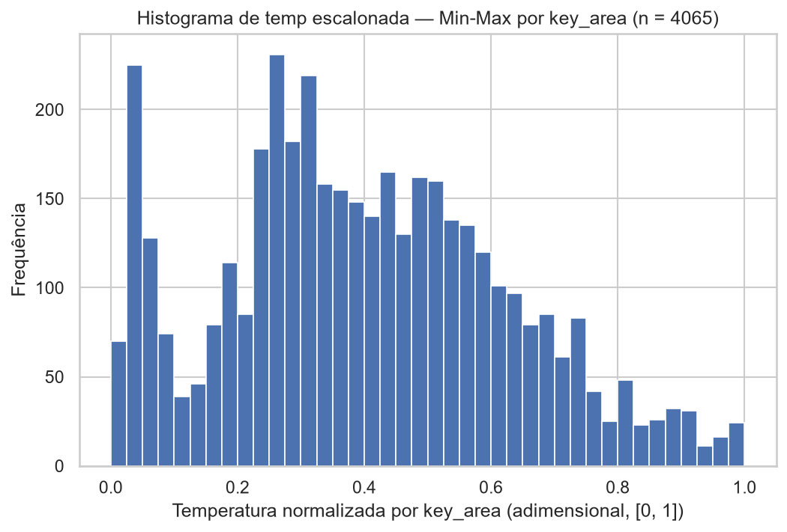<br>
  <sup>Fonte: Elaborado pelos autores (2026), a partir de data/dataset_pre_processado.csv.</sup>
</div>

**Comparação com o histograma antes do escalonamento (Figura 21)**

| Medida | Antes (°C) | Depois (adimensional) |
|:---|---:|---:|
| Mínimo | 27,69 | 0,0000 |
| Máximo | 273,60 | 1,0000 |
| Média | 81,7745 | 0,4002 |
| Mediana | 76,5000 | 0,3830 |
| Assimetria | +1,7630 | +0,2831 |
| Curtose (excesso) | +4,8996 | −0,4546 |
| n | 4.065 | 4.065 |

Antes do escalonamento, o histograma de `temp` (Figura 21, descrito em detalhe no item d) da subseção anterior) é assimétrico à direita, com cauda longa até 273,60 °C, corte físico abrupto em 27,69 °C e um modo secundário entre 206,0 °C e 212,1 °C — traços consistentes com a mistura de sete regimes térmicos regionais (`key_area`) numa única variável.

Depois do escalonamento, a variável ocupa o intervalo [0, 1], com mínimo e máximo exatos de 0,0 e 1,0 em cada uma das sete `key_area`. A Figura 22 mostra uma distribuição mais espalhada ao longo do intervalo, sem a cauda longa da Figura 21: média (0,4002) e mediana (0,3830) se deslocam para perto do centro, a assimetria cai de +1,763 para +0,283 (mantendo média > mediana) e a curtose em excesso passa de +4,90 para −0,45, caudas mais curtas que as de uma normal. O modo secundário de ~209 °C deixa de ser discernível como pico isolado. Origem do efeito: a assimetria de `Mainback` (skewness = +1,83, item c) empurra a maior parte de suas leituras para perto de 0 no intervalo normalizado — esse encolhimento, região por região, dilui o modo secundário e encurta a cauda direita.

**O que muda.** Além da escala do eixo X (°C → [0, 1]), a forma da distribuição também muda, e esse é o ponto central da comparação: assimetria de +1,76 para +0,28, curtose em excesso de +4,90 para −0,45, cauda longa e modo secundário (Figura 21) desaparecem. A correlação de Pearson entre a série original e a escalonada é de apenas 0,688 — baixa para duas versões da mesma variável, o que confirma que a transformação reestrutura os valores entre regiões, não só muda a régua.

**Por que muda.** O escalonamento é **sete** transformações lineares independentes, uma por `key_area`, cada uma com seu próprio mínimo e máximo (item b). Cada região é esticada para o intervalo [0, 1] separadamente, o que elimina por construção a diferença de patamar térmico entre regiões — a causa da cauda longa original. As leituras mais quentes de `Mainback` (até 273,60 °C) e as mais frias de `Oven HMI` (a partir de 43,64 °C) passam a ocupar a mesma posição relativa, 1,0 e 0,0.

Em contraste, um Min-Max **global** preservaria a forma exatamente (assimetria e curtose permaneceriam em +1,7630 e +4,8996, correlação de 1,000000), alterando só a escala do eixo. A mudança de forma na Figura 22 é, portanto, consequência esperada de segmentar por região (item a), não um erro de execução.

**Relação com os testes de normalidade.** Os três testes aplicados aos dados originais — Shapiro-Wilk (W = 0,8669; p = 2,72 × 10⁻⁵⁰), D'Agostino-Pearson (K² = 1.484,31; p ≈ 0) e Anderson-Darling (A² = 93,89, acima do crítico de 0,752 a 5%) — rejeitam H₀, o que converge com a Figura 21 (sem formato de sino, assimétrica, cauda longa, corte à esquerda). Nenhum teste foi recalculado sobre `temp_scaled`; a comparação pós-escalonamento usa só os indicadores descritivos acima. A queda de assimetria e curtose sugere uma distribuição menos distante de uma normal, mas +0,283 ainda é diferente de zero e a curtose negativa já é incompatível com a de uma normal — não há base para afirmar que o escalonamento "tornou `temp` normal", só que ficou menos assimétrica e com caudas mais curtas. Confirmar normalidade exigiria repetir o teste sobre `temp_scaled`.

**O que permanece.** A ordenação **dentro de cada** `key_area` é preservada — a transformação é monotônica crescente por região. Não há perda de observações (4.065 antes e depois) nem valores fora do intervalo previsto. A distribuição continua não normal, só por outros motivos.

**f) Alerta de produção — congelamento dos parâmetros de mínimo e máximo**

O Min-Max por `key_area` (item a) tem uma propriedade que os itens anteriores não tornam explícita: **cada par $(\min_k, \max_k)$ é calculado sobre o conjunto de treino e precisa ser reutilizado, sem recálculo, sobre qualquer dado novo** — validação, teste e, mais adiante, produção. Diferente do que ocorre num pipeline em que o escalonamento é só um passo de conveniência, aqui os mínimos e máximos são também os parâmetros que definem a régua de cada região: recalculá-los sobre um conjunto diferente desloca essa régua e invalida a comparação entre o dado novo e o que o modelo aprendeu.

O risco é concreto neste dataset porque, como o item f.3 da subseção de normalidade mostrou, a distribuição de `temp` **não é estável ao longo da campanha de ensaios**: o terço final introduz condições mais severas, e é justamente lá que aparece o máximo global de 273,60 °C. Um split temporal — treinar com os runs iniciais e validar com os finais, prática comum quando os dados têm ordem de coleta — é o cenário em que o efeito do congelamento fica mais visível.

**Simulação do efeito.** Os 56 runs foram ordenados por `run_id` e divididos em treino (Run 1 a Run 35, 33 runs, 2.578 observações) e teste (Run 38 a Run 75, 16 runs, 1.487 observações), reproduzindo os mesmos terços do item f.3. Os parâmetros $(\min_k, \max_k)$ foram calculados **apenas sobre o treino** e depois comparados aos parâmetros que o item b) já reporta, calculados sobre a base completa:

| `key_area` | Mín. treino (°C) | Mín. total (°C) | Máx. treino (°C) | Máx. total (°C) | Amplitude treino (°C) | Amplitude total (°C) |
|---|---:|---:|---:|---:|---:|---:|
| Mainback | 36,07 | 35,41 | 251,09 | 273,60 | 215,02 | 238,19 |
| Coil Temps | 43,95 | 40,80 | 234,60 | 234,60 | 190,65 | 193,80 |
| Main Vent Sys | 42,29 | 41,56 | 126,70 | 135,00 | 84,41 | 93,44 |
| IPC Comp | 48,24 | 45,58 | 129,63 | 129,63 | 81,39 | 84,05 |
| IPC Cooling | 27,69 | 27,69 | 114,94 | 114,94 | 87,25 | 87,25 |
| CT Knobs | 36,99 | 34,34 | 73,42 | 73,42 | 36,43 | 39,08 |
| Oven HMI | 49,77 | 43,64 | 72,01 | 72,01 | 22,24 | 28,37 |

<sup>Fonte: Elaborado pelos autores (2026). "Total" reproduz a tabela do item b); "treino" usa apenas Run 1–35.</sup>

Em cinco das sete regiões o **máximo** do treino já coincide com o da base inteira — os valores mais extremos aparecem cedo na campanha —, mas o **mínimo** do treino é sistematicamente mais alto que o real (a diferença chega a 6,13 °C em `Oven HMI`). `Mainback` é o caso mais grave: o máximo do treino (251,09 °C) fica 22,51 °C abaixo do máximo verdadeiro (273,60 °C), porque a leitura de 273,60 °C só ocorre em runs do terço final.

Aplicando esses parâmetros do treino à fórmula do item c) sobre as observações de teste:

| `key_area` | n (teste) | Abaixo de 0 | Acima de 1 | % fora de [0, 1] | scaled mín. | scaled máx. |
|---|---:|---:|---:|---:|---:|---:|
| Oven HMI | 80 | 8 | 0 | 10,0% | −0,2756 | 0,7428 |
| Main Vent Sys | 100 | 2 | 3 | 5,0% | −0,0086 | 1,0983 |
| CT Knobs | 120 | 3 | 0 | 2,5% | −0,0727 | 0,8993 |
| Mainback | 219 | 2 | 3 | 2,3% | −0,0031 | 1,1047 |
| Coil Temps | 160 | 2 | 0 | 1,3% | −0,0165 | 0,9824 |
| IPC Comp | 728 | 4 | 0 | 0,5% | −0,0327 | 0,7109 |
| IPC Cooling | 80 | 0 | 0 | 0,0% | 0,0473 | 0,6866 |
| **Total** | **1.487** | **21** | **6** | **1,8%** | −0,2756 | 1,1047 |

<sup>Fonte: Elaborado pelos autores (2026).</sup>

Congelar os parâmetros no treino produz **27 observações (1,8% do conjunto de teste) fora do intervalo [0, 1]**, com `temp_scaled` chegando a −0,2756 em `Oven HMI` e a 1,1047 em `Mainback`. Isso não é um bug de implementação: é a consequência esperada e correta de aplicar, sobre dado novo, uma régua fixada no passado — o próprio objetivo do congelamento é permitir que o dado extrapole a régua quando for mais extremo do que tudo que o treino viu. O ponto do alerta é que essas 27 observações **precisam de uma decisão explícita de tratamento**, e não podem ser silenciosamente aceitas nem descartadas sem registro.

**Efeito de um recorte (clipping) em [0, 1].** Se as observações fora do intervalo forem forçadas para os extremos — prática comum para manter a saída de um `MinMaxScaler` compatível com o intervalo esperado pelo modelo —, o erro introduzido, traduzido de volta para °C pela equação inversa do item c), tem média de **2,10 °C** e máximo de **22,51 °C** (a leitura de 273,60 °C de `Mainback`, recortada para 1,0, passaria a representar 251,09 °C). Para a variável-alvo do projeto, esse é um erro sistemático que se soma ao erro do próprio modelo, e que o KPI de erro do projeto não distingue de erro de previsão a menos que seja documentado.

**Contraste com o vazamento (data leakage).** Se, em vez de congelar, os parâmetros forem recalculados sobre o conjunto de teste — ou, pior, sobre a base completa antes do split, erro mais comum na prática —, o mesmo dado de teste recebe valores de `temp_scaled` sistematicamente diferentes: a diferença média entre as duas versões é de 0,0276 (equivalente a 2,10 °C na régua do treino) e chega a 0,2756 em `Oven HMI`. Esse desvio não aparece como erro explícito — o pipeline roda sem falhar —, mas contamina a avaliação do modelo com informação que, num cenário real de produção, ainda não existiria no momento da previsão.

**Recomendações para a etapa de modelagem (Seção 4.3):**

1. **Persistir os sete pares $(\min_k, \max_k)$ junto ao artefato do modelo**, exatamente como o item c) já recomenda para a transformação inversa — não como metadado documental, mas como parte do contrato de inferência: o mesmo `key_area` sempre usa o mesmo par, em treino, validação e produção.
2. **Ajustar os parâmetros exclusivamente sobre o conjunto de treino**, nunca sobre validação, teste ou a base completa — o padrão `fit` (só treino) e `transform` (treino, validação, teste e produção) do próprio `MinMaxScaler` do scikit-learn já impõe essa separação quando usado corretamente por `key_area`.
3. **Monitorar em produção a fração de leituras que caem fora de [0, 1]** por região, com a tabela deste item como linha de base (0,0% a 10,0%, dependendo da região). Um aumento sustentado nessa fração é sinal de *drift*: a distribuição de temperatura real se afastando da distribuição observada no treino, o que este próprio anexo já demonstrou ser plausível (item f.3 da subseção de normalidade, sobre a tendência de a campanha ficar mais extrema ao longo do tempo).
4. **Decidir e documentar o tratamento de valores fora do intervalo antes da consolidação do pipeline** — recortar em [0, 1] (com o custo de erro sistemático quantificado acima), permitir extrapolação sem recorte, ou tratar como excedência de `active_limit` (Seção 4.2.4) — em vez de deixar essa escolha implícita no comportamento padrão da biblioteca utilizada.

**Código utilizado (Python):**

```python
import numpy as np
import pandas as pd

df['run_num'] = df['run_id'].str.extract(r'Run\s*(\d+)').astype(float)
runs = sorted(df['run_num'].dropna().unique())
tercos = np.array_split(np.array(runs), 3)          # mesmos tercos do item f.3
runs_treino = np.concatenate([tercos[0], tercos[1]])
runs_teste = tercos[2]

treino = df[df['run_num'].isin(runs_treino)]
teste = df[df['run_num'].isin(runs_teste)].copy()

# Parametros SOMENTE do treino - o congelamento em si.
parametros_treino = treino.groupby('key_area')['temp'].agg(minimo='min', maximo='max')

teste = teste.join(parametros_treino, on='key_area')
teste['temp_scaled'] = ((teste['temp'] - teste['minimo'])
                         / (teste['maximo'] - teste['minimo']))
teste['fora_do_intervalo'] = (teste['temp_scaled'] < 0) | (teste['temp_scaled'] > 1)

resumo = teste.groupby('key_area').agg(
    n=('temp', 'size'),
    fora=('fora_do_intervalo', 'sum'),
    pct_fora=('fora_do_intervalo', 'mean'),
    scaled_min=('temp_scaled', 'min'),
    scaled_max=('temp_scaled', 'max'),
)
resumo['pct_fora'] = (resumo['pct_fora'] * 100).round(1)
print(resumo.round(4).to_string())
print(f"\nTotal fora de [0,1]: {teste['fora_do_intervalo'].sum()} de {len(teste)} "
      f"({teste['fora_do_intervalo'].mean() * 100:.1f}%)")
```

**g) Tabelas Comparativas dos Dados**

O objetivo desta questão foi apresentar as variáveis quantitativas analisadas do conjunto de dados e exibir os 10 primeiros registros tanto dos dados originais quanto dos dados após escalonamento Min-Max.

Conforme a classificação das colunas apresentada na Seção 4.2.1, o conjunto `data/dataset_pre_processado.csv` possui uma única variável quantitativa efetiva: `temp`, a temperatura registrada pelo termopar ao final do ensaio, em °C. As demais colunas numéricas na origem não viraram variáveis quantitativas pelos seguintes motivos:

- `tc_number` tem `dtype` inteiro, mas é um identificador do sensor, não uma quantidade. Média, desvio-padrão e normalização não têm significado sobre um rótulo, por isso foi classificada como categórica.
- `active_limit` é expressa em °C, mas é um parâmetro de especificação de engenharia atribuído a cada termopar, não uma grandeza medida no experimento: seu valor é constante para um mesmo sensor em todas as execuções, funcionando como atributo do ponto de medição, não como observação. Além disso, a coluna carrega sujeira documentada na Seção 4.2.1 (o valor textual `Monitor (150 C)` e as 302 linhas com `active_limit = 1000`, placeholder numérico de "sem limite definido"), o que tornaria qualquer escalonamento dependente de um valor sem significado físico.
- Todas as demais colunas (`run_id`, `tc_name`, `key_area`, `reason`, `blower_direction`, `housing`, `board_position`, `run_case`, `losses`, `deflector_hole`, `material_coil_support`) são categóricas nominais.

Portanto, o escalonamento foi aplicado exclusivamente a `temp`.

Procedimento de preparação:

1. Padronizar os nomes das colunas (remover espaços no início e no fim).
2. Converter a variável para valor numérico, substituindo vírgula decimal por ponto, para garantir tipagem consistente independentemente da origem do arquivo.
3. Verificar registros inválidos (`NaN`). A coluna `temp` não apresentou valores ausentes: as 4.065 linhas do conjunto foram mantidas, sem descarte.
4. Aplicar o escalonamento Min-Max com o `MinMaxScaler`, que transforma linearmente a variável para o intervalo `[0,1]` segundo a fórmula `x' = (x - min) / (max - min)`.

---

#### Código utilizado

```python
from sklearn.preprocessing import MinMaxScaler
import pandas as pd

# padronizar nomes das colunas (remover espaços no início/fim)
df.columns = df.columns.str.strip()

# variável quantitativa analisada
variaveis = ['temp']

# garantir tipagem numérica (corrigindo eventual vírgula decimal)
for v in variaveis:
    df[v] = df[v].astype(str).str.replace(',', '.')
    df[v] = pd.to_numeric(df[v], errors='coerce')

# cópia limpa para não alterar o df original
df_limpo = df.dropna(subset=variaveis).copy()
df_limpo.reset_index(drop=True, inplace=True)

# Tabela 1 — dados originais
print("Tabela 1: Dados Originais")
print(df_limpo[['run_id', 'tc_name', 'key_area'] + variaveis].head(10))

# Escalonamento Min-Max
scaler = MinMaxScaler()
dados_escalonados_array = scaler.fit_transform(df_limpo[variaveis])

# novo dataframe com dados escalonados
df_scaled = pd.DataFrame(dados_escalonados_array, columns=variaveis)

# Tabela 2 — dados normalizados
print("\nTabela 2: Dados Normalizados")
print(df_scaled.head(10))

# limites usados pelo scaler
print("\nmin:", scaler.data_min_, "| max:", scaler.data_max_)
```

---

### Tabela 1: Dados Originais — 10 primeiros registros

As colunas `run_id`, `tc_name` e `key_area` são exibidas apenas como contexto de identificação do registro; a variável submetida ao escalonamento é `temp`.

| # | run_id | tc_name | key_area | temp (°C) |
|---|--------|---------|----------|-----------|
| 0 | Run 1 | Door Lock Motor Ambient 1/2" Below | Mainback | 99.35 |
| 1 | Run 1 | Door Lock Microswitch Body | Mainback | 114.72 |
| 2 | Run 1 | Convect Motor Winding | Mainback | 89.93 |
| 3 | Run 1 | Storage Drawer (Metal Above) | Mainback | 167.87 |
| 4 | Run 1 | L2, Wire, Power Cord | Mainback | 53.65 |
| 5 | Run 1 | Ambient Below Terminal Block | Mainback | 48.94 |
| 6 | Run 1 | ACU Ambient (Hill Only) Top | Mainback | 60.00 |
| 7 | Run 1 | ACU K8 Housing / Double Line Break | Mainback | 55.44 |
| 8 | Run 1 | Coil FR | Coil Temps | 55.69 |
| 9 | Run 1 | Coil FL | Coil Temps | 49.33 |

<sup>Fonte: Elaborado pelos autores (2026), a partir de data/dataset_pre_processado.csv.</sup>

---

### Tabela 2: Dados Escalonados (Min-Max) — 10 primeiros registros

| # | temp (original, °C) | temp (escalonada) |
|---|---------------------|-------------------|
| 0 | 99.35 | 0.291407 |
| 1 | 114.72 | 0.353910 |
| 2 | 89.93 | 0.253101 |
| 3 | 167.87 | 0.570046 |
| 4 | 53.65 | 0.105567 |
| 5 | 48.94 | 0.086414 |
| 6 | 60.00 | 0.131390 |
| 7 | 55.44 | 0.112846 |
| 8 | 55.69 | 0.113863 |
| 9 | 49.33 | 0.088000 |

<sup>Fonte: Elaborado pelos autores (2026), a partir de data/dataset_pre_processado.csv.</sup>

---

#### Interpretação dos resultados

Os parâmetros usados pelo `MinMaxScaler`, calculados sobre as 4.065 observações de `temp`:

| Estatística | Valor (°C) |
|-------------|------------|
| Mínimo | 27.69 |
| Máximo | 273.60 |
| Amplitude | 245.91 |
| Média | 81.77 |
| Mediana | 76.50 |
| Desvio-padrão | 33.28 |

**Verificação do cálculo:** aplicando a fórmula ao primeiro registro, `(99.35 - 27.69) / 245.91 = 0.291407`, valor idêntico ao da Tabela 2. Por ser uma transformação monotônica, o Min-Max preserva a ordem relativa dos registros: `Storage Drawer` (167.87 °C) segue o mais quente da amostra nas duas tabelas (0.570), e `Ambient Below Terminal Block` (48.94 °C) o mais frio nas duas (0.086).

**Concentração na faixa inferior do intervalo:** os dez valores normalizados ficam entre 0.086 e 0.570, sem se aproximar do topo da escala, refletindo a assimetria à direita de `temp` (mediana de 76.50 °C abaixo da média de 81.77 °C, com máximo de 273.60 °C isolado em `Coil Temps`/`Mainback`). Como o Min-Max se baseia apenas nos dois extremos, esse máximo comprime a maior parte das observações na metade inferior do intervalo `[0,1]`.

Implicação para a modelagem: ainda que exista apenas uma variável quantitativa, o escalonamento continua sendo necessário porque as variáveis categóricas passarão por codificação ordinal (Seção 4.3.1), gerando colunas de inteiros pequenos (0, 1, 2...). Sem normalizar `temp`, ela entraria no modelo em uma escala até duas ordens de grandeza maior que essas colunas codificadas, dominando o cálculo de distância em algoritmos sensíveis à magnitude (KNN, K-Means, SVM) e a inicialização dos pesos em redes neurais. O Min-Max coloca `temp` na mesma faixa das variáveis codificadas. Como ressalva, por depender exclusivamente dos extremos, o Min-Max é sensível a outliers — caso a etapa de modelagem indique perda de desempenho por esse motivo, `StandardScaler` (média e desvio-padrão) ou `RobustScaler` (mediana e IQR) são alternativas mais estáveis para essa distribuição assimétrica.

A comparação estatística de `temp` antes × depois do escalonamento já foi apresentada e discutida no item e) acima. Este item complementa esse resultado com a verificação, região a região, de que o Min-Max segmentado mapeou cada `key_area` para o intervalo [0, 1] esperado.

**Verificação do intervalo de `temp_scaled` por `key_area`**

| `key_area` | n | mín(`temp_scaled`) | máx(`temp_scaled`) |
|---|---:|---:|---:|
| Mainback | 610 | 0,0000 | 1,0000 |
| Coil Temps | 420 | 0,0000 | 1,0000 |
| Main Vent Sys | 288 | 0,0000 | 1,0000 |
| IPC Cooling | 218 | 0,0000 | 1,0000 |
| IPC Comp | 1.979 | 0,0000 | 1,0000 |
| CT Knobs | 330 | 0,0000 | 1,0000 |
| Oven HMI | 220 | 0,0000 | 1,0000 |

Por construção da equação de normalização (item c), o mínimo e o máximo de cada `key_area` são necessariamente mapeados para 0 e 1 — a tabela acima, portanto, não é uma medição sujeita a variação amostral, mas uma verificação de que a implementação (Seção 5 do notebook) respeitou a fórmula em todas as sete regiões, sem observações fora do intervalo [0, 1] previsto.
