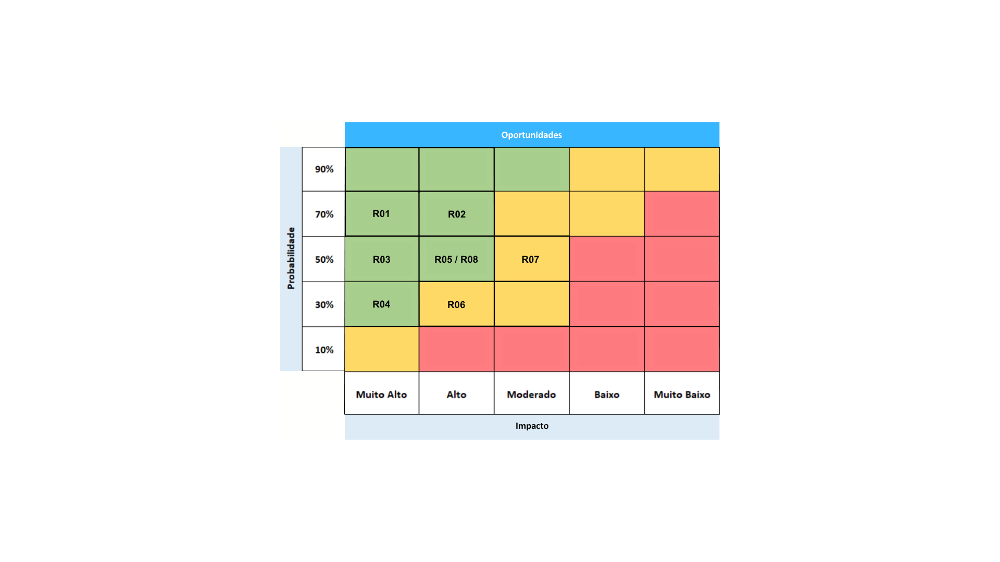

# Documentação Modelo Preditivo - Inteli

```
INSTRUÇÕES GERAIS (remova este trecho ao final)

Você deve editar este documento utilizando notação markdown - siga as convenções neste link 
https://docs.github.com/en/get-started/writing-on-github/getting-started-with-writing-and-formatting-on-github/basic-writing-and-formatting-syntax
```

## Nome da Solução
### Nome do grupo
#### (preencha aqui os nomes dos integrantes, em ordem alfabética, separados por vírgula)

## Sumário
[1. Introdução](#c1)

[2. Objetivos e Justificativa](#c2)

[3. Metodologia](#c3)

[4. Desenvolvimento e Resultados](#c4)

[5. Conclusões e Recomendações](#c5)

[6. Referências](#c6)

[Anexos](#attachments)


## <a name="c1"></a>1. Introdução
```
Apresente de forma sucinta o parceiro de negócio, seu porte, local, área de atuação e posicionamento no mercado. Maiores detalhes deverão ser descritos na seção 4. Descreva resumidamente o problema a ser resolvido (sem ainda mencionar a solução). 

Remova este bloco ao final
```

## <a name="c2"></a>2. Objetivos e Justificativa
### 2.1 Objetivos
```
Descreva resumidamente os objetivos gerais e específicos do seu parceiro de negócios.

Remova este bloco ao final
```

### 2.2 Proposta de solução
```
Descreva resumidamente sua proposta de modelo preditivo e como esse modelo pretende resolver o problema, atendendo os objetivos.

Remova este bloco ao final
```

### 2.3 Justificativa
```
Faça uma breve defesa de sua proposta de solução, escreva sobre seus potenciais, seus benefícios e como ela se diferencia.

Remova este bloco ao final
```

## <a name="c3"></a>3. Metodologia
```
Descreva a metodologia CRISP-DM e suas etapas de desenvolvimento, citando o referencial teórico. Você deve apenas enunciar os métodos, sem dizer ainda como eles foram aplicados, nem quais resultados foram obtidos.

Remova este bloco ao final
```

## <a name="c4"></a>4. Desenvolvimento e Resultados
### 4.1. Compreensão do Problema
#### 4.1.1. Contexto da indústria 
```
Descreva aqui o Contexto Setorial e posicione a análise das 5 Forças de Porter

Remova este bloco ao final
```
#### 4.1.2. Análise SWOT 
```
Posicione aqui sua análise SWOT.

Remova este bloco ao final
```

#### 4.1.3. Planejamento Geral da Solução
```
a) quais os dados disponíveis (fonte e conteúdo - exemplo: dados da área de Compras da empresa descrevendo seus fornecedores).
b) qual a solução proposta (pode ser um resumo do texto da Seção 2.2).
c) como a solução proposta deverá ser utilizada.
d) quais os benefícios trazidos pela solução proposta.
e) qual será o critério de sucesso.

Remova este bloco ao final
```

#### 4.1.4. Value Proposition Canvas
```
Posicione aqui seu canvas.

Remova este bloco ao final
```

#### 4.1.5. Matriz de Riscos

<p align="center">
  
  <br>
  <em>Fonte: Produção dos autores (2026)</em>
</p>

**1. Avaliação em larga escala de configurações de projeto (R01)**

Trata-se de uma oportunidade de natureza de negócio e engenharia. Sua probabilidade de ocorrência foi estimada em 70%, pois decorre de uma característica intrínseca da solução e depende apenas de execução pela equipe: uma simulação CFD leva horas para ser concluída, enquanto uma previsão do modelo treinado é obtida em frações de segundo. O impacto foi classificado como muito alto porque permite avaliar centenas de configurações em uma única sessão de trabalho, volume inviável no processo atual, alterando a própria natureza do trabalho de engenharia. A combinação desses fatores resulta em uma classificação geral alta. Hoje o engenheiro seleciona previamente poucas alternativas e simula apenas essas, enquanto a ferramenta permite varrer sistematicamente o conjunto de possibilidades e identificar combinações que dificilmente seriam escolhidas para simulação individual. Como plano de ação, a equipe implementará no dashboard uma funcionalidade de avaliação em lote, capaz de processar simultaneamente múltiplas combinações de direção do soprador, tipo de placa e modo de operação, com resultados ordenados pela proximidade ao limite normativo. Caso a funcionalidade registre uso por mais de 50% dos engenheiros treinados no primeiro mês, será desenvolvido módulo complementar capaz de sugerir configurações que atendam a um alvo térmico especificado.

**2. Consolidação da base histórica como acervo permanente (R02)**

Trata-se de uma oportunidade de natureza de dados. Sua probabilidade de ocorrência foi estimada em 70%, uma vez que o pipeline de tratamento previsto como resposta ao risco R01 produzirá, como resultado necessário, uma base padronizada, documentada e versionada, dependendo apenas de sua formalização como entregável. O impacto foi classificado como alto porque a Whirlpool passará a dispor de um histórico de simulações organizado e consultável, condição hoje inexistente, cujo valor persiste independentemente do desempenho do modelo preditivo. A combinação desses fatores resulta em uma classificação geral alta. Trata-se da única entrega do projeto que gera valor mesmo na hipótese de a meta de 10% de erro não ser plenamente atingida, o que a torna especialmente relevante diante da concentração de riscos descrita na matriz de ameaças. Como plano de ação, a equipe tratará a base tratada e seu dicionário de dados como entregáveis formais do projeto, e não como artefatos internos de desenvolvimento, documentando-os para transferência à Whirlpool e estruturando o formato de modo a acomodar execuções futuras sem retrabalho. Caso a base tratada ultrapasse 95% de conformidade nas regras de validação e seja aprovada pela equipe de CFD na Prova de Conceito, será elaborado procedimento padronizado de ingestão para que novas simulações alimentem o acervo sem intervenção da equipe de dados.

**3. Priorização dos ensaios físicos a partir do modelo (R03)**

Trata-se de uma oportunidade de natureza de negócio. Sua probabilidade de ocorrência foi estimada em 50%, pois depende de resultado técnico ainda não verificado: o modelo precisa ordenar corretamente as configurações por criticidade térmica, ainda que não necessariamente acerte a temperatura absoluta de cada uma. O impacto foi classificado como muito alto porque permitiria concentrar os protótipos físicos remanescentes nas configurações de maior risco, superando a meta de redução de 25% prevista no Project Charter. A combinação desses fatores resulta em uma classificação geral alta. Cabe destacar que ordenar configurações por criticidade é tarefa substancialmente mais simples do que prever sua temperatura exata, de modo que esta oportunidade pode concretizar-se mesmo em cenário de atingimento apenas parcial do critério de aceite. Como plano de ação, a equipe avaliará não apenas o erro absoluto do modelo, mas também sua capacidade de ordenar corretamente as configurações por risco térmico, e desenvolverá no dashboard uma visão de priorização que classifique os casos candidatos por temperatura estimada e por grau de confiança associado. Caso a ordenação produzida pelo modelo coincida com a ordenação real em pelo menos 80% dos pares de configurações avaliados na validação técnica, a funcionalidade será proposta à Whirlpool como apoio formal ao planejamento dos ensaios.

**4. Replicação da solução para outras linhas de produto (R04)**

Trata-se de uma oportunidade de natureza estratégica. Sua probabilidade de ocorrência foi estimada em 30%, pois a decisão excede a alçada da equipe de projeto e depende de deliberação da liderança da Whirlpool, além de exigir a disponibilização de bases históricas de outras linhas, hoje não mapeadas. O impacto foi classificado como muito alto porque a maior parte do que está sendo construído — o processo de tratamento de dados, a arquitetura de modelagem, os alertas de uso fora do domínio válido e o dashboard — independe do produto ser um fogão de piso, podendo ser replicada a fornos, cooktops e demais linhas com esforço significativamente inferior ao do projeto inicial. A combinação desses fatores resulta em uma classificação geral alta, uma vez que a matriz mantém na faixa superior as oportunidades de ganho muito expressivo ainda que de ocorrência incerta. O valor desta oportunidade reside menos no modelo treinado e mais no método replicável que o projeto estabelece. Como plano de ação, a equipe documentará no relatório final quais componentes da solução são independentes do produto e quais foram desenvolvidos especificamente para fogões de piso. Caso o mapa de replicabilidade indique que mais de 70% dos componentes são reutilizáveis sem alteração, o esforço estimado para replicação será formalmente apresentado ao Sponsor na reunião de encerramento.

**5. Identificação de relações entre geometria e temperatura (R05)**

Trata-se de uma oportunidade de natureza de engenharia. Sua probabilidade de ocorrência foi estimada em 50%, pois o modelo analisa as trinta e nove execuções em conjunto, perspectiva indisponível na leitura individual de cada simulação, embora a relevância dos achados dependa de validação pelos especialistas e nem toda relação identificada seja necessariamente desconhecida deles. O impacto foi classificado como alto, uma vez que compreender como determinadas características construtivas influenciam a temperatura gera conhecimento aplicável a projetos futuros, independentemente da adoção da ferramenta preditiva. A combinação desses fatores resulta em uma classificação geral alta. Efeitos combinados entre parâmetros geométricos e modo de operação são particularmente difíceis de perceber na análise caso a caso, e tendem a emergir apenas quando os dados são examinados de forma agregada. Como plano de ação, a equipe aplicará técnicas de interpretabilidade para identificar quais características mais influenciam a temperatura prevista, registrará sistematicamente os padrões encontrados e os submeterá à equipe de CFD no marco de validação técnica, com a ressalva de que correlação estatística não estabelece, por si só, causalidade física. Caso alguma característica figure entre as cinco de maior influência e não seja reconhecida como esperada pela equipe de CFD, o achado será formalizado como entrega complementar no relatório final.

**6. Revisão das margens de segurança com base quantitativa (R06)**

Trata-se de uma oportunidade de natureza de engenharia e custo. Sua probabilidade de ocorrência foi estimada em 30%, pois não basta que o modelo informe sua margem de erro: é necessário que a engenharia esteja disposta a revisar folgas de segurança historicamente consolidadas, decisão que envolve critérios normativos e cultura técnica interna, e não apenas evidência numérica. O impacto foi classificado como alto porque margens excessivamente conservadoras implicam superdimensionamento de isolamento e de materiais, com custo unitário recorrente em toda a produção. A combinação desses fatores resulta em uma classificação geral média, uma vez que o ganho, embora relevante, depende de decisão organizacional pouco provável no horizonte do projeto. Projetos de engenharia térmica frequentemente adotam folgas generosas justamente por não disporem de estimativa formal da incerteza envolvida, de modo que quantificá-la é condição prévia para discutir sua redução. Como plano de ação, a equipe apresentará, junto a cada previsão, a faixa de variação esperada e a distribuição das folgas observadas no histórico, oferecendo à engenharia base quantitativa para avaliar seus critérios. Caso sejam identificados termopares cuja folga média em relação ao limite normativo seja superior ao dobro da incerteza estimada pelo modelo, a relação desses pontos será encaminhada como subsídio à revisão dos critérios de projeto, cabendo à Whirlpool a decisão final.

**7. Identificação de simulações históricas inconsistentes (R07)**

Trata-se de uma oportunidade de natureza de qualidade de dados. Sua probabilidade de ocorrência foi estimada em 50%, pois a comparação entre os valores previstos pelo modelo e os registrados na base evidencia naturalmente as execuções cujo comportamento diverge do padrão das demais, restando incerta a confirmação da inconsistência pela equipe de CFD. O impacto foi classificado como moderado porque não altera diretamente os objetivos definidos no Project Charter, mas contribui para a confiabilidade do próprio acervo de simulações da Whirlpool. A combinação desses fatores resulta em uma classificação geral média. Uma execução que diverge sistematicamente das demais admite duas explicações igualmente informativas: a ausência de alguma variável relevante na base ou uma inconsistência na configuração daquela simulação específica, hipótese de interesse direto para a equipe de CFD. Como plano de ação, a equipe listará as execuções com maior divergência entre valor previsto e valor registrado e as submeterá à equipe de CFD acompanhadas de sua configuração completa, sem presumir qual das duas explicações se aplica. Caso alguma execução apresente divergência superior a três desvios-padrão e a inconsistência seja confirmada pelo parceiro, esta será excluída do conjunto de treino e o achado registrado como contribuição do projeto à qualidade da base.

**8. Padronização de nomenclatura e indicadores entre Brasil e México (R08)**

Trata-se de uma oportunidade de natureza organizacional. Sua probabilidade de ocorrência foi estimada em 50%, pois o tratamento conjunto das bases das duas regiões exigirá, de qualquer forma, conciliar nomenclaturas de termopares, definições de Key Area e critérios de limite, restando incerta apenas a validação do resultado pelas duas unidades. O impacto foi classificado como alto porque uma nomenclatura comum permite comparar diretamente o desempenho térmico das arquiteturas das duas regiões, comparação atualmente dificultada por divergências terminológicas, e não apenas por diferenças construtivas reais. A combinação desses fatores resulta em uma classificação geral alta. Como essa conciliação é condição técnica prévia à modelagem conjunta, o trabalho será realizado de todo modo, restando incerta apenas sua adoção formal pela organização. Como plano de ação, a equipe consolidará em documento único a correspondência entre as nomenclaturas das duas unidades, distinguindo o que é divergência meramente terminológica do que reflete diferença construtiva efetiva, e o submeterá às equipes de engenharia de ambas as regiões. Caso o mapeamento seja validado sem divergências pendentes pelas duas equipes, será proposto à Whirlpool como padrão de referência para o registro de simulações futuras.

#### 4.1.6. Personas
```
Posicione aqui suas Personas (indique se são personas que utilizam o modelo e/ou se são afetadas pelo modelo).

Remova este bloco ao final
```

#### 4.1.7. Jornadas do Usuário
```
Posicione aqui seus mapas de jornadas do usuário que utiliza o modelo.

Remova este bloco ao final
```

#### 4.1.8 Política de Privacidade
```
Posicione aqui sua política de privacidade em acordo com a LGPD

Remova este bloco ao final
```

### 4.2. Compreensão dos Dados

#### 4.2.1. Exploração de dados
```
Apresentar a estatística descritiva básica de cada coluna, identificar se a coluna é numérica ou categórica e pelo menos 3 gráficos para visualizar a relação entre colunas escolhidas pelo grupo.

Remova este bloco ao final
```

#### 4.2.2. Pré-processamento dos dados
```
Apresentar quais foram as ações realizadas de limpeza (tratamento de missing values e remoção de outliers) e transformação (normalização e codificação) das colunas. Se houverem outliers, cite quais são e qual(is) correção(ões) será(ão) aplicada(s).

Remova este bloco ao final
```

#### 4.2.3. Hipóteses
```
Descreva três hipóteses sobre a relação dos dados e o problema. Justifique cada uma delas. 

Remova este bloco ao final
```

### 4.3. Preparação dos Dados e Modelagem
```
Caso seu projeto seja Modelo Supervisionado, apresentar: 
a) Organização dos dados (conjunto de treinamento, validação e testes)
b) Modelagem para o problema (proposta de features com a explicação completa da linha de raciocínio).
c) Métricas relacionadas ao modelo (pelo menos 3).
d) Apresentar o primeiro modelo candidato, e uma discussão sobre os resultados deste modelo (discussão sobre as métricas para esse modelo candidato).

Caso seu projeto seja Modelo Não-Supervisionado, apresentar:
a) Modelagem para o problema (proposta de features com a explicação completa da linha de raciocínio).
b) Primeiro modelo candidato para o problema.
c) Justificativa para a definição do K do modelo.
d) Escolha de um tipo de sistema de recomendação e a justificativa para essa escolha.

Remova este bloco ao final
```

### 4.4. Comparação de Modelos
```
- Descrever e justificar a escolha da métrica de avaliação dos modelos com base no que é mais importante para o problema ao 
  se medir a qualidade desses modelos;
- Descrever ao menos três modelos candidatos, seus respectivos algoritmos, seus tunings de hiperparâmetros e suas métricas 
  alcançadas;

Remova este bloco ao final
```

### 4.5. Avaliação
```
- Descreva a solução final de modelo preditivo e justifique a escolha. Alinhe sua justificativa com a Seção 4.1, resgatando o entendimento 
  do negócio e das personas, explicando de que formas seu modelo atende os requisitos e definições. 
- Descreva também um plano de contingência para os casos em que o modelo falhar em suas predições.
- Além disso, discuta sobre a explicabilidade do modelo (se aplicável) e realize a verificação de aceitação ou refutação das hipóteses.
- Se aplicável, utilize equações, tabelas e gráficos de visualização de dados para melhor ilustrar seus argumentos. 

Remova este bloco ao final
```

## <a name="c5"></a>5. Conclusões e Recomendações
```
Escreva, de forma resumida, sobre os principais resultados do seu projeto e faça recomendações formais ao seu parceiro de negócios em relação ao uso desse modelo. Você pode aproveitar este espaço para comentar sobre possíveis materiais extras, como um manual de usuário mais detalhado na seção “Anexos”. Não se esqueça também das pessoas que serão potencialmente afetadas pelas decisões do modelo preditivo e elabore recomendações que ajudem seu parceiro a tratá-las de maneira estratégica e ética. 

Remova este bloco ao final
```

## <a name="c6"></a>6. Referências
```
Incluir as principais referências de seu projeto, para que seu parceiro possa consultar caso ele se interessar em aprofundar. Não se esqueça de formatar as referências conforme a ABNT.

Remova este bloco ao final
```

## <a name="attachments"></a>Anexos
```
Utilize esta seção para anexar materiais como manuais de usuário, documentos complementares que ficaram grandes e não couberam no corpo do texto etc.

Remova este bloco ao final
```
