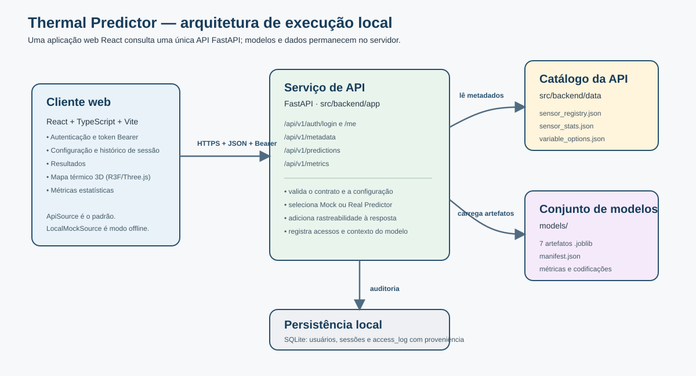
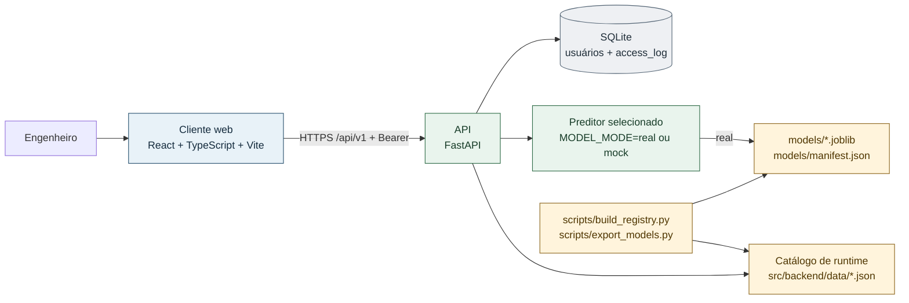
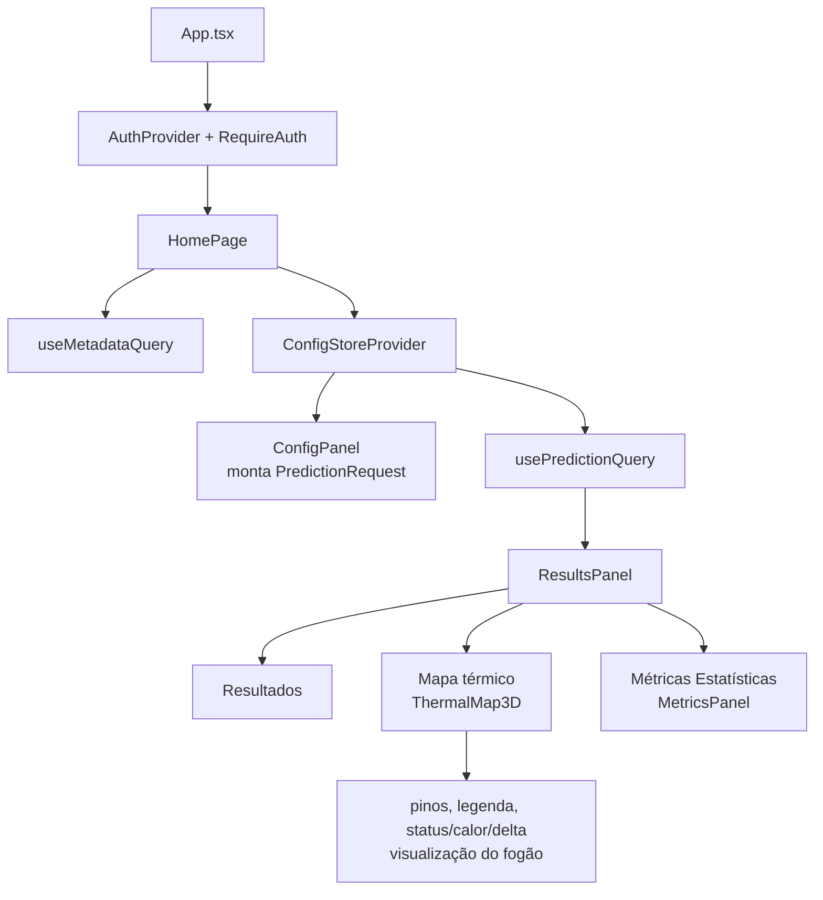
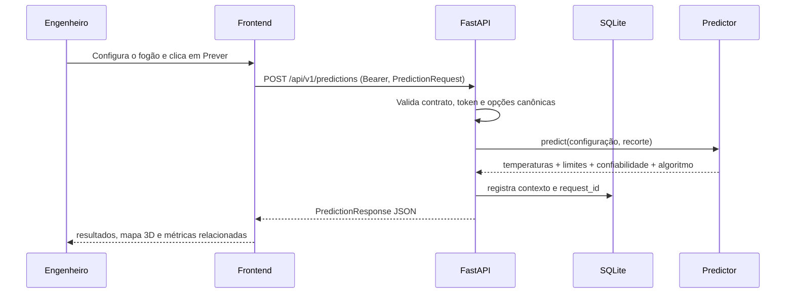
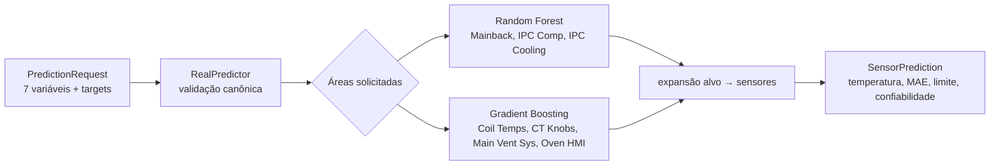
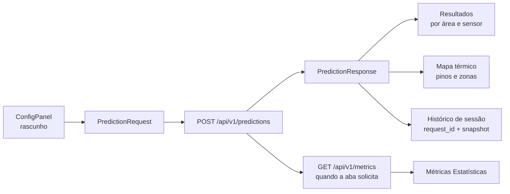

# Nova arquitetura do Thermal Predictor

> Relatório do estado atual do repositório, verificado no código em 27 de
> setembro de 2026. Este documento descreve o que está implementado agora; não
> substitui o plano de evolução em `../REFACTORING_AGENT_GUIDE.md`.



## Visão geral

O repositório passou a organizar o Thermal Predictor como uma aplicação local
de duas camadas de execução: um **cliente web React** e uma **API FastAPI**.
O navegador não lê artefatos de modelo nem arquivos de catálogo do repositório.
Ele obtém metadados, predições e métricas por HTTP autenticado. A API é quem
possui os dados de runtime, carrega os modelos e registra a rastreabilidade de
cada consulta.

O fluxo operacional é:



O antigo dashboard Streamlit e os arquivos de Docker estão removidos da árvore
de trabalho atual. Portanto, o caminho suportado é executar os dois processos
locais — API e frontend — e não iniciar uma segunda interface ou um container.

## Mapa de responsabilidades

| Camada | Diretório principal | Responsabilidade | Não deve fazer |
| --- | --- | --- | --- |
| Cliente web | `src/frontend/` | interação, estado de tela, visualização 3D e apresentação de resultados | executar modelo treinado ou ler JSONs internos do servidor |
| Cliente HTTP | `src/frontend/src/sources/ApiSource.ts` | anexar token, chamar a API, traduzir falhas HTTP em erros da interface | duplicar regras de validação/modelagem |
| Contrato | `src/frontend/src/contract/v1.ts`, `contracts/` e `src/backend/app/schemas.py` | definir forma dos pedidos e respostas v1 | carregar dados ou executar predições |
| API | `src/backend/app/` | autenticação, validação, roteamento, acesso aos dados, predição e auditoria | renderizar UI ou depender de arquivos do frontend |
| Catálogo | `src/backend/data/` | sensores, opções canônicas, estatísticas e recorte de metadados do manifesto | ficar embutido no bundle do navegador |
| Modelos | `models/` | artefatos `.joblib` e manifesto completo por área | ser enviado ao cliente |
| Pesquisa e geração | `notebooks/`, `scripts/` | preparar dados, construir catálogo e treinar/exportar modelos | participar do caminho de requisição em produção |

## Organização de diretórios

```text
g03/
├── src/
│   ├── frontend/                  # cliente React/Vite
│   │   └── src/
│   │       ├── features/          # auth, config, history, results, metrics
│   │       ├── components/        # UI reutilizável e mapa 3D
│   │       ├── sources/           # ApiSource e LocalMockSource
│   │       ├── hooks/             # consultas TanStack Query
│   │       └── contract/          # tipos e erros do contrato v1
│   └── backend/                   # serviço FastAPI
│       ├── app/                   # rotas, preditores, segurança, banco
│       ├── data/                  # catálogo servido pela API
│       └── tests/                 # testes de API, modelo e contrato
├── models/                        # modelos treinados + manifesto completo
├── scripts/                       # build_registry.py e export_models.py
├── notebooks/                     # pesquisa e experimentação
├── contracts/                     # schema JSON e fixture de paridade
└── documents/                     # documentação, incluindo este relatório
```

## Cliente web e experiência do usuário

O frontend é uma SPA React com TypeScript e Vite. `App.tsx` declara as rotas
`/login`, `/`, `/styleguide` e `/dev/thermal-map`. A rota principal exige
sessão no modo API; o `AuthProvider` mantém o usuário e o token, enquanto
`RequireAuth` protege a tela inicial.

A tela inicial monta `AppShell`, `ConfigPanel`, `HistoryPanel` e
`ResultsPanel`. O estado da configuração e do histórico de sessão fica no
domínio de `features/config` e `features/history`; chamadas de servidor ficam
no TanStack Query, em `hooks/useThermalQueries.ts`.

As três abas de produto são responsabilidade de `ResultsPanel`:

- **Resultados:** resume a consulta e agrupa os sensores por área, com
  temperatura, limite, margem de erro, confiabilidade e algoritmo aplicado.
- **Mapa térmico:** monta `ThermalMap3D` de forma preguiçosa. A cena é
  implementada com React Three Fiber/Three.js e inclui pinos de sensor, modos
  de cor por status/calor/delta, legenda, seleção de área e vista explodida.
- **Métricas Estatísticas:** usa a resposta de métricas do backend para mostrar
  previsto × real, importância de variáveis, mapa de erro e tabela por área.



`ApiSource` é a fonte padrão (`VITE_DATA_SOURCE=api`) e envia o token Bearer
em toda chamada protegida. `LocalMockSource` continua no código como modo
offline explícito (`VITE_DATA_SOURCE=local`), sem login e sem backend. Ele é
uma ferramenta de demonstração, não a fonte de resultados treinados.

## API, autenticação e auditoria

`src/backend/app/main.py` cria a aplicação FastAPI, configura CORS, adiciona o
middleware de log e inicializa o SQLite no ciclo de vida. As rotas de negócio
estão em `routers/auth.py` e `routers/predictions.py`.

| Operação | Rota | Papel |
| --- | --- | --- |
| Login | `POST /api/v1/auth/login` | recebe OAuth2 password form e devolve JWT Bearer |
| Sessão atual | `GET /api/v1/auth/me` | devolve o usuário autenticado |
| Metadados | `GET /api/v1/metadata` | opções das sete variáveis, áreas, sensores e configuração de referência |
| Predição | `POST /api/v1/predictions` | valida a configuração e devolve sensores previstos, limites, erros e proveniência |
| Métricas | `GET /api/v1/metrics` | devolve métricas de validação, pontos previsto × real e importância por área |
| Saúde | `GET /health` | informa disponibilidade, versão do contrato e modo de modelo |

As rotas `/api/v1/*`, exceto login, dependem de `current_user`. O middleware
cria uma linha de `access_log` para cada chamada. Nas predições, a linha guarda
também a arquitetura, as sete opções usadas, o recorte solicitado, o conjunto
de modelos e o mapa **área → algoritmo efetivamente aplicado**. Isso evita que
uma alteração futura do manifesto impeça a reconstrução da origem de um
resultado antigo.



## Dados e modelos

Há dois conjuntos de arquivos que cumprem papéis diferentes:

1. `src/backend/data/` contém o catálogo que a API usa para validar e explicar
   consultas. Inclui `sensor_registry.json`, `sensor_stats.json`,
   `variable_options.json` e uma versão de consumo do `model_manifest.json`.
   Esses arquivos passaram a pertencer ao backend; o frontend os recebe por
   `GET /api/v1/metadata`.
2. `models/` contém os sete artefatos treinados `.joblib` e o
   `manifest.json` completo. O manifesto mapeia cada área a seu algoritmo,
   registra métricas, codificações, opções conhecidas no treino, expansão de
   alvos para termopares, versão do conjunto e proveniência.

Quando `MODEL_MODE=real`, `RealPredictor` lê o manifesto e roteia a consulta
pelas sete áreas: Mainback, IPC Comp, IPC Cooling, Coil Temps, CT Knobs, Main
Vent Sys e Oven HMI. As áreas usam Random Forest ou Gradient Boosting conforme
o manifesto — o cliente não escolhe algoritmo. Cada área pode ter codificação
própria; por isso a normalização canônica → valor de treino ocorre no backend,
imediatamente antes de chamar o artefato correto.



O backend trata `BR` como arquitetura disponível no conjunto atual. Para `MX`,
a resposta mantém a forma do contrato, mas informa
`architecture_available: false` e não devolve predições. Uma opção aceita pelo
catálogo, mas nunca vista pelo modelo de uma área, faz aquela área ser omitida
e registrada como `skipped_areas`; o servidor não inventa uma substituição de
modelo.

`scripts/build_registry.py` é responsável por gerar o catálogo do backend a
partir dos dados preparados. `scripts/export_models.py` treina/exporta os
artefatos, constrói o manifesto e escreve o recorte de manifesto em
`src/backend/data/`. Os notebooks são o ambiente de pesquisa e não fazem parte
do caminho de uma requisição web.

## Contrato e fluxo de dados

O contrato v1 é consumido pelos dois lados: o frontend modela pedidos e
respostas em `src/frontend/src/contract/v1.ts`; a API usa DTOs Pydantic em
`src/backend/app/schemas.py`; e `contracts/api_v1.schema.json` é o schema JSON
gerado. A forma mais importante é `PredictionRequest`, formada por arquitetura,
sete variáveis de configuração e, opcionalmente, filtros por área/sensor.



## Execução e verificação local

O repositório usa dois processos locais e requer Python 3.12+ e Node 20+:

```powershell
# na raiz: instalar dependências
pip install -r src/backend/requirements.txt
npm run install:frontend

# terminal 1: API com os artefatos treinados
cd src/backend
$env:MODEL_MODE = 'real'
python -m uvicorn app.main:app --port 8000

# terminal 2: interface
npm run dev
```

O frontend fica em `http://localhost:5173` e usa
`VITE_API_BASE_URL=http://localhost:8000` quando API e UI estão em origens
distintas. O `package.json` da raiz oferece atalhos para `dev`, `build`,
`test`, `lint` e `contract:schema`; o projeto npm efetivo é
`src/frontend/`.

## Pontos de atenção do estado atual

Estes itens são observações do código atual, importantes para não confundir a
estrutura implementada com o objetivo arquitetural definido pela equipe:

- **Delta ainda faz duas predições.** `Home.tsx` usa `usePredictionQuery` para
  a configuração submetida e `useReferencePredictionQuery` para a configuração
  de referência do mapa delta. Hoje ambas chamam `POST /api/v1/predictions`.
  A API é única, mas a ação de prever continua podendo gerar duas requisições
  para o mesmo propósito comparativo. A evolução prevista é uma única chamada
  com cenário atual e baseline no mesmo payload/resposta.
- **O mock local existe por escolha explícita.** O padrão do código é API, mas
  `VITE_DATA_SOURCE=local` ainda habilita `LocalMockSource`. Use-o apenas para
  demo offline e deixe claro na interface quando estiver ativo.
- **Parte da documentação histórica está defasada.** Alguns textos em
  `src/backend/README.md`, `scripts/README.md` e `contracts/README.md` ainda
  citam caminhos, fases ou origem de dados anteriores. Para decisões técnicas,
  priorize `app/config.py`, `app/data.py`, os scripts e os testes atuais; estes
  documentos devem ser atualizados em seguida.
- **Sem Docker no fluxo atual.** `docker-compose.yml`, Dockerfiles e arquivos
  de suporte aparecem removidos nas alterações locais. O guia de entrada deve
  permanecer alinhado ao fluxo de dois processos locais acima.

## Checklist para novos integrantes

1. Leia este relatório e `../REFACTORING_AGENT_GUIDE.md` antes de alterar
   fronteiras entre camadas.
2. Para UI, comece em `src/frontend/src/pages/Home.tsx` e siga até
   `ResultsPanel`, `ThermalMapSlot` e `MetricsPanel`.
3. Para uma chamada HTTP, comece em `ApiSource.ts`, siga para
   `routers/predictions.py` e depois para `predictors/`.
4. Para entender uma temperatura, consulte o `models/manifest.json` da área:
   ele identifica artefato, codificação, métricas e sensores atendidos.
5. Para alterar opções, sensores ou métricas, regenere os artefatos por meio
   dos scripts; não copie dados para o frontend.
6. Preserve a separação: navegador apresenta; API valida, prediz e audita;
   scripts/notebooks produzem catálogo e modelos.
